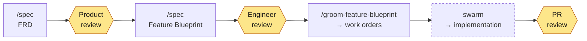

# `sf` — Spec-First Development

**Agency for the agents.**

A Claude Code plugin — five skills, a document taxonomy, and a CLI — that
takes a feature from a written requirement to merged code with agents
doing the work and humans reviewing at two checkpoints.

---

## The premise

Vibe coding is genuinely fun. It is also how demos get built, and it is
why the influencer feed looks the way it does. Specs are how systems get
built — and the question every enterprise is actually asking is not
"should agents write our code" but **"how do we adopt agentic
development at scale, and trust what comes back?"**

The answer is not more supervision. It is **agency**.

An agent that must stop and ask a human every time reality diverges from
the plan is not autonomous — it is an expensive autocomplete with a
human in the loop on the critical path. But an agent turned loose with
no written intent does not stop; it guesses, and it guesses
confidently.

Autonomy is only safe when the agent can make a **good decision** on its
own. Specs are what make the decision good. When the plan meets reality
mid-run:

| What happens mid-run | What the agent does without specs | What it does with them |
|:---|:---|:---|
| An acceptance criterion is missing or contradicts another feature | Picks one and moves on, silently | Detects the conflict against the FRD and bounces it back before writing code |
| The architecture has to evolve in a way planning didn't anticipate | Invents a structure that fits the file it's in | Reads the container/module blueprint's change guidance and stays inside the boundary — or flags that the boundary must move |
| A blocker nobody predicted appears | Works around it, inventing new behavior | Checks the blocker against the standards and ADRs that already settled the question |
| Scope quietly grows | Absorbs it — the diff triples | Recognizes the work is outside the blueprint's deltas and files it as new work |

Specs enable agents to act with agency. Agency requires good decisions.
Good decisions come from written intent. The result is a better
implementation — and a diff a human can actually review, because the
thing it was supposed to do was written down first.

---

## The workflow



The implementation step is a **separate plugin in a separate repository**:
[brettcallaghan/swarm](https://github.com/brettcallaghan/swarm) ships
`bead-bonanza` and its sprint subprocesses. It depends on this plugin — its
`sprint-plan` invokes `groom-beads` — and nothing here depends on it.

Two review checkpoints before the PR: the **FRD**, where Product asks
whether this is the right feature, and the **Feature Blueprint**, where
an Engineer asks whether this is the right way to build it. Everything
downstream of the blueprint is mechanical enough to hand to agents —
which is exactly the point. The blueprint review is the last cheap place
to change your mind.

---

## Install

**The plugin** (skills, in Claude Code):

```
/plugin marketplace add brettcallaghan/agent-plugins
/plugin install sf@spec-driven-dev
```

Or install the skills into `~/.claude/skills` from a checkout, without
the plugin system:

```bash
scripts/install-spec-skill.sh
```

**The CLI** (optional, but recommended once you have more than a handful
of documents):

```bash
go install github.com/brettcallaghan/agent-plugins/cli/spec@latest
```

Pre-built binaries for Linux, macOS and Windows (amd64 and arm64) are
attached to each `cli/vX.Y.Z` release. They are statically linked — no
Go toolchain, no runtime, nothing to install alongside them.

---

## The specs

Every document type below is authored by the `spec` skill from a
template it ships with. The taxonomy is deliberately small and closed:
if a piece of work doesn't fit one of these, that is a signal to stop
and think, not to invent a ninth kind of document.

### Product

The *what*. Owned by Product.

| Document | Captures | Example | Template |
|:---|:---|:---|:---|
| **FRD** — Feature Requirements Document | Pure features: the user story (WHY) and the acceptance criteria (WHAT), in EARS. Never the how. | [FRD: Spec Corpus Index](specs/features/spec-index/spec-index-frd.md) | [`frd-template.md`](plugin/skills/spec/references/frd-template.md) |

**Always start here. No FRD, no feature.** An FRD is one feature that
delivers independently testable value — sub-features get their own FRDs
rather than nesting.

### Architecture and Engineering

The *how*, and the constraints the how has to respect. We use the
[C4 model](https://c4model.com/): system → container → component. C4 is
useful for describing one application, but its real payoff is in the
enterprise — a shared, scale-free vocabulary for describing hundreds or
thousands of systems, where every team's diagram means the same thing.

| Document | Captures | Example | Template |
|:---|:---|:---|:---|
| **System Blueprint** | A system's context, its containers, its public contracts, deployment (C4 levels 1–2) | *none in this repo yet* | [`system-blueprint-template.md`](plugin/skills/spec/references/system-blueprint-template.md) |
| **Container Blueprint** | One deployable unit: components, contracts provided and consumed, owned data, change guidance | [Container: Spec CLI](specs/containers/spec-cli/spec-cli-container.md) | [`container-blueprint-template.md`](plugin/skills/spec/references/container-blueprint-template.md) |
| **Component Blueprint** | An atomic internal building block of one container, plus its interface | *none in this repo yet* | [`component-blueprint-template.md`](plugin/skills/spec/references/component-blueprint-template.md) |
| **Module Blueprint** | A unit that crosses a boundary of independent change — shared or published across containers, or composite — plus versioning and change rules | [Module: Document Core](specs/modules/document-core/document-core-module.md) | [`module-blueprint-template.md`](plugin/skills/spec/references/module-blueprint-template.md) |
| **ADR** — Architecture Decision Record | One significant decision: context, alternatives, choice, consequences | [ADR-015: Go for the Spec CLI](specs/adrs/adr-015-go-for-the-spec-cli.md) | [`adr-template.md`](plugin/skills/spec/references/adr-template.md) |
| **Standards** | Cross-cutting standards, policies, invariants, constraints | [Testing Standards](specs/standards/testing-standards.md) | [`standards-template.md`](plugin/skills/spec/references/standards-template.md) |
| **Contract** | The prose semantics of an interface consumed across a boundary: an API, event stream, or data product | [Contract: Specs Configuration](specs/contracts/specs-configuration-contract.md) | [`contract-template.md`](plugin/skills/spec/references/contract-template.md) |

> **We document systems, containers, and components — and stop there.**
> Code is the last level of the C4 hierarchy, and only transient work
> orders may reference it. We let the code speak for itself.

### From requirement to running code

These two are the bridge. Both are **transient**: keep them for audit,
or delete them once merged.

| Document | Captures | Example | Template |
|:---|:---|:---|:---|
| **Feature Blueprint** | The HOW, 1:1 with an FRD's WHAT: how the feature maps onto your architecture — components created, updated, deleted — plus contracts, sequencing, AC coverage, and a definition of done | [Blueprint: Spec Corpus Index](specs/features/spec-index/spec-index-blueprint.md) | [`feature-blueprint-template.md`](plugin/skills/spec/references/feature-blueprint-template.md) |
| **Work Order** | One atomic unit of work — a "dev task". Everything a fresh, zero-context agent needs to finish one job, connecting component changes to code changes | Materialized as beads in [`.beads/issues.jsonl`](.beads/issues.jsonl) | [`work-order-template.md`](plugin/skills/spec/references/work-order-template.md) |

A **Feature Blueprint** references exactly one FRD, and as many
system/container/component/module blueprints as the change touches. It
is the last review before the PR review. When it merges, its
architecture deltas get folded back into the owning blueprints —
`groom-feature-blueprint` always emits a work order to do exactly that,
so the architecture docs can't rot.

A **Work Order** is never hand-written. It is *generated* by grooming,
to a Definition of Ready, because the bar it has to clear is specific: a
capable planner has documented everything a less capable (or equally
capable) executor needs. One bead per work order, if you use
[beads](https://github.com/gastownhall/beads).

### Cross-cutting specs

**Standards** and **ADRs** may be defined at any level of the C4
hierarchy: system landscape (enterprise), system, container/module, or
component. Their relevance is scoped to the level at which they are
defined, and they apply **from that level down**.

- A system-level standard applies to that system and every container in
  it.
- A component-level ADR — say, picking an external framework — records
  a decision for that component alone.

Today the level is conveyed by where the document lives and what it
references. Making it an explicit frontmatter property is planned.

---

## The skills

| Skill | What it does |
|:---|:---|
| **`spec`** | Authors every document type above from the framework's templates, in [EARS](https://alistairmavin.com/ears/) syntax and the C4 model. Picks the right type for what you're describing and refuses to invent new ones. Runs readiness checklists before anything is handed to a reviewer. |
| **`groom-feature-blueprint`** | The boundary between the human specification loop and autonomous execution. Gates on an approved blueprint with no open questions, then decomposes its deltas into a graph of work orders carrying AC coverage and a definition of done. A quality firewall: a blueprint it can't plan mechanically gets sent back, not guessed at. |
| **`groom-beads`** | The Definition of Ready engine for the beads backend. Materializes work orders as beads, wires the dependency graph, assigns each a capability tier, validates the result, and previews execution waves. The north star: a fresh sub-agent with zero context can open `bd show <id>` and finish the job without asking anyone anything. |
| **`retro-spec`** | Retrospective on the *documents* a completed phase consumed. A spec's quality is only observable through its consumers, so this runs after a downstream phase has exercised it, and argues from that evidence into improvement RFCs for your own specs. |
| **`retro-skill`** | Retrospective on the *skill* an agent just ran. Cites the exact instruction that misled, names the script that failed, records the model that ran it — and produces an RFC against the skill itself. This is how the framework improves. |

---

## How to use these skills

**1. Start with the FRD.** Gather your notes, links, and context
documents, start a session, and run `/spec`. Review what comes back —
this is the cheapest possible moment to disagree.

**2. New project? Scaffold your architecture first.** Identify your
containers and modules. Write down the technology decisions you've
already landed — as ADRs if they had real alternatives. Establish the
standards you want up front (testing approach, security posture, and so
on). A blueprint written against no architecture invents one.

**3. Design the feature.** Once the FRD is approved and you have at
least a skeleton architecture, run `/spec` again to produce a Feature
Blueprint for it. An Engineer reviews and approves it.

**4. Groom.** Run `/groom-feature-blueprint`. It turns the approved
blueprint into specific work orders — beads, if you use them —
specifying how agents should build the feature.

**5. Execute.** Install the
[swarm](https://github.com/brettcallaghan/swarm) plugin, start a fresh
session and run `/bead-bonanza` to work through the epic. Review the PR.

**6. Retro.** When a phase struggled, run `/retro-spec` on the documents
it consumed, or `/retro-skill` on the skill that guided it. The friction
is only visible while the session is fresh — and it is the raw material
for making the next run better.

---

## The `spec` CLI

Creating and maintaining specs places a burden on agents. Every
readiness checklist an agent runs by reading is expensive, and worse,
**unverifiable** — an agent that claims a checklist passed produces
exactly the same output as one that ran it.

The `spec` CLI exists to lift that burden: it moves the busy work into
deterministic commands. A prototype run over this repository's own ~50
documents found 26 broken references and a document whose frontmatter
didn't parse — none of which a reviewer had noticed.

| Command | Purpose |
|:---|:---|
| `spec index` | Walk the spec root, build a machine-readable index of every document's metadata and location, write it to `specs.json` (or `--out`, or stdout) |
| `spec check [path]` | Check the corpus, or one document, for conformance: frontmatter against the active profile's schema, slug patterns, duplicate slugs. `--json`, `--strict`, `--only <rule>` |
| `spec next-id <type>` | Return the next identifier for a numbered document type |
| `spec slug-exists <slug>` | Report whether any corpus member declares that slug |

Configuration lives in [`specs.toml`](specs.toml) at the repository
root:

```toml
[workspace]
name = "agent-plugins"
root = "specs"

[profile]
name = "spec-driven-dev"

[conventions]
line_width = 80
```

The engine is framework-agnostic; the document vocabulary comes from a
**profile** plugged into it — see
[Module: Spec-Driven Development Profile](specs/modules/spec-profile/spec-profile-module.md).

---

## Repository layout

| Path | Contents |
|:---|:---|
| `plugin/skills/` | The five skills, each with its templates, references, and scripts |
| `specs/` | This repository's own specs — the framework applied to itself |
| `cli/` | The `spec` CLI (Go) |
| `schemas/` | [Strata](https://github.com/strata-lang/strata) schema sources for frontmatter, findings, the index, and the profile |
| `rfcs/` | Improvement RFCs: `inbox/` received, `outbox/` sent, `retired/` resolved |

The framework specifies itself. The FRDs, ADRs, blueprints and standards
under `specs/` are the ones that produced the CLI in `cli/` — which is
the only honest way to find out whether any of this works.
