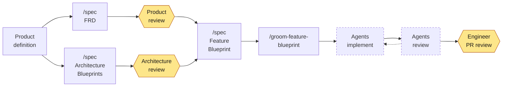

# Specs: spec-first development

<!-- coverage:badge:start -->
[](docs/code-coverage.md)
<!-- coverage:badge:end -->

**Agency for the agents.**

Specs is an agentic development plugin for Claude Code. Its skills write
feature requirements, C4 architecture blueprints, architecture decision
records (ADRs), and software development standards. Its CLI navigates,
validates, and maintains those documents. Together, they take a feature
from a concept to written requirements, an architecture design, and an
implementation plan.

## Why specs matter

Agents can plan, write, and test code faster than a team can by hand. An AI software factory builds what its inputs describe. Feature and architecture 
specs are those inputs. They help agents build the software that you intended.

Vibe coding works well for exploring an idea or building a demo. To build
systems, teams need to know how to adopt agentic development at scale and
how to trust what the agents produce.

More supervision doesn't answer that question. Agency does. If an agent
must stop and ask a person every time the plan and reality diverge, that
person is on the critical path. If an agent has no written intent, it
doesn't stop. It guesses.

An agent can act safely on its own only when it can make good decisions,
and specs guide those decisions. The following table shows what an agent 
does when the plan meets reality during a run:

| Situation during a run | Without specs, the agent | With specs, the agent |
|:---|:---|:---|
| An acceptance criterion is missing or contradicts another feature. | Picks one interpretation and continues without saying so. | Detects the conflict against the FRD and returns it before it writes code. |
| The architecture must change in a way that planning didn't anticipate. | Invents a structure that fits the file that it's editing. | Reads the change guidance in the container or module blueprint and stays inside the boundary, or reports that the boundary must move. |
| An unexpected blocker appears. | Works around it and invents new behavior. | Checks the blocker against the standards and ADRs that already settled the question. |
| The scope grows. | Absorbs the extra work, and the diff grows with it. | Recognizes that the work is outside the blueprint's deltas and files it as new work. |

Clear intent leads to good decisions, and good decisions lead to a
better implementation.

## Workflow

The following diagram shows how work moves from a product definition to
a reviewed pull request (PR):



Work starts with a **product definition**: a high-level description of
the product that you plan to build. It can list the product's features
without their acceptance criteria. The product definition feeds two
parallel tracks:

- **Product:** Product defines features and reviews the acceptance
  criteria in each feature requirements document (FRD).
- **Architecture and Engineering:** Engineering designs the
  systems, containers, and components based on the product definition.

Both tracks feed the **feature blueprint**, which maps one FRD onto the
architecture. After that, agents do the work. Grooming turns the
blueprint into work orders, agents implement them, and agents review,
test, and refine the result. When the implementation is complete,
Engineering reviews the PR.

## Install

### Install the plugin

The `brettcallaghan` marketplace at
[brettcallaghan/agent-plugins](https://github.com/brettcallaghan/agent-plugins)
serves the latest 0.x release of the plugin. To install the plugin in
Claude Code, run the following commands:

```
/plugin marketplace add brettcallaghan/agent-plugins
/plugin install specs@brettcallaghan
```

**Optional:** If you're developing the skills, you can install them into
`~/.claude/skills` from a checkout instead of using the plugin system:

```bash
scripts/install-spec-skill.sh
```

### Install the CLI

The skills call the `specs` CLI to check documents, number them, and
trace references. If the CLI isn't installed, the skills check documents
by hand and say so. A manual check is slower, and a reviewer can't
rerun it.

To install the CLI with Go, run the following command:

```bash
go install github.com/brettcallaghan/specs/cli/specs@latest
```

Each `cli/vX.Y.Z` release also includes prebuilt binaries for Linux,
macOS, and Windows on amd64 and arm64. The binaries are statically
linked, so you don't need a Go toolchain, a runtime, or any other
software to run them.

## Document types

The `spec` skill writes each of the following document types from a
template that it includes. The set of types is small and closed. If a
piece of work doesn't fit one of these types, stop and reconsider the
work instead of creating a new type.

### Product documents

Product documents describe *what* to build. Product owns them.

| Document | Captures | Example | Template |
|:---|:---|:---|:---|
| **FRD** (feature requirements document) | The feature only: the user story (why) and the acceptance criteria (what), written as tagged Gherkin. An FRD never describes how to build the feature. | [FRD: Spec Corpus Index](specs/features/spec-index/spec-index-frd.md) | [`frd-template.md`](plugin/skills/spec/references/frd-template.md) |

Every feature starts with an FRD. Each FRD describes one feature that
delivers value that you can test on its own. A sub-feature gets its own
FRD instead of being nested inside another one.

### Architecture and engineering documents

Architecture and engineering documents describe *how* to build the
system and the constraints that the design must respect. These documents
use the [C4 model](https://c4model.com/), which describes software at
the system, container, and component levels. C4 works for a single
application, and it's most useful across an enterprise, where it gives
every team the same vocabulary for describing many systems.

| Document | Captures | Example | Template |
|:---|:---|:---|:---|
| **System blueprint** | A system's context, its containers, its public contracts, and its deployment (C4 levels 1 and 2). | - | [`system-blueprint-template.md`](plugin/skills/spec/references/system-blueprint-template.md) |
| **Container blueprint** | One deployable unit: its components, the contracts that it provides and consumes, the data that it owns, and change guidance. | [Container: Spec CLI](specs/containers/spec-cli/spec-cli-container.md) | [`container-blueprint-template.md`](plugin/skills/spec/references/container-blueprint-template.md) |
| **Component blueprint** | An atomic internal building block of one container, and its interface. | - | [`component-blueprint-template.md`](plugin/skills/spec/references/component-blueprint-template.md) |
| **Module blueprint** | A unit that crosses a boundary of independent change, because it's shared or published across containers or because it's composite. Includes versioning and change rules. | [Module: Document Core](specs/modules/document-core/document-core-module.md) | [`module-blueprint-template.md`](plugin/skills/spec/references/module-blueprint-template.md) |
| **ADR** (architecture decision record) | One significant decision: its context, the alternatives, the choice, and the consequences. | [ADR-015: Go for the Spec CLI](specs/adrs/adr-015-go-for-the-spec-cli.md) | [`adr-template.md`](plugin/skills/spec/references/adr-template.md) |
| **Standards** | Cross-cutting standards, policies, invariants, and constraints. | [Testing Standards](specs/standards/testing-standards.md) | [`standards-template.md`](plugin/skills/spec/references/standards-template.md) |
| **Contract** | The meaning of an interface that's used across a boundary, such as an API, an event stream, or a data product. | [Contract: Specs Configuration](specs/contracts/specs-configuration-contract.md) | [`contract-template.md`](plugin/skills/spec/references/contract-template.md) |

These documents cover systems, containers, modules, and components, and they stop
there. Code is the last level of the C4 hierarchy, and only work orders,
which are temporary, can refer to it. The code documents itself.

### Documents that connect requirements to code

The following two document types connect a requirement to code that
implements it. Both are temporary. You can keep them for audit purposes
or delete them after the change merges.

| Document | Captures | Example | Template |
|:---|:---|:---|:---|
| **Feature blueprint** | How one FRD's feature maps onto your architecture: the components that it creates, updates, and deletes, plus contracts, sequencing, acceptance criteria coverage, and a definition of done. | [Blueprint: Spec Corpus Index](specs/features/spec-index/spec-index-blueprint.md) | [`feature-blueprint-template.md`](plugin/skills/spec/references/feature-blueprint-template.md) |
| **Work order** | One atomic unit of work, similar to a development task. It contains everything that a new agent with no context needs to finish one job, and it connects component changes to code changes. | Stored as beads in this repository's tracker | [`work-order-template.md`](plugin/skills/spec/references/work-order-template.md) |

A feature blueprint refers to exactly one FRD and to every system,
container, component, or module blueprint that the change affects. When
the change merges, its architecture changes are copied into the
blueprints that own them. The `groom-feature-blueprint` skill makes
sure that this happens: each work order updates the owning blueprint
along with the code and tests, and the last work order verifies that
every change was copied. As a result, the architecture specs stay
current.

Nobody writes a work order by hand. Grooming generates each work order
to meet a Definition of Ready. That definition requires a capable
planner to document everything that an executor, whether less capable or
equally capable, needs. If you use [beads](https://github.com/gastownhall/beads),
each work order becomes one bead.

### Cross-cutting documents

You can define standards and ADRs at any level of the C4 hierarchy: the
system landscape (enterprise), a system, a container or module, or a
component. A standard or ADR applies at the level where you define it
and at every level below. For example:

- A system-level standard applies to the system and to every container
  in it.
- A component-level ADR, such as a choice of external framework, applies
  only to that component.

The document's location and the documents that it refers to show its
level. Frontmatter doesn't record the level.

## Skills

The plugin includes the following skills:

| Skill | Description |
|:---|:---|
| **`spec`** | Writes every document type in this README from the framework's templates. Writes acceptance criteria in Gherkin, other requirements in [EARS](https://alistairmavin.com/ears/), and architecture in the C4 model. Chooses the right type for what you describe and doesn't create new types. Runs readiness checklists before a document goes to a reviewer. |
| **`groom-feature-blueprint`** | Turns an approved feature blueprint into work for agents. Requires an approved blueprint with no open questions, and then breaks its changes into a graph of work orders that carry acceptance criteria coverage and a definition of done. If the skill can't plan a blueprint mechanically, it returns the blueprint instead of guessing. |
| **`groom-beads`** | Applies the Definition of Ready to work orders stored as beads. Creates the beads, connects their dependencies, assigns each one a capability tier, validates the result, and shows which beads would conflict if they ran in parallel. The goal is that a new subagent with no context can run `bd show <id>` and finish the work without asking questions. |
| **`retro-spec`** | Runs a retrospective on the *documents* that a completed phase used. You can judge a spec's quality through the work that uses it, so this skill runs after a later phase uses the spec. It reports a ranked list of issues against your specs, and you choose which ones to file. |
| **`retro-skill`** | Runs a retrospective on the *skill* that an agent just ran. It cites the instruction that misled the agent, names the script that failed, and records the model that ran. It ranks issues against the skill so that you can file them with the skill's owner as a bead, a GitHub issue, or a Markdown file. |

## The `specs` CLI

Specs take effort for agents to write and maintain. When an agent runs a
readiness checklist by reading documents, the check is expensive, and
nobody can verify it: an agent that claims a checklist passed produces
the same output as an agent that ran it.

The `specs` CLI moves that work into the following deterministic commands:

| Command | Description |
|:---|:---|
| `specs index` | Walks the spec root, builds a machine-readable index of every document's metadata and location, and writes it to `specs.json` in the spec root, to the path in `--out`, or to standard output. |
| `specs check [path]` | Checks the corpus, or one document, for conformance: frontmatter against the active profile's schema, slug patterns, duplicate slugs, and unresolved references. Accepts `--json`, `--strict`, `--only <rule>`, and `--verbose`. |
| `specs next-id <type>` | Returns the next identifier for a numbered document type. |
| `specs slug-exists <slug>` | Reports whether any corpus member declares the slug. |
| `specs list` | Reports every document's path, slug, type, status, title, and description. `--type` filters the list, and `--all` includes superseded documents. |
| `specs refs <slug>` | Reports which documents refer to a slug or one of its headings, or what the slug refers to. |
| `specs headings` | Reports the headings that match a selection, with the span of each heading's section. |
| `specs criterion [id]` | Queries an acceptance criterion, or lists the criteria that changed locally. |
| `specs feature [id]` | Queries a feature, or writes one as a standalone Gherkin file. |
| `specs links <path>` | Rewrites a document's wikilinks as Markdown links. |
| `specs c4` | Writes the corpus's C4 model: the systems, containers, components, and modules that it documents, their relationships, and any relationship statements that it rejects. `--root <slug>` limits the model to one element. |

The CLI reads its configuration from [`specs.toml`](specs.toml) at the
repository root:

```toml
[workspace]
name = "agent-plugins"
root = "specs"

[profile]
name = "specs"

[conventions]
line_width = 80
```

The CLI's engine doesn't depend on any one framework. A **profile**
supplies the document vocabulary. For details, see
[Module: Specs Profile](specs/modules/spec-profile/spec-profile-module.md).

For the CLI's test coverage by test layer and package, see
[docs/code-coverage.md](docs/code-coverage.md).

## Repository layout

The repository contains the following directories:

| Path | Contents |
|:---|:---|
| `plugin/skills/` | The five skills, each with its templates, references, and scripts. |
| `specs/` | This repository's own specs, written with the framework. |
| `cli/` | The `specs` CLI, written in Go. |
| `schemas/` | [Strata](https://github.com/strata-lang/strata) schema sources for frontmatter, findings, the index, the profile, the C4 model, features, and configuration. |
| `scripts/` | Repository checks, the coverage report, release builds, and the skill installer. |
| `docs/` | Research notes and temporary plans for changes to this repository. |

The framework specifies itself. The FRDs, ADRs, blueprints, and
standards in `specs/` are the ones that produced the CLI in `cli/`. This
repository uses its own framework to test whether the framework works.

## License

This project is licensed under the [MIT License](LICENSE).
