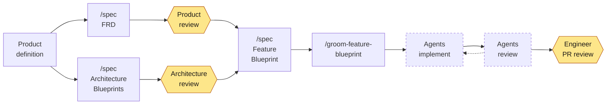

# Specs — Spec-First Development

<!-- coverage:badge:start -->
[](docs/code-coverage.md)
<!-- coverage:badge:end -->

**Agency for the agents.**

An agentic development plugin for Claude Code. Skills author a taxonomy
of feature requirements, architecture blueprints, decision records
(ADRs) and software development standards. A CLI navigates, validates
and maintains those specs. Together they take a feature from concept, to
written requirements, to an architecture design, to an implementation
plan.

---

## The premise

Agents are becoming an **AI software factory**: they plan, write and
test code at a pace no team can match by hand. A factory builds what its
inputs describe, so feature and architecture specs are the critical
inputs that make sure agents build software as it was intended.

Vibe coding is a fine way to explore an idea or build a demo. Specs are
how systems get built, and the question teams are asking is not "should
agents write our code" but **"how do we adopt agentic development at
scale, and trust what comes back?"**

The answer is not more supervision. It is **agency**.

An agent that must stop and ask a human every time reality diverges from
the plan puts that human on the critical path. An agent with no written
intent doesn't stop; it has to guess.

Autonomy is only safe when the agent can make a **good decision** on its
own. Specs are what make the decision good. When the plan meets reality
mid-run:

| What happens mid-run | What the agent does without specs | What it does with them |
|:---|:---|:---|
| An acceptance criterion is missing or contradicts another feature | Picks one and moves on, silently | Detects the conflict against the FRD and bounces it back before writing code |
| The architecture has to evolve in a way planning didn't anticipate | Invents a structure that fits the file it's in | Reads the container/module blueprint's change guidance and stays inside the boundary — or flags that the boundary must move |
| A blocker nobody predicted appears | Works around it, inventing new behavior | Checks the blocker against the standards and ADRs that already settled the question |
| Scope quietly grows | Absorbs it — the diff triples | Recognizes the work is outside the blueprint's deltas and files it as new work |

Specs enable agents to act with agency. Agency requires good decisions.
Good decisions come from clear intent. The result is a better
implementation — and a diff a human can actually review, because the
thing it was supposed to do was written down first.

---

## The workflow



Everything starts from a **product definition**: a high-level
description of the product you're going to build, which may list its
features without going into acceptance criteria. It feeds both tracks.

Two tracks then run in parallel. On the **Product** track, Product
defines features and reviews the acceptance criteria in each FRD. On the
**Architecture & Engineering** track, Engineering designs the systems,
containers and components based on the product definition.

Both tracks feed the **Feature Blueprint**, which maps one FRD onto the
architecture. From there the work is mechanical enough to hand to
agents: grooming turns the blueprint into work orders, agents implement
them, and agents review, test and refine the result. Once the
implementation is complete, Engineering reviews the PR.

---

## Install

**The plugin** (skills, in Claude Code), from the `brettcallaghan`
marketplace at [brettcallaghan/agent-plugins](https://github.com/brettcallaghan/agent-plugins),
which serves the latest 0.x release:

```
/plugin marketplace add brettcallaghan/agent-plugins
/plugin install specs@brettcallaghan
```

For development of the skills themselves, install them into
`~/.claude/skills` from a checkout, without the plugin system:

```bash
scripts/install-spec-skill.sh
```

**The CLI.** The skills call `specs` directly to check documents, number
them and trace references. Without it they fall back to checking by hand
and say so, which is slower and cannot be re-run by a reviewer:

```bash
go install github.com/brettcallaghan/specs/cli/specs@latest
```

Pre-built binaries for Linux, macOS and Windows (amd64 and arm64) are
attached to each `cli/vX.Y.Z` release. They are statically linked — no
Go toolchain, no runtime, nothing to install alongside them.

---

## The specs

Every document type below is authored by the `spec` skill from a
template it ships with. The taxonomy is deliberately small and closed:
if a piece of work doesn't fit one of these, that is a signal to stop
and think, not to invent an eleventh kind of document.

### Product

The *what*. Owned by Product.

| Document | Captures | Example | Template |
|:---|:---|:---|:---|
| **FRD** — Feature Requirements Document | Pure features: the user story (WHY) and the acceptance criteria (WHAT), as tagged Gherkin. Never the how. | [FRD: Spec Corpus Index](specs/features/spec-index/spec-index-frd.md) | [`frd-template.md`](plugin/skills/spec/references/frd-template.md) |

**Always start here. No FRD, no feature.** An FRD is one feature that
delivers independently testable value — sub-features get their own FRDs
rather than nesting.

### Architecture and Engineering

The *how*, and the constraints the how has to respect. We use the
[C4 model](https://c4model.com/): system → container → component. C4 is
useful for describing one application, but its real payoff is in the
enterprise — a shared, scale-free vocabulary for describing hundreds or
thousands of systems, where every team's diagram means the same thing.

| Document | Captures | Example | Template |
|:---|:---|:---|:---|
| **System Blueprint** | A system's context, its containers, its public contracts, deployment (C4 levels 1–2) | *none in this repo yet* | [`system-blueprint-template.md`](plugin/skills/spec/references/system-blueprint-template.md) |
| **Container Blueprint** | One deployable unit: components, contracts provided and consumed, owned data, change guidance | [Container: Spec CLI](specs/containers/spec-cli/spec-cli-container.md) | [`container-blueprint-template.md`](plugin/skills/spec/references/container-blueprint-template.md) |
| **Component Blueprint** | An atomic internal building block of one container, plus its interface | *none in this repo yet* | [`component-blueprint-template.md`](plugin/skills/spec/references/component-blueprint-template.md) |
| **Module Blueprint** | A unit that crosses a boundary of independent change — shared or published across containers, or composite — plus versioning and change rules | [Module: Document Core](specs/modules/document-core/document-core-module.md) | [`module-blueprint-template.md`](plugin/skills/spec/references/module-blueprint-template.md) |
| **ADR** — Architecture Decision Record | One significant decision: context, alternatives, choice, consequences | [ADR-015: Go for the Spec CLI](specs/adrs/adr-015-go-for-the-spec-cli.md) | [`adr-template.md`](plugin/skills/spec/references/adr-template.md) |
| **Standards** | Cross-cutting standards, policies, invariants, constraints | [Testing Standards](specs/standards/testing-standards.md) | [`standards-template.md`](plugin/skills/spec/references/standards-template.md) |
| **Contract** | The prose semantics of an interface consumed across a boundary: an API, event stream, or data product | [Contract: Specs Configuration](specs/contracts/specs-configuration-contract.md) | [`contract-template.md`](plugin/skills/spec/references/contract-template.md) |

> **We document systems, containers, and components — and stop there.**
> Code is the last level of the C4 hierarchy, and only transient work
> orders may reference it. We let the code speak for itself.

### From requirement to running code

These two are the bridge. Both are **transient**: keep them for audit,
or delete them once merged.

| Document | Captures | Example | Template |
|:---|:---|:---|:---|
| **Feature Blueprint** | The HOW, 1:1 with an FRD's WHAT: how the feature maps onto your architecture — components created, updated, deleted — plus contracts, sequencing, AC coverage, and a definition of done | [Blueprint: Spec Corpus Index](specs/features/spec-index/spec-index-blueprint.md) | [`feature-blueprint-template.md`](plugin/skills/spec/references/feature-blueprint-template.md) |
| **Work Order** | One atomic unit of work — a "dev task". Everything a fresh, zero-context agent needs to finish one job, connecting component changes to code changes | Materialized as beads in this repository's own tracker | [`work-order-template.md`](plugin/skills/spec/references/work-order-template.md) |

A **Feature Blueprint** references exactly one FRD, and as many
system/container/component/module blueprints as the change touches.
When it merges, its
architecture deltas get folded back into the owning blueprints —
`groom-feature-blueprint` makes each work order carry the fold of its
own delta alongside the code and tests, and ends the plan with one that
verifies every delta was folded, so the architecture docs can't rot.

A **Work Order** is never hand-written. It is *generated* by grooming,
to a Definition of Ready, because the bar it has to clear is specific: a
capable planner has documented everything a less capable (or equally
capable) executor needs. One bead per work order, if you use
[beads](https://github.com/gastownhall/beads).

### Cross-cutting specs

**Standards** and **ADRs** may be defined at any level of the C4
hierarchy: system landscape (enterprise), system, container/module, or
component. Their relevance is scoped to the level at which they are
defined, and they apply **from that level down**.

- A system-level standard applies to that system and every container in
  it.
- A component-level ADR — say, picking an external framework — records
  a decision for that component alone.

The level is conveyed by where the document lives and what it
references; frontmatter does not record it.

---

## The skills

| Skill | What it does |
|:---|:---|
| **`spec`** | Authors every document type above from the framework's templates, writing acceptance criteria in Gherkin, other requirements in [EARS](https://alistairmavin.com/ears/), and architecture in the C4 model. Picks the right type for what you're describing and refuses to invent new ones. Runs readiness checklists before anything is handed to a reviewer. |
| **`groom-feature-blueprint`** | The boundary between the human specification loop and autonomous execution. Gates on an approved blueprint with no open questions, then decomposes its deltas into a graph of work orders carrying AC coverage and a definition of done. A quality firewall: a blueprint it can't plan mechanically gets sent back, not guessed at. |
| **`groom-beads`** | The Definition of Ready engine for the beads backend. Materializes work orders as beads, wires the dependency graph, assigns each a capability tier, validates the result, and previews which beads would collide if run in parallel. The north star: a fresh sub-agent with zero context can open `bd show <id>` and finish the job without asking anyone anything. |
| **`retro-spec`** | Retrospective on the *documents* a completed phase consumed. A spec's quality is only observable through its consumers, so this runs after a downstream phase has exercised it, and argues from that evidence to a ranked list of issues against your own specs. You choose which to file. |
| **`retro-skill`** | Retrospective on the *skill* an agent just ran. Cites the exact instruction that misled, names the script that failed, records the model that ran it — and ranks issues against the skill for you to file with whoever vends it: a bead, a GitHub issue, or a Markdown file to hand over. This is how the framework improves. |

---

## How to use these skills

**0. Define the product.** Write a high-level definition of what you're
building: its purpose, its users, and the features you expect, without
acceptance criteria yet. Both tracks start from it.

**1. Specify the feature.** Gather your notes, links, and context
documents, start a session, and run `/spec` to write the FRD. Product
reviews its acceptance criteria — this is the cheapest possible moment
to disagree.

**2. Design the architecture, in parallel.** Starting from the product
definition, Engineering runs `/spec` for the system, container, module
and component blueprints. You don't need every FRD
first; after a few, the architecture usually has enough to go on. Write
down the technology decisions you've landed — as ADRs if they had real
alternatives — and the standards you want up front (testing approach,
security posture, and so on). Engineering reviews the blueprints. A
feature blueprint written against no architecture invents one.

**3. Design the feature.** With an approved FRD and the architecture it
touches, run `/spec` again to produce a Feature Blueprint, mapping the
feature onto the architecture.

**4. Groom.** Run `/groom-feature-blueprint`. It turns the approved
blueprint into specific work orders — beads, if you use them —
specifying how agents should build the feature.

**5. Execute.** Hand each work order to a fresh agent session. Every
one carries what that agent needs, so no one has to brief it. Agents
review, test and refine the work; Engineering reviews
the PR only after that.

**6. Retro.** When a phase struggled, run `/retro-spec` on the documents
it consumed, or `/retro-skill` on the skill that guided it. The friction
is only visible while the session is fresh. The retro reports back in
the session with a ranked list of issues; you pick which to file, and
nothing else is kept.

---

## The `specs` CLI

Creating and maintaining specs places a burden on agents. Every
readiness checklist an agent runs by reading is expensive, and worse,
**unverifiable** — an agent that claims a checklist passed produces
exactly the same output as one that ran it.

The `specs` CLI exists to lift that burden: it moves the busy work into
deterministic commands. A prototype run over this repository's own ~50
documents found 26 broken references and a document whose frontmatter
didn't parse — none of which a reviewer had noticed.

| Command | Purpose |
|:---|:---|
| `specs index` | Walk the spec root, build a machine-readable index of every document's metadata and location, write it to `specs.json` in the spec root (or `--out`, or stdout) |
| `specs check [path]` | Check the corpus, or one document, for conformance: frontmatter against the active profile's schema, slug patterns, duplicate slugs, unresolved references. `--json`, `--strict`, `--only <rule>`, `--verbose` |
| `specs next-id <type>` | Return the next identifier for a numbered document type |
| `specs slug-exists <slug>` | Report whether any corpus member declares that slug |
| `specs list` | Report every document's path, slug, type, status, title and description. `--type` filters; `--all` includes superseded documents |
| `specs refs <slug>` | Report which documents reference a slug or one of its headings, or what it references |
| `specs headings` | Report the headings matching a selection, with the span of each one's section |
| `specs criterion [id]` | Query an acceptance criterion, or list ones that changed locally |
| `specs feature [id]` | Query a feature, or emit one as a standalone Gherkin file |
| `specs links <path>` | Rewrite a document's wikilinks into markdown links |
| `specs c4` | Emit the corpus's C4 model: the systems, containers, components and modules it documents, their relationships, and any relationship statements it rejects. `--root <slug>` narrows to one element |

Configuration lives in [`specs.toml`](specs.toml) at the repository
root:

```toml
[workspace]
name = "agent-plugins"
root = "specs"

[profile]
name = "specs"

[conventions]
line_width = 80
```

The engine is framework-agnostic; the document vocabulary comes from a
**profile** plugged into it — see
[Module: Specs Profile](specs/modules/spec-profile/spec-profile-module.md).

Test coverage of the CLI, broken down by test layer and package, is in
[docs/code-coverage.md](docs/code-coverage.md).

---

## Repository layout

| Path | Contents |
|:---|:---|
| `plugin/skills/` | The five skills, each with its templates, references, and scripts |
| `specs/` | This repository's own specs — the framework applied to itself |
| `cli/` | The `specs` CLI (Go) |
| `schemas/` | [Strata](https://github.com/strata-lang/strata) schema sources for frontmatter, findings, the index, the profile, the C4 model, features and configuration |
| `scripts/` | Repository checks, the coverage report, release builds, and the skill installer |
| `docs/` | Research notes and transient plans for changes to this repository |

The framework specifies itself. The FRDs, ADRs, blueprints and standards
under `specs/` are the ones that produced the CLI in `cli/` — which is
the only honest way to find out whether any of this works.

---

## License

[MIT](LICENSE).
