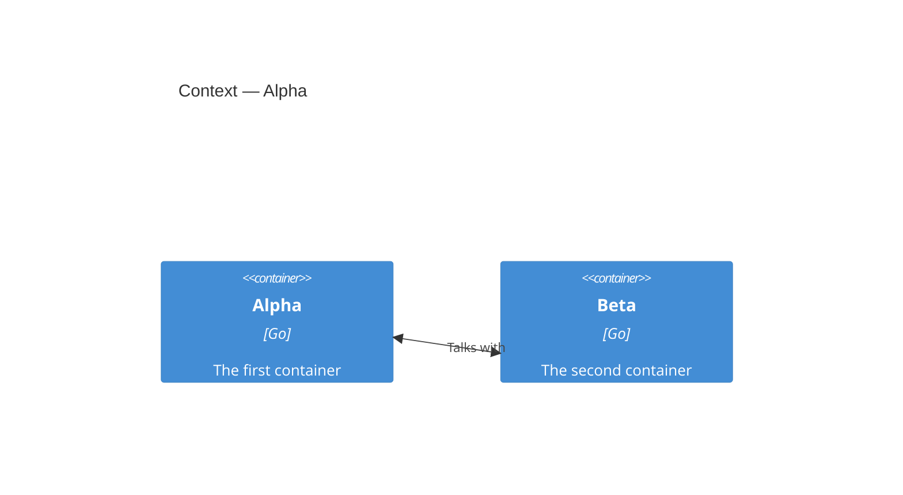

# Alpha

## Context



## Components

### Parser

```component
entity_name: Parser
slug: component-parser
description: Parses
```

### Writer

```component
entity_name: Writer
slug: component-writer
description: Writes
```
