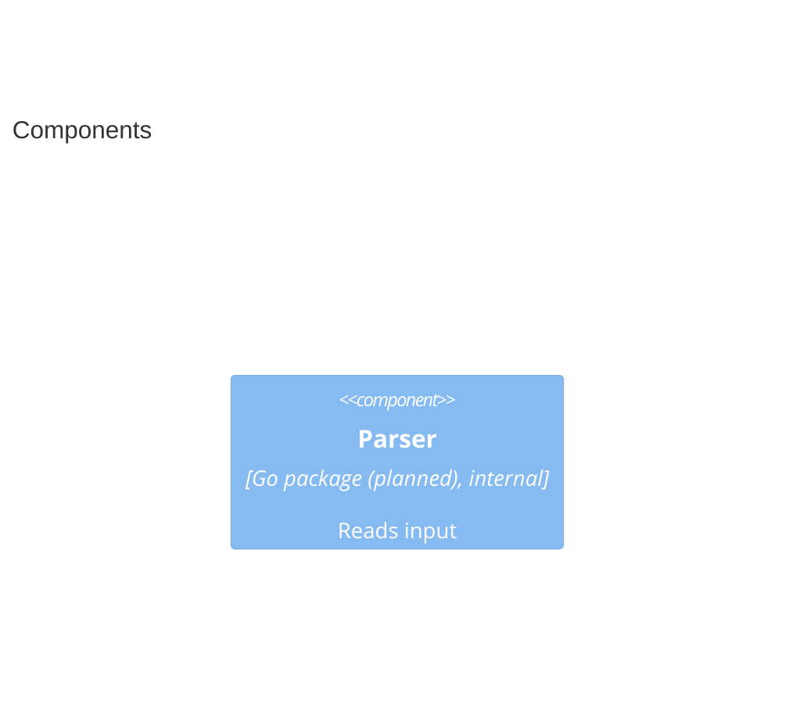

# Spec CLI

## Context

```mermaid
C4Container
    title Context
    Person(author, "Spec Author", "Writes documents")
    System_Ext(ci, "CI Pipeline", "Runs checks")
    Container(cli, "Spec CLI", "Go binary", "Indexes a corpus (and checks it), quickly")
    ContainerDb(corpus, "Spec Corpus", "Markdown files", "The documents")
    Container(twin, "Twin", "Go", "One of two containers named Twin")
    Container(ghost, "Ghost Service", "Go", "Names no element")
    Frobnicate(x, "Not a macro")
    Rel(author, cli, "Runs")
```

## Components



### Parser

```component
entity_name: Parser
slug: component-cli-parser
description: Reads input
```

## Sequence

```mermaid
C4Dynamic
    title A dynamic view
```
