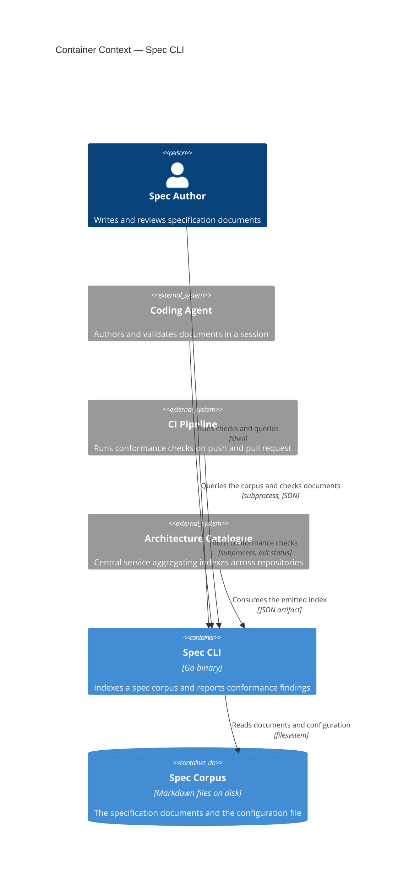
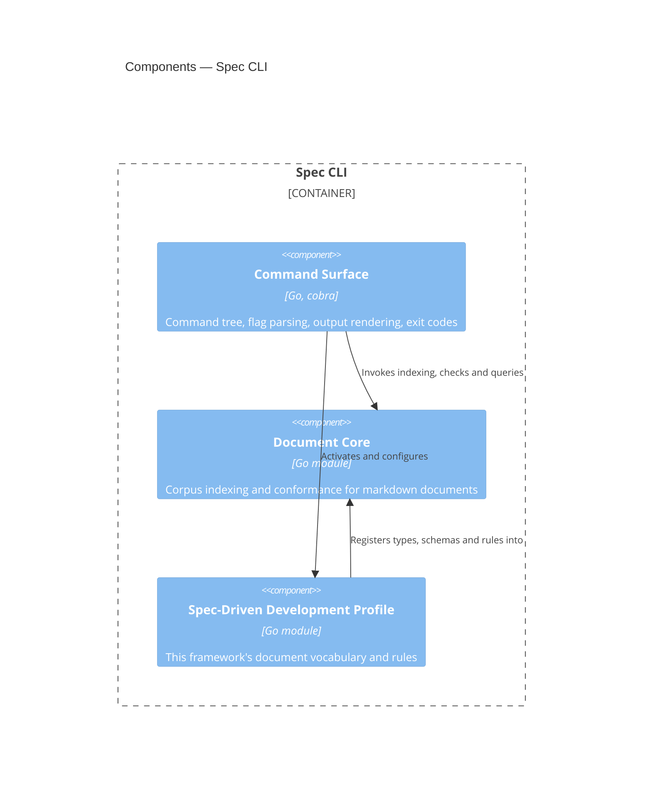

# Spec CLI

## Overview

The Spec CLI is the single deployable artifact realizing this
framework's specification tooling. [[frd-spec-validation-cli]] is the
first of the feature requirements documents it serves, and this
blueprint describes the container as a whole rather than that one
feature. It walks a specification corpus, builds a
machine-readable index of every document's metadata, structure and
relationships, and reports deterministic conformance findings against
the rules the active profile registers.

The container itself is deliberately thin. Every capability lives in one
of two composed modules — [[module-document-core]], which knows about
markdown documents with frontmatter that reference each other, and
[[module-spec-profile]], which supplies this framework's document
vocabulary. The container contributes only the command surface: argument
parsing, configuration loading, output rendering, and exit codes. That
split exists so the same capabilities can later be wrapped in an HTTP
API or an MCP server without extracting them from a CLI first.

- **Responsibility:** present the indexing and conformance capabilities
  of its composed modules as a command-line interface, and own the
  process-level concerns those modules deliberately do not — argument
  parsing, configuration discovery, output format, and exit status.
- **Technology:** Go, `cobra` for the command tree. See [[adr-015]] for
  the language decision and its measured basis.
- **Runtime:** a single statically linked binary, invoked per command.
  No daemon, no persistent process, no network listener.

## Container Context



**Spec Author → Spec CLI.** A human runs the CLI directly to check a
document before review, or to ask what identifier is next. The surface
is the command tree and its `--help` output.

**Coding Agent → Spec CLI.** An agent invokes the CLI as a subprocess
and parses its JSON output, rather than reading documents itself. This
is the interaction the latency requirements in REQ-SPEC-009 exist for:
the agent asks one question and acts on the answer.

**CI Pipeline → Spec CLI.** An adopting repository runs the CLI in its
build and fails on a non-zero exit status. The CLI is invoked as a
subprocess with no runtime installed beyond the binary itself.

**Architecture Catalogue → Spec CLI.** A central service consumes the
emitted index to compose an organization-wide architecture graph. The
CLI does not push; it emits an artifact that a pipeline uploads, so the
CLI has no network dependency and no knowledge of the catalogue. The
index schema that governs this exchange is not yet a contract document —
see Open Questions.

**Spec CLI → Spec Corpus.** The CLI reads markdown documents and one
configuration file, and writes nothing. Read-only operation is a
property of this feature, not an implementation detail:
[[frd-spec-validation-cli]] places document modification out of scope.

## Components



### Command Surface

```component
title: Command Surface
slug: component-command-surface
description: Command tree, flag parsing, configuration discovery, output rendering and exit codes
```

(Go, `cobra`) — Command tree, flag parsing, configuration discovery,
output rendering and exit codes. This is the only component the
container owns outright. It resolves `specs.toml`, activates the
profile, dispatches to Document Core, and turns findings into either
human-readable text or the JSON that AC-SPEC-006.5 requires. It holds no
domain logic: a check that lives here rather than in a module is a
layering defect, because it would be unavailable to a future API or MCP
wrapper.

### Document Core

See [[module-document-core]] (internal). (Go module) — Corpus
discovery, frontmatter parsing and schema validation, markdown structure
and span extraction, reference graph construction, numbering, and the
index and finding models. Knows nothing about this framework's document
types.

### Spec-Driven Development Profile

See [[module-spec-profile]] (internal). (Go module) — This framework's
document vocabulary: the type registry, per-type schemas and slug
patterns, required sections, element record blocks, and lifecycle rules.
Registers itself into Document Core through the extension point that
module defines.

**Command Surface → Spec-Driven Development Profile.** The command
surface activates exactly one profile per invocation and hands it the
configuration it resolved. Which profile is active is a configuration
decision, not a compile-time one.

**Command Surface → Document Core.** All indexing, checking and query
work is delegated. The command surface converts between the module's
finding and index models and the process's stdout and exit status.

**Spec-Driven Development Profile → Document Core.** The profile is a
consumer of Document Core's extension point: it registers document
types, schemas, patterns and rules, and never the other way round.
Document Core SHALL NOT import the profile.

## Provided Contracts

**Public** (consumable outside the system):

- [[contract-specs-configuration]] — the `specs.toml` format an adopting
  repository authors, and the profile-registration surface beneath it.

## Consumed Contracts

None. The CLI reads files and emits artifacts; it calls no service and
depends on no interface another team provides.

## Data

The CLI owns no persistent data. It reads the corpus and emits
artifacts, and any cache it keeps is derived and disposable.

- **Index cache** (on-disk, derived) — the built index, retained so a
  subsequent query answers without re-reading the corpus. This is the
  "warm index" REQ-SPEC-009.1 and REQ-SPEC-009.2 are measured against.
  - WHEN any input the cache was built from has changed, the CLI SHALL
    rebuild the affected entries rather than serve a stale answer.
  - The CLI SHALL produce identical output whether or not a cache is
    present, so deleting the cache is always safe.

## Infrastructure and Deployment

This container is standalone: there is no system blueprint, so this
section is authoritative for its deployment.

- **Exclusive infrastructure:** none. The CLI has no database, no queue,
  and no network dependency at runtime.
- **Deployment:** the CLI is distributed as a per-platform binary.
  REQ-SPEC-009.4 through REQ-SPEC-009.6 govern the shape: it runs with
  no language runtime installed beyond itself, it retrieves no
  executable content at install time, and it is installable from at
  least one package registry that supports on-premises mirroring.
  Cross-compilation produces the platform matrix from a single build.

## Cross-Cutting Standards

This container SHALL comply with:

- [[testing-standards]] — unit tests per declared component,
  harness-independent snapshot cases for observable behavior, and the
  coverage obligations tying both back to acceptance criteria.

The repository's other standards document,
`docs/standards/skill-best-practices.md`, governs skill authoring and
does not apply to a compiled binary.

## Change Guidance

- WHEN a capability is added to the command surface, that capability
  SHALL be implemented in [[module-document-core]] or
  [[module-spec-profile]] and invoked from the command surface, never
  implemented in the command surface itself.
- [[module-document-core]] SHALL NOT depend on [[module-spec-profile]]
  or on any framework-specific vocabulary. The dependency runs one way,
  and a violation is what would make the core unusable for the Obsidian
  vault case it is designed to serve.
- WHEN the emitted index changes shape, its schema version SHALL be
  updated in the same change, per AC-SPEC-002.2.
- WHEN a new command or flag is added, its `--help` text SHALL be
  derived from the same declaration that defines it, so the two cannot
  drift.
- **Verification gates:** `go test ./cmd/...` for command-surface
  changes, plus the snapshot cases under `cli/testdata/cases/` governed
  by [[testing-standards]]. WHEN the command surface changes in a way
  that alters observable output, the snapshot regeneration script SHALL
  be run and every resulting diff reviewed before commit. Changes
  reaching into a module additionally run that module's gates. CI runs
  the full suite.

## Key Decisions

- [[adr-015]] — Go is the implementation language; the measured basis
  and the rejected alternatives are recorded there.
- [[adr-014]] — acceptance-criteria and feature-definition validation
  are deferred, so no component here parses them.

## Open Questions

- [ ] The emitted index is a published artifact with a versioned schema
      (AC-SPEC-002.2, AC-SPEC-002.3) consumed by the Architecture
      Catalogue. That makes it a contract by this framework's own filing
      rule, but no contract document exists yet. It is deferred to the
      index-schema ADR, which also has to settle whether references are
      modelled as object properties or as a separate edge collection
      (`agent-plugins-dgn`). Decide whether the contract is authored
      alongside that ADR or before it.
- [ ] Whether the CLI ships a `serve` mode holding the index in memory
      across queries. Not required — the measured margin against
      REQ-SPEC-009.1 is wide — but it is the natural home for filesystem
      watching, which is listed as a follow-on capability.

## References

- `c4-guide.md` — C4 mapping rules and diagram conventions
- [[frd-spec-validation-cli]] — the requirements this container realizes
- [[module-document-core]] — the general engine it composes
- [[module-spec-profile]] — the framework vocabulary it composes
