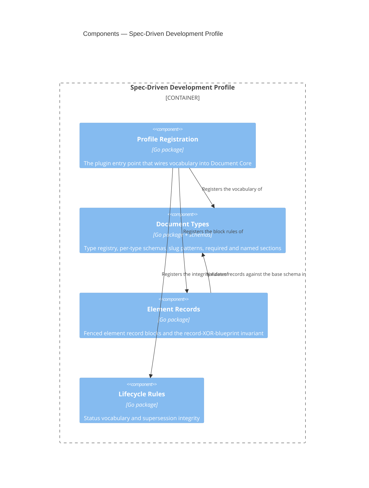

# Spec-Driven Development Profile

## Overview

This module is the domain half of the CLI. It knows that an ADR is a
document type, that its slug is `adr-<nnn>`, that a container blueprint
declares un-promoted components as fenced record blocks, and that a
retired document names its successor. [[module-document-core]] knows
none of that, and this module is how it arrives.

It is a **plugin**: it holds no engine of its own and implements no
parsing. Every capability it needs — frontmatter extraction, schema
validation, reference resolution, span queries — comes from Document
Core, and this module's job is to register vocabulary and rules into
that host through the extension point Document Core defines. The
dependency runs one way, and the value of that is concrete rather than
aesthetic: an enterprise with a different taxonomy writes a different
profile and reuses the whole engine.

Most of this module is configuration rather than code. Type names, JSON
Schemas, slug patterns and required sections are data. Only the rules
that cannot be expressed as data — the element-record invariants and the
lifecycle integrity checks — are implemented here.

- **Role:** supply this framework's document vocabulary and its
  non-schema-expressible rules to Document Core.
- **Scope:** in — the document type registry, per-type schemas and slug
  patterns, required sections, named section sets, element record blocks
  and their invariants, and status lifecycle integrity. Out — all
  parsing, indexing and reference resolution, which belong to Document
  Core; and all process-level concerns, which belong to the command
  surface of [[container-spec-cli]].
- **Composed into:** [[container-spec-cli]] — a Go module in the same
  repository, imported as a package and activated by configuration. See
  that blueprint for this module's relationships to its sibling
  components.
- **Source & tests:** `cli/profile`, with tests beside their subjects
  per Go convention.

## Interface

This module's surface is deliberately narrow: it exports one
constructor returning a value satisfying Document Core's `Profile`
interface. Everything else is internal.

- **Surface:** the exported `New` constructor in `cli/profile`,
  returning a `corpus.Profile`. The registered content — types,
  schemas, patterns — is described by
  [[contract-specs-configuration]].

- **Guarantees:**
  - The module SHALL implement Document Core's `Profile` interface
    without requiring changes to that interface for framework-specific
    reasons.
  - The module SHALL register every document type this framework
    defines, so a corpus authored to the framework produces no
    `unknown-type` exclusion for a conforming document.
  - The module SHALL NOT parse document text directly; it registers
    schemas, patterns and predicates that Document Core applies.
  - WHERE a rule is expressible as a JSON Schema or a pattern, the
    module SHALL register it as data rather than implement it as code,
    so that an adopting repository can override it through configuration.

## Components



### Profile Registration

```component
title: Profile Registration
slug: component-profile-registration
description: The plugin entry point that wires this framework's vocabulary and rules into Document Core
```

(Go package) — The plugin entry point that wires this framework's
vocabulary and rules into Document Core. It is the only component the
host sees, and it holds no rules of its own. Its value is that the
conformance surface is one file: whether this module is a well-behaved
plugin is answerable by reading it.

### Document Types

```component
title: Document Types
slug: component-document-types
description: The type registry with per-type schemas, slug patterns, required sections and named section sets
```

(Go package + schemas) — The type registry with per-type schemas, slug
patterns, required sections and named section sets. Registers every type
in this framework's taxonomy — ADR, FRD, standards, the four blueprint
levels, contract and work order — each with the JSON Schema its
frontmatter satisfies, the slug pattern from the prefix registry, the
headings its template requires, and which of its sections carry
normative statements. That last one is what makes the
extract-then-review pattern work: a reviewing agent asks for the
normative sections of a standards document and reads only those.

### Element Records

```component
title: Element Records
slug: component-element-records
description: Fenced element record blocks and the invariant that a child is a record block or a blueprint link, never both
```

(Go package) — Fenced element record blocks and the invariant that a
child is a record block or a blueprint link, never both. Registers the
`component` fence tag so Document Core extracts and parses those blocks,
supplies the base record schema they validate against, and implements
the record-XOR-blueprint-link rule from [[adr-008]] — the one rule here
that no schema can express, because it is a constraint between a block
and a sibling link rather than a constraint on a value.

### Lifecycle Rules

```component
title: Lifecycle Rules
slug: component-lifecycle-rules
description: The status vocabulary and the supersession and retirement integrity rules
```

(Go package) — The status vocabulary and the supersession and retirement
integrity rules. The vocabulary itself is registered as a schema
constraint on `status`; what needs code is the relational part — that a
retired document names a resolvable successor, and that live documents
referencing a retired one are surfaced.

**Profile Registration → Document Types, Element Records, Lifecycle
Rules.** Registration is a pure wiring layer: each component exposes
what it registers, and Registration hands it to the host. No component
here reaches the host directly, so there is exactly one place to look
when the plugin contract changes.

**Element Records → Document Types.** Record blocks validate against the
same base schema a promoted document's frontmatter satisfies — the
two-schema `allOf` model [[adr-008]] chose — so the record rules depend
on the type registry rather than carrying a second copy of the base
schema.

## Cross-Cutting Standards

This module SHALL comply with:

- [[testing-standards]] — every component declared below carries unit
  tests covering its exported surface.

Its registered rules derive from this framework's own reference
documents —
`plugin/skills/spec/references/frontmatter-standards.md`,
`plugin/skills/spec/references/template-authoring-standards.md` and
`plugin/skills/spec/references/cross-document-references.md` — which
are shipped with the `spec` skill rather than authored as project
standards documents.

## Change Guidance

- WHEN this framework's document vocabulary changes — a type added, a
  slug pattern altered, a required section introduced — the registered
  schema or pattern here SHALL be updated in the same change as the
  template or standard that defines it. This module is a copy of rules
  owned elsewhere, and a copy that lags is worse than no check at all.
- The module SHALL NOT implement parsing, indexing or reference
  resolution. WHEN a rule appears to need one of those, the capability
  belongs in [[module-document-core]] and this module registers against
  it.
- The module SHALL NOT require a change to Document Core's `Profile`
  interface for a framework-specific reason. WHEN a rule cannot be
  expressed through the existing extension point, that is a signal the
  extension point is too narrow, and widening it is a change to the host
  reviewed on its own merits — not a special case for this profile.
- WHILE visibility is internal, this module and its in-repo consumers
  evolve together, with no compatibility window.
- **Verification gates:** `go test ./profile/...` for any change here,
  plus the conformance test asserting that this module satisfies
  Document Core's `Profile` interface, and the self-application test
  that runs the built profile against this repository's own `docs/`
  corpus. That last gate is the one that catches a registered schema
  drifting from the templates it mirrors. CI runs the full suite.

## Key Decisions

- [[adr-008]] — element record blocks and the two-schema model this
  module's Element Records component implements.
- [[adr-012]] — the reference conventions the registered types rely on.
- [[adr-014]] — acceptance-criteria validation is deferred, so no
  component here registers AC rules.
- [[adr-015]] — Go, and the profile-as-package composition model.

## Open Questions

- [ ] `kind` is `standard` because exactly one profile exists. WHEN a
      second profile is written — an enterprise taxonomy, or a stripped
      Obsidian-vault profile — this blueprint SHOULD be reconsidered as
      `kind: pattern`, governing how any profile is built, with the
      profiles as instances. Deciding early would be inventing a pattern
      from one example.
- [ ] How much of the vocabulary should be shipped as data files an
      adopter can override versus compiled-in defaults. The registered
      form is settled; the override mechanism is not, and it interacts
      with [[contract-specs-configuration]].
- [ ] Whether the deferred domain rules — AC traceability, C4 diagram
      conventions, blueprint AC-coverage keys, work-order readiness —
      become components here or a second profile layered on this one.
      They are out of scope for the current feature and the answer is
      not yet forced.

## References

- `c4-guide.md` — C4 mapping rules and diagram conventions
- [[container-spec-cli]] — the container this module is composed into
- [[module-document-core]] — the host it registers into
- [[contract-specs-configuration]] — the configuration surface it
  populates and extends
