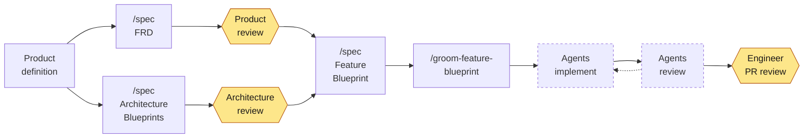

# Workflow

The following diagram shows how work moves from a product definition to a
reviewed pull request (PR):

Work starts with a **product definition**: a high-level description of the
product that you plan to build. It can list the product's features without
their acceptance criteria. The product definition feeds two parallel tracks:

- **Product:** Product defines features and reviews the acceptance criteria
  in each feature requirements document (FRD).
- **Architecture and Engineering:** Engineering designs the systems,
  containers, and components based on the product definition.

Both tracks feed the **Feature Blueprint**, which maps one FRD onto the
architecture. After that, agents do the work. Grooming turns the blueprint
into Work Orders, agents implement them, and agents review, test, and refine
the result. When the implementation is complete, Engineering reviews the PR.

People review at three points, shaded in the diagram: the FRD, the
architecture, and the finished PR. Everything between the approved Feature
Blueprint and the PR is agent work.

For the steps, see [Plan a feature for agents](../how-to/plan-a-feature.md).
