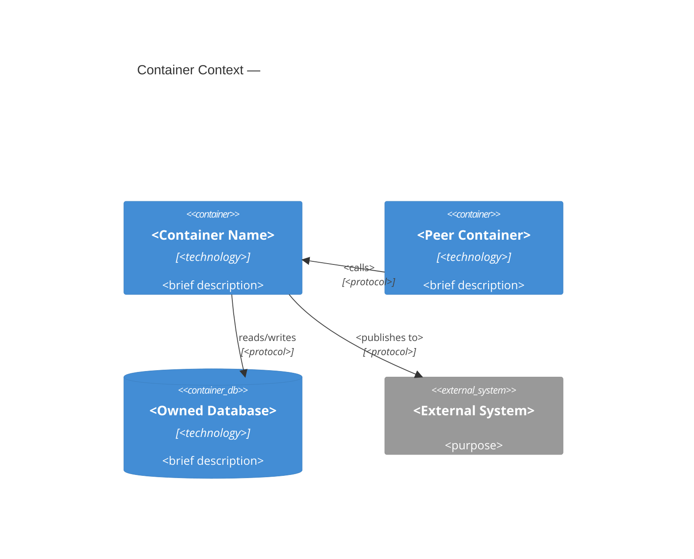
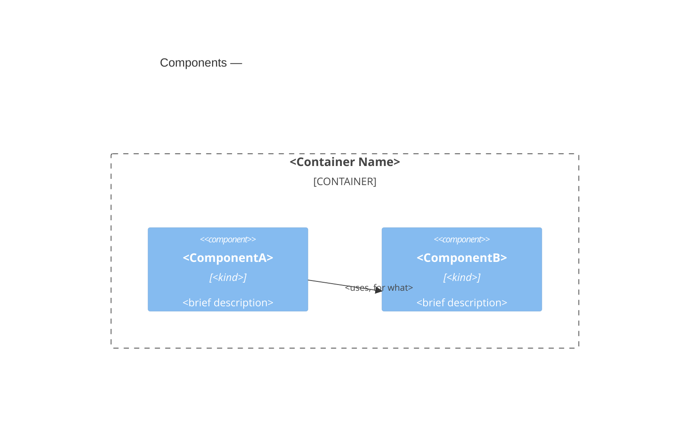

<!--
Template: Container Blueprint
Source: Architecture documentation framework.

Load before authoring
  - `shared/c4-standards.md`: how the framework applies C4 — the module
    level, element declarations, edge ownership, and diagram placement.
  - `shared/c4-guide.md`: the C4 levels, naming and relationship
    conventions, diagram types, and Mermaid authoring rules.
  - `shared/blueprint-content-standards.md`: what a blueprint states, and
    the blueprint audit. A quoted rule name below, such as "Name owners,
    not neighbors", is the heading of a rule there.
  - `shared/design-principles-guide.md`: the universal design principles.
  - `shared/design-principles-containers-guide.md`: patterns for composing
    components.
  - `shared/design-principles-components-guide.md`: patterns for composing
    code.
  Skip the design principles guides for an edit that doesn't change the
  element's design.

Sections (complete each, then delete its instruction block)
  - Overview
  - Tech stack
  - Container context
  - Components
  - Design
  - Provided Contracts
  - Consumed Contracts
  - Data
  - Infrastructure and deployment
  - Cross-cutting Standards
  - Change guidance
  - Key decisions
  - Open questions
  - References

Purpose
  Document one container (C4 sense: an application or data store that
  must be running for the system to work): its responsibility, the
  containers and infrastructure it depends on, the components inside it,
  the contracts it provides and consumes, and the data it owns.

Reader profile (apply with the tech-writer skill)
- Reader: an engineer or agent about to change or build on this container,
  often while writing a Feature Blueprint, and a newcomer who needs the facts
  first.
- Knows: the surrounding system, not this container.
- Wants: its stack, components, contracts, owned data, and the change guidance
  feature work must respect.
- Budget: one focused read.
- Tone: matter-of-fact, describing the container as it is, with exact names,
  linked rather than described ("Link what the code reveals"). Decisions
  and their alternatives belong in ADRs.

When to use
  - Documenting an application your team builds and runs: API server, web
    app, worker, mobile app, CLI, scheduled job, serverless function set
  - Documenting a data store your team IMPLEMENTS (you build the database
    engine itself)

When NOT to use
  - A data store or queue your container merely uses → a line in this
    document and an element on its diagrams; no blueprint of its own
  - The whole system → system blueprint
  - A shared library, package, or complex component → component blueprint
  - An interface's shape and semantics → `contract-template.md`

Contract visibility (see `shared/c4-standards.md` for full rules)
  public   — consumed outside the owning system. Standalone contract doc.
  internal — consumed by other containers within the system, not outside.
             Standalone contract doc, marked internal.
  private  — between this container and infrastructure it exclusively
             owns (its database schema, its cache keys), or in-process.
             Documented in the Data section below; NO standalone contract
             document. WHEN a second independently-built consumer appears,
             the contract SHALL be promoted to internal or public and
             extracted to a contract document.

Standalone containers
  A container MAY be documented without a system blueprint: omit
  `system`. Standalone containers are valid; the system level is
  introduced when a second container needs shared context worth
  modeling (see `shared/c4-standards.md`). WHEN there is no system blueprint, this
  document's Infrastructure and deployment section is authoritative
  for this container's deployment.

Slug format
  container-<container-name>, lowercase kebab-case.
  Example: container-notification-worker

Status vocabulary
  draft | ready-for-review | approved | active | retired

This is a living document — update it when the container changes. Remove
all HTML comment blocks after completing each section. WHILE status is
draft, the Open questions section MAY contain open questions or the
literal text "None."; remove the section when the document becomes
active.
-->

# <Container Name>

## Overview

<!--
What this container is and does, in one or two paragraphs. The
technologies it is built from go in Tech stack, below. Keep reasoning
out: decisions go in Key decisions.
-->

### Responsibility

<!--
What this container does within the system.
-->

### Does not own

<!--
Each excluded responsibility, with its owner's [[slug]]
("Name owners, not neighbors").
-->

<Excluded responsibility> — [[<owner-slug>]] owns it.

### Runtime

<!--
How and where it runs: its platform and scaling model.
-->

## Tech stack

<!--
The technologies this container is built from, one line each: language and runtime, frameworks, notable libraries, the data
stores and messaging it uses, and how it is built and packaged.
Name what a maintainer must know to read and change the code, not every
transitive dependency — the dependency manifest (go.mod, package.json,
pom.xml, …) is the source of truth for the full list.

Each line item MAY cite the ADR that decided the choice, as a trailing
[[adr-<nnn>]] link. Cite one WHEN such an ADR exists; an uncited line is
valid and records a choice nobody has yet needed to defend. Do not
author an ADR only to fill the slot. An ADR cited here SHALL also be
listed under Key decisions, which stays the complete index of decisions
governing this container.

Do not state dependency versions ("State only what must stay true"). WHEN
a version is contractual (a minimum supported runtime, a pinned
toolchain), state it as a requirement in EARS in Change guidance instead.

The frontmatter `technology` value is the short label diagrams draw; it
SHALL agree with the primary entries here.
-->

**<Category>:** <technology> — <what it is used for>. [[adr-<nnn>]]

**<Category>:** <technology> — <what it is used for>.

## Container context

<!--
A Container Context Diagram (defined in `shared/c4-guide.md`): THIS container in the
center, plus only the containers, systems, and actors it directly
communicates with — in either direction — regardless of system boundary.
Not the whole system; the system-wide view lives in the system blueprint.

Follow the diagram with one prose paragraph per relationship: state
direction (who depends on whom), what crosses the boundary, the governing
[[contract-slug]] (or vendor contract URL for third-party systems), and why
the boundary sits here.
-->



## Components

<!--
The container's full component roster — every component and module this
container composes, enumerated here. They are DECLARED under the
headings below; the C4 Component diagram is a view rendered from those
declarations and from the component/module blueprints this container
composes (see `shared/c4-standards.md`). This container owns the
relationships AMONG its components.

Each declaration captures: the name (canonical — used verbatim on
diagrams), its technology or kind, a brief description that doubles as
the diagram's description text, and a detailed description. A composed
unit is declared by a record block, by its own blueprint, or both:
  - un-promoted (a simple internal component): the follow-on sentence(s)
    here ARE the detailed description. They state the component's
    responsibility and the decision it hides, never its internals. The
    declaration also carries a
    machine-readable record block holding entity_name, slug and
    description (and optionally technology), validated against the
    shared element-record schema:

        ```component
        entity_name: <Component Name>
        slug: component-<component-name>
        description: <one-line brief description>
        technology: <technology / kind>        # optional
        ```

  - promoted (warrants its own blueprint): link its [[component-<name>]] or
    [[module-<name>]] blueprint and do NOT restate its internals. The
    record block MAY stay; where it does, it SHALL agree with the
    blueprint's frontmatter. A module is listed in this container's
    `modules` frontmatter as well. For a
    module, name its visibility tier (internal or public) — it governs
    the change rules for work touching it.

WHEN a composed unit is promoted, its record block is lifted
into that document's frontmatter and replaced here by the link — and
every container that composes it updates its roster in the same change
(lockstep).

Components are code-level groupings with defined interfaces; they are
not separately deployable. A composed unit that is shared or published
across containers, or is composite, is a MODULE (module blueprint); an
atomic in-container unit is a component. See `shared/c4-standards.md` for the
definitions this framework uses (a deliberate superset of C4's).

Each component is declared under its own `### <Component Name>` heading
below — the heading is the canonical display name, matching the diagram.
Reference an un-promoted component with a wikilink heading anchor into
this roster, `[[container-<name>#Component Name]]`; reference a promoted
one by its own slug, `[[component-<name>]]`. The heading persists through
promotion, so anchor references survive it.
-->



### <ComponentA>

```component
entity_name: <ComponentA>
slug: component-<component-a>
description: <brief description>
technology: <technology / kind>      # optional; the technology line drawn on
                                     # diagrams — omit WHEN not meaningful
```

(<technology / kind>) — <brief description, as it appears on diagrams>.
<Detailed description: its responsibility and the decision it hides.>

### <Component B>

```component
entity_name: <Component B>
slug: component-<component-b>
description: <brief description>
technology: <technology / kind>      # optional; the technology line drawn on
                                     # diagrams — omit WHEN not meaningful
```

(<technology / kind>) — <brief description>.

### <ComponentC>

See [[component-<name>]]. (<technology / kind>) — <brief
description>.

### <ModuleD>

See [[module-<name>]] (internal | public).
(<technology>) — <brief description>; when public, its blueprint carries
versioning.

## Design

<!--
How the container is built to stay sound as it changes.
-->

### Architectural style and patterns

<!--
The style its components follow and the patterns between them, for example
Ports and Adapters: which components are the core, and which adapt it to
I/O. Draw on the universal guide and the containers guide. Name each
pattern with its progenitor, the roles its components play, and the
present need it serves. State what it rules out as an invariant
("Name each pattern with its progenitor, constraint, and need"). Also name
entries from the components guide that all of the container's code
follows.
-->

<Style or pattern> (<progenitor>) — <the roles its components play>;
<the present need it serves>.

### Invariants

<!--
EARS statements that hold across the container, each ending "Enforced by:
<test, check, lint, or review only>" ("Say what enforces each invariant").
-->

The container SHALL <invariant that holds across the container>.
Enforced by: <test, check, lint, or review only>.

### Extension points

<!--
Where the container is designed to grow, the intended way in, and the
wrong way to extend it. If it has none, write "None: <why it is closed>"
("State where the element grows").
-->

<Where it grows> — <the intended way in>. Not by <the wrong way to
extend it>.

## Provided Contracts

<!--
Interfaces this container exposes, grouped by visibility. One line per
contract linking its [[contract-slug]]; shape and semantics live there.
Private interfaces do not appear here — they are in the Data section.
-->

**Public** (consumable outside the system):

[[contract-<name>]] — <what it vends, via what mechanism>.

**Internal** (this system only — SHALL NOT be consumed outside it):

[[contract-<name>]] — <what it vends, to which sibling containers>.

## Consumed Contracts

<!--
Contracts this container depends on, provided by sibling containers or
other systems. One line each with the [[contract-slug]] and what it is used
for.

Third-party (SaaS) interfaces are governed by the vendor's published
contract: reference it by URL. contract documents exist only for
interfaces the organization provides — SHALL NOT be authored for
third-party interfaces.
-->

[[contract-<name>]] (provided by <container or system>) — <used for>.

<Vendor / SaaS product> — <used for>; contract: <URL to the vendor's
published specification>.

## Data

<!--
The data this container exclusively owns, and its private contracts: the
schema between this container and its dedicated stores. Documented here
inline — private contracts do not get standalone contract documents.

For each owned store: what it holds, the schema source of truth (link the
migration directory or DDL — do not duplicate it), and the invariants the
container maintains over it, in EARS.

WHEN any of this data is published for consumption by others (a view, a
replicated topic, a data product), THEN that published surface SHALL be
extracted to a contract document and listed under Provided Contracts.
-->

- **<Store name>** (<technology>) — <what it holds>. Schema source of
  truth: <link>. Exclusively owned by this container.
  - The container SHALL <invariant maintained over this data>.

## Infrastructure and deployment

<!--
Infrastructure exclusively supporting this container (its cache, its
queue, its bucket) and how the container reaches the environments it
runs in.
-->

### Exclusive infrastructure

<!--
The nodes that exist only for this container, such as its Redis or its
dead-letter queue.
-->

### Deployment

<!--
The system blueprint's Deployment section is authoritative for shared
topology: link it and add only what is specific to this container, such
as its scaling policy, resource envelope, or rollout order.

WHEN the container does not belong to a documented system (standalone),
this section is authoritative for the container's deployment: describe
it here instead of referencing a system blueprint.

A container-scoped deployment view MAY be included here: a filtered view
showing only this container and the infrastructure nodes that exist
solely for it. Omit it when the system-level diagram already tells the
story.
-->

See [[system-<system-name>]] § Deployment. <Anything container-specific:
scaling policy, resource envelope, rollout order.>

```mermaid
C4Deployment
    title Deployment view — <Container Name> (<environment>)
    Deployment_Node(node, "<Runtime>", "<tech>") {
        ContainerInstance(this)
    }
```

## Cross-cutting Standards

<!--
Standards this container complies with, by reference. Platform choices
that apply to every container (logging platform, mesh, authN provider)
are mentioned in prose or standards docs, never modeled as elements on
this container's diagrams — see `shared/c4-standards.md`.
-->

This container SHALL comply with [[<standard-slug>]]: <one-line scope>.

## Change guidance

<!--
Rules for feature work touching this container: the constraints a
feature blueprint — and the planning agent downstream of it — must
respect when changing this container. Write normative rules in EARS.

This section carries ARCHITECTURAL constraints: lockstep-update rules,
layering boundaries, regeneration obligations. Invariants go in Design.
It is not a task list or a commands reference — reference the
repository's build/contributor docs for procedure rather than
duplicating them (duplication drifts). Constraints that span multiple
containers belong in a cross-cutting requirements document referenced
from Cross-cutting Standards, not here.
-->

WHEN <a kind of change is made>, <the artifacts that must change
together> SHALL be updated in the same change.

### Verification gates

<!--
The gates in two groups ("Verify isolation tests always"), each gate in
its own paragraph. CI and downstream agents still run the full suite.
Feature Blueprints map their AC coverage "Verified by" column onto these
gates.
-->

#### Verify always

<!--
The isolation tests under test_paths, as runnable targets (test paths,
ids, or task names).
-->

#### Verify conditionally

<!--
Each wider suite, with the change that requires it, such as "WHEN the
public interface changes, run the integration suite."
-->

WHEN <condition>, run <the wider suite that condition requires>.

## Key decisions

<!--
One paragraph per significant decision: restate the outcome and reference
the ADR. The trade-off analysis lives in the ADR, not here.
-->

[[adr-<nnn>]] — <one-line statement of the decision>.

## Open questions

<!--
Optional, draft only. Track unresolved questions while the document is
a draft. WHEN a question is resolved, fold the answer into the relevant
section (or, for an architecture decision, record it as an ADR) and
delete it here. WHILE status is draft, the section MAY instead state the
literal text "None." (no checkbox) — the absence of questions is
information. Remove the whole section when the document leaves draft.
-->

- [ ] <open question> — <what is blocked on it, who decides>

## References

<!--
Optional. What a reader needs next, one paragraph each: [[slug]] for
documents in this corpus, a URL for anything outside it. Remove the
section when there is nothing to cite.

C4 mapping rules and diagram conventions are in this skill's
`shared/c4-standards.md`. Read it while authoring, but do not cite it
here: it is not a document in your corpus.
-->
