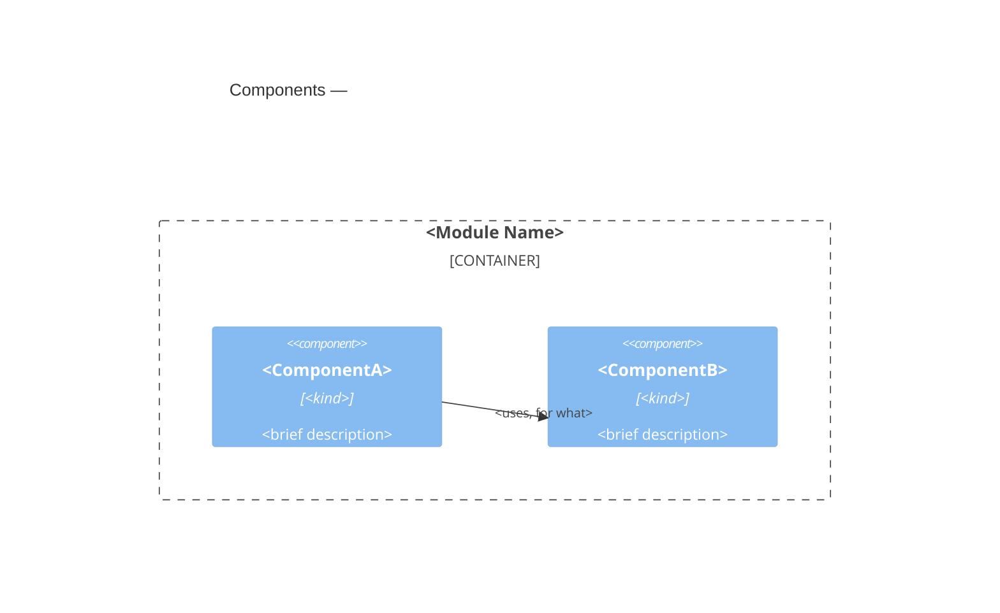

<!--
Template: Module Blueprint
Version: 0.8
Source: Architecture documentation framework. C4 mapping rules are
  defined in `shared/c4-guide.md` — load it before authoring.

Sections (complete each, then delete its instruction block)
  - Overview
  - Interface
  - Components
  - Pattern Guidance
  - Versioning and Compatibility
  - Cross-Cutting Standards
  - Change Guidance
  - Key Decisions
  - Open Questions
  - References

Purpose
  Document one MODULE: a unit of software that crosses a boundary of
  independent change — it is shared or vended across containers on their
  own schedules (so versioning and compatibility are concerns), and/or
  it has internal components of its own worth documenting structurally.
  A module is composed INTO a container rather than deployed on its own;
  it owns no runtime data and no deployment of its own.

  Modules are most often shared libraries providing core capabilities
  many containers adopt — a logging framework, a design-system package,
  a client SDK, common web-framework middleware — as well as plugins in
  a plugin architecture, IaC modules, and micro-frontends. Some are not
  shared but are composite: a rules engine built from sub-engines inside
  a single container is a module by virtue of its internal structure.

  The dividing line from a component is the same one the framework draws
  for contract visibility: does it cross a boundary of independent
  change? A component does not — it is internal to one container and
  changes in lockstep with it; a module does. This framework's "module"
  is part of the deliberate C4 superset defined in `shared/c4-guide.md`.

When to use — either trigger is sufficient
  - SHARED / PUBLISHED: the unit is vended or consumed across containers
    or systems, so versioning, compatibility, and vending become
    concerns. It MAY be atomic — an atomic shared library is still a
    module.
  - COMPOSITE: the unit has internal components of its own, with
    relationships among them, worth a Components roster.

  visibility — the highest-value classification; it gates change rules:
  public   — published to a registry (enterprise or public). Consumers
             are independent and may span majors, so backwards
             compatibility, deprecation windows, and a recorded change
             history are required (see Change Guidance and Versioning).
  internal — not published; lives in the repo and evolves in lockstep
             with its consumers, so it may be refactored or broken
             freely in the same change as its consumers. Modules often
             start internal and are promoted to public once matured.

  kind:
  standard — the default: a single module instance.
  pattern  — a module type built repeatedly to the same design, where
             the blueprint governs how each new instance is built and is
             authoritative for every instance's conformance (one
             blueprint for "plugin", many plugins).

When NOT to use
  - An internal building block of a single container that is neither
    shared nor composite → component blueprint (the leaner leaf).
  - A unit with runtime elements of its own (a service, a worker, a
    queue) — that is a container or system (container blueprint /
    system blueprint).
  - The container this module is composed into → container blueprint.
  - An interface's shape and semantics → `contract-template.md`.

Edges — light on outward, authoritative on internal
  A module does NOT document its outward relationships (to the sibling
  components of its host container): those edges are owned by the host
  [[container-<name>]] blueprint — a shared module has different neighbors
  in each host, so they cannot live here. Point to the host(s) instead.
  WHERE a module has internal components, it DOES own the relationships
  among them, declared in the Components section — "the container owns
  the edges among its children," applied one level down.

Lifecycle migration
  WHEN an internal module is published to a registry, THEN its
  visibility becomes public: from that point backwards compatibility,
  deprecation windows, and a recorded change history apply (see Change
  Guidance). Modules commonly mature internal → public this way.
  WHEN a module gains runtime elements of its own (a service, a worker,
  a queue), THEN it has become a container or system: author the
  appropriate blueprint, mark this one retired, and point superseded_by
  at the successor. Its contract usually survives the move.
  WHEN a module stops being shared AND has no internal components, THEN
  it has become a plain component: fold it into the single consuming
  container (as a component blueprint or a roster bullet) and retire
  this document.

Slug format
  module-<module-name>, lowercase kebab-case.
  Example: module-logging-client

Status vocabulary
  draft | ready-for-review | approved | active | retired

This is a living document — update it when the module changes. Remove
all HTML comment blocks after completing each section. WHILE status is
draft, the Open Questions section MAY contain open questions or the
literal text "None."; remove the section when the document becomes
active.
-->

# <Module Name>

## Overview

<!--
What this module is, why it exists as a documented unit, and how it is
vended. Cover, in 1-2 paragraphs plus the facts below:
  - its role — what it does within the container(s) that host it;
  - its scope — what is in scope and, explicitly, what is out of scope;
  - how it is vended/composed — package registry (npm/PyPI/Maven),
    monorepo build target, plugin loaded at runtime, IaC module
    registry, module-federation remote, generated code;
  - where its source and tests live — the source_paths and test_paths
    frontmatter fields are the machine-readable copy.

Relationships: point to the host [[container-<name>]]; do NOT restate the
edges to sibling components here (see the instruction block above).
-->

- **Role:** <what this module does within its host container>
- **Scope:** in — <what this module owns>; out — <what it deliberately
  does not do>.
- **Composed into:** [[container-<name>]] (one per host container) — <how
  it is vended and composed>; see those blueprints for this module's
  relationships to sibling components.
- **Source & tests:** <source root(s) and test root(s); mirror in the
  source_paths / test_paths frontmatter>.

## Interface

<!--
The module's public surface — what its host and consumers may depend on.
Point at the source of truth for the shape (type definitions, plugin
API, module schema) rather than duplicating it. State the semantic
guarantees consumers can rely on, in EARS.

This section documents what the module PROVIDES; there is deliberately
no consumed-dependencies section — a module's dependencies are outward
edges, owned by its host container and discovered from code (see the
Edges note in the instruction block above).

IF the interface is formally specified and consumed across team
boundaries, THEN author a contract document for it and reference it
here instead of documenting the surface inline.
-->

- **Surface:** <link to exported API / plugin contract / module schema>
- **Guarantees:**
  - The module SHALL <semantic guarantee consumers can rely on>.
  - The module SHALL NOT <thing consumers must not have to defend
    against>.

## Components

<!--
OPTIONAL — include only WHEN this module has internal components of its
own. An atomic shared library (a logging client, a single-purpose SDK)
has none; delete this section for it.

The module's internal components — the container-like half of a module
blueprint. The components are DECLARED in the list below; the C4
Component diagram is a view rendered from those declarations (see
`shared/c4-guide.md`). This module owns the relationships AMONG these components.

Each declaration captures: the component's name (canonical — used
verbatim on diagrams), its technology or kind, a brief description that
doubles as the diagram's description text, and a detailed description —
  - atomic internal component: a follow-on sentence or two here IS the
    detailed description, AND the declaration carries a machine-readable
    record block (see below);
  - complex or shared internal component (itself a composite): link its
    [[component-<name>]] or [[module-<name>]] blueprint and do not restate its
    internals.

Machine-readable record (un-promoted components): every internal
component that does NOT have its own blueprint SHALL carry a fenced
record block immediately under its bullet, holding title, slug, and
description — validated against the shared component-record schema, the
same schema a promoted component's frontmatter satisfies:

    ```component
    title: <Component Name>
    slug: component-<component-name>
    description: <one-line brief description>
    ```

WHEN such a component is promoted to its own blueprint, its record block
is lifted out verbatim into that document's frontmatter and replaced
here by an [[component-<name>]] / [[module-<name>]] link — never both.

Each component is declared under its own `### <Component Name>` heading
below — the heading is the canonical display name, matching the diagram.
Reference an un-promoted component with a wikilink heading anchor into
this roster, `[[module-<name>#Component Name]]`; reference a promoted one
by its own slug, `[[component-<name>]]`. The heading persists through
promotion, so anchor references survive it.
-->



### <ComponentA>

```component
title: <ComponentA>
slug: component-<component-a>
description: <one-line brief description>
```

(<kind>) — <brief description, as it appears on diagrams>. <Detailed
description: responsibilities and boundaries.>

### <ComponentB>

See [[component-<name>]]. (<kind>) — <brief description>.

<Relationship paragraphs: who depends on whom, what crosses, why.>

## Pattern Guidance

<!--
kind: pattern only — delete this section otherwise.

Authoritative instructions for building a new instance of this module
type. The archetype is a plugin architecture: one "plugin" module
blueprint governs many plugins. Write conformance rules in EARS so an
instance can be reviewed against them, and keep a registry of instances.

WHEN an authoritative pattern document already exists outside the
framework (a pre-existing architecture or tenets doc), this blueprint
MAY wrap it rather than rewrite it: declare the pattern, its instances,
and conformance gates here, and reference the existing document (by
repo-relative path, per [[template-authoring-standards]]) as the detailed
specification.
-->

**Building a new instance:**

1. <step>
2. <step>

**Conformance — every instance:**

- SHALL <structural or behavioral rule all instances meet>.
- SHALL NOT <divergence that would break the pattern>.

**Instances:**

- **<InstanceName>** (<container or repo>) — <target/variant>.

## Versioning and Compatibility

<!--
visibility: public only — delete this section otherwise. This is the
version-awareness a published artifact needs: consumers may span
multiple majors and cannot be updated in lockstep.
-->

- **Versioning scheme:** <semver | calver | pinned-by-consumer>
- **Compatibility policy:** WHEN a breaking change is released, the
  module SHALL <major bump / migration notes / support window for the
  prior major>.
- **Deprecation:** WHEN an API is deprecated, it SHALL remain functional
  for <window> and SHALL emit <deprecation signal>.

## Cross-Cutting Standards

<!--
Standards this module complies with, by reference. A shared module
complies with standards independently of any one host container.
Platform choices that apply everywhere are mentioned in prose or
standards docs, never modeled as elements on this module's diagrams —
see `shared/c4-guide.md`.
-->

This module SHALL comply with:

- [[<standard-slug>]] — <one-line scope>.

## Change Guidance

<!--
Rules for feature work touching this module: the constraints a feature
blueprint — and the planning agent downstream of it — must respect when
changing this module. Write normative rules in EARS. Gate rules on
visibility where it matters: a public (published) module must honor
backwards compatibility and record change history; an internal module
may break in lockstep with its in-repo consumers.

This section carries ARCHITECTURAL constraints: invariants, lockstep-
update rules, layering boundaries between internal components,
regeneration obligations. It is not a task list or a commands
reference — reference the repository's build and contributor docs for
procedure rather than duplicating them (duplication drifts). Constraints
that span multiple modules or containers belong in a cross-cutting
requirements document referenced from Cross-Cutting Standards, not here.

WHEN prose anywhere in this blueprint mentions a known defect or other
open tracker issue, it SHOULD cite the tracker ID in greppable form
(e.g. `proj-ab12`) — feature-blueprint authors harvest these IDs when
reconciling their deltas against the tracker.

End with a Verification gates entry. Name the SPECIFIC tests that MUST
run when this module changes — real runnable targets (test paths, ids,
or task names), not "the suite." This is the minimal, targeted set an
agent changing the module runs to prove the change before handoff:
running the whole suite for every change does not scale (a bead bonanza
slows to a crawl), so the blueprint is the authority on what THIS
module's change must run. CI and downstream agents still run the full
suite. Feature blueprints map their AC Coverage "Verified by" column onto
these gates.
-->

- WHEN <a kind of change is made>, <the artifacts that must change
  together> SHALL be updated in the same change.
- <A layering or boundary rule any change must respect, in EARS.>
- WHILE visibility is public, the module SHALL preserve backwards
  compatibility within a major version; WHEN a breaking change is
  unavoidable, it SHALL bump the major per its versioning scheme and
  record the change, its rationale, and a migration note in
  <changelog / history location>.
- WHILE visibility is internal, the module and its in-repo consumers
  evolve together: a breaking change MAY be made in the same change as
  the consumer updates, with no compatibility window.
- **Verification gates:** <the specific tests that MUST run when this
  module changes — runnable targets (paths / ids / task names); the
  minimal targeted set an agent runs before handoff, not the full suite
  (which CI runs)>.

## Key Decisions

- [[adr-<nnn>]] — <one-line statement of the decision>.

## Open Questions

<!--
Draft-mode only. WHEN a question is resolved, record it as an ADR or fold
it into the relevant section, then delete it here. WHILE status is draft,
the section MAY instead state the literal text "None." (no checkbox) —
the absence of questions is information. Remove the section entirely when
status becomes active.
-->

- [ ] <open question> — <what is blocked on it, who decides>

## References

- `shared/c4-guide.md` — C4 mapping rules and diagram conventions
- [[container-<name>]] — the container(s) this module is composed into
- <Additional references>
