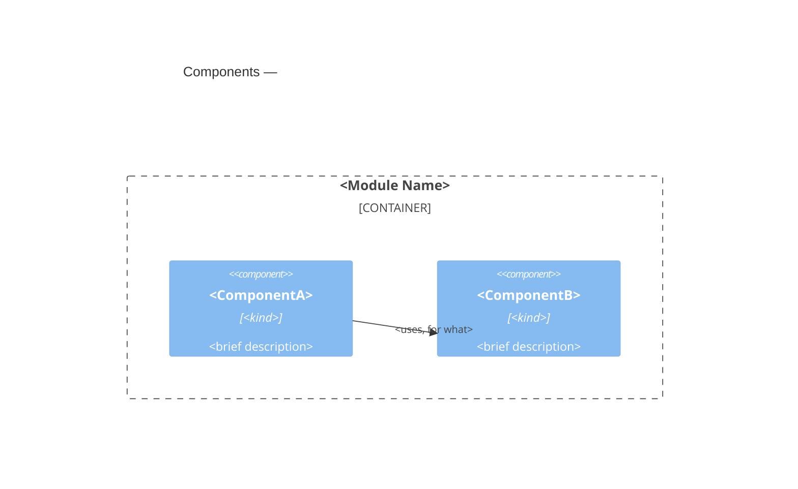

<!--
Template: Module Blueprint
Source: Architecture documentation framework. C4 mapping rules are
  defined in `shared/c4-standards.md`. Load it,
  `shared/blueprint-content-standards.md`,
  `shared/design-principles-guide.md`,
  `shared/design-principles-containers-guide.md`,
  and `shared/design-principles-components-guide.md` before
  authoring. A quoted rule name below, such as
  "Name owners, not neighbors", is the heading of a rule in the content
  standards.

Sections (complete each, then delete its instruction block)
  - Responsibility
  - Tech stack
  - Interface
  - Design
  - Components
  - Pattern guidance
  - Versioning and compatibility
  - Cross-cutting Standards
  - Change guidance
  - Key decisions
  - Open questions
  - References

Purpose
  Document one MODULE: a unit of software that crosses a boundary of
  independent change — it is shared or vended across containers on their
  own schedules (so versioning and compatibility are concerns), and/or
  it has internal components of its own worth documenting structurally.
  A module is composed INTO a container rather than deployed on its own;
  it owns no runtime data and no deployment of its own.

  Modules are most often shared libraries providing core capabilities
  many containers adopt — a logging framework, a design-system package,
  a client SDK, common web-framework middleware — as well as plugins in
  a plugin architecture, IaC modules, and micro-frontends. Some are not
  shared but are composite: a rules engine built from sub-engines inside
  a single container is a module by virtue of its internal structure.

  The dividing line from a component is the same one the framework draws
  for contract visibility: does it cross a boundary of independent
  change? A component does not — it is internal to one container and
  changes in lockstep with it; a module does. This framework's "module"
  is part of the deliberate C4 superset defined in `shared/c4-standards.md`.

Reader profile (apply with the tech-writer skill)
- Reader: an engineer or agent changing this module, or consuming it from a
  container that composes it.
- Knows: the containers that use it, not its internals.
- Wants: its interface, versioning and compatibility rules, and the change
  guidance feature work must respect.
- Budget: one focused read.
- Tone: matter-of-fact and exact. For a public module, name interfaces,
  versions, and compatibility promises. Link the code a rule depends on;
  don't describe what the code shows ("Link what the code reveals").
  Decisions and their alternatives belong in ADRs.

When to use — either trigger is sufficient
  - SHARED / PUBLISHED: the unit is vended or consumed across containers
    or systems, so versioning, compatibility, and vending become
    concerns. It MAY be atomic — an atomic shared library is still a
    module.
  - COMPOSITE: the unit has internal components of its own, with
    relationships among them, worth a Components roster.

  visibility — the highest-value classification; it gates change rules:
  public   — published to a registry (enterprise or public). Consumers
             are independent and may span majors, so backwards
             compatibility, deprecation windows, and a recorded change
             history are required (see Change guidance and Versioning).
  internal — not published; lives in the repo and evolves in lockstep
             with its consumers, so it may be refactored or broken
             freely in the same change as its consumers. Modules often
             start internal and are promoted to public once matured.

  kind:
  standard — the default: a single module instance.
  pattern  — a module type built repeatedly to the same design, where
             the blueprint governs how each new instance is built and is
             authoritative for every instance's conformance (one
             blueprint for "plugin", many plugins).

When NOT to use
  - An internal building block of a single container that is neither
    shared nor composite → component blueprint (the leaner leaf).
  - A unit with runtime elements of its own (a service, a worker, a
    queue) — that is a container or system (container blueprint /
    system blueprint).
  - The container this module is composed into → container blueprint.
  - An interface's shape and semantics → `contract-template.md`.

Edges — light on outward, authoritative on internal
  Each host [[container-<name>]] blueprint owns this module's edges to its
  siblings; point to the hosts ("Name owners, not neighbors"). WHERE a
  module has internal components, it DOES own the relationships among
  them, declared in the Components section.

Lifecycle migration
  WHEN an internal module is published to a registry, THEN its
  visibility becomes public: from that point backwards compatibility,
  deprecation windows, and a recorded change history apply (see Change
  Guidance). Modules commonly mature internal → public this way.
  WHEN a module gains runtime elements of its own (a service, a worker,
  a queue), THEN it has become a container or system: author the
  appropriate blueprint, mark this one retired, and point superseded_by
  at the successor. Its contract usually survives the move.
  WHEN a module stops being shared AND has no internal components, THEN
  it has become a plain component: fold it into the single consuming
  container (as a component blueprint or a roster entry) and retire
  this document.

Slug format
  module-<module-name>, lowercase kebab-case.
  Example: module-logging-client

Status vocabulary
  draft | ready-for-review | approved | active | retired

This is a living document — update it when the module changes. Remove
all HTML comment blocks after completing each section. WHILE status is
draft, the Open questions section MAY contain open questions or the
literal text "None."; remove the section when the document becomes
active.
-->

# <Module Name>

## Responsibility

<!--
One paragraph on why this module exists. Source and test roots go in the
source_paths and test_paths frontmatter, not in the body.
-->

### Owns

<!--
The responsibilities and data this module is the sole authority for.
-->

### Hides

<!--
The design decision likely to change that no other element may depend
on. Required, and "none" is not an answer: an element that hides no
decision is a candidate to merge into a neighbor.
-->

### Does not own

<!--
Each excluded responsibility, with its owner's [[slug]]
("Name owners, not neighbors"), each in its own paragraph.
-->

<Excluded responsibility> — [[<owner-slug>]] owns it.

### Composed into

<!--
Each host container. Its blueprint holds this module's relationships to
sibling components.
-->

[[container-<name>]] (one paragraph per host container); see those
blueprints for this module's relationships to sibling components.


### Vended as

<!--
How the module is vended and composed: package registry (npm, PyPI,
Maven), monorepo build target, plugin loaded at runtime, IaC module
registry, module-federation remote, or generated code.
-->

## Tech stack

<!--
The technologies this module is built from, one line each: language, frameworks, notable libraries it depends on, and how
it is built and packaged.
Name what a maintainer must know to read and change the code, not every
transitive dependency — the dependency manifest (go.mod, package.json,
pom.xml, …) is the source of truth for the full list.

Each line item MAY cite the ADR that decided the choice, as a trailing
[[adr-<nnn>]] link. Cite one WHEN such an ADR exists; an uncited line is
valid and records a choice nobody has yet needed to defend. Do not
author an ADR only to fill the slot. An ADR cited here SHALL also be
listed under Key decisions, which stays the complete index of decisions
governing this module.

Do not state dependency versions ("State only what must stay true"). WHEN
a version is contractual (a minimum supported runtime, a pinned
toolchain), state it as a requirement in EARS in Change guidance instead.

The frontmatter `technology` value is the short label diagrams draw; it
SHALL agree with the primary entries here.
-->

**<Category>:** <technology> — <what it is used for>. [[adr-<nnn>]]

**<Category>:** <technology> — <what it is used for>.

## Interface

<!--
What this module's hosts and consumers may depend on. If the interface is
formally specified and consumed across team boundaries, author a contract
document for it and reference it here instead of documenting the surface
inline.
-->

### Surface

<!--
The path or symbol that defines the interface: type definitions, plugin
API, or module schema ("Point the interface at its definition").
-->

`<path or symbol>`

### Provides

<!--
The postconditions consumers rely on, in EARS.
-->

The module SHALL <postcondition consumers rely on>.

The module SHALL NOT <thing consumers must not have to defend against>.

### Requires

<!--
The abstractions and contracts this module depends on, with their
preconditions, in EARS. List abstractions and contracts, not edges: a
module's edges belong to each host ("Name owners, not neighbors").
-->

WHEN <operation> is called, <abstraction or [[contract-<name>]]> SHALL
<precondition this module depends on>.

## Design

<!--
How the module is built to stay sound as it changes.
-->

### Patterns and principles

<!--
Each pattern the module follows. Draw on the universal guide, the
containers guide for how its components and submodules compose, and the
components guide for the code it holds directly. Name each pattern with
its progenitor, its roles mapped to this module's types, and the present
need it serves. State what it rules out as an invariant
("Name each pattern with its progenitor, constraint, and need"). Also name
entries from the components guide that all of the module's code follows.
-->

<Pattern> (<progenitor>) — <roles mapped to this module's types>; <the
present need it serves>.

### Invariants

<!--
EARS statements that hold across all operations, each ending "Enforced
by: <test, check, lint, or review only>" ("Say what enforces each invariant").
-->

The module SHALL <invariant that holds across all operations>.
Enforced by: <test, check, lint, or review only>.

### Extension points

<!--
Where the module is designed to grow, the intended way in, and the wrong
way to extend it. If it has none, write "None: <why it is closed>"
("State where the element grows").
-->

<Where it grows> — <the intended way in>. Not by <the wrong way to
extend it>.

## Components

<!--
OPTIONAL — include only WHEN this module has internal components of its
own. An atomic shared library (a logging client, a single-purpose SDK)
has none; delete this section for it.

The module's internal components — the container-like half of a module
blueprint. The components are DECLARED under the headings below; the C4
Component diagram is a view rendered from those declarations (see
`shared/c4-standards.md`). This module owns the relationships AMONG
these components.

Each declaration captures: the component's name (canonical — used
verbatim on diagrams), its technology or kind, a brief description that
doubles as the diagram's description text, and a detailed description.
The detailed description states the component's responsibility and the
decision it hides, never its functions, files, or other internals.
  - atomic internal component: a follow-on sentence or two here IS the
    detailed description, AND the declaration carries a machine-readable
    record block (see below);
  - an internal component or module with its own blueprint: link its
    [[component-<name>]] or [[module-<name>]] blueprint and do not restate its
    internals.

Machine-readable record (un-promoted components): every internal
component that does NOT have its own blueprint SHALL carry a fenced
record block immediately under its heading, holding entity_name, slug
and description (and optionally technology) — validated against the
shared element-record schema, the same schema a promoted component's
frontmatter satisfies:

    ```component
    entity_name: <Component Name>
    slug: component-<component-name>
    description: <one-line brief description>
    technology: <technology / kind>        # optional
    ```

WHEN such a component is promoted to its own blueprint, its record block
is lifted out into that document's frontmatter and replaced
here by an [[component-<name>]] / [[module-<name>]] link — never both.

Each component is declared under its own `### <Component Name>` heading
below — the heading is the canonical display name, matching the diagram.
Reference an un-promoted component with a wikilink heading anchor into
this roster, `[[module-<name>#Component Name]]`; reference a promoted one
by its own slug, `[[component-<name>]]`. The heading persists through
promotion, so anchor references survive it.

Follow the diagram with one paragraph per relationship: who depends on
whom, what crosses, and why.
-->



### <ComponentA>

```component
entity_name: <ComponentA>
slug: component-<component-a>
description: <one-line brief description>
technology: <technology / kind>      # optional; the technology line drawn on
                                     # diagrams — omit WHEN not meaningful
```

(<kind>) — <brief description, as it appears on diagrams>. <Detailed
description: its responsibility and the decision it hides.>

### <ComponentB>

See [[component-<name>]]. (<kind>) — <brief description>.

## Pattern guidance

<!--
kind: pattern only — delete this section otherwise.

Authoritative instructions for building a new instance of this module
type. The archetype is a plugin architecture: one "plugin" module
blueprint governs many plugins. Write conformance rules in EARS so an
instance can be reviewed against them, and keep a registry of instances.

WHEN an authoritative pattern document already exists outside the
framework (a pre-existing architecture or tenets doc), this blueprint
MAY wrap it rather than rewrite it: declare the pattern, its instances,
and conformance gates here, and reference the existing document (by
repo-relative path, per [[template-authoring-standards]]) as the detailed
specification.
-->

### Building a new instance

<!--
The steps to build a new instance, in order.
-->

1. <step>
2. <step>

### Conformance

<!--
The rules every instance meets, in EARS.
-->

Every instance SHALL <structural or behavioral rule all instances meet>.

Every instance SHALL NOT <divergence that would break the pattern>.

### Instances

<!--
One paragraph per instance: where it lives and how it differs
("Give each pattern instance one line").
-->

**<InstanceName>** (<container or repo>) — <target/variant>.

## Versioning and compatibility

<!--
visibility: public only — delete this section otherwise. This is the
version-awareness a published artifact needs: consumers may span
multiple majors and cannot be updated in lockstep.
-->

**Versioning scheme:** <semver | calver | pinned-by-consumer>

**Compatibility policy:** WHEN a breaking change is released, the
module SHALL <major bump / migration notes / support window for the
prior major>.

**Deprecation:** WHEN an API is deprecated, it SHALL remain functional
for <window> and SHALL emit <deprecation signal>.

## Cross-cutting Standards

<!--
Standards this module complies with, by reference. A shared module
complies with standards independently of any one host container.
Platform choices that apply everywhere are mentioned in prose or
standards docs, never modeled as elements on this module's diagrams —
see `shared/c4-standards.md`.
-->

This module SHALL comply with [[<standard-slug>]]: <one-line scope>.

## Change guidance

<!--
Rules for feature work touching this module: the constraints a feature
blueprint — and the planning agent downstream of it — must respect when
changing this module. Write normative rules in EARS. Gate rules on
visibility where it matters: a public (published) module must honor
backwards compatibility and record change history; an internal module
may break in lockstep with its in-repo consumers.

This section carries ARCHITECTURAL constraints: lockstep-update rules,
layering boundaries between internal components, regeneration
obligations. Invariants go in Design. It is not a task list or a
commands reference — reference the repository's build and contributor
docs for procedure rather than duplicating them (duplication drifts).
Constraints that span multiple modules or containers belong in a
cross-cutting requirements document referenced from Cross-cutting
Standards, not here.
-->

WHEN <a kind of change is made>, <the artifacts that must change
together> SHALL be updated in the same change.

WHILE visibility is public, the module SHALL preserve backwards
compatibility within a major version; WHEN a breaking change is
unavoidable, it SHALL bump the major per its versioning scheme and
record the change, its rationale, and a migration note in
<changelog / history location>.

WHILE visibility is internal, the module and its in-repo consumers
evolve together: a breaking change MAY be made in the same change as
the consumer updates, with no compatibility window.

### Verification gates

<!--
The gates in two groups ("Verify isolation tests always"), each gate in
its own paragraph. CI and downstream agents still run the full suite.
Feature Blueprints map their AC coverage "Verified by" column onto these
gates.
-->

#### Verify always

<!--
The isolation tests under test_paths, as runnable targets (test paths,
ids, or task names).
-->

#### Verify conditionally

<!--
Each wider suite, with the change that requires it, such as "WHEN the
public interface changes, run the integration suite."
-->

WHEN <condition>, run <the wider suite that condition requires>.

## Key decisions

<!--
One paragraph per significant decision: restate the outcome and reference
the ADR. The trade-off analysis lives in the ADR, not here.
-->

[[adr-<nnn>]] — <one-line statement of the decision>.

## Open questions

<!--
Optional, draft only. Track unresolved questions while the document is
a draft. WHEN a question is resolved, fold the answer into the relevant
section (or, for an architecture decision, record it as an ADR) and
delete it here. WHILE status is draft, the section MAY instead state the
literal text "None." (no checkbox) — the absence of questions is
information. Remove the whole section when the document leaves draft.
-->

- [ ] <open question> — <what is blocked on it, who decides>

## References

<!--
Optional. What a reader needs next, one paragraph each: [[slug]] for
documents in this corpus, a URL for anything outside it. Remove the
section when there is nothing to cite.

C4 mapping rules and diagram conventions are in this skill's
`shared/c4-standards.md`. Read it while authoring, but do not cite it
here: it is not a document in your corpus.
-->

[[container-<name>]] — the container(s) this module is composed into
