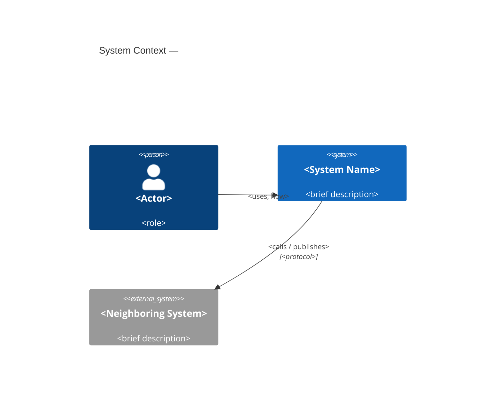
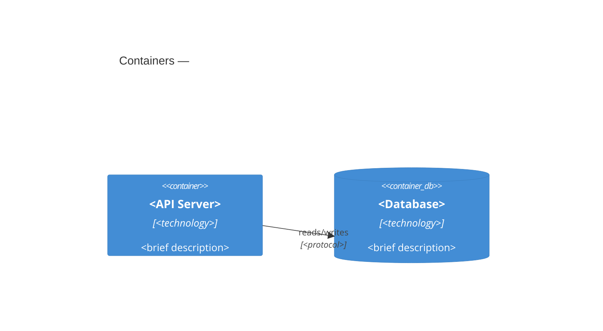

<!--
Template: System Blueprint
Source: Architecture documentation framework. C4 mapping rules are
  defined in `shared/c4-standards.md`. Load it,
  `shared/blueprint-content-standards.md`,
  `shared/design-principles-guide.md`,
  and `shared/design-principles-systems-guide.md` before
  authoring. A quoted rule name below, such as
  "Name owners, not neighbors", is the heading of a rule in the content
  standards.

Sections (complete each, then delete its instruction block)
  - Overview
  - System context
  - Containers
  - Design
  - Public Contracts
  - Consumed systems and Contracts
  - Deployment
  - Cross-cutting Standards
  - Change guidance
  - Key decisions
  - Open questions
  - References

Purpose
  Document one software system: the related capabilities it bundles, its
  context among neighboring systems and actors, the containers it is made
  of, the public contracts it provides, and how it deploys. This is the
  top-level architecture document for a system and the entry point for
  readers.

Reader profile (apply with the tech-writer skill)
- Reader: anyone starting on the system: a newcomer, a reviewer, or an agent
  planning feature work. This document is their entry point.
- Knows: the problem domain, not this system's structure.
- Wants: the system's context, its containers, public contracts, and
  deployment, and where to read next.
- Budget: one focused read.
- Tone: matter-of-fact, describing the system as it is. Favor the big picture.
  Decisions and their alternatives belong in ADRs.

When to use
  - Documenting a system your team owns (one blueprint per system)
  - A capability has runtime elements of its own — it IS a system (or part
    of one); document it here, not in a component blueprint

When NOT to use
  - A single deployable unit inside a system → container blueprint
  - A shared library, package, or complex component → component blueprint
  - An interface's shape and semantics → `contract-template.md`
  - Recording a decision's trade-offs → ADR (reference it from Key
    Decisions below)

System boundary
  System boundaries SHOULD be domain-centric: a system bundles related
  capabilities within one business domain or subdomain. Team ownership
  drawn along domain lines yields the same boundaries indirectly. In
  practice, accommodate boundaries however the enterprise has drawn
  them — this blueprint documents the architecture as it is. WHERE
  history has left a container in a system it does not belong to, keep
  it in this blueprint and document the misplacement in the Containers
  section: mark it "not for external use" and name the system it
  should belong to. See `shared/c4-standards.md`.

Diagrams
  Diagrams are views rendered from the element declarations in this
  document and the blueprints it links — declare first, then draw. Embed
  Mermaid C4 diagrams (C4Context, C4Container, C4Deployment) or link
  rendered views from your modeling tool. Every element on a diagram
  SHALL be declared in prose or frontmatter; see `shared/c4-standards.md` for the
  declaration format and for what to model as an element vs mention in
  prose.

Slug format
  system-<system-name>, lowercase kebab-case. Example: system-notifications

Status vocabulary
  draft | ready-for-review | approved | active | retired

This is a living document. Update it when the architecture changes — a
system blueprint describes the system as it is, not as it was planned.
Remove all HTML comment blocks after completing each section. WHILE status
is draft, the Open questions section MAY contain open questions or the
literal text "None."; remove the section when the document becomes active.
-->

# <System Name>

## Overview

<!--
1-2 paragraphs: the related capabilities this system bundles, who it
serves, and why it exists as a distinct system. Name the owning team. Do
not describe internal structure here — that is what the sections below
are for.
-->

## System context

<!--
A C4 System Context diagram: this system, the people who use it, and the
neighboring systems it exchanges data with. Follow the diagram with one
short prose paragraph per external relationship: direction, what crosses
the boundary, and why. Reference the governing contract with [[slug]] where
one exists (or the vendor's published contract URL for third-party
systems).
-->



## Containers

<!--
The containers are DECLARED in the list below; the C4 Container diagram
is a view rendered from those declarations (see `shared/c4-standards.md`). Each
declaration captures: the container's name (canonical — used verbatim on
diagrams), its technology, and a brief description that doubles as the
diagram's description text. Each declaration states the container's
responsibility only, and "State only what must stay true" applies to the
brief descriptions.

The detailed description of an active container lives in its
[[container-<name>]] blueprint — do not restate internals here. Passive
containers (data stores, buckets, queues this system owns but did not
implement) have no blueprint of their own: give their detailed
description here (what they hold, which container owns the schema).
Their published surface, if any, is a contract.

Mark any container that exists here for historical reasons: state that
it SHALL NOT be consumed from outside the system, and name the system it
should belong to.
-->



**<Container Name>** ([[container-<name>]]; <technology>) — <brief
description, as it appears on diagrams>.

**<Data Store Name>** (<technology>) — <brief description>. <Detailed
description: what it holds, which container owns its schema.>

## Design

<!--
How the system is built to stay sound as its containers change.
-->

### Integration style and patterns

<!--
How the containers interact and stay consistent, for example
Event-Driven Architecture, with a Saga for each transaction that spans
containers. Draw on the universal guide and the systems guide. Name each
pattern with its progenitor, the roles its containers play, and the
present need it serves. State what it rules out as an invariant
("Name each pattern with its progenitor, constraint, and need").
-->

<Pattern> (<progenitor>) — <the roles its containers play>; <the
present need it serves>.

### Invariants

<!--
EARS statements that hold across the system, each ending "Enforced by:
<test, check, lint, or review only>" ("Say what enforces each invariant").
-->

The system SHALL <invariant that holds across containers>.
Enforced by: <test, check, lint, or review only>.

### Extension points

<!--
Where a new container or integration joins, the intended way in, and the
wrong way to extend the system. If it has none, write "None: <why it is
closed>" ("State where the element grows").
-->

<Where a new container or integration joins> — <the intended way in>.
Not by <the wrong way to extend it>.

## Public Contracts

<!--
The interfaces this system provides for consumers OUTSIDE the system —
its integration surface. One line per contract, linking the [[contract-slug]].
Shape and semantics live in the contract documents; do not restate them.

Interfaces used only between this system's own containers are internal
contracts — list them in the providing container's blueprint, not here.
-->

[[contract-<name>]] — <what it vends, to whom, via what mechanism>.

## Consumed systems and Contracts

<!--
What this system depends on: neighboring systems, platform services, and
the specific contracts consumed. One line each. Cross-cutting platform
obligations (logging, authN, mesh) are standards, not dependencies — see
the next section.

Third-party (SaaS) interfaces are governed by the vendor's published
contract: reference it by URL. contract documents exist only for
interfaces the organization provides — SHALL NOT be authored for
third-party interfaces.
-->

[[contract-<name>]] (provided by <system>) — <what we use it for>.

<Vendor / SaaS product> — <what we use it for>; contract:
<URL to the vendor's published specification>.

## Deployment

<!--
The authoritative deployment views for this system, one C4 Deployment
diagram per environment WHERE topology differs across environments.
Container blueprints MAY carry a container-scoped deployment view; those
are filtered views of the model shown here and defer to this section on
shared topology.
-->

### <Environment>

```mermaid
C4Deployment
    title Deployment — <System Name> (<environment>)
    Deployment_Node(cloud, "<Region / Account>", "<provider>") {
        Deployment_Node(cluster, "<Cluster / Runtime>", "<tech>") {
            ContainerInstance(api)
        }
    }
```

## Cross-cutting Standards

<!--
The standards and platform obligations this system complies with, by
reference. Never restate a standard's requirements here.
-->

This system SHALL comply with [[<standard-slug>]]: <one-line scope of the standard>.

## Change guidance

<!--
Rules for feature work touching this system as a whole: the constraints
a feature blueprint — and the planning agent downstream of it — must
respect when a change spans containers. Write normative rules in EARS.

This section carries system-level architectural constraints:
cross-container lockstep-update rules and boundary rules for what may talk
to what. Invariants that hold across containers belong in Design.
Constraints scoped to a single container belong in that
[[container-<name>]] blueprint's Change guidance, not here.
Organization-wide rules belong in a cross-cutting requirements document
referenced from Cross-cutting Standards.
-->

WHEN <a change spans containers>, <the artifacts that must change
together> SHALL be updated in the same change.

### Verification gates

<!--
The gates in two groups ("Verify isolation tests always"), each gate in
its own paragraph. Feature Blueprints map their AC coverage "Verified by"
column onto these gates.
-->

#### Verify always

<!--
The system-level suites every cross-container change runs, as runnable
targets.
-->

#### Verify conditionally

<!--
Each wider suite (integration, end-to-end, contract tests), with the
change that requires it.
-->

WHEN <condition>, run <the wider suite that condition requires>.

## Key decisions

<!--
One paragraph per significant decision: restate the outcome and reference
the ADR. The trade-off analysis lives in the ADR, not here.
-->

[[adr-<nnn>]] — <one-line statement of the decision>.

## Open questions

<!--
Optional, draft only. Track unresolved questions while the document is
a draft. WHEN a question is resolved, fold the answer into the relevant
section (or, for an architecture decision, record it as an ADR) and
delete it here. WHILE status is draft, the section MAY instead state the
literal text "None." (no checkbox) — the absence of questions is
information. Remove the whole section when the document leaves draft.
-->

- [ ] <open question> — <what is blocked on it, who decides>

## References

<!--
Optional. What a reader needs next, one paragraph each: [[slug]] for
documents in this corpus, a URL for anything outside it. Remove the
section when there is nothing to cite.

C4 mapping rules and diagram conventions are in this skill's
`shared/c4-standards.md`. Read it while authoring, but do not cite it
here: it is not a document in your corpus.
-->
