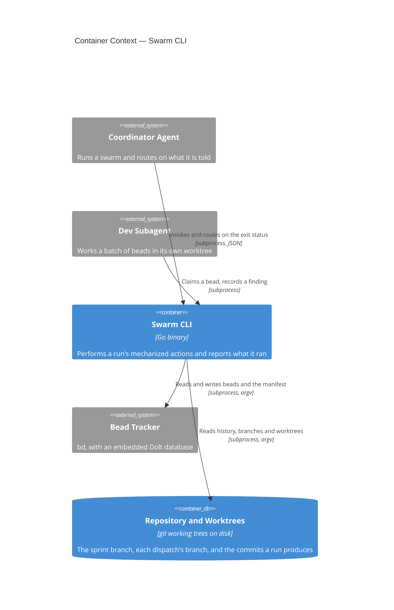

# Swarm CLI

## Overview

The Swarm CLI is the executable substrate under the `bead-bonanza` skill
family. Those skills describe a distributed system whose control plane is
documentation: its invariants are prose, and most of that prose exists to
warn an agent away from an invocation that returns the wrong answer at
exit 0. This container takes the highest-value of those actions and makes
each one a command whose verdict is an exit status.

It is deliberately not an orchestrator. It spawns no agent, arms no
monitor, schedules nothing and holds no state of its own; it is invoked
from inside an existing harness, does one thing, and returns. Every fact
it reports comes from the bead tracker or from git, and it names the
invocation behind each one so a caller can re-run it.

[[frd-swarm-core]] is the first of the feature requirements documents it
serves — the command contract, the run manifest, and status — and this
blueprint describes the container as a whole rather than that one
feature.

- **Responsibility:** perform a run's mechanized actions against the
  tracker and git; report every fact with the command that established
  it; own the process-level concerns those actions imply — argument
  parsing, plan rendering, output format, and exit status.
- **Technology:** Go, `cobra` for the command tree, `os/exec` for every
  external invocation. See [[adr-023]] for the language and packaging
  decision.
- **Runtime:** a single statically linked binary, invoked per command.
  No daemon, no persistent process, no network listener. It shells out to
  `bd` and `git`, which must be on `PATH`.

## Container Context



**Coordinator Agent → Swarm CLI.** The coordinator is the CLI's principal
caller and the reason its exit vocabulary is a contract: it decides
whether to repair, stop or carry on from the status alone, without
reading the output. It holds the scarcest context in a run, which is why
the commands it calls most are the ones that replace several queries with
one answer.

**Dev Subagent → Swarm CLI.** A subagent working a batch calls a much
smaller surface — what is in my queue, claim this bead, record this
finding — from inside its own worktree. It never merges, never pushes,
and never calls a command that mutates run-level state.

**Swarm CLI → Bead Tracker.** Every read and write of a bead, an edge or
the run manifest goes through the tracker as a subprocess invocation with
an argv vector. The CLI depends on the tracker's command surface and on
the JSON shape of each subcommand it uses; that dependency is confined to
one component per [[adr-025]], so a tracker upgrade that changes a shape
changes one decoder. The tracker's own contract is its published command
documentation, not a document this repository owns.

**Swarm CLI → Repository and Worktrees.** git is invoked the same way,
for history, branches, worktrees, merges and pushes. The repository is
not exclusively owned by this container — subagents and humans commit to
it — which is why every command reads it at the moment it acts rather
than from anything remembered.

## Components

**Every dependency on something outside this process is an interface with
one implementation beside it**, named for the role and the technology
respectively. That is the seam the unit tier replaces with a fake, and
the seam a second tracker would arrive at. A reader can tell which
components are coupled to `bd` and to `git` by their names alone.


### Swarm Command Surface

```component
title: Swarm Command Surface
slug: component-swarm-command-surface
description: Command tree, flag parsing, output rendering and the exit status a caller routes on
```

(Go, `cobra`) — Command tree, flag parsing, output rendering and the exit
status a caller routes on. It owns the conventions [[frd-swarm-core]]
specifies for every command: the required run scope, `--explain`,
`--dry-run`, `--json`, `--full-result`, and the mapping from an outcome to
one of four statuses. It contains no knowledge of the tracker or of git;
it resolves arguments, asks a command to build a plan, hands the plan to
the mode the flags selected, and turns what comes back into YAML or JSON
and a status.

It lives at `cli/swarm/cli`. A subcommand supplies two functions — build
the plan, and turn the plan's report into facts and an outcome — and
nothing else: the five flags, the scope refusal, the mode selection, both
renderings and the exit status are the surface's, so no command
implements any of them a second time.

- **A command reports an outcome; the status is derived from it**, so the
  two cannot disagree. An outcome the surface does not recognise is
  treated as a condition the caller cannot repair in place rather than as
  a success, because defaulting to success is the silent failure this
  container exists to remove.
- **The scope is checked before the mode is resolved**, so a command
  refusing an empty run scope has read and written nothing — that is the
  guarantee, not just the status.
- **Two renderings of one value.** YAML and JSON come from one node
  tree, so they carry the same values in the same order rather than being
  two renderers kept in agreement. `--json` selects a syntax and
  `--full-result` selects a depth: two independent choices, four
  combinations, all four defined. The full result is emitted on every
  exit status, carries the contract version, and reports a duration as an
  integer count of milliseconds rather than a formatted one, since the
  contract forbids a field whose meaning depends on the producing
  process's locale.
- **A fact with no invocation behind it cannot be rendered.** The surface
  refuses such a result rather than printing it, and refuses an attention
  outcome that names no resolution — both are contract obligations, and
  enforcing them here is what makes them true of every command rather
  than of the ones that remembered.
- **The plan runner's output is captured rather than streamed**, so a
  `--json` envelope is never preceded on standard output by transcript
  lines that would corrupt it, and both forms carry the same transcript.
- **A subcommand may declare flags of its own**, bound after the five
  every subcommand carries — so a subcommand cannot redeclare one of them
  without cobra saying so.
- **Every command prints its answer, and the full result is asked for.**
  The answer is the properties the command established and their values;
  `--full-result` renders the whole result instead, and `--explain` and
  `--dry-run` imply it, because what they produce is the plan and nothing
  else. Both shapes go to standard output, so one redirect captures
  whichever arrives and the caller routes on the status to know which
  they are holding.
- **When the plan's ordering guard stops a command, the stopping step's
  reason is what the caller is told.** Reading the fragment's answer
  instead would report "the last step produced no value", which is true
  and useless.
- **`swarm status` is the one command that does not supply a plan and an
  interpretation.** The Status Collector's completion walk queries one
  level of the run's tree at a time, with the next query depending on
  what the last one answered, so there is no fixed sequence to render
  before running it — a plan has to be a value a test can compare without
  starting a process, and a walk of unknown depth is not one. It declares
  the five contract flags itself instead, and reuses the surface's own
  exit-status mapping and both renderings, so those two stay properties of
  the surface rather than a second copy of them. Explain still measures
  nothing: it describes what the collector would query rather than
  printing a plan it cannot know the shape of, per the Status Collector's
  own note on this.

The tree so far is `swarm manifest get | set | require | validate` and
`swarm status`. `manifest` is a noun with no `RunE`: it cannot be
invoked, and cobra prints its verbs instead — so the rule that every
subcommand carries the contract flags is about the leaves, and that is
what the surface's own test walks.

**`get` is the lookup**: `--key <k>` answers with that key and its value,
no key answers with every key the record carries, and several keys answer
with just those. A value carrying whitespace, a newline or a leading dash
arrives intact because a multi-line value is rendered as a block scalar
and a hazardous one-line value is quoted — the style rules the standard
below fixes, rather than a form of this command's own.

A manifest value is reported with the fact kind its JSON has — text,
count, flag, list, or **structured** for an object or a list of them,
which the renderer emits as nested YAML rather than as an escaped
string.

**`require` reports the same values `get` reports.** It is the caller
saying "I need these keys, now, and I am about to use them", so it means
"set to a VALID value" and not merely "set": a key written with a value
of the wrong type fails it, and reports the value it holds beside what is
wrong with it. Whether every key is satisfied is the exit status;
reporting a verdict where a value belongs would put a different quantity
under the key's own name. `validate` without `--stage`
validates against the stage the record has reached and reports both the
stage and that it was derived, since a caller reading a clean result has
to know what it was clean against.

**What both renderings contain is
[[swarm-output-standards]]'s** — YAML by default and JSON under
`--json`, the answer alone unless `--full-result` is asked for, the
per-property verdicts a failing invocation renders, and the style rules
that keep the two forms readable. It is a standard over every subcommand
rather than a property of any one of them, which is why it is stated
there and enforced here.

### Plan Runner

```component
title: Plan Runner
slug: component-plan-runner
description: Builds an ordered plan of step values and interprets it as explain, dry-run or execute
```

(Go) — Builds an ordered plan of step values and interprets it as
explain, dry-run or execute. A step describes one invocation, how to
decode its result, what happens when it fails, and whether re-running it
is safe; the plan is the whole sequence including the alternative arms of
any branch. The ordering guard lives here rather than at call sites — a
step declaring that failure stops the plan is honoured by the
interpreter, so no command can chain a removal after a failed merge.
Per-step timing and the audit line each command prints are derived from
the step value. See [[adr-024]].

It lives at `cli/swarm/plan`. Three facts about the built component that
a caller has to know and cannot read off the roster:

- **A plan is validated before anything is printed or run** — a duplicate
  step name, or an argument taken from a step that is not strictly
  earlier, is refused up front rather than partway through. That check is
  what makes "produced by an earlier step" a property of the plan rather
  than a convention.
- **The explain transcript is POSIX `sh`.** Comments carry the step's
  name, its declarations and each branch's condition; the invocations are
  quoted so a reader can paste one. A reference argument renders as
  `'<from step: NAME>'`, which is one shell word and visibly a
  placeholder. On a Windows shell a reader adapts the transcript, which is
  a cost of the transcript being text rather than an argv vector.
- **A failed step publishes no value**, so a later step referencing it is
  skipped with its reason recorded rather than being handed whatever the
  failing tool printed.
- **A step may declare the exit statuses it answers with.** Some tools
  report an answer through the status rather than the output —
  `git merge-base --is-ancestor` exits 1 for "no" — and without the
  declaration a legitimate "no" would trip the ordering guard and publish
  no value, which is the mirror image of the failure-read-as-a-pass this
  container exists to remove. A status the step did not declare is still
  a failure.

The per-step record carries a digest of each stream — `sha256:<hex>`,
separately per stream — rather than the bytes: a record is an audit line,
and carrying every byte of every tool's output would put tracker contents
into a report meant to be shareable while making it unreadable. The digest
still detects a step whose output changed between two runs.

### Process Runner

```component
title: Process Runner
slug: component-process-runner
description: Runs one external invocation as an argv vector with separated streams and a status read from the process
```

(Go, `os/exec`) — Runs one external invocation as an argv vector with
separated streams and a status read from the process, and records how
long it took. It is the only component that starts a process, which is
what makes the four properties of [[adr-025]] structural rather than
conventional, and it is the seam the unit tier replaces with a fake that
replays recorded output. It knows nothing about what it is running: the
argv and the decoder both arrive from the step.

A non-zero exit is data on the result rather than an error — a tool
answering no is a successful invocation of it — and the error return is
reserved for an invocation that produced no status at all, which is what
keeps a missing executable distinguishable from a tool that answered no.

It lives at `cli/swarm/exec`, and its fake at `cli/swarm/exec/exectest`.
The fake being test-only is enforced rather than asserted: a test in the
runner's own package parses every non-test source file in the module and
fails if any of them imports the fake, because a fake reachable from
production code is a way for a command to report an answer it never
obtained.

### Tracker

```component
title: Tracker
slug: component-tracker
description: The interface stating what a run needs from an issue tracker, independent of which one
```

(Go interface) — The interface stating what a run needs from an issue
tracker: reading a bead, its children and its metadata; the ready set
under a scope; writing a status, an assignee, a label, a comment and an
edge. It names operations in the run's vocabulary rather than any
tracker's, which is what makes a second implementation a matter of
satisfying it rather than of rewriting the callers.

It lives at `cli/swarm/tracker`. Three things about the built interface
that the roster line does not carry:

- **Every operation returns a plan step, not a result.** An
  implementation declares an invocation and how to decode it; the Plan
  Runner is what runs it. That is what keeps a tracker read visible to
  explain mode and under the plan's ordering guard.
- **An edge operation names its direction.** `BlockedBy(bead, blocker)`
  and `DiscoveredFrom(bead, origin)` rather than one `Link(from, to)`,
  because a generic pair is one argument order away from inverting every
  dependency it writes, at exit 0.
- **A bead's state is the run's word, and the tracker's own string is
  kept beside it.** A status the vocabulary does not cover becomes
  `unknown` rather than any of the others, so a tracker release that adds
  one is visible instead of making every bead carrying it read as open.

**`Descendants` is a walk, and lives here rather than in an
implementation.** "Every bead in this run" is not a query any tracker
answers: measured on bd 1.2.2 against this repository's own database,
`bd list --parent <run>` returns the run's direct children only, while
`bd ready --parent <run>` is transitive but returns only what is ready.
So the set is derived level by level, one plan per level, with each
invocation still a recorded step. A cycle terminates, an empty scope is
refused, and a level that failed is an error rather than a shorter
answer — an incomplete set reported as whole is the failure this
container exists to remove.

### Beads Tracker

```component
title: Beads Tracker
slug: component-beads-tracker
description: The Tracker implemented over the bd command line, one decoder per subcommand
```

(Go) — The Tracker implemented over the `bd` command line. Each
subcommand it uses has a decoder that knows that subcommand's result
shape, which is where the measured non-uniformity is confined: an empty
result comes back as a bare null from one subcommand, an empty array from
several and an object from others, all at exit 0, so each decoder
normalizes its own subcommand's empty forms rather than a shared guard
doing it for all of them. This is the only component that knows the word
`bd`.

It lives at `cli/swarm/tracker/beads`, and "only this component names the
tool" is enforced rather than asserted: a test parses every non-test
source file under `cli/swarm` and fails if any outside that package
carries the executable's name as a string literal.

The shapes each decoder pins, measured on bd 1.2.2 against this
repository's own database, are why there is a decoder per subcommand
rather than one guard:

| invocation | at exit 0 | on failure |
|---|---|---|
| `bd show <id> --json` | an array of one issue | exit 1, an **object** carrying `error` on **stdout** |
| `bd list --parent <id> --json` | an array; empty is `[]` | — |
| `bd ready --parent <id> --json` | an array; empty is `[]` | — |
| `bd update <id> … --json` | an array of the updated issue | exit 1, **stdout empty**, message on **stderr** |
| `bd comment <id> <text> --json` | an **object** | — |
| `bd dep add <a> <b> --json` | an **object**, `status:"added"` even when the edge already existed | exit 1, an object carrying `error` on stdout |
| `bd gate list --json` | an array; empty is a bare **`null`** | — |

Two failure shapes and four container shapes, all but the failures at
exit 0. The two rules that a shared guard gets wrong are both in that
table: "treat any non-array as empty" reports a written comment as one
that was not written, and "read stderr on failure" reports `bd show`'s
message as absent. Absent, `null` and `[]` normalize to one empty value
per subcommand; any other shape is an error, because a shape a decoder
does not know is not evidence of emptiness.

`bd` also writes standing warnings to stderr while its JSON goes to
stdout, which is why nothing here reads a merged stream and why a
decoder reporting a failure takes the last line rather than the first.

### Version Control

```component
title: Version Control
slug: component-version-control
description: The interface stating what a run needs from version control, independent of which system
```

(Go interface) — The interface stating what a run needs from version
control: history and commit subjects, branches and their ancestry,
worktree registrations, merges, and the comparison of a local branch
against its remote. Stated in the run's vocabulary — a dispatch's branch,
the sprint branch, a standing worktree — rather than in any one system's.

It lives at `cli/swarm/vcs`. Its operations return a **fragment** — an
ordered slice of steps whose last one carries the answer — rather than a
single step, because one of them genuinely needs two invocations: reading
the standing worktrees means clearing stale registrations first. An
interface where one method returned a fragment and the rest returned
single steps would be one a caller has to remember the shape of. The
Tracker's operations are each a single invocation and return a bare step;
if one ever needs two, this is the type it takes.

### Git Version Control

```component
title: Git Version Control
slug: component-git-version-control
description: Version Control implemented over the git command line, one decoder per subcommand
```

(Go) — Version Control implemented over the `git` command line, with a
decoder per subcommand as the tracker implementation has. Registration
pruning belongs here, because a stale registration reads as a live
worktree to everything above it. This is the only component that knows
the word `git`, and that is enforced the same way the tracker's half is:
a test parses every non-test source file under `cli/swarm` and fails if
any outside `cli/swarm/vcs/git` carries the executable's name.

Measured on git 2.43.0, in this repository and in a scratch repository
for the case that needs a deliberately broken registration:

| invocation | what it does |
|---|---|
| `git worktree list --porcelain` | exit 0. A registration whose directory was deleted is **still listed**, with a `prunable <reason>` line — so it reads as a live worktree |
| `git worktree prune` | exit 0, and the stale entry is gone |
| `git merge-base --is-ancestor A B` | **exit 0 yes, exit 1 no, exit 128 when a revision does not resolve** |
| `git rev-parse <missing>` | exit 128 — **and it echoes the argument on stdout**, so a decoder reading stdout before the status takes a branch name for a commit id |
| `git rev-list --count --left-right <b>...<b>@{upstream}` | exit 128 with "no upstream configured" when there is none, which is a condition rather than a crash |

Three consequences the code carries:

- **Worktrees prunes and then lists, and the list's decoder drops
  prunable entries too.** The prune is a write, so a dry run refuses it;
  the filter is what keeps the answer right in that one mode.
- **Ancestry's answer is its exit status**, which is why the step
  declares 1 as an answer beside 0 while leaving 128 a failure. Reporting
  an unresolvable revision as "not an ancestor" is the answer that would
  let a dispatch branch cut from the wrong base pass its own guard.
- **A commit is read through a requested format with NUL separators**,
  never out of a rendered log. A run's own commit subjects carry a bead
  id, a priority and a title, and a subject may contain anything.

### Manifest

```component
title: Manifest
slug: component-manifest
description: The run record's model — its declared key set, its types and stages, its merge semantics and its logical validation
```

(Go) — The run record's model: the declared key set, each key's type and
the stage at which it becomes required, the merge semantics, and every
logical rule — a branch written once, a counter that never goes
backwards, an append-only ledger, three admission lists that do not
overlap. It holds no knowledge of where the document lives; it asks a
Manifest Store for the document and hands one back. That split is what
makes moving the record somewhere else a change to one small component
rather than to the validation this container is mostly made of.

It lives at `cli/swarm/manifest`, and **it does not write the key set
down**: it reads the declaration by reflection off the generated model,
so a key's name, its type and its stage reach reading, requiring and
validating from the one place they are declared. A key added to
`schemas/swarm/manifest.strata` is known to all three at once, and this
component cannot hold a fourth opinion about any of them.

Three consequences worth stating, because each is a state a reader would
otherwise have to guess at:

- **A key that is absent reads as absent**, never as an empty value of
  its declared type. "Not yet written" and "written as nothing" are
  different states of a run.
- **A key this version does not know is preserved.** The record is not
  exclusively owned, and a reader that rewrote only what it understood
  would delete the rest.
- **A refused write reports every reason and stores none of them.** A
  caller that fixed one refusal and re-ran to find the next would be
  doing the work the check exists to do.

**A key whose absence is legitimate at every stage has no stage**, and
that is said by where it is declared: on `RunManifest` itself rather than
in a stage struct. Validation does not report such a key at all — a reader
told "pending" would wait for something that is never coming. That is the
whole of what having no stage means: the key is declared, so reading,
requiring and writing it all resolve it, and its declared type is still
enforced. `trailers` is the one today.

**The logical rules are the ones no single write can check on its own**,
and each is a rule identifier a caller can act on rather than a message
it has to read:

| rule | what it refuses, and why |
|---|---|
| write-once | a different `branch` or `base_sha`. Three things read them — the review scopes its diff from the base, every worktree branches from the branch, the pull request opens against it — so a run that repointed either mid-flight would leave the three describing different trees. Re-writing the SAME value is not a change, which is what lets a resumed run reuse its branch |
| counter backwards | a lower `review_passes`, because a resumed run that restarted the counter would loop forever |
| counter over budget | a `review_passes` past the `review_budget` beside it |
| ledger rewritten | an entry removed, reordered or altered. Dispatch prompts cite entries by position, so a rewrite retargets every citation that addressed one — and nothing downstream can tell |
| admission overlap | a bead in more than one of `admitted`, `excluded` and `moved`. The finding names the BEAD rather than the lists, because the bead is what somebody has to decide about |
| effort unrecorded | an absent `effort` past its stage. A harness exposing no such setting records `unrecorded`, so a reader can tell "not offered" from "not yet written" |

### Manifest Store

```component
title: Manifest Store
slug: component-manifest-store
description: The interface for reading and writing the manifest document, wherever it is kept
```

(Go interface) — The interface for reading and writing the manifest
document: fetch it whole, and write it back conditionally on it not
having changed since the fetch. Conditional writing is in the interface
rather than in the model because it is a property of the store, and the
concurrent-write refusal cannot be implemented above a store that does
not offer it.

### Beads Manifest Store

```component
title: Beads Manifest Store
slug: component-beads-manifest-store
description: Manifest Store over a beads run epic's metadata object, the one place the record lives today
```

(Go) — Manifest Store implemented over the run epic's **beads** metadata
object, which is where the record lives today. It carries the two
measured constraints of writing there: the per-key write parses JSON
scalars but stores arrays and objects as strings, and the whole-object
write merges at the top level while replacing a nested value wholesale.

**Named for beads rather than for trackers in general, deliberately.** An
arbitrary JSON object attached to an issue is a beads feature, not a
property of issue trackers; this project has not established which other
trackers offer one, and the attempt to check from this environment was
blocked by the egress proxy. So the Tracker interface does not carry a
metadata-blob operation, and a store for a tracker without one would keep
the record somewhere that tracker does have — a fenced block in the
epic's body, a pinned comment, a per-issue property API — and satisfy the
same Manifest Store interface. Which of those any given tracker supports
is unestablished here and is that store's author's problem, which is the
point of the seam.

It reaches beads through the Beads Tracker rather than invoking `bd`
itself, so the rule that only two components name a tool still holds. The
metadata write it needs is a method on the Beads Tracker's concrete type
and not on the Tracker interface, which is what keeps the interface free
of an operation only one tracker is known to offer.

It lives at `cli/swarm/manifest/beads`. **A conditional write is a
two-step fragment: a read whose decoder is the guard, then the write.**
The comparison happens in the decoder, so a key that moved makes the
guard fail and the plan's own ordering policy is what stops the write —
there is no conjunction to write and none to forget. The payload is known
when the fragment is built, because the record's store merges at the top
level: writing only the covered keys leaves every other key exactly as
another writer left it, and the whole fragment stays renderable before
anything runs.

A key that was **absent** when the caller read must still be absent, and
a key another writer added since is as much a concurrent change as one
they altered. Two values are compared by their decoded content, so a
re-encoding that spaced an object differently is not mistaken for a
change.

### Status Collector

```component
title: Status Collector
slug: component-status-collector
description: Takes a run's measurements from the tracker and version control, and records what it could not establish
```

(Go) — Takes a run's measurements and returns them as a value: the
standing worktree count, the timestamp and age of the last commit, the
depth of the ready front, each dispatch's drain state from its two
queries, the completion walk, and the delta between the live queue and
the admitted set. It walks the run's descendants itself rather than
asking for them, because the tracker's parent-scoped queries answer three
different questions and none of them is "every bead in this run". It
formats nothing and decides nothing; a measurement it could not take is
recorded as unestablished.

It lives at `cli/swarm/status`. Three properties are worth stating,
because each is a place the obvious implementation is wrong:

- **Each measurement is its own plan.** A plan stops at its first failed
  step — that ordering guard is what stops a command chaining a removal
  after a failed merge — so folding six independent reads into one plan
  would let the first failure erase five measurements that were
  perfectly takeable. A source that cannot answer costs exactly the line
  it was measuring.
- **A dispatch is matched to its worktree through the bead its HEAD
  commit closed**, never through the tree's branch name: the mechanism
  that creates a dispatch's worktree does not control that name — measured
  against this harness's own worktrees, whose branches read
  `worktree-agent-<hash>`, carrying no dispatch id at all. The commit's
  subject names the bead (`<id> P<priority> <title>`, the `bb-close-bead.sh`
  convention) and that bead's own `.assignee` names the dispatch.
  Detachment plays no part either way — a detached worktree's HEAD is a
  commit like any other. A worktree whose HEAD is not shaped like a
  bead's own close, or whose bead this run's walk did not find, matches
  nobody, and that is the safe direction: an unmatched tree is reported
  standing rather than attributed to an agent that does not own it.
- **It executes.** Explain and dry-run are the command surface's modes
  and belong to the command that renders the measurements; a collector
  asked to explain would return a set in which nothing was established,
  which is not what a reader of `--explain` is asking for.

A run with no `branch` in its manifest has no history to measure, and
that is reported as unestablished rather than measured against `HEAD`:
`HEAD` in the process's own directory is whatever the caller happens to
have checked out, so an age taken from it would be a real number about
the wrong tree.

### Status Reporter

```component
title: Status Reporter
slug: component-status-reporter
description: Turns a measurement set into the report a caller reads and the exit status it implies
```

(Go) — Turns a measurement set into the report a caller reads and the
exit status it implies. It names the threshold it compared the last
commit's age against, states that whether a subagent is still working is
not observable from outside the harness, and never asserts that a run has
stalled. Separating it from the collector is what lets the report's
wording and its status be tested against a fixed measurement set, with no
subprocess anywhere in the test.

## Provided Contracts

**Internal** (this repository's skills only — SHALL NOT be consumed
outside it). The `bead-bonanza` skill family is its whole audience, and
no consumer outside this repository is anticipated:

- [[contract-swarm-json]] — the JSON every command emits under `--json`,
  and the run manifest this container reads, validates and writes. Shape
  is fixed by Strata schemas ([[adr-016]]) and generated from them;
  that document carries the semantics and the change policy.

The manifest is in a contract rather than in the Data section below
because this container is not its only writer: several skills write keys
into the same object during migration, which makes them
independently-built consumers of its shape.

## Consumed Contracts

- **`bd` (the bead tracker)** — used for every read and write of a bead,
  an edge, a gate and the run manifest. Third-party: its contract is its
  own published command documentation,
  https://github.com/gastownhall/beads. This container depends on the
  subcommands it invokes and on each one's result shape.
- **`git`** — used for history, branches, worktrees, merges and the
  comparison of a branch against its remote. Third-party: its contract is
  its published documentation, https://git-scm.com/docs.

## Data

This container owns no store. Everything it reads and writes lives in
something another party also writes, which is the constraint most of its
behaviour follows from.

- **The run manifest** (JSON in the run epic's tracker metadata) — the
  run's only durable record. Not exclusively owned: the sprint skills
  write keys into the same object today, and will continue to during
  migration, which is why its shape is [[contract-swarm-json]] rather
  than a private schema. Schema source of truth:
  `schemas/swarm/manifest.strata` — a Strata package of its own, which
  generates `cli/core/schema/swarm-model.schema.json` and the Go model at
  `cli/swarm/swarmmodel`. Every key is optional on the wire, because the
  record grows as a run proceeds; the stage at which a key becomes
  required is the struct in the inheritance chain that declares it, so a
  key's name, its type and its stage come from one declaration.
  - WHEN the manifest is written, the container SHALL merge rather than
    replace, so keys written by another party survive.
  - IF a write names a key outside the declared set, THEN the container
    SHALL refuse it.
  - IF a value's type is not its key's declared type, THEN the container
    SHALL refuse the write.
  - WHEN a key has changed since the caller read the manifest, the
    container SHALL refuse the write and name the key that moved.
  - WHEN several keys are written in one invocation, the container SHALL
    apply them as one merge.
  - IF any key in a multi-key write is refused, THEN the container SHALL
    store none of them.
- **The repository and its worktrees** (git) — read for history,
  branches, ancestry and worktree registrations; written by the commands
  that create a branch or a worktree, merge, or push. Not exclusively
  owned: subagents commit into worktrees this container created.
  - The container SHALL read the merge target at the moment it merges,
    never a value read earlier.
  - The container SHALL clear stale worktree registrations before any
    decision reads the registration list.
- **The end-to-end fixtures** (`cli/testdata/swarm-fixtures/`) — the only
  data this container owns outright, and the one store it both writes and
  reads exclusively. Each fixture is a directory holding `repository.bundle`,
  `tracker.jsonl` and `fixture.toml`; the upper test tier restores one
  through `git` and `bd` rather than generating a world, so a case asserts
  against a repository and a tracker that behave like the real ones. Three
  are committed today — `core`, `status-attention` and
  `status-narrowed-scope`. [[adr-027]] owns the decision; Change Guidance
  below owns the rules for re-recording one.
  - WHEN a fixture is recorded, the contract version it was recorded
    against SHALL be recorded with it, so a case that starts failing names
    a shape change rather than a mystery.
  - A fixture SHALL be restored per case rather than shared across cases,
    so no case depends on another having run.

## Infrastructure and Deployment

This container belongs to no documented system, so this section is
authoritative for its deployment.

- **Exclusive infrastructure:** none. It has no database, no queue, no
  cache and no network listener.
- **Artifact:** one binary named `swarm`, built from the main package at
  `cli/swarm` in the `github.com/brettcallaghan/agent-plugins/cli`
  module. The directory name is the binary name, so `go install
  github.com/brettcallaghan/agent-plugins/cli/swarm@<tag>` is the
  toolchain install channel. `.github/workflows/cli.yml` builds it for
  every platform below on every pull request and executes it in an image
  holding only a shell; `.github/workflows/release.yml` publishes one
  archive per binary per platform from a `cli/vX.Y.Z` tag.
- **Deployment:** a single statically linked binary per platform,
  cross-compiled with cgo disabled and shipped as a release artifact,
  alongside the `spec` binary from the same module ([[adr-023]]). It is
  installed onto `PATH` and invoked per command. Its only runtime
  requirements are `bd` and `git` on `PATH`; it needs no runtime,
  interpreter or package manager of its own.
- **Platforms:** `linux/amd64`, `linux/arm64`, `darwin/amd64`,
  `darwin/arm64`, `windows/amd64`, `windows/arm64` — the targets the
  existing cross-compile leg already builds.
- **The tracker this container is tested against on Windows** is the
  CGO-free, server-mode `bd` install; [[adr-027]] carries the choice and
  what it leaves untested.
- **`SWARM_E2E_REQUIRE_TRACKER` is how a platform declares the tracker
  present.** The end-to-end tier restores its fixture through `git` and
  `bd`, and where either is absent it skips with the reason; where that
  variable is set, an absent tool fails the run instead. Skipping is the
  right default on a developer machine and the wrong one on a runner that
  was supposed to have a tracker, which is what the variable exists to
  separate. The Windows leg of `.github/workflows/cli.yml`'s `test` job
  sets it, because it is the one leg that installs `bd` (the CGO-free,
  server-mode build above) and `dolt`; the other two legs do not install
  either yet, so their platform guarantee for the commands that need a
  tracker still rests on the unit tier plus the cross-compile.
- **Whether the server-mode install needs a `dolt sql-server` started by
  hand before a fixture restores is answered: no.** `bd init --server`
  auto-starts and manages its own server when it finds none already
  listening on the port it tries — measured (Linux, dolt 2.3.1): two such
  calls made back to back, neither given `--server-port`, came up on two
  different auto-selected ports with no conflict, which is what lets the
  end-to-end suite's cases, restored in parallel, avoid colliding on one
  server between them. [[adr-027]] marked this unmeasured; nothing in
  `cli/testdata/swarm-fixtures/` or the harness needs to start one.

## Cross-Cutting Standards

This container SHALL comply with:

- [[testing-standards]] — the test layers, and the snapshot-case
  structure its end-to-end cases are written in.
- [[ac-traceability-standards]] — every test cites the acceptance
  criteria it verifies.
- [[c4-standards]] — the mapping rules this blueprint's elements and
  diagrams follow.

## Change Guidance

- WHEN a command is added or its behaviour changes, the plan it builds
  SHALL be asserted by a unit test that runs no subprocess, because the
  plan is what explain, dry-run and execute all read.
- WHEN a new tracker or git subcommand is invoked, it SHALL be added to
  the Beads Tracker or the Git Version Control implementation with a
  decoder of its own.
- A component other than those two implementations SHALL NOT reach the
  Process Runner.
- A component other than those two implementations SHALL NOT name `bd` or
  `git`, so that what is coupled to a tool stays visible in the roster.
- WHEN an operation is added to the Tracker or the Version Control
  interface, it SHALL be stated in the run's vocabulary rather than in
  the vocabulary of the tool implementing it.
- WHEN a decoder is added or changed, a unit case SHALL pin every result
  shape that subcommand is known to return, including its empty forms.
- WHEN a manifest key is added, removed or retyped,
  `schemas/swarm/manifest.strata`, the generated artifacts and the
  validation rules SHALL be updated in the same change.
- WHEN a manifest key is added, removed or retyped, the core end-to-end
  fixture SHALL be re-recorded in the same change, since a fixture
  asserting a shape the code no longer writes passes while meaning
  nothing.
- A fixture recorded to prove that an older manifest shape is still
  readable SHALL NOT be re-recorded, since re-recording it destroys the
  only evidence that reading an older shape works.
- WHEN a fixture is recorded, the contract version it was recorded
  against SHALL be recorded with it, in the `fixture.toml` beside the
  artifacts, alongside the kind that says how that version must compare
  with the current one: `core` equal, `variant` equal, `legacy` older.
- A fixture SHALL be one directory under `cli/testdata/swarm-fixtures/`
  holding `repository.bundle`, `tracker.jsonl` and `fixture.toml`, and a
  case SHALL be one directory under `cli/testdata/swarm-cases/` holding
  `case.toml` and the `expected/` artifacts it names — so adding either
  is data a reviewer reads rather than Go a reviewer runs.
- WHEN a new world shape is needed for a case, it SHALL be derived as a
  branch from the core fixture rather than authored separately, so a
  change to the core reaches every variant.
- WHEN a field is added to a command's JSON result,
  `schemas/swarm/output.strata` SHALL be updated in the same change.
- WHEN a change to either schema removes, renames or retypes anything,
  the major version in [[contract-swarm-json]] SHALL be raised in the
  same change.
- The Manifest component SHALL NOT read or write the record other than
  through a Manifest Store, so that where the record lives stays
  replaceable.
- WHEN a step performs a write, it SHALL declare whether re-running it is
  safe, because recovery from a partial plan is re-running rather than
  undoing ([[adr-026]]).
- A command SHALL NOT invoke an external tool outside a plan step, since
  a call made directly is invisible to explain mode and unguarded by the
  ordering policy.
- The container SHALL NOT construct a command string for a shell
  interpreter; every invocation is an argv vector ([[adr-025]]).
- WHEN an end-to-end snapshot is re-recorded, the normalization list for
  that case SHALL be reviewed in the same change — a substitution added
  to make a case pass can remove the thing it was written to assert.
- **Verification gates:** `cd cli && go test ./swarm/e2e/` for the
  end-to-end cases against the committed fixture; `cd cli && go test
  ./swarm/...` for both tiers, the unit tier being every package under
  `cli/swarm` except `e2e`; `cd cli && go vet ./...`,
  `scripts/format-check`, and `scripts/generate-schemas.sh --check`. A
  change touching the Process Runner, either interface or either
  implementation additionally runs
  `cd cli && go test ./cmd/... -run TestCRLFCheckoutProducesIdenticalOutput`.
  CI runs the whole suite on all three platforms and the cross-compile
  matrix; these are the targeted set an agent runs before handoff.

## Key Decisions

- [[adr-023]] — Go, as a second binary in the existing `cli` module,
  which is what puts this container on the three-OS matrix and the
  six-target cross-compile.
- [[adr-024]] — a command builds a plan of step values, and explain,
  dry-run and execute are three interpreters over it.
- [[adr-025]] — every external invocation is an argv vector through one
  gateway, with separated streams and a per-subcommand decoder.
- [[adr-026]] — no rollback: validate before writing, order the
  irreversible writes last, and declare each step's idempotence.
- [[adr-027]] — two test tiers, and the committed fixture the upper tier
  restores rather than a command that generates one.
- [[adr-016]] — Strata as the one source for schemas and generated
  models, which is where this container's JSON shapes are fixed.

## Open Questions

**Windows executable resolution for npm-installed tools.** On Windows, a tool
installed through npm is a `.cmd` shim rather than an executable. Go applies its
own rules to resolving and running such shebangs (see [[adr-025]], Consequences,
Negative). The Process Runner's current implementation invokes the resolved path
directly through `os/exec` and relies on platform-native handling. An open
question remains: what is the correct behaviour when the path resolves to a
`.cmd` shim on Windows, and what fallback strategy should the Process Runner
implement if the platform's native handling fails? This affects any invocation
of a tool that may be installed through npm on a Windows deployment.

## References

- [[frd-swarm-core]] — the first feature this container serves
- [[module-bead-bonanza]] — the module whose components call this
  container, and which names it as a dependency it consumes today
- `docs/research/swarm-cli/2026-08-25-capability-audit.md` — the
  inventory of actions and traps this container mechanizes
- `.claude/skills/spec/references/shared/c4-guide.md` — C4 mapping rules
  and diagram conventions
