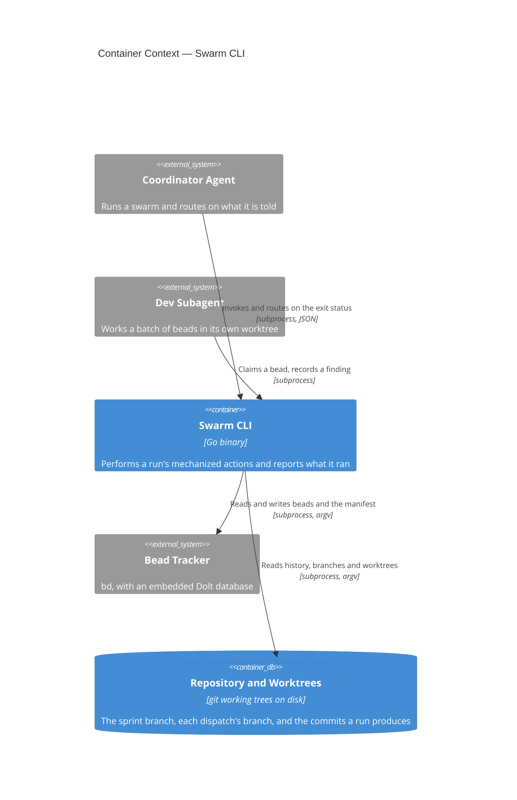
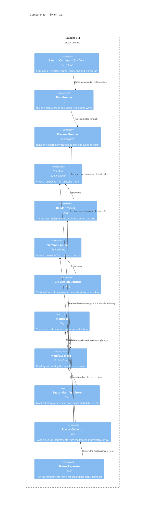

# Swarm CLI

## Overview

The Swarm CLI is the executable substrate under the `bead-bonanza` skill
family. Those skills describe a distributed system whose control plane is
documentation: its invariants are prose, and most of that prose exists to
warn an agent away from an invocation that returns the wrong answer at
exit 0. This container takes the highest-value of those actions and makes
each one a command whose verdict is an exit status.

It is deliberately not an orchestrator. It spawns no agent, arms no
monitor, schedules nothing and holds no state of its own; it is invoked
from inside an existing harness, does one thing, and returns. Every fact
it reports comes from the bead tracker or from git, and it names the
invocation behind each one so a caller can re-run it.

[[frd-swarm-core]] is the first of the feature requirements documents it
serves — the command contract, the run manifest, and status — and this
blueprint describes the container as a whole rather than that one
feature.

- **Responsibility:** perform a run's mechanized actions against the
  tracker and git; report every fact with the command that established
  it; own the process-level concerns those actions imply — argument
  parsing, plan rendering, output format, and exit status.
- **Technology:** Go, `cobra` for the command tree, `os/exec` for every
  external invocation. See [[adr-023]] for the language and packaging
  decision.
- **Runtime:** a single statically linked binary, invoked per command.
  No daemon, no persistent process, no network listener. It shells out to
  `bd` and `git`, which must be on `PATH`.

## Container Context



**Coordinator Agent → Swarm CLI.** The coordinator is the CLI's principal
caller and the reason its exit vocabulary is a contract: it decides
whether to repair, stop or carry on from the status alone, without
reading the output. It holds the scarcest context in a run, which is why
the commands it calls most are the ones that replace several queries with
one answer.

**Dev Subagent → Swarm CLI.** A subagent working a batch calls a much
smaller surface — what is in my queue, claim this bead, record this
finding — from inside its own worktree. It never merges, never pushes,
and never calls a command that mutates run-level state.

**Swarm CLI → Bead Tracker.** Every read and write of a bead, an edge or
the run manifest goes through the tracker as a subprocess invocation with
an argv vector. The CLI depends on the tracker's command surface and on
the JSON shape of each subcommand it uses; that dependency is confined to
one component per [[adr-025]], so a tracker upgrade that changes a shape
changes one decoder. The tracker's own contract is its published command
documentation, not a document this repository owns.

**Swarm CLI → Repository and Worktrees.** git is invoked the same way,
for history, branches, worktrees, merges and pushes. The repository is
not exclusively owned by this container — subagents and humans commit to
it — which is why every command reads it at the moment it acts rather
than from anything remembered.

## Components

**Every dependency on something outside this process is an interface with
one implementation beside it**, named for the role and the technology
respectively. That is the seam the unit tier replaces with a fake, and
the seam a second tracker would arrive at. A reader can tell which
components are coupled to `bd` and to `git` by their names alone.



### Swarm Command Surface

```component
title: Swarm Command Surface
slug: component-swarm-command-surface
description: Command tree, flag parsing, output rendering and the exit status a caller routes on
```

(Go, `cobra`) — Command tree, flag parsing, output rendering and the exit
status a caller routes on. It owns the conventions [[frd-swarm-core]]
specifies for every command: the required run scope, `--explain`,
`--dry-run`, `--json`, and the mapping from an outcome to one of four
statuses. It contains no knowledge of the tracker or of git; it resolves
arguments, asks a command to build a plan, hands the plan to the mode the
flags selected, and turns what comes back into text or JSON and a status.

### Plan Runner

```component
title: Plan Runner
slug: component-plan-runner
description: Builds an ordered plan of step values and interprets it as explain, dry-run or execute
```

(Go) — Builds an ordered plan of step values and interprets it as
explain, dry-run or execute. A step describes one invocation, how to
decode its result, what happens when it fails, and whether re-running it
is safe; the plan is the whole sequence including the alternative arms of
any branch. The ordering guard lives here rather than at call sites — a
step declaring that failure stops the plan is honoured by the
interpreter, so no command can chain a removal after a failed merge.
Per-step timing and the audit line each command prints are derived from
the step value. See [[adr-024]].

### Process Runner

```component
title: Process Runner
slug: component-process-runner
description: Runs one external invocation as an argv vector with separated streams and a status read from the process
```

(Go, `os/exec`) — Runs one external invocation as an argv vector with
separated streams and a status read from the process, and records how
long it took. It is the only component that starts a process, which is
what makes the four properties of [[adr-025]] structural rather than
conventional, and it is the seam the unit tier replaces with a fake that
replays recorded output. It knows nothing about what it is running: the
argv and the decoder both arrive from the step.

### Tracker

```component
title: Tracker
slug: component-tracker
description: The interface stating what a run needs from an issue tracker, independent of which one
```

(Go interface) — The interface stating what a run needs from an issue
tracker: reading a bead, its children and its metadata; the ready set
under a scope; writing a status, an assignee, a label, a comment and an
edge. It names operations in the run's vocabulary rather than any
tracker's, which is what makes a second implementation a matter of
satisfying it rather than of rewriting the callers.

### Beads Tracker

```component
title: Beads Tracker
slug: component-beads-tracker
description: The Tracker implemented over the bd command line, one decoder per subcommand
```

(Go) — The Tracker implemented over the `bd` command line. Each
subcommand it uses has a decoder that knows that subcommand's result
shape, which is where the measured non-uniformity is confined: an empty
result comes back as a bare null from one subcommand, an empty array from
several and an object from others, all at exit 0, so each decoder
normalizes its own subcommand's empty forms rather than a shared guard
doing it for all of them. This is the only component that knows the word
`bd`.

### Version Control

```component
title: Version Control
slug: component-version-control
description: The interface stating what a run needs from version control, independent of which system
```

(Go interface) — The interface stating what a run needs from version
control: history and commit subjects, branches and their ancestry,
worktree registrations, merges, and the comparison of a local branch
against its remote. Stated in the run's vocabulary — a dispatch's branch,
the sprint branch, a standing worktree — rather than in any one system's.

### Git Version Control

```component
title: Git Version Control
slug: component-git-version-control
description: Version Control implemented over the git command line, one decoder per subcommand
```

(Go) — Version Control implemented over the `git` command line, with a
decoder per subcommand as the tracker implementation has. Registration
pruning belongs here, because a stale registration reads as a live
worktree to everything above it. This is the only component that knows
the word `git`.

### Manifest

```component
title: Manifest
slug: component-manifest
description: The run record's model — its declared key set, its types and stages, its merge semantics and its logical validation
```

(Go) — The run record's model: the declared key set, each key's type and
the stage at which it becomes required, the merge semantics, and every
logical rule — a branch written once, a counter that never goes
backwards, an append-only ledger, three admission lists that do not
overlap. It holds no knowledge of where the document lives; it asks a
Manifest Store for the document and hands one back. That split is what
makes moving the record somewhere else a change to one small component
rather than to the validation this container is mostly made of.

### Manifest Store

```component
title: Manifest Store
slug: component-manifest-store
description: The interface for reading and writing the manifest document, wherever it is kept
```

(Go interface) — The interface for reading and writing the manifest
document: fetch it whole, and write it back conditionally on it not
having changed since the fetch. Conditional writing is in the interface
rather than in the model because it is a property of the store, and the
concurrent-write refusal cannot be implemented above a store that does
not offer it.

### Beads Manifest Store

```component
title: Beads Manifest Store
slug: component-beads-manifest-store
description: Manifest Store over a beads run epic's metadata object, the one place the record lives today
```

(Go) — Manifest Store implemented over the run epic's **beads** metadata
object, which is where the record lives today. It carries the two
measured constraints of writing there: the per-key write parses JSON
scalars but stores arrays and objects as strings, and the whole-object
write merges at the top level while replacing a nested value wholesale.

**Named for beads rather than for trackers in general, deliberately.** An
arbitrary JSON object attached to an issue is a beads feature, not a
property of issue trackers; this project has not established which other
trackers offer one, and the attempt to check from this environment was
blocked by the egress proxy. So the Tracker interface does not carry a
metadata-blob operation, and a store for a tracker without one would keep
the record somewhere that tracker does have — a fenced block in the
epic's body, a pinned comment, a per-issue property API — and satisfy the
same Manifest Store interface. Which of those any given tracker supports
is unestablished here and is that store's author's problem, which is the
point of the seam.

It reaches beads through the Beads Tracker rather than invoking `bd`
itself, so the rule that only two components name a tool still holds.

### Status Collector

```component
title: Status Collector
slug: component-status-collector
description: Takes a run's measurements from the tracker and version control, and records what it could not establish
```

(Go) — Takes a run's measurements and returns them as a value: the
standing worktree count, the timestamp and age of the last commit, the
depth of the ready front, each dispatch's drain state from its two
queries, the completion walk, and the delta between the live queue and
the admitted set. It walks the run's descendants itself rather than
asking for them, because the tracker's parent-scoped queries answer three
different questions and none of them is "every bead in this run". It
formats nothing and decides nothing; a measurement it could not take is
recorded as unestablished.

### Status Reporter

```component
title: Status Reporter
slug: component-status-reporter
description: Turns a measurement set into the report a caller reads and the exit status it implies
```

(Go) — Turns a measurement set into the report a caller reads and the
exit status it implies. It names the threshold it compared the last
commit's age against, states that whether a subagent is still working is
not observable from outside the harness, and never asserts that a run has
stalled. Separating it from the collector is what lets the report's
wording and its status be tested against a fixed measurement set, with no
subprocess anywhere in the test.

## Provided Contracts

**Internal** (this repository's skills only — SHALL NOT be consumed
outside it). The `bead-bonanza` skill family is its whole audience, and
no consumer outside this repository is anticipated:

- [[contract-swarm-json]] — the JSON every command emits under `--json`,
  and the run manifest this container reads, validates and writes. Shape
  is fixed by Strata schemas ([[adr-016]]) and generated from them;
  that document carries the semantics and the change policy.

The manifest is in a contract rather than in the Data section below
because this container is not its only writer: several skills write keys
into the same object during migration, which makes them
independently-built consumers of its shape.

## Consumed Contracts

- **`bd` (the bead tracker)** — used for every read and write of a bead,
  an edge, a gate and the run manifest. Third-party: its contract is its
  own published command documentation,
  https://github.com/gastownhall/beads. This container depends on the
  subcommands it invokes and on each one's result shape.
- **`git`** — used for history, branches, worktrees, merges and the
  comparison of a branch against its remote. Third-party: its contract is
  its published documentation, https://git-scm.com/docs.

## Data

This container owns no store. Everything it reads and writes lives in
something another party also writes, which is the constraint most of its
behaviour follows from.

- **The run manifest** (JSON in the run epic's tracker metadata) — the
  run's only durable record. Not exclusively owned: the sprint skills
  write keys into the same object today, and will continue to during
  migration, which is why its shape is [[contract-swarm-json]] rather
  than a private schema. Schema source of truth:
  `schemas/swarm-manifest.strata`.
  - WHEN the manifest is written, the container SHALL merge rather than
    replace, so keys written by another party survive.
  - IF a write names a key outside the declared set, THEN the container
    SHALL refuse it.
  - IF a value's type is not its key's declared type, THEN the container
    SHALL refuse the write.
  - WHEN a key has changed since the caller read the manifest, the
    container SHALL refuse the write and name the key that moved.
  - WHEN several keys are written in one invocation, the container SHALL
    apply them as one merge.
  - IF any key in a multi-key write is refused, THEN the container SHALL
    store none of them.
- **The repository and its worktrees** (git) — read for history,
  branches, ancestry and worktree registrations; written by the commands
  that create a branch or a worktree, merge, or push. Not exclusively
  owned: subagents commit into worktrees this container created.
  - The container SHALL read the merge target at the moment it merges,
    never a value read earlier.
  - The container SHALL clear stale worktree registrations before any
    decision reads the registration list.

## Infrastructure and Deployment

This container belongs to no documented system, so this section is
authoritative for its deployment.

- **Exclusive infrastructure:** none. It has no database, no queue, no
  cache and no network listener.
- **Artifact:** one binary named `swarm`, built from the main package at
  `cli/swarm` in the `github.com/brettcallaghan/agent-plugins/cli`
  module. The directory name is the binary name, so `go install
  github.com/brettcallaghan/agent-plugins/cli/swarm@<tag>` is the
  toolchain install channel. `.github/workflows/cli.yml` builds it for
  every platform below on every pull request and executes it in an image
  holding only a shell; `.github/workflows/release.yml` publishes one
  archive per binary per platform from a `cli/vX.Y.Z` tag.
- **Deployment:** a single statically linked binary per platform,
  cross-compiled with cgo disabled and shipped as a release artifact,
  alongside the `spec` binary from the same module ([[adr-023]]). It is
  installed onto `PATH` and invoked per command. Its only runtime
  requirements are `bd` and `git` on `PATH`; it needs no runtime,
  interpreter or package manager of its own.
- **Platforms:** `linux/amd64`, `linux/arm64`, `darwin/amd64`,
  `darwin/arm64`, `windows/amd64`, `windows/arm64` — the targets the
  existing cross-compile leg already builds.
- **The tracker this container is tested against on Windows** is the
  CGO-free, server-mode `bd` install; [[adr-027]] carries the choice and
  what it leaves untested.

## Cross-Cutting Standards

This container SHALL comply with:

- [[testing-standards]] — the test layers, and the snapshot-case
  structure its end-to-end cases are written in.
- [[ac-traceability-standards]] — every test cites the acceptance
  criteria it verifies.
- [[c4-standards]] — the mapping rules this blueprint's elements and
  diagrams follow.

## Change Guidance

- WHEN a command is added or its behaviour changes, the plan it builds
  SHALL be asserted by a unit test that runs no subprocess, because the
  plan is what explain, dry-run and execute all read.
- WHEN a new tracker or git subcommand is invoked, it SHALL be added to
  the Beads Tracker or the Git Version Control implementation with a
  decoder of its own.
- A component other than those two implementations SHALL NOT reach the
  Process Runner.
- A component other than those two implementations SHALL NOT name `bd` or
  `git`, so that what is coupled to a tool stays visible in the roster.
- WHEN an operation is added to the Tracker or the Version Control
  interface, it SHALL be stated in the run's vocabulary rather than in
  the vocabulary of the tool implementing it.
- WHEN a decoder is added or changed, a unit case SHALL pin every result
  shape that subcommand is known to return, including its empty forms.
- WHEN a manifest key is added, removed or retyped,
  `schemas/swarm-manifest.strata`, the generated artifacts and the
  validation rules SHALL be updated in the same change.
- WHEN a manifest key is added, removed or retyped, the core end-to-end
  fixture SHALL be re-recorded in the same change, since a fixture
  asserting a shape the code no longer writes passes while meaning
  nothing.
- A fixture recorded to prove that an older manifest shape is still
  readable SHALL NOT be re-recorded, since re-recording it destroys the
  only evidence that reading an older shape works.
- WHEN a fixture is recorded, the contract version it was recorded
  against SHALL be recorded with it.
- WHEN a new world shape is needed for a case, it SHALL be derived as a
  branch from the core fixture rather than authored separately, so a
  change to the core reaches every variant.
- WHEN a field is added to a command's JSON result,
  `schemas/swarm-output.strata` SHALL be updated in the same change.
- WHEN a change to either schema removes, renames or retypes anything,
  the major version in [[contract-swarm-json]] SHALL be raised in the
  same change.
- The Manifest component SHALL NOT read or write the record other than
  through a Manifest Store, so that where the record lives stays
  replaceable.
- WHEN a step performs a write, it SHALL declare whether re-running it is
  safe, because recovery from a partial plan is re-running rather than
  undoing ([[adr-026]]).
- A command SHALL NOT invoke an external tool outside a plan step, since
  a call made directly is invisible to explain mode and unguarded by the
  ordering policy.
- The container SHALL NOT construct a command string for a shell
  interpreter; every invocation is an argv vector ([[adr-025]]).
- WHEN an end-to-end snapshot is re-recorded, the normalization list for
  that case SHALL be reviewed in the same change — a substitution added
  to make a case pass can remove the thing it was written to assert.
- **Verification gates:** `cd cli && go test ./swarm/...` for the unit
  tier; `cd cli && go test ./cmd/... -run TestSwarmSnapshotCases` for the
  end-to-end cases against the committed fixture; `cd cli && go vet
  ./...`, `scripts/format-check`, and `scripts/generate-schemas.sh
  --check`. A change touching the Process Runner, either interface or
  either implementation additionally runs
  `cd cli && go test ./cmd/... -run TestCRLFCheckoutProducesIdenticalOutput`.
  CI runs the whole suite on all three platforms and the cross-compile
  matrix; these are the targeted set an agent runs before handoff.

## Key Decisions

- [[adr-023]] — Go, as a second binary in the existing `cli` module,
  which is what puts this container on the three-OS matrix and the
  six-target cross-compile.
- [[adr-024]] — a command builds a plan of step values, and explain,
  dry-run and execute are three interpreters over it.
- [[adr-025]] — every external invocation is an argv vector through one
  gateway, with separated streams and a per-subcommand decoder.
- [[adr-026]] — no rollback: validate before writing, order the
  irreversible writes last, and declare each step's idempotence.
- [[adr-027]] — two test tiers, and the committed fixture the upper tier
  restores rather than a command that generates one.
- [[adr-016]] — Strata as the one source for schemas and generated
  models, which is where this container's JSON shapes are fixed.

## Open Questions

None.

## References

- [[frd-swarm-core]] — the first feature this container serves
- [[module-bead-bonanza]] — the module whose components call this
  container, and which names it as a planned dependency
- `docs/research/swarm-cli/2026-08-25-capability-audit.md` — the
  inventory of actions and traps this container mechanizes
- `.claude/skills/spec/references/shared/c4-guide.md` — C4 mapping rules
  and diagram conventions
