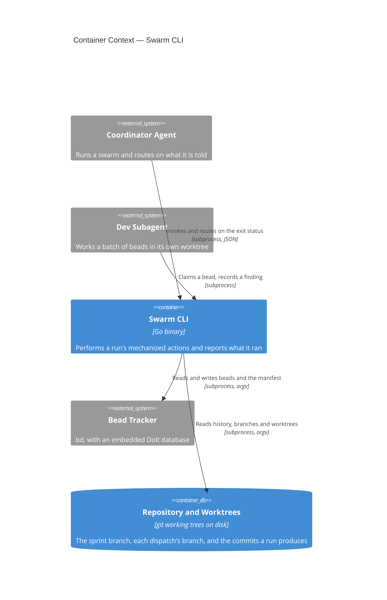
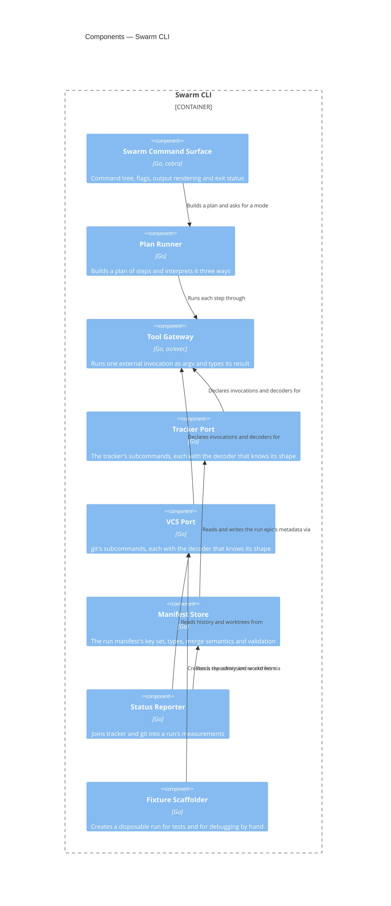

# Swarm CLI

## Overview

The Swarm CLI is the executable substrate under the `bead-bonanza` skill
family. Those skills describe a distributed system whose control plane is
documentation: its invariants are prose, and most of that prose exists to
warn an agent away from an invocation that returns the wrong answer at
exit 0. This container takes the highest-value of those actions and makes
each one a command whose verdict is an exit status.

It is deliberately not an orchestrator. It spawns no agent, arms no
monitor, schedules nothing and holds no state of its own; it is invoked
from inside an existing harness, does one thing, and returns. Every fact
it reports comes from the bead tracker or from git, and it names the
invocation behind each one so a caller can re-run it.

[[frd-swarm-core]] is the first of the feature requirements documents it
serves — the command contract, the run manifest, and status — and this
blueprint describes the container as a whole rather than that one
feature.

- **Responsibility:** perform a run's mechanized actions against the
  tracker and git; report every fact with the command that established
  it; own the process-level concerns those actions imply — argument
  parsing, plan rendering, output format, and exit status.
- **Technology:** Go, `cobra` for the command tree, `os/exec` for every
  external invocation. See [[adr-023]] for the language and packaging
  decision.
- **Runtime:** a single statically linked binary, invoked per command.
  No daemon, no persistent process, no network listener. It shells out to
  `bd` and `git`, which must be on `PATH`.

## Container Context



**Coordinator Agent → Swarm CLI.** The coordinator is the CLI's principal
caller and the reason its exit vocabulary is a contract: it decides
whether to repair, stop or carry on from the status alone, without
reading the output. It holds the scarcest context in a run, which is why
the commands it calls most are the ones that replace several queries with
one answer.

**Dev Subagent → Swarm CLI.** A subagent working a batch calls a much
smaller surface — what is in my queue, claim this bead, record this
finding — from inside its own worktree. It never merges, never pushes,
and never calls a command that mutates run-level state.

**Swarm CLI → Bead Tracker.** Every read and write of a bead, an edge or
the run manifest goes through the tracker as a subprocess invocation with
an argv vector. The CLI depends on the tracker's command surface and on
the JSON shape of each subcommand it uses; that dependency is confined to
one component per [[adr-025]], so a tracker upgrade that changes a shape
changes one decoder. The tracker's own contract is its published command
documentation, not a document this repository owns.

**Swarm CLI → Repository and Worktrees.** git is invoked the same way,
for history, branches, worktrees, merges and pushes. The repository is
not exclusively owned by this container — subagents and humans commit to
it — which is why every command reads it at the moment it acts rather
than from anything remembered.

## Components



### Swarm Command Surface

```component
title: Swarm Command Surface
slug: component-swarm-command-surface
description: Command tree, flag parsing, output rendering and the exit status a caller routes on
```

(Go, `cobra`) — Command tree, flag parsing, output rendering and the exit
status a caller routes on. It owns the conventions
[[frd-swarm-core]] specifies for every command: the required run scope,
`--explain`, `--dry-run`, `--json`, and the mapping from an outcome to
one of four statuses. It contains no knowledge of the tracker or of git;
it resolves arguments, asks a command to build a plan, hands the plan to
the mode the flags selected, and turns what comes back into text or JSON
and a status.

### Plan Runner

```component
title: Plan Runner
slug: component-plan-runner
description: Builds an ordered plan of step values and interprets it as explain, dry-run or execute
```

(Go) — Builds an ordered plan of step values and interprets it as
explain, dry-run or execute. A step describes one invocation, how to
decode its result, what happens when it fails, and whether re-running it
is safe; the plan is the whole sequence including the alternative arms of
any branch. The ordering guard lives here rather than at call sites —
a step declaring that failure stops the plan is honoured by the
interpreter, so no command can chain a removal after a failed merge.
Per-step timing and the audit line each command prints are derived from
the step value. See [[adr-024]].

### Tool Gateway

```component
title: Tool Gateway
slug: component-tool-gateway
description: Runs one external invocation as an argv vector with separated streams and a status read from the process
```

(Go, `os/exec`) — Runs one external invocation as an argv vector with
separated streams and a status read from the process, and records how
long it took. It is the only component that starts a process, which is
what makes the four properties of [[adr-025]] structural rather than
conventional, and it is the seam the unit tier replaces with a fake that
replays recorded output. It knows nothing about what it is running: the
argv and the decoder both arrive from the step.

### Tracker Port

```component
title: Tracker Port
slug: component-tracker-port
description: The tracker subcommands the CLI uses, each with the decoder that knows that subcommand's result shape
```

(Go) — The tracker subcommands the CLI uses, each with the decoder that
knows that subcommand's result shape. This is where the measured
non-uniformity is confined: an empty result comes back as a bare null
from one subcommand, an empty array from several and an object from
others, all at exit 0, so each decoder normalizes its own subcommand's
empty forms rather than a shared guard doing it for all of them. It is
also the interface a second tracker would implement.

### VCS Port

```component
title: VCS Port
slug: component-vcs-port
description: The git subcommands the CLI uses, each with the decoder that knows its output shape
```

(Go) — The git subcommands the CLI uses, each with the decoder that knows
its output shape: history and commit subjects, branches and their
ancestry, worktree registrations, merges, and the comparison of a local
branch against its remote. Registration pruning belongs here, because a
stale registration reads as a live worktree to everything above.

### Manifest Store

```component
title: Manifest Store
slug: component-manifest-store
description: The run manifest's declared key set, its types and stages, its merge semantics and its logical validation
```

(Go) — The run manifest's declared key set, its types and stages, its
merge semantics and its logical validation. Every command that touches a
run reads it through this component, which is why it ships first: its
behaviour on an absent key, a wrong type and a concurrent write is the
contract the rest are written against. The key set is one declaration
that reading, requiring and validating all consult, so a validator can
answer for a key nothing has written yet.

### Status Reporter

```component
title: Status Reporter
slug: component-status-reporter
description: Joins the tracker and git into a run's measurements, and reports what it could not observe
```

(Go) — Joins the tracker and git into a run's measurements, and reports
what it could not observe. It walks the run's descendants itself rather
than asking for them, because the tracker's parent-scoped queries answer
three different questions and none of them is "every bead in this run".
It reports measurements and never a diagnosis: whether a subagent is
still working is not observable from outside the harness, so the report
gives the standing worktree count, the age of the last commit and the
depth of the ready front, with the threshold it compared against.

### Fixture Scaffolder

```component
title: Fixture Scaffolder
slug: component-fixture-scaffolder
description: Creates a disposable run — a repository, a branch, worktrees and a seeded tracker — for end-to-end tests and hand debugging
```

(Go) — Creates a disposable run for end-to-end tests and hand debugging:
a git repository with commits and a sprint branch, optional dispatch
worktrees, and a tracker seeded with a run epic, its phase chain, a flat
target and beads beneath it. Its content is seeded deterministically so a
snapshot is stable. It is the one component whose blast radius is a
directory the caller names rather than a run, and the only one that
creates a repository. See [[adr-027]].

## Provided Contracts

This container provides no contract document yet. Two of its surfaces are
candidates and are tracked in Open Questions: the JSON each command emits
under `--json`, which skills parse; and the run manifest's declared key
set, which several skills still write directly.

## Consumed Contracts

- **`bd` (the bead tracker)** — used for every read and write of a bead,
  an edge, a gate and the run manifest. Third-party: its contract is its
  own published command documentation,
  https://github.com/gastownhall/beads. This container depends on the
  subcommands it invokes and on each one's result shape.
- **`git`** — used for history, branches, worktrees, merges and the
  comparison of a branch against its remote. Third-party: its contract is
  its published documentation, https://git-scm.com/docs.

## Data

This container owns no store. Everything it reads and writes lives in
something another party also writes, which is the constraint most of its
behaviour follows from.

- **The run manifest** (JSON in the run epic's tracker metadata) — the
  run's only durable record. Not exclusively owned: the sprint skills
  write keys into the same object today, and will continue to during
  migration. Schema source of truth: the declared key set in the Manifest
  Store component.
  - WHEN the manifest is written, the container SHALL merge rather than
    replace, so keys written by another party survive.
  - IF a write names a key outside the declared set, THEN the container
    SHALL refuse it.
  - IF a value's type is not its key's declared type, THEN the container
    SHALL refuse the write.
  - WHEN a key has changed since the caller read the manifest, the
    container SHALL refuse the write and name the key that moved.
  - WHEN several keys are written in one invocation, the container SHALL
    apply them as one merge.
  - IF any key in a multi-key write is refused, THEN the container SHALL
    store none of them.
- **The repository and its worktrees** (git) — read for history,
  branches, ancestry and worktree registrations; written by the commands
  that create a branch or a worktree, merge, or push. Not exclusively
  owned: subagents commit into worktrees this container created.
  - The container SHALL read the merge target at the moment it merges,
    never a value read earlier.
  - The container SHALL clear stale worktree registrations before any
    decision reads the registration list.
- **A scaffolded fixture** (a directory the caller names) — created by
  the Fixture Scaffolder, owned by nothing, and disposable.
  - The container SHALL create a fixture only under a directory named in
    the invocation.
  - The container SHALL NOT write outside that directory.

## Infrastructure and Deployment

This container belongs to no documented system, so this section is
authoritative for its deployment.

- **Exclusive infrastructure:** none. It has no database, no queue, no
  cache and no network listener.
- **Deployment:** a single statically linked binary per platform,
  cross-compiled with cgo disabled and shipped as a release artifact,
  alongside the `spec` binary from the same module ([[adr-023]]). It is
  installed onto `PATH` and invoked per command. Its only runtime
  requirements are `bd` and `git` on `PATH`; it needs no runtime,
  interpreter or package manager of its own.
- **Platforms:** `linux/amd64`, `linux/arm64`, `darwin/amd64`,
  `darwin/arm64`, `windows/amd64`, `windows/arm64` — the targets the
  existing cross-compile leg already builds.

## Cross-Cutting Standards

This container SHALL comply with:

- [[testing-standards]] — the test layers, and the snapshot-case
  structure its end-to-end cases are written in.
- [[ac-traceability-standards]] — every test cites the acceptance
  criteria it verifies.
- [[c4-standards]] — the mapping rules this blueprint's elements and
  diagrams follow.

## Change Guidance

- WHEN a command is added or its behaviour changes, the plan it builds
  SHALL be asserted by a unit test that runs no subprocess, because the
  plan is what explain, dry-run and execute all read.
- WHEN a new tracker or git subcommand is invoked, it SHALL be added to
  the Tracker Port or the VCS Port with a decoder of its own.
- A command SHALL NOT reach the Tool Gateway except through one of those
  two ports.
- WHEN a decoder is added or changed, a unit case SHALL pin every result
  shape that subcommand is known to return, including its empty forms.
- WHEN a manifest key is added, removed or retyped, the declared key set
  and the validation rules SHALL be updated in the same change.
- WHEN the declared key set changes, the end-to-end cases asserting
  `manifest validate` SHALL be re-recorded in the same change.
- WHEN a step performs a write, it SHALL declare whether re-running it is
  safe, because recovery from a partial plan is re-running rather than
  undoing ([[adr-026]]).
- A command SHALL NOT invoke an external tool outside a plan step, since
  a call made directly is invisible to explain mode and unguarded by the
  ordering policy.
- The container SHALL NOT construct a command string for a shell
  interpreter; every invocation is an argv vector ([[adr-025]]).
- WHEN an end-to-end snapshot is re-recorded, the normalization list for
  that case SHALL be reviewed in the same change — a substitution added
  to make a case pass can remove the thing it was written to assert.
- **Verification gates:** `cd cli && go test ./swarm/...` for the unit
  tier; `cd cli && go test ./cmd/... -run TestSwarmSnapshotCases` for the
  end-to-end cases; `cd cli && go vet ./...` and `scripts/format-check`.
  A change touching the Tool Gateway or either port additionally runs
  `cd cli && go test ./cmd/... -run TestCRLFCheckoutProducesIdenticalOutput`.
  CI runs the whole suite on all three platforms and the cross-compile
  matrix; these are the targeted set an agent runs before handoff.

## Key Decisions

- [[adr-023]] — Go, as a second binary in the existing `cli` module,
  which is what puts this container on the three-OS matrix and the
  six-target cross-compile.
- [[adr-024]] — a command builds a plan of step values, and explain,
  dry-run and execute are three interpreters over it.
- [[adr-025]] — every external invocation is an argv vector through one
  gateway, with separated streams and a per-subcommand decoder.
- [[adr-026]] — no rollback: validate before writing, order the
  irreversible writes last, and declare each step's idempotence.
- [[adr-027]] — two test tiers, and the scaffold command that creates the
  run the upper tier runs against.

## Open Questions

- [ ] Should the `--json` output become a contract document? Skills parse
      it, which makes them independently-built consumers; it is private
      only while the CLI and the skills ship together. Decide when the
      first consumer outside this repository appears.
- [ ] Should the manifest's declared key set become a contract document?
      Several skills write the same object directly today, so there is
      already more than one writer; the argument for deferring is that
      migration is expected to remove them.
- [ ] Is `bd` installable and runnable on Windows runners? The unit tier
      and the cross-compile cover the platform either way, but whether
      the tracker-dependent end-to-end cases can run there is
      unestablished, and [[adr-027]] assumes only that they run where the
      tracker is present.

## References

- [[frd-swarm-core]] — the first feature this container serves
- [[module-bead-bonanza]] — the module whose components call this
  container, and which names it as a planned dependency
- `docs/research/swarm-cli/2026-08-25-capability-audit.md` — the
  inventory of actions and traps this container mechanizes
- `.claude/skills/spec/references/shared/c4-guide.md` — C4 mapping rules
  and diagram conventions
