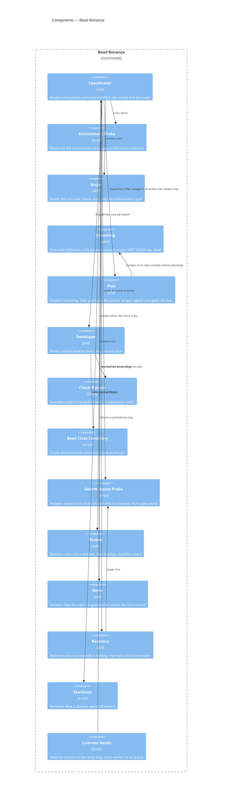

# Bead Bonanza

## Overview

Bead Bonanza autonomously completes **an epic's worth of well-defined work**.
It is a **control plane expressed as skills**: a coordinator that only routes,
single-purpose skills it invokes for each phase, and scripts that answer "what
is true" from git and the tracker rather than from what an agent reported.

- **Role:** dispatch a run epic's beads to isolated subagents, merge what they
  return, and produce the run's record.
- **Scope:** in — run scoping and authorization, readiness gating,
  partitioning, dispatch, worktree lifecycle, merging, review looping, the
  retrospective, teardown and recovery. Out — authoring work orders
  ([[work-order-definition-of-ready]] and its grooming skill), reading the
  diff at review (the project declares a reviewer), and anything that decides
  *what* work exists.
- **Composed into:** the `sf` plugin, loaded by a skill-capable agent harness.
  No host container has a blueprint of its own.
- **Consumes:** the `swarm` CLI — [[container-swarm-cli]], a **container** in
  its own right. The command sequences these components prescribed by hand are
  what it mechanizes; this module calls it rather than containing it. The run
  manifest is reached through `swarm manifest`, and a run's progress,
  completion and per-dispatch drain through `swarm status`.
- **Source & tests:** `plugin/skills/{bead-bonanza,sprint-*,run-batch}`,
  `plugin/hooks`, `plugin/monitors`. Scripts carry `--self-test` in-file;
  there is no separate test tree.

### The deliberate non-goal

**This module orchestrates within one session of an existing harness. It does
not build a harness.** It is not an attempt to replicate or compete with a
purpose-built agent runtime. The question it exists to answer is narrower and
more useful: *how much autonomy is reachable with nothing but `bd`, `git`, an
existing harness (Claude Code, Claude Desktop, Cursor) and a frontier model?*

That constraint is why the module owns no scheduler, no daemon, no queue
service and no state store — and why every design choice below prefers a fact
already recorded in `bd` or `git` over a mechanism that would have to be built
and then kept true.

### Hypotheses

Autonomy is enabled by four things, and the components below exist to supply
them. Each is a claim this module is a test of, not a settled fact.

- **Sandboxing.** A subagent that cannot see or damage another's tree removes
  a whole class of failure from the run.
- **Well-defined work, spec-first.** A bead that carries its own context is
  what makes a zero-context agent viable at all.
- **Delegating decisions to agents.** Better specs produce better decisions,
  so the run records decisions rather than escalating them.
- **Mechanization wherever possible.** A CLI or script produces a consistent,
  deterministic outcome, spends fewer tokens, and does not have to be
  remembered.

### The graph is the substrate

Every component reads and writes **one tracker** (`bd`) and **one git
repository**. There is no run directory, no progress file and no second store.
Agents and subagents query and traverse the bead DAG, and it carries:

- what work is done and what remains;
- the decisions agents made, the issues they hit, and the findings that answer
  *how do we do better on the next run?*;
- the step-by-step workflow, as the phase chain;
- sequencing, as dependency edges;
- **who works what** — a bead's `assignee` is its owner, and therefore how
  beads are batched;
- enough to survive compaction, the end of a turn, and a session restart.

The run epic's metadata is the manifest — reached through `swarm manifest`,
which owns its key set, its types and its merge semantics — its comments are
the amendments, and a worktree's existence is the in-flight signal. That is what lets a component
be replaced, or a session be lost, without losing the run.

### One question per component

The components are agents and the artifacts they read, so the usual component
boundary — a call across a module boundary — is replaced by a sharper one: **a
component owns a question, and no other component may answer that question.**
Two components that can both answer "is this bead ready" will eventually
disagree, and the one that drifts is the one that does not get fixed when the
answer changes.

## Interface

- **Surface:** one skill a caller may invoke — **`bead-bonanza`**. Every other
  skill in this module is `user-invocable: false` and is reached only through
  it, recovery included: a run is resumed by re-invoking `bead-bonanza` on its
  run epic, never by calling an internal skill. Project configuration is
  `sf.toml`; run state is the run epic's manifest, read and written through
  `swarm manifest`.
- **Guarantees:**
  - **Resumability.** WHEN `bead-bonanza` is invoked on a run epic that
    already exists, it SHALL recover that run's state and continue it —
    reusing the manifest's sprint branch — rather than opening a second run.
  - **Acceptance is read from state, never from a subagent's report.** A bead
    is accepted only when all five of these hold, checked in order and
    stopping at the first failure:
    1. the bead's `status` reads `closed` in the tracker;
    2. a commit exists whose subject carries the bead id;
    3. that commit is an ancestor of the sprint branch's HEAD;
    4. the dispatch's worktree has been removed;
    5. at least one `retro:`-prefixed comment was recorded on the bead.

    Signals 3 and 4 are false by construction before the coordinator merges,
    so the pre-merge check defers them and the post-merge re-run is what
    actually verifies them.
  - **One commit per bead**, carrying both the code and **the closure — the
    `bd` write that sets the bead's `status` to `closed`.** Neither lands
    without the other, so a bead is never closed-but-uncommitted or
    committed-but-open.
  - **Validation is per bead.** The module SHALL run the checks the project
    declares in `sf.toml` against each bead's change, before that bead's
    commit, and SHALL hard-code no build, test or lint command of its own.
  - **One human interaction per run**, at authorization. Every later decision
    is recorded as a finding rather than escalated.
  - The module SHALL NOT require a harness feature it cannot detect: it blocks
    the run where delegation is unavailable and degrades where a monitor or
    durable trigger is.

## Components



### Boundaries at a glance

The table is the point of this blueprint. Each row names the one question its
component answers, and the question it is most often wrongly given.

| Component | Owns the question | Must NOT answer |
|---|---|---|
| **Coordinator** | what happens next, and when is there nothing left? | anything requiring a source file to be read |
| **Environment Probe** | can a run start in this environment at all? | whether the queue is any good |
| **Scope** | which beads are in this run, and who authorized it? | whether any of them is ready to dispatch |
| **Grooming** | does this bead carry enough context for a subagent to complete it with no other input? | which agent gets it, or when it runs |
| **Plan** | is this epic ready to swarm, who owns each bead, and what must not run at once? | what makes a bead ready to dispatch |
| **Developer** | is this bead implemented, validated and committed? | whether its branch may land |
| **Check Runner** | do the project's declared checks pass on this change? | what the bar is — the baseline decides |
| **Bead Close Ceremony** | did this bead's closure and its code land as one commit? | whether the work is correct |
| **Swarm Status Probe** | what is true of this branch, and of this bead? | what is true of the run as a whole — `swarm status` measures that |
| **Review** | what is wrong with this run's own diff, and is fixing it in scope? | the reading of the diff (a declared reviewer does that), or whether to loop again |
| **Retro** | how do we do better on the next run? | whether a finding becomes work — a human decides |
| **Recovery** | what state is this run actually in? | how to finish it |
| **Teardown** | what may safely be removed now the run is over? | anything ambiguous — it leaves and names it |
| **Liveness Hooks** | may this agent stop yet? | why it stopped, or what to do instead |

**"Ready" is two different questions, and splitting them is what this exercise
settled.** *Ready to dispatch* is Grooming's — a property of one bead, checked
against [[work-order-definition-of-ready]], which Grooming alone holds. *Ready
to swarm* is Plan's — a property of the epic, and two of its checks (every
child assigned, dev pool within the concurrency cap) are undecidable before
Plan's own assign step. A component that answers both will drift on the first.

### Coordinator

```component
title: Coordinator
slug: component-bb-coordinator
description: Routes every phase of a run; owns the manifest, the merge and the two loops
```

(skill — `bead-bonanza`) — the **only** user-invocable entry point, for a new
run and for resuming one alike.

- **Queries the graph for ready work, coordinates its execution, and loops**
  until there is nothing ready left.
- Routes each phase: invokes a skill or runs a script, reads the verdict,
  decides what happens next.
- **Spawns the subagents**, one per batch, each in its own worktree.
- **Monitors them**, and recovers a dispatch that stopped, stalled or died
  rather than waiting on it.
- **Asks where the run is with `swarm status`, and routes on its exit
  status** — progress, completion and each dispatch's drain state are
  measured there rather than derived here, and it never writes a health label
  of its own.
- **Re-checks scope at every re-query, and readiness never.** `swarm status`
  names beads the admission record does not, and each is admitted as an
  amendment or deferred out before it is dispatched. Readiness has owners
  earlier in the run: `bd lint`'s findings and a bead's capability tier are
  settled while the queue is groomed, and the open human-decision queue by
  the end of the scope phase, where an unmade decision is deferred out of the
  run. **A ready bead carrying no `metadata.tier` is dispatched at the
  advanced tier** rather than withheld, so a bead that slipped grooming
  cannot stop the front from moving.
- **When something goes wrong, works out a solution** and records the
  decision. It does not stop to ask.
- **Owns the run manifest** and the run's amendments (`amend:` comments).
  Neither is ever delegated. It reaches the manifest through `swarm manifest`
  — `get` to read, `set` once for a whole write, `require` where a key is a
  precondition — and **validates the record with `swarm manifest validate`
  when it resumes a run it did not hold**, so a half-written record is a status
  it routes on rather than a key it discovers missing mid-dispatch.
- **Executes the merges**, one dispatch's branch at a time, as that dispatch
  completes its work — and removes its worktree only behind an ancestry check.
  This is a coordinator responsibility, not a component: there is nothing to
  serialize (it is one agent) and nothing to schedule.
- Owns both loops: the dispatch loop (until the ready front is dry) and
  the review loop (until findings stop or the budget is spent).
- **Spawns a subagent to fix a merge conflict** as one arises, and never
  resolves one itself: it holds no bead's context, so a resolution it invented
  would be an unreviewed edit landing under someone else's commit.
- **Does not read source files.** Reading a file to decide something is a
  subagent's job.
- **Does not escalate mid-run.** A decision that changes what "correct"
  means is recorded as a finding of its kind.

### Environment Probe

```component
title: Environment Probe
slug: component-bb-preflight
description: Measures the environment, captures the checks baseline, and blocks a run that cannot succeed
```

(script — `scripts/pre-flight-check.sh`) — run twice: once bare, once
with the run epic.

- Measures git, `bd`, tracker write access, worktree base-ref and event-log
  writability; emits evalable facts and a human report.
- **Probes the `swarm` binary's capability, not its presence or a version
  string.** `swarm manifest` and `swarm status` are required steps a run
  invokes directly, and `swarm` carries no version string — a binary built
  before `swarm status` existed still exits 0 for a version check and would
  pass one. The probe is behavioural: `swarm status --help` exiting non-zero
  with "unknown command" is the measured failure a version check cannot
  catch, and either a missing or a stale binary blocks the run.
  **Provisioning is a cloud session's `.claude/hooks/session-start.sh`**,
  which builds `swarm` from this repository's own `cli/swarm` — no clone,
  no network — the same place that provisions `bd` and `strata`. A local
  session is expected to have its own build.
- **Captures the checks baseline** on the untouched tree, so a
  pre-existing failure is never charged to the first bead.
- **The one component that still writes the manifest by hand.** Every
  other component reaches the record through `swarm manifest`; this script
  merges into the run epic's metadata itself, with its own
  `manifest_merge` helper over `bd update --metadata`. Its writes are
  therefore unvalidated — the key set, the declared types and the
  conditional-write guard the command enforces do not apply to
  `checks_baseline`, `checks_baseline_status`, `checks_ids` or
  `concurrency_cap` on the way in. Stated here rather than left implicit
  because a reader who has seen the adoption elsewhere will otherwise
  assume it is uniform, and because the gap is what a later change closes:
  the probe adopts `swarm manifest set` like everything else.
- Blocks the run — exit non-zero — rather than degrading, and names the
  remedy for each blocker.
- **Does not judge the queue.** Readiness is grooming's.

### Scope

```component
title: Scope
slug: component-bb-scope
description: Turns a user's selector into one run epic with its phase chain, and takes the run's single authorization gate
```

(skill — `sprint-scope`)

- Resolves whatever the user gave (an epic, ids, a label, a priority)
  into exactly one **run epic**, and records the admission record:
  admitted, excluded with a reason each, moved and from where.
- Builds the phase chain and the **flat target** whose task children are
  the work.
- **Takes the run's one human interaction** — the authorization gate,
  opened before it asks so a session that dies mid-question leaves the
  run held rather than authorized.
- **Does not groom and does not dispatch.** A bead it admits may still be
  bounced by the next component.

### Grooming

```component
title: Grooming
slug: component-bb-grooming
description: The Definition of Ready engine; the sole holder of the per-bead readiness checklist
```

(skill — `groom-beads`) — a component of this module, and **also
independently user-invocable**, useful with no sprint in sight.

Two consumers outside this module's dispatch path use it — a human directly,
and `groom-feature-blueprint`, which hands it the finishing pass over a
decomposed blueprint. **That does not make it a module of its own.** It is one
skill with one responsibility and no internal components, and a second consumer
is an inbound edge rather than a boundary of independent change: it ships,
versions and breaks with the rest of the plugin. Documenting it here is what
keeps the readiness boundary in one place.

- **Sole owner of the per-bead Definition of Ready.** No other component
  holds a copy or applies it.
- Answers **per bead** over a set it is handed: `ready` (changed
  nothing), `ready — <change>`, or `NOT-READY — <the gap a human must
  close>`.
- Brings a failing bead to Ready by editing it in place: description,
  design, acceptance criteria, tier, dependency edges, C4 blast radius.
- **Parks what it cannot clear** rather than guessing, and returns a
  partition preview for the component downstream.
- Produces a **non-authoritative partition preview** while every description is
  still in context — signal captured at the one moment it is cheap. Plan
  remains the source of truth on packing.
- **Does not assign agents** and does not decide what runs together.

### Plan

```component
title: Plan
slug: component-bb-plan
description: Partitions the queue into batches, assigns every bead an agent, and gates the epic for swarming
```

(skill — `sprint-plan`) — the coordinator dispatches **one** subagent here;
it invokes Grooming itself and plans in the same context.

- **Runs Grooming first, in its own context, and never as a second dispatch.**
  `c4_changes` / `c4_impacts` are optional, so where a repo documents no
  architecture the collision signal is each bead's description — which Grooming
  has just read. Splitting the two agents would re-read every description, and
  a metadata-only planner would under-detect collisions on precisely the repos
  that have no C4 docs.
- **Owns the queue** — re-derives it from the epic and accounts for every
  id in grooming's reply. A bead with no verdict is unexamined, not ready.
- **Reads the manifest and never writes it** — `swarm manifest get` for the
  concurrency cap the dev pool is checked against; an unwritten key is
  reported, never supplied.
- Classifies beads and computes collision and sequencing overlap from C4
  metadata, not from file paths.
- **Assigns every bead** a dispatch id, which is the whole of the
  handover: the assignee *is* the batch.
- Emits one **collision-edge file**, loaded with `bd dep add --file`, so
  the ready front is safe to dispatch whole.
- **Gates the epic for swarming** — the epic-level Definition of Ready,
  two of whose checks are undecidable before assignment.
- **Does not hold the per-bead checklist** and creates no beads.

### Developer

```component
title: Developer
slug: component-bb-developer
description: Works an assigned batch bead by bead in one worktree, landing each as one commit
```

(skill — `run-batch`) — the only component that writes product code.

- Resolves its own assignment from three given values: dispatch id, run
  epic, scripts path. Everything else it queries — the tracker for its queue,
  `swarm manifest` for the run's branch and checks baseline.
- Per bead: claim, read, implement **strictly in scope**, gate, record
  findings, close-and-commit.
- **Files what it finds** beyond scope rather than doing it or dropping
  it.
- Accounts for **every** bead its queue returned, in exactly one of
  completed / blocked / skipped.
- **Merges nothing and pushes nothing.** Leaves partial work uncommitted
  in the worktree, which is the durable record that a bead is unfinished.

### Check Runner

```component
title: Check Runner
slug: component-bb-checks
description: Runs the checks a project declares in sf.toml, in order, continuing past a failure
```

(script — `scripts/bb-checks.py`)

- Runs every declared check in declaration order and **keeps going after
  a failure**, so all of them are visible at once.
- Narrowable by id for a fast loop; the gate is always the full run.
- **Hard-codes no command.** The project declares them.
- **Does not decide the bar** — the baseline does: "no findings beyond
  it", not "exit 0".

### Bead Close Ceremony

```component
title: Bead Close Ceremony
slug: component-bb-close
description: Closes one bead in the tracker and commits its code as one act, in the required order
```

(scripts — `scripts/bb-close-bead.sh`, `scripts/bb-verify-skip.sh`)

- Performs the close in the one order that cannot half-fail: close,
  **verify the close against the database**, stage code only, one commit,
  push the tracker.
- Refuses to run on the default branch or with nothing staged.
- Verifies a skip claim against the tree, so "already done" cannot be
  asserted over uncommitted work.
- **Does not judge correctness.** Gates ran before it.

### Swarm Status Probe

```component
title: Swarm Status Probe
slug: component-bb-status
description: Answers what is true of a swarm run's branch, its beads and its findings — from git and the tracker
```

(script — `scripts/bb-status.sh`) — read-only; repairs nothing. **"Run" means
the swarm run throughout.** One component, three modes, all about the same run:

| mode | scope | answers |
|---|---|---|
| `branch` | the run's branch | is the tree clean, and did the branch land? Needs no epic, so it runs before anything else is known |
| `bead <id>` | one bead | the five acceptance signals, in order |
| `harvest` | the run's findings | is the `retro:` total non-zero — a zero is a broken pipeline, not a flawless run |

**The run as a whole is not its scope.** `swarm status --run <epic>` measures
progress, completion and per-dispatch drain; a `run` mode here would be a
second answer to a question the CLI already owns.

- Verifies a bead's acceptance signals in order and stops at the first
  failure.
- Reports the branch's cleanliness and whether it **landed**, which is
  the only signal separating a pushed run from a stranded one.
- Names what it **cannot** verify, so a clean report never implies a
  clean run.
- Prints the command behind each line, so any single check is re-runnable
  without reconstructing it.

### Review

```component
title: Review
slug: component-bb-review
description: Resolves a reviewer, scopes it to the run's diff, files each finding as a bead and classifies its scope
```

(skill — `sprint-review`)

- **Resolves and runs a reviewer; it does not read the diff itself.** The
  project declares one in `sf.toml`; failing that, one found in the session;
  failing that, a bare agent. It **names which ran**, because those are not the
  same evidence.
- Scopes the review to `base_sha`..head, read off the manifest with
  `swarm manifest get`; `swarm manifest require` is what turns an unwritten
  `base_sha` into a status rather than an empty string.
- Files every finding as a bead against its origin, citing a durable
  anchor rather than a line number.
- Classifies each finding against three stated criteria; a defect the
  run's own diff introduced is in scope whatever the gate says.
- **Owns what happens to findings, not the reading that produced them** — and
  **does not decide whether to loop**, which is the coordinator's counter.

### Retro

```component
title: Retro
slug: component-bb-retro
description: Answers how the next run goes better — harvests every finding, routes each by kind, and writes the run's one human-facing retro
```

(skill — `sprint-retro`)

- Harvests every `retro:` comment across the run's closure set.
- Routes each by **kind alone**, without reading content; two kinds
  terminate rather than becoming issues.
- Writes the run's **one** document — results, findings verbatim,
  validation, and what the run could not verify — to the configured
  directory, and records its path on the epic.
- Puts candidates to a human **once** and files what they accept.
- **Files nothing without a yes**, and blocks on nobody: an unanswered
  candidate stays decidable from the record.

### Recovery

```component
title: Recovery
slug: component-bb-recovery
description: Reconstructs an in-flight run from the branch, the epic and the worktree list when no session holds it
```

(skill — `sprint-recovery`) — **internal.** The coordinator invokes it as its
first act whenever it is given a run epic that already exists; a user resumes a
run by re-invoking `bead-bonanza`, and a durable trigger names the coordinator
for the same reason. It is a skill rather than a reference file because a fresh
session can resolve a skill name and cannot resolve a path into a bundle it
never loaded.

- Derives the run from **the branch**, its history from `git log`, its
  in-flight set from `git worktree list`, its manifest from the epic.
- Classifies every unfinished bead by status against worktree presence.
- Names a source for every fact, and names what it could not establish.
- **Carries the review counter forward** rather than restarting it.
- **Does not decide how to finish the work** — it hands state back.

### Teardown

```component
title: Teardown
slug: component-bb-teardown
description: Removes worktrees whose owning agent has drained, and leaves anything ambiguous standing and named
```

(script — `scripts/sprint-cleanup.sh`)

- Removes a worktree only when its owner has **drained**, belongs to this
  run, and holds no blocked bead.
- **Leaves five cases standing and names each**, exiting non-zero:
  unknown branch, another run's agent, a live queue, a blocked bead, an
  unreadable tracker.
- **Is never destructive on ambiguity**, and is not to be forced.

### Liveness Hooks

```component
title: Liveness Hooks
slug: component-bb-liveness
description: Harness hooks that hold the session to its ready loop and a worker to its own queue
```

(hooks — `plugin/hooks/*.sh`, `plugin/monitors/*.sh`)

- Refuse a stop while the armed run's ready front is non-empty, or while
  a worker's assigned beads are still ready or in progress.
- Bounded: a fixed number of consecutive blocks, then they stand down —
  a queue that will not drain needs a human, and holding a session
  hostage is the worse failure.
- **Fail open.** Anything that is not "armed, and provably non-empty"
  exits 0.
- **Are a convenience over a path that works without them.** No ceremony
  may depend on a hook having fired.

## Versioning and Compatibility

- **Versioning scheme:** semver, in `plugin/.claude-plugin/plugin.json`,
  covering the whole plugin rather than any one skill.
- **Compatibility policy:** WHEN a skill is renamed, removed, or has its
  invocation contract changed, the release SHALL bump the minor while
  pre-1.0 and the major thereafter, and SHALL sweep every citation of the
  old name in the same change.
- **Consumers depend on names, not files.** A skill name and its
  `user-invocable` flag are the compatibility surface; reference files
  and scripts are internal and MAY be renamed freely.
- **Deprecation:** WHILE pre-1.0, a removed skill MAY be removed without
  a window, because the plugin is versioned as a unit and adopters
  upgrade it wholesale.

## Cross-Cutting Standards

This module SHALL comply with:

- [[work-order-definition-of-ready]] — what a dispatchable bead is;
  enforced by the Grooming component and by no other.
- [[findings-capture-protocol]] — the finding format, its nine kinds, and
  how they are harvested.
- [[skill-authoring-standards]] — skill naming, frontmatter, body size,
  and the vendoring rules for shared references.

## Change Guidance

- **A question has exactly one owner.** WHEN a change would let a second
  component answer a question the boundary table assigns to another, it
  SHALL instead move the question, and update the table in the same
  change.
- WHEN a component's returned verdict changes shape, the component that
  reads it SHALL be updated in the same change — a verdict nobody parses
  is indistinguishable from a phase that did not run.
- WHEN a shared reference under `references/shared/` needs to change, the
  **source** named in its header SHALL be edited and
  `scripts/sync-shared-references.sh` re-run; a generated copy SHALL NOT
  be edited directly.
- A skill SHALL NOT cite a sibling skill's reference by path. Vendor the
  whole file WHEN it is applied verbatim; otherwise cite the owning skill
  **by role**, in prose, with no path.
- WHEN a mechanism is deleted, every prompt, reference and script naming
  it SHALL be swept in the same change — nothing greps for a mechanism
  that no longer exists, so a leftover survives indefinitely.
- Scripts SHALL read state, never testimony, and SHALL print the command
  behind each line they report.
- **Verification gates:** `scripts/check-skills.sh --strict` (frontmatter,
  body byte cap, path resolution, no cross-skill reference paths);
  `scripts/sync-shared-references.sh --check` (vendored copies current);
  and each changed script's own `--self-test`, which the `script-self-tests`
  check id runs. A change touching a script's decision logic SHALL add or
  update an assertion in that script's self-test and SHALL demonstrate the
  assertion failing on the unfixed code.

## Key Decisions

- [[adr-019]] — orchestrate work orders with a skill composing native
  primitives, which is why this module is skills rather than a program.
- [[adr-022]] — projects declare their checks in `sf.toml`, which is why
  the Check Runner hard-codes none.
- [[adr-013]] — "work order" as the name for the atomic unit of
  executable work; a bead is its materialization in the tracker.
- [[adr-011]] — blueprints declare targeted verification gates, which is
  what the Verification gates entry above is.

## Open Questions

None.

<!--
Four questions from the first draft were decided by the owner and folded into
the sections above: the merge is a Coordinator responsibility (not a
component); `groom-beads` is a component of this module (not a module of its
own); the `swarm` CLI is a CONTAINER carrying its own blueprint,
[[container-swarm-cli]]; and groom-and-plan is ONE subagent — the coordinator dispatches
`sprint-plan`, which invokes `groom-beads` in its own context.
-->

## References

- `shared/c4-guide.md` — C4 mapping rules and diagram conventions
- `docs/research/swarm-cli/2026-08-25-capability-audit.md` — every action
  these components perform, and the commands behind each; the input to the
  `swarm` CLI's FRD and, after it, that container's own blueprint
