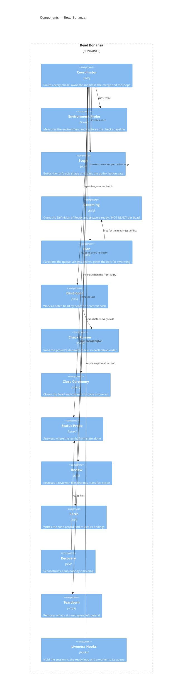

# Bead Bonanza

## Overview

Bead Bonanza turns a queue of groomed work orders into merged commits
without a human in the loop between authorization and hand-over. It is a
**control plane expressed as skills**: a coordinator that only routes,
single-purpose skills it invokes for each phase, and scripts that answer
"what is true" from git and the tracker rather than from what an agent
reported.

Its components are agents and the artifacts they read, so the usual
component boundary — a call across a module boundary — is replaced by a
sharper one: **a component owns a question, and no other component may
answer that question.** Two components that can both answer "is this bead
ready" will eventually disagree, and the one that drifts is the one that
does not get fixed when the answer changes.

- **Role:** dispatch a run epic's beads to isolated subagents, merge what
  they return, and produce the run's record.
- **Scope:** in — run scoping and authorization, readiness gating,
  partitioning, dispatch, worktree lifecycle, merging, review looping,
  the retrospective, teardown and recovery. Out — authoring work orders
  ([[work-order-definition-of-ready]] and its grooming skill),
  reviewing code (the project declares a reviewer), and anything that
  decides *what* work exists.
- **Composed into:** the `sf` plugin, loaded by a skill-capable agent
  harness. No host container has a blueprint of its own.
- **Source & tests:** `plugin/skills/{bead-bonanza,sprint-*,run-batch}`,
  `plugin/hooks`, `plugin/monitors`. Scripts carry `--self-test`
  in-file; there is no separate test tree.

### The one substrate

Every component reads and writes **one tracker** (`bd`) and **one git
repository**. There is no run directory, no progress file and no second
store: the run epic's metadata is the manifest, its comments are the
amendments, a bead's `assignee` is its owner, and a worktree's existence
is the in-flight signal. That is what lets a component be replaced, or a
session be lost, without losing the run.

## Interface

- **Surface:** the skill names a caller may invoke — `bead-bonanza`
  (user-facing) and `sprint-recovery` (invoked by name from a session
  holding no context). Every other skill in this module is
  `user-invocable: false` and is reached only through the coordinator.
  Project configuration is `sf.toml`; run state is the run epic's
  `--metadata` manifest.
- **Guarantees:**
  - The module SHALL make every acceptance verdict from git or the
    tracker, never from a subagent's report.
  - The module SHALL land each bead as exactly one commit carrying both
    the code and the closure.
  - The module SHALL take at most one human interaction per run, at
    authorization, and SHALL record every later decision rather than
    escalating it.
  - The module SHALL run the checks the project declares in `sf.toml`
    before every close, and SHALL hard-code no build, test or lint
    command of its own.
  - The module SHALL NOT require a harness feature it cannot detect: it
    blocks the run where delegation is unavailable and degrades where a
    monitor or trigger is.

## Components



### Boundaries at a glance

The table is the point of this blueprint. Each row names the one question
its component answers, and the question it is most often wrongly given.

| Component | Owns the question | Must NOT answer |
|---|---|---|
| **Coordinator** | what happens next? | anything requiring a source file to be read |
| **Environment Probe** | can this run start here? | whether the queue is any good |
| **Scope** | which beads are in this run, and who authorized it? | whether any of them is ready |
| **Grooming** | is this bead dispatchable cold? | which agent gets it |
| **Plan** | can this epic be swarmed, and by whom? | what "ready" means |
| **Developer** | is this bead done and committed? | whether its branch may land |
| **Check Runner** | do the project's checks pass? | what the bar is (the baseline decides) |
| **Close Ceremony** | did the closure and the code land together? | whether the work is correct |
| **Status Probe** | where is this run? | what to do about it |
| **Review** | what is wrong with this run's diff? | whether to loop again |
| **Retro** | what did this run cost, and what should change? | whether a finding becomes work (a human decides) |
| **Recovery** | what state is this run actually in? | how to finish it |
| **Teardown** | what may safely be removed? | anything ambiguous — it leaves and names it |
| **Liveness Hooks** | may this agent stop yet? | why it stopped |

### Coordinator

```component
title: Coordinator
slug: component-bb-coordinator
description: Routes every phase of a run; owns the manifest, the merge and the two loops
```

(skill — `bead-bonanza`) — the only user-invocable entry point.

- Routes each phase: invokes a skill or runs a script, reads the verdict,
  decides what happens next.
- **Owns the run manifest** (`--metadata` on the run epic) and the run's
  amendments (`amend:` comments). Neither is ever delegated.
- **Merges**, one dispatch's branch at a time, as that dispatch returns —
  and removes its worktree only behind an ancestry check.
- Owns both loops: the dispatch loop (until the ready front is dry) and
  the review loop (until findings stop or the budget is spent).
- Dispatches one agent to resolve a rebase conflict; never resolves one
  itself, holding no bead's context.
- **Does not read source files.** Reading a file to decide something is a
  subagent's job.
- **Does not escalate mid-run.** A decision that changes what "correct"
  means is recorded as a finding of its kind.

### Environment Probe

```component
title: Environment Probe
slug: component-bb-preflight
description: Measures the environment, captures the checks baseline, and blocks a run that cannot succeed
```

(script — `scripts/pre-flight-check.sh`) — run twice: once bare, once
with the run epic.

- Measures git, `bd`, tracker write access, worktree base-ref and event-log
  writability; emits evalable facts and a human report.
- **Captures the checks baseline** on the untouched tree, so a
  pre-existing failure is never charged to the first bead.
- Blocks the run — exit non-zero — rather than degrading, and names the
  remedy for each blocker.
- **Does not judge the queue.** Readiness is grooming's.

### Scope

```component
title: Scope
slug: component-bb-scope
description: Turns a user's selector into one run epic with its phase chain, and takes the run's single authorization gate
```

(skill — `sprint-scope`)

- Resolves whatever the user gave (an epic, ids, a label, a priority)
  into exactly one **run epic**, and records the admission record:
  admitted, excluded with a reason each, moved and from where.
- Builds the phase chain and the **flat target** whose task children are
  the work.
- **Takes the run's one human interaction** — the authorization gate,
  opened before it asks so a session that dies mid-question leaves the
  run held rather than authorized.
- **Does not groom and does not dispatch.** A bead it admits may still be
  bounced by the next component.

### Grooming

```component
title: Grooming
slug: component-bb-grooming
description: The Definition of Ready engine; the sole holder of the per-bead readiness checklist
```

(skill — `groom-beads`) — **also independently user-invocable**, and
useful with no sprint in sight.

- **Sole owner of the per-bead Definition of Ready.** No other component
  holds a copy or applies it.
- Answers **per bead** over a set it is handed: `ready` (changed
  nothing), `ready — <change>`, or `NOT-READY — <the gap a human must
  close>`.
- Brings a failing bead to Ready by editing it in place: description,
  design, acceptance criteria, tier, dependency edges, C4 blast radius.
- **Parks what it cannot clear** rather than guessing, and returns a
  partition preview for the component downstream.
- **Does not assign agents** and does not decide what runs together.

### Plan

```component
title: Plan
slug: component-bb-plan
description: Partitions the queue into batches, assigns every bead an agent, and gates the epic for swarming
```

(skill — `sprint-plan`)

- **Owns the queue** — re-derives it from the epic and accounts for every
  id in grooming's reply. A bead with no verdict is unexamined, not ready.
- Classifies beads and computes collision and sequencing overlap from C4
  metadata, not from file paths.
- **Assigns every bead** a dispatch id, which is the whole of the
  handover: the assignee *is* the batch.
- Emits one **collision-edge file**, loaded with `bd dep add --file`, so
  the ready front is safe to dispatch whole.
- **Gates the epic for swarming** — the epic-level Definition of Ready,
  two of whose checks are undecidable before assignment.
- **Does not hold the per-bead checklist** and creates no beads.

### Developer

```component
title: Developer
slug: component-bb-developer
description: Works an assigned batch bead by bead in one worktree, landing each as one commit
```

(skill — `run-batch`) — the only component that writes product code.

- Resolves its own assignment from three given values: dispatch id, run
  epic, scripts path. Everything else it queries.
- Per bead: claim, read, implement **strictly in scope**, gate, record
  findings, close-and-commit.
- **Files what it finds** beyond scope rather than doing it or dropping
  it.
- Accounts for **every** bead it was given, in exactly one of completed /
  blocked / skipped.
- **Merges nothing and pushes nothing.** Leaves partial work uncommitted
  in the worktree, which is the durable record that a bead is unfinished.

### Check Runner

```component
title: Check Runner
slug: component-bb-checks
description: Runs the checks a project declares in sf.toml, in order, continuing past a failure
```

(script — `scripts/bb-checks.py`)

- Runs every declared check in declaration order and **keeps going after
  a failure**, so all of them are visible at once.
- Narrowable by id for a fast loop; the gate is always the full run.
- **Hard-codes no command.** The project declares them.
- **Does not decide the bar** — the baseline does: "no findings beyond
  it", not "exit 0".

### Close Ceremony

```component
title: Close Ceremony
slug: component-bb-close
description: Closes a bead in the tracker and commits its code as one act, in the required order
```

(scripts — `scripts/bb-close-bead.sh`, `scripts/bb-verify-skip.sh`)

- Performs the close in the one order that cannot half-fail: close,
  **verify the close against the database**, stage code only, one commit,
  push the tracker.
- Refuses to run on the default branch or with nothing staged.
- Verifies a skip claim against the tree, so "already done" cannot be
  asserted over uncommitted work.
- **Does not judge correctness.** Gates ran before it.

### Status Probe

```component
title: Status Probe
slug: component-bb-status
description: Answers where a run is from git and the tracker, printing the command behind every line
```

(script — `scripts/bb-status.sh`) — read-only; repairs nothing.

- Verifies a bead's acceptance signals in order and stops at the first
  failure.
- Reports the branch's cleanliness and whether it **landed**, which is
  the only signal separating a pushed run from a stranded one.
- **Derives run health** from standing worktrees, the age of the last
  commit and the depth of the ready front.
- Names what it **cannot** verify, so a clean report never implies a
  clean run.
- Prints the command behind each line, so any single check is re-runnable
  without reconstructing it.

### Review

```component
title: Review
slug: component-bb-review
description: Resolves a reviewer, scopes it to the run's diff, files each finding as a bead and classifies its scope
```

(skill — `sprint-review`)

- Resolves the reviewer the project declared, else one in the session,
  else a bare agent — and **names which ran**, because they are not the
  same evidence.
- Scopes the review to `base_sha`..head, read off the manifest.
- Files every finding as a bead against its origin, citing a durable
  anchor rather than a line number.
- Classifies each finding against three stated criteria; a defect the
  run's own diff introduced is in scope whatever the gate says.
- **Does not review code itself** and **does not decide whether to loop**.

### Retro

```component
title: Retro
slug: component-bb-retro
description: Harvests every finding, routes each by kind, and writes the run's one human-facing record
```

(skill — `sprint-retro`)

- Harvests every `retro:` comment across the run's closure set.
- Routes each by **kind alone**, without reading content; two kinds
  terminate rather than becoming issues.
- Writes the run's **one** document — results, findings verbatim,
  validation, and what the run could not verify — to the configured
  directory, and records its path on the epic.
- Puts candidates to a human **once** and files what they accept.
- **Files nothing without a yes**, and blocks on nobody: an unanswered
  candidate stays decidable from the record.

### Recovery

```component
title: Recovery
slug: component-bb-recovery
description: Reconstructs an in-flight run from the branch, the epic and the worktree list when no session holds it
```

(skill — `sprint-recovery`) — invocable by name from a session with no
context, which is why it is a skill rather than a reference.

- Derives the run from **the branch**, its history from `git log`, its
  in-flight set from `git worktree list`, its manifest from the epic.
- Classifies every unfinished bead by status against worktree presence.
- Names a source for every fact, and names what it could not establish.
- **Carries the review counter forward** rather than restarting it.
- **Does not decide how to finish the work** — it hands state back.

### Teardown

```component
title: Teardown
slug: component-bb-teardown
description: Removes worktrees whose owning agent has drained, and leaves anything ambiguous standing and named
```

(script — `scripts/sprint-cleanup.sh`)

- Removes a worktree only when its owner has **drained**, belongs to this
  run, and holds no blocked bead.
- **Leaves five cases standing and names each**, exiting non-zero:
  unknown branch, another run's agent, a live queue, a blocked bead, an
  unreadable tracker.
- **Is never destructive on ambiguity**, and is not to be forced.

### Liveness Hooks

```component
title: Liveness Hooks
slug: component-bb-liveness
description: Harness hooks that hold the session to its ready loop and a worker to its own queue
```

(hooks — `plugin/hooks/*.sh`, `plugin/monitors/*.sh`)

- Refuse a stop while the armed run's ready front is non-empty, or while
  a worker's assigned beads are still ready or in progress.
- Bounded: a fixed number of consecutive blocks, then they stand down —
  a queue that will not drain needs a human, and holding a session
  hostage is the worse failure.
- **Fail open.** Anything that is not "armed, and provably non-empty"
  exits 0.
- **Are a convenience over a path that works without them.** No ceremony
  may depend on a hook having fired.

## Versioning and Compatibility

- **Versioning scheme:** semver, in `plugin/.claude-plugin/plugin.json`,
  covering the whole plugin rather than any one skill.
- **Compatibility policy:** WHEN a skill is renamed, removed, or has its
  invocation contract changed, the release SHALL bump the minor while
  pre-1.0 and the major thereafter, and SHALL sweep every citation of the
  old name in the same change.
- **Consumers depend on names, not files.** A skill name and its
  `user-invocable` flag are the compatibility surface; reference files
  and scripts are internal and MAY be renamed freely.
- **Deprecation:** WHILE pre-1.0, a removed skill MAY be removed without
  a window, because the plugin is versioned as a unit and adopters
  upgrade it wholesale.

## Cross-Cutting Standards

This module SHALL comply with:

- [[work-order-definition-of-ready]] — what a dispatchable bead is;
  enforced by the Grooming component and by no other.
- [[findings-capture-protocol]] — the finding format, its nine kinds, and
  how they are harvested.
- [[skill-authoring-standards]] — skill naming, frontmatter, body size,
  and the vendoring rules for shared references.

## Change Guidance

- **A question has exactly one owner.** WHEN a change would let a second
  component answer a question the boundary table assigns to another, it
  SHALL instead move the question, and update the table in the same
  change.
- WHEN a component's returned verdict changes shape, the component that
  reads it SHALL be updated in the same change — a verdict nobody parses
  is indistinguishable from a phase that did not run.
- WHEN a shared reference under `references/shared/` needs to change, the
  **source** named in its header SHALL be edited and
  `scripts/sync-shared-references.sh` re-run; a generated copy SHALL NOT
  be edited directly.
- A skill SHALL NOT cite a sibling skill's reference by path. Vendor the
  whole file WHEN it is applied verbatim; otherwise cite the owning skill
  **by role**, in prose, with no path.
- WHEN a mechanism is deleted, every prompt, reference and script naming
  it SHALL be swept in the same change — nothing greps for a mechanism
  that no longer exists, so a leftover survives indefinitely.
- Scripts SHALL read state, never testimony, and SHALL print the command
  behind each line they report.
- **Verification gates:** `scripts/check-skills.sh --strict` (frontmatter,
  body byte cap, path resolution, no cross-skill reference paths);
  `scripts/sync-shared-references.sh --check` (vendored copies current);
  and each changed script's own `--self-test`, which the `script-self-tests`
  check id runs. A change touching a script's decision logic SHALL add or
  update an assertion in that script's self-test and SHALL demonstrate the
  assertion failing on the unfixed code.

## Key Decisions

- [[adr-019]] — orchestrate work orders with a skill composing native
  primitives, which is why this module is skills rather than a program.
- [[adr-022]] — projects declare their checks in `sf.toml`, which is why
  the Check Runner hard-codes none.
- [[adr-013]] — "work order" as the name for the atomic unit of
  executable work; a bead is its materialization in the tracker.
- [[adr-011]] — blueprints declare targeted verification gates, which is
  what the Verification gates entry above is.

## Open Questions

- [ ] **The groom/plan dispatch topology.** `sprint-plan` and
      `grooming-prompt.md` describe different agent topologies; only one
      can be right, and it decides who triages readiness. Tracked as
      `agent-plugins-hg9t.11`; the owner decides.
- [ ] **Is the Coordinator's merge a component of its own?** It is the
      one responsibility the Coordinator holds that is not routing, and
      folding it in may be hiding a boundary rather than respecting one.
- [ ] **Does `groom-beads` belong to this module at all?** It is
      independently user-invocable and useful with no sprint, which is
      the shape of a module in its own right rather than a component of
      this one.
- [ ] **Where do the swarm-CLI capabilities land?** `agent-plugins-offx`
      proposes replacing prescribed command sequences with a tested
      action surface; whether that becomes a component here or a module
      this one consumes is undecided.

## References

- `shared/c4-guide.md` — C4 mapping rules and diagram conventions
- `docs/research/swarm-cli/2026-08-25-capability-audit.md` — every action
  these components perform, and the commands behind each
