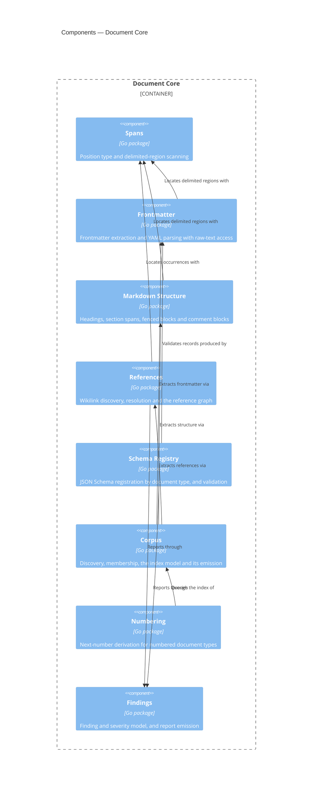

# Document Core

## Overview

Document Core is the general half of the CLI: everything that is true of
*any* corpus of markdown documents that carry YAML frontmatter and
reference each other by slug. It discovers a corpus, parses each
document into a structured record, resolves the reference graph, and
reports findings against schemas and patterns supplied from outside.

It has no knowledge of this framework. It does not know that `adr` is a
document type, that ADR slugs are numbered, or that a component record
block exists. Those facts arrive through the extension point described
under Interface, which [[module-spec-profile]] populates. The test for
whether a capability belongs here is the one
`docs/plans/spec-validation-cli-brief.md` states: could an Obsidian
vault with nothing to do with C4 use it?

That boundary is not tidiness for its own sake. It is what allows the
module to be wrapped in an HTTP API or an MCP server later without first
being extracted from a CLI, and what lets an enterprise with a different
document taxonomy reuse the engine.

- **Role:** parse, index and check a corpus of frontmatter-bearing
  markdown documents, driven entirely by registered configuration.
- **Scope:** in — corpus discovery, frontmatter parsing, JSON Schema
  validation, markdown structure and span extraction, reference graph
  construction, numbering, the index and finding models. Out — any
  document-type vocabulary, any framework-specific rule, and all
  process-level concerns (argument parsing, output rendering, exit
  codes), which belong to the command surface of
  [[container-spec-cli]].
- **Composed into:** [[container-spec-cli]] — a Go module in the same
  repository, imported as a package. See that blueprint for this
  module's relationships to its sibling components.
- **Source & tests:** `cli/core`, with tests beside their subjects per
  Go convention.

## Interface

The module's surface is its Go package API. Two parts of it are
load-bearing enough to state here: the **Profile extension point**,
which is how all domain knowledge enters, and the **Span type**, which
is how every position in the corpus is addressed.

- **Surface:** the exported identifiers of the packages under
  `cli/core`. The `Profile` interface in `cli/core/corpus` is the
  extension point.

**The Profile extension point.** A profile is a value supplied at
startup that registers document types and the rules attached to them.
This is the plugin architecture: Document Core is the host, a profile is
the plugin, and no framework vocabulary is compiled into the host.

- **Guarantees:**
  - The module SHALL accept exactly one active profile per corpus
    operation, supplied by the caller.
  - WHERE no profile is registered, the module SHALL still discover the
    corpus, parse frontmatter, and build the reference graph, reporting
    every document as excluded with reason `unknown-type`.
  - The module SHALL NOT import, reference, or special-case any
    individual profile.
  - WHEN a profile registers a document type, the module SHALL treat
    that type's schema, slug pattern and required headings as the
    authority for documents declaring it.
  - The module SHALL express every position it reports as a `Span`, so a
    caller never receives a bare line number.
  - WHEN a document fails to parse, the module SHALL record the failure
    against that document and continue, so that indexing never fails as
    a whole (AC-SPEC-002.4).
  - The module SHALL NOT write to the filesystem outside a cache
    location the caller supplies.

## Components



### Spans

```component
title: Spans
slug: component-spans
description: Position type and delimited-region scanning shared by every parser
```

(Go package) — Position type and delimited-region scanning shared by
every parser. Owns the `Span` type defined in
[[frd-spec-validation-cli]]: a byte offset and byte length as the
authoritative extent, plus line and column for readability. It also
provides the general delimiter scanner every other parser is built on —
find the region between an opening and a closing delimiter, such as
`---` and `---` for frontmatter or `<!--` and `-->` for a comment block.
Keeping one scanner here is what makes positions consistent across
components: two parsers that locate regions differently will disagree
about where a finding is.

### Frontmatter

```component
title: Frontmatter
slug: component-frontmatter
description: Frontmatter extraction and YAML parsing that preserves each property's raw text
```

(Go package) — Frontmatter extraction and YAML parsing that preserves
each property's raw text. Splits the delimited block and parses it to a
generic document model, which serves both schema validation and — after
conversion to JSON — decoding into the generated typed records. The two
steps share one generic model rather than unmarshalling the source twice,
because generated structs carry no YAML tags. The raw text of each
property is retained alongside the parsed value, because AC-SPEC-003.2
requires validating what the author wrote rather than what a YAML parser
inferred from it.

### Markdown Structure

```component
title: Markdown Structure
slug: component-markdown-structure
description: Headings with their section spans, fenced blocks by info string, and HTML comment blocks
```

(Go package) — Headings with their section spans, fenced blocks by info
string, and HTML comment blocks. Produces the heading tree with the span
of content beneath each heading, extracts fenced blocks whose info
string matches a registered tag and parses their content in the declared
format, and locates HTML comment blocks both as content and as
leftover-scaffolding hygiene. This is the component the
extract-then-review pattern depends on: an agent asks for the spans of
particular sections and reads only those.

### References

```component
title: References
slug: component-references
description: Wikilink discovery, heading-anchor resolution, and the inbound and outbound reference graph
```

(Go package) — Wikilink discovery, heading-anchor resolution, and the
inbound and outbound reference graph. Finds every `[[slug]]` and
`[[slug#Anchor]]` in a document body, records the span at which each
occurs, and resolves them against the corpus. It never scans fenced or
inline code spans, because an illustrative reference inside backticks is
not a reference. Inbound edges are derived, so no document maintains a
list of its own referrers.

### Schema Registry

```component
title: Schema Registry
slug: component-schema-registry
description: Registration of JSON Schemas by document type, and validation producing located findings
```

(Go package) — Registration of JSON Schemas by document type, and
validation producing located findings. A profile registers one schema
per type; this component compiles them once and validates each
document's frontmatter against the schema for its declared type. It
reports every violation in one pass, each with the JSON Pointer at which
it occurred, rather than stopping at the first.

### Corpus

```component
title: Corpus
slug: component-corpus
description: Discovery, membership determination, the index model and its versioned emission
```

(Go package) — Discovery, membership determination, the index model and
its versioned emission. Walks the configured spec root, decides
membership from frontmatter and declared type, records exclusions with
their reason rather than dropping them, and assembles the index every
other capability queries. It orchestrates the parsing components but
holds no parsing logic of its own.

**The index model is `SpecIndex`, and it is generated.** The index
crosses a boundary — CI, agents and a central architecture catalogue all
read it — so its shape is declared once in `schemas/index.strata` and
transpiled to JSON Schema, Go and Markdown with every other model, per
[[adr-016]], rather than being assembled by hand in the emitter. Corpus
populates the generated `specmodel.SpecIndex`; it does not define it.

The vocabulary is:

- **`SpecIndex`** — the root: a `schema_version`, the `workspace`
  identifier from configuration, an ordered list of `entries`, and an
  ordered list of `exclusions`. Both collections are lists rather than
  maps precisely so that the emitter owns their order and can make
  output byte-identical across platforms (AC-SPEC-009.7) without a
  change to the model.
- **`IndexEntry`** — one corpus member: its repository-relative `path`,
  its parsed `frontmatter`, and a `parse_error` carrying a located
  failure for a member whose frontmatter could not be read
  (AC-SPEC-002.4). Exactly one of the latter two is present.
- **`IndexExclusion`** — one candidate file that is not a member: its
  `path`, a `reason` of `no-frontmatter` or `unknown-type`, and — where
  the reason is `unknown-type` — the `type` value the file declared
  (AC-SPEC-001.3, AC-SPEC-001.4).
- **`Span`** and **`ParseError`** — the position type every component
  reports through, and a message paired with one. `Span` is declared
  here, in the generated model, because findings and parse errors carry
  it across the JSON boundary; the Spans component below owns its
  semantics and is the only place spans are computed.

`schema_version` is required and pinned to `1.0` (AC-SPEC-002.2). The
model is additive: later features attach headings, extracted record
blocks and references to the same entry under this same version. Strata
has no notion of a constant, so the emitted value lives in
`cli/core/specindex` alongside the constructor that writes it —
a separate package because `scripts/generate-schemas.sh` rebuilds
`cli/core/specmodel/` from scratch on every run.

The index is not yet a contract document. It has one producer and no
independently-built consumer, so the generated JSON Schema is its interim
machine-readable specification; promotion, with a formal versioning
policy, waits for the first consumer.

### Numbering

```component
title: Numbering
slug: component-numbering
description: Next-number derivation for document types a profile registers as numbered
```

(Go package) — Next-number derivation for document types a profile
registers as numbered. Numbering is global per type: the next ADR number
is one greater than the highest ADR number in the corpus, regardless of
directory. It reads the index rather than the filesystem, so it costs a
query rather than a corpus walk.

### Findings

```component
title: Findings
slug: component-findings
description: The finding and severity model, and emission of the report in human and JSON form
```

(Go package) — The finding and severity model, and emission of the
report in human and JSON form. Owns the three severities
[[frd-spec-validation-cli]] defines — `error`, `warning` and
`unverified` — and the rule that a check which could not run is reported
as `unverified` rather than as passed. Every finding carries a rule
identifier, a severity, a path, a span, and a message stating the
violated constraint and the offending value.

**Corpus → Frontmatter, Markdown Structure, References.** Corpus is the
orchestrator: it walks files and delegates every act of parsing. A
parser that Corpus does not call is unreachable, and parsing logic that
lives in Corpus is misplaced.

**Frontmatter, Markdown Structure, References → Spans.** All three
locate regions through the shared scanner rather than implementing their
own, so every position in a report is computed the same way.

**Schema Registry → Frontmatter.** The registry validates the generic
document model Frontmatter produces. It never reads files.

**Numbering → Corpus.** Numbering is a query over the built index, not
an independent scan.

**Schema Registry, References → Findings.** Every component that can
report a problem produces `Finding` values; none of them formats output.
Rendering belongs to the command surface of [[container-spec-cli]].

## Cross-Cutting Standards

This module SHALL comply with:

- [[testing-standards]] — every component declared below carries unit
  tests covering its exported surface, cited to the acceptance criteria
  they verify.

## Change Guidance

- The module SHALL NOT gain a dependency on [[module-spec-profile]] or
  on any other profile. A capability that cannot be expressed without
  naming a specific document type belongs in a profile, not here.
- WHEN a component needs to report a position, it SHALL do so with a
  `Span` from the Spans component rather than a bare line number, so
  positions stay comparable across components.
- WHEN the index model changes shape, the schema version and the emitted
  index SHALL be updated in the same change, per AC-SPEC-002.2.
- WHEN a new parsing capability is added, it SHALL be built on the Spans
  delimiter scanner rather than scanning independently.
- WHILE visibility is internal, this module and its in-repo consumers
  evolve together: a breaking change to the package API MAY be made in
  the same change as the consumer updates, with no compatibility window.
  WHEN the module is first published for use outside this repository,
  its visibility becomes public and the versioning obligations in the
  module template apply from that point.
- **Verification gates:** `go test ./core/...` for any change in this
  module, plus the fixture-corpus snapshot tests under
  `cli/core/testdata/` that assert the JSON report for each rule. A
  change to Spans additionally runs the property tests over the
  delimiter scanner, which is the highest-risk component because every
  other position derives from it. CI runs the full suite.

## Key Decisions

- [[adr-015]] — Go, `goccy/go-yaml`, `santhosh-tekuri/jsonschema` and
  `goldmark` are the implementation choices this module is built on.
- [[adr-016]] — Strata is the single source for generated models, which
  is why the index model this module emits is declared in
  `schemas/index.strata` rather than written as Go structs.
- [[adr-014]] — acceptance-criteria notation is deferred, so no
  component here parses acceptance criteria.
- [[adr-012]] — the `[[slug]]` and heading-anchor conventions the
  References component implements.

## Open Questions

- [ ] Whether the index cache is invalidated by file modification time
      or by content hash. Mtime is cheaper; hashing is correct across
      checkouts and clock skew. Bears directly on whether the warm-index
      latency in REQ-SPEC-009.1 holds in CI, where checkouts are fresh.
- [ ] Whether Findings should adopt `samber/oops` for structured error
      context, as raised in [[adr-015]]. Deferred to implementation; it
      affects this component's API shape.

## References

- `c4-guide.md` — C4 mapping rules and diagram conventions
- [[container-spec-cli]] — the container this module is composed into
- [[frd-spec-validation-cli]] — the requirements it implements
- [[module-spec-profile]] — the profile that registers into this module
