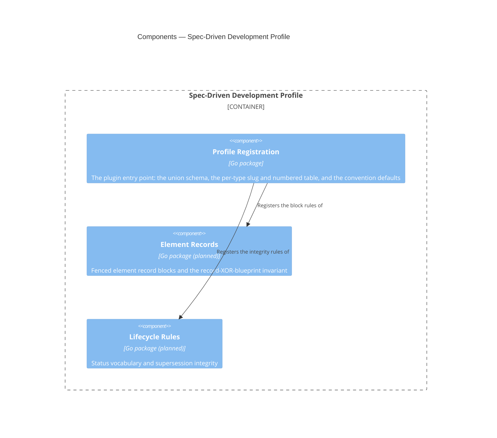

# Spec-Driven Development Profile

## Overview

This module is the domain half of the CLI. It knows that an ADR is a
document type, that its slug is `adr-<nnn>`, and that ADRs are numbered
while FRDs are not. [[module-document-core]] knows none of that, and this
module is how it arrives. A fuller vocabulary — that a container
blueprint declares un-promoted components as fenced record blocks, that a
retired document names its successor — is designed below and not yet
registered.

It is a **plugin**: it holds no engine of its own and implements no
parsing. Every capability it needs — frontmatter extraction, schema
validation, reference resolution, span queries — comes from Document
Core, and this module's job is to register vocabulary and rules into
that host through the extension point Document Core defines. The
dependency runs one way, and the value of that is concrete rather than
aesthetic: an enterprise with a different taxonomy writes a different
profile and reuses the whole engine.

Most of this module is configuration rather than code, and as built it is
configuration almost exclusively: the vocabulary is one generated union
schema plus a table of slug patterns and numbered flags, and the module's
whole implementation is a single Go file supplying them. Only rules that
cannot be expressed as data — the element-record invariants and the
lifecycle integrity checks, neither yet implemented — would be code here.

- **Role:** supply this framework's document vocabulary and its
  non-schema-expressible rules to Document Core.
- **Scope:** in — the one union schema over every document type, each
  type's slug pattern and numbered-ness, the convention defaults, and (as
  later capabilities) required sections, named section sets, element
  record blocks and their invariants, and status lifecycle integrity.
  Out — all parsing, indexing and reference resolution, which belong to
  Document Core; and all process-level concerns, which belong to the
  command surface of [[container-spec-cli]].
- **Composed into:** [[container-spec-cli]] — a Go module in the same
  repository, imported as a package and activated by configuration. See
  that blueprint for this module's relationships to its sibling
  components.
- **Source & tests:** `cli/profile`, with tests beside their subjects
  per Go convention.

## Interface

This module's surface is deliberately narrow: it exports one
constructor returning a value satisfying Document Core's `Profile`
interface. Everything else is internal.

- **Surface:** the exported `New` constructor in `cli/profile`,
  returning a `corpus.Profile`. The registered content — types,
  schemas, patterns — is described by
  [[contract-specs-configuration]].

- **Guarantees:**
  - The module SHALL implement Document Core's `Profile` interface
    without requiring changes to that interface for framework-specific
    reasons.
  - The module SHALL register every document type this framework
    defines, so a corpus authored to the framework produces no
    `unknown-type` exclusion for a conforming document.
  - The module SHALL NOT parse document text directly; it registers
    schemas, patterns and predicates that Document Core applies.
  - WHERE a rule is expressible as a JSON Schema or a pattern, the
    module SHALL register it as data rather than implement it as code.
    [[contract-specs-configuration]] does not expose that data publicly
    in v1, so the reason is not adopter override but reviewability: a
    registered pattern is checkable against the template it mirrors,
    while the same rule buried in a predicate is not.

**Built — single-schema profile.** `cli/profile.New` returns a value
satisfying `corpus.Profile`, registered under the name `spec-driven-dev`.
It supplies three things and nothing else: **one** embedded union schema
(`cli/core/schema/spec-model.schema.json`, via Go's `//go:embed`, so the
binary reads no schema file at runtime), a thin per-type table of slug
pattern and numbered-ness for every `DocumentType`, and the `line_width`
convention default of 80 codepoints. There is no per-type schema, no
required-sections tree, no named section sets and no element-record
registration.

**The host's extension point is wider than what this profile fills.**
`corpus.DocumentTypeRules` now carries a type's reference-bearing
properties, its typed references and its pairings, and `corpus.Profile`
carries a `Lifecycle()` member supplying the status vocabulary, the live
and retired statuses and the successor property. This profile returns the
zero lifecycle registration and registers no reference property yet: the
registered set is to be derived from `schemas/frontmatter.strata` rather
than transcribed from it, so it lands with the change that derives it.
Until then the checks that read those registrations do not run, which is
a profile whose documents the lifecycle says nothing about rather than a
placeholder the host has to recognise.

The components below have been reconciled to that shape: the separate
Document Types "type registry" is gone, folded into Profile Registration,
and Element Records and Lifecycle Rules are retained as designed but
marked not yet built.

**The registered patterns are grounded in this repository's corpus, not
transcribed from the prefix registry**, and in three places the two
disagree. Feature blueprints: the registry assigns `fb-`, while this
repository's one real feature blueprint is slugged
`feature-spec-validation-cli`, so the pattern follows the document that
exists. Guides: the registry has no row at all and this repository's four
guides split two-and-two on a `guide-` prefix, so the pattern is the
type's least restrictive form. RFCs: this repository mixes a numbered
form (`rfc-0007`) with an unnumbered self-critique form, so `Numbered` is
false for the type — a "highest number in use" query would silently
ignore every `self-` document, which is worse than not offering `next-id`
for RFCs at all. Each divergence is recorded at the table in
`cli/profile/profile.go`; the Change Guidance below is what obliges a
template change to come back here.

## Components



**One component is built.** Profile Registration is the whole of the
module today — `cli/profile/profile.go`, one file. Element Records and
Lifecycle Rules are planned and carry no package, so the two edges into
them describe the intended wiring rather than an existing one.

**The separate "Document Types" component has been removed.** The
earlier design gave it a type registry holding a schema per type, and the
host it would have registered into was never built that way: Document
Core's extension point accepts exactly one
union schema instead, precisely so the host never has to choose which
schema to reach for. What remains of a per-type registry is a two-column
table — slug pattern and numbered flag — small enough that a component of
its own would be a directory containing a map literal. It lives in
Profile Registration alongside the schema it complements.

### Profile Registration

```component
title: Profile Registration
slug: component-profile-registration
description: The plugin entry point supplying the union schema, the per-type slug and numbered table, and the convention defaults
```

(Go package) — The plugin entry point supplying this framework's
vocabulary to Document Core. It is the only component the host sees, and
it holds no engine and no parsing of its own. Its value is that the
conformance surface is one file: whether this module is a well-behaved
plugin is answerable by reading it.

**Built** — `cli/profile`. `New` returns a `corpus.Profile` whose four
members are the whole of what this framework tells the host:

| Member | Registers |
|---|---|
| `Schema()` | the embedded union schema over every document type |
| `DocumentTypes()` | per type, its slug pattern and whether it is numbered; its reference-bearing properties, typed references and pairings are not yet registered |
| `Conventions()` | the `line_width` default of 80 codepoints |
| `Lifecycle()` | nothing yet — the zero registration, so no status is treated as live or retired and no successor property is named |

**The union schema is generated, not authored here.** It comes from
`schemas/*.strata` through `scripts/generate-schemas.sh`, which emits
`cli/core/schema/spec-model.schema.json` and the matching Go vocabulary
in `cli/core/specmodel`. This module embeds the result. Two mechanisms
keep the registered vocabulary and the generated `DocumentType`
constants from drifting: the per-type table is keyed by those constants
rather than by string literals, so a renamed or removed type fails to
compile here; and `TestDocumentTypesCoversEveryVocabularyValue` asserts
one table entry, with a compiling slug pattern, for every value in the
generated vocabulary, so an *added* type fails the suite.

Required sections, named section sets and the heading-tree requirement
described in [[contract-specs-configuration]] are later capabilities.
None is registered, because Document Core's extension point has nowhere
to receive them yet — widening it is a change to the host, per the
Change Guidance below. The reference and lifecycle registrations are no
longer in that position: the host has been widened to receive them, and
what remains is for this module to derive and register its own.

### Element Records

```component
title: Element Records
slug: component-element-records
description: Fenced element record blocks and the invariant that a child is a record block or a blueprint link, never both
```

(Go package) — Fenced element record blocks and the invariant that a
child is a record block or a blueprint link, never both. Registers the
`component` fence tag so Document Core extracts and parses those blocks,
supplies the base record schema they validate against, and implements
the record-XOR-blueprint-link rule from [[adr-008]] — the one rule here
that no schema can express, because it is a constraint between a block
and a sibling link rather than a constraint on a value.

**Not yet built.** No fence tag is registered and no record schema is
supplied, because Document Core has neither a Markdown Structure
component to extract fenced blocks nor an extension-point member through
which a tag could be registered. Building this component means widening
the host first; it is not blocked on this module.

### Lifecycle Rules

```component
title: Lifecycle Rules
slug: component-lifecycle-rules
description: The status vocabulary and the supersession and retirement integrity rules
```

(Go package) — The status vocabulary and the supersession and retirement
integrity rules. The vocabulary itself is registered as a schema
constraint on `status`; what needs code is the relational part — that a
retired document names a resolvable successor, and that live documents
referencing a retired one are surfaced.

**Not yet built.** The status vocabulary itself *is* registered, because
it is a schema constraint and the union schema carries it. The relational
half is not: `superseded_by` naming a document that does not exist is
currently unreported, since resolving it needs Document Core's References
component, which is also not built.

**Profile Registration → Element Records, Lifecycle Rules.** Registration
is a pure wiring layer: each component exposes what it registers, and
Registration hands it to the host. No component here reaches the host
directly, so there is exactly one place to look when the plugin contract
changes. Today it is the only place, because it is the only component.

## Cross-Cutting Standards

This module SHALL comply with:

- [[testing-standards]] — every component declared below carries unit
  tests covering its exported surface.

Its registered rules derive from this framework's own reference
documents —
`plugin/skills/spec/references/frontmatter-standards.md`,
`plugin/skills/spec/references/template-authoring-standards.md` and
`plugin/skills/spec/references/cross-document-references.md` — which
are shipped with the `spec` skill rather than authored as project
standards documents. The derivation is not literal transcription: the
union schema reaches this module through `schemas/*.strata`, and each
slug pattern was checked against the documents this repository actually
holds before being registered, which is where the three divergences noted
under Interface come from.

## Change Guidance

- WHEN this framework's document vocabulary changes — a type added, a
  slug pattern altered, a required section introduced — the registered
  schema or pattern here SHALL be updated in the same change as the
  template or standard that defines it. This module is a copy of rules
  owned elsewhere, and a copy that lags is worse than no check at all.
- The module SHALL NOT implement parsing, indexing or reference
  resolution. WHEN a rule appears to need one of those, the capability
  belongs in [[module-document-core]] and this module registers against
  it.
- The module SHALL NOT require a change to Document Core's `Profile`
  interface for a framework-specific reason. WHEN a rule cannot be
  expressed through the existing extension point, that is a signal the
  extension point is too narrow, and widening it is a change to the host
  reviewed on its own merits — not a special case for this profile.
- WHILE visibility is internal, this module and its in-repo consumers
  evolve together, with no compatibility window.
- **Verification gates:** `go test ./profile/...` for any change here,
  which includes the conformance test asserting that this module
  satisfies Document Core's `Profile` interface, the vocabulary-coverage
  test above, and the self-application gate in
  `cli/profile/self_application_test.go` that runs discovery and checking
  over this repository's own corpus. That last gate is the one that
  catches a registered schema drifting from the templates it mirrors —
  and it is rooted at `specs/`, not `docs/`, which is the repository's
  actual corpus root per `specs.toml`. It resolves that root from its own
  file's location and fails outright if `specs.toml` and `specs/` are not
  there, because a gate that passes over zero documents is worse than no
  gate. CI runs the full suite.

## Key Decisions

- [[adr-008]] — element record blocks and the two-schema model this
  module's Element Records component will implement when it is built.
- [[adr-012]] — the reference conventions the registered types rely on.
- [[adr-014]] — acceptance-criteria validation is deferred, so no
  component here registers AC rules.
- [[adr-015]] — Go, and the profile-as-package composition model.

## Open Questions

- [ ] `kind` is `standard` because exactly one profile exists. WHEN a
      second profile is written — an enterprise taxonomy, or a stripped
      Obsidian-vault profile — this blueprint SHOULD be reconsidered as
      `kind: pattern`, governing how any profile is built, with the
      profiles as instances. Deciding early would be inventing a pattern
      from one example.
- [ ] How much of the vocabulary should be shipped as data files versus
      compiled-in defaults. The registered form is settled and v1
      exposes none of it publicly, so this is purely a question of where
      the bytes live — but it forces the answer to the promotion
      question in [[contract-specs-configuration]], because a data file
      is most of the way to an override mechanism already. As built,
      everything is compiled in: the schema through `//go:embed` and the
      per-type table as a Go map, so the binary reads no vocabulary file
      at runtime. That is an implementation default taken to keep the
      binary self-contained, not an answer to this question.
- [ ] Whether the deferred domain rules — AC traceability, C4 diagram
      conventions, blueprint AC-coverage keys, work-order readiness —
      become components here or a second profile layered on this one.
      They are out of scope for the current feature and the answer is
      not yet forced.

## References

- `c4-guide.md` — C4 mapping rules and diagram conventions
- [[frd-spec-validation-cli]] — the requirements this module's
  registrations satisfy
- [[container-spec-cli]] — the container this module is composed into
- [[module-document-core]] — the host it registers into
- [[contract-specs-configuration]] — the configuration surface it
  populates and extends
- [[adr-008]] — the record-block-XOR-blueprint-link invariant this
  profile registers as a rule
- [[adr-012]] — the reference conventions its slug patterns resolve
  against
