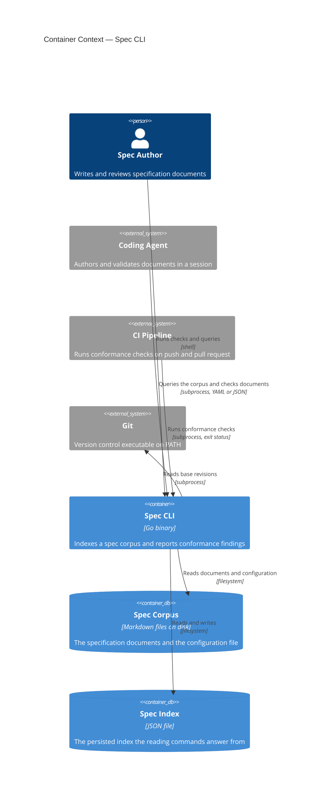
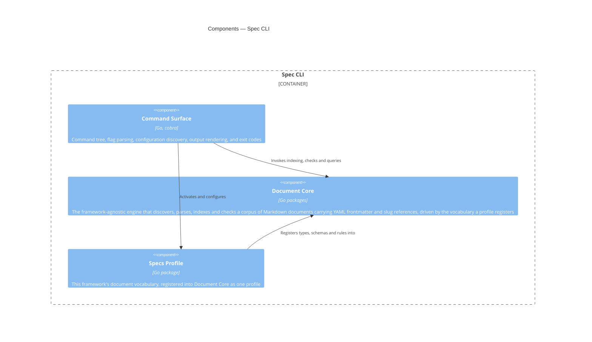

# Spec CLI

## Overview

The Spec CLI is the `specs` binary: the one deployable unit of this
framework's specification tooling. It walks a specification corpus, which
is the set of Markdown documents under one directory, the spec root. It
builds an index of each document's metadata, structure, and references,
and it answers queries over that index. It also reports conformance
findings: places where a document breaks a rule that the active profile
registers. A profile is a compiled-in vocabulary of document types,
schemas, and rules, and `specs.toml` selects one by name.

Each indexing, query, and conformance capability lives in a module that
the container composes: [[module-document-core]] or
[[module-spec-profile]]. The container adds the commands over them and the
index cache on disk.

### Responsibility

The Spec CLI presents its modules' capabilities as a command-line interface.
It owns the process-level concerns the modules leave out: the command tree
and its flags, finding and validating the `specs.toml` configuration file,
rendering each answer (what a command writes to standard output), choosing
the exit status, and persisting the index between runs.

### Does not own

Corpus discovery, parsing, the reference graph, every conformance check, and
the index's data model — [[module-document-core]] owns them.

The document types, slug patterns, Gherkin tag vocabulary, and convention
defaults such as line width — [[module-spec-profile]] owns them.

What each command does, and its acceptance criteria — the following FRDs
own it, and [[frd-spec-index]] owns the set of commands itself:

| Command | Owning FRDs |
|---|---|
| `index`, `slug-exists`, `next-id` | [[frd-spec-index]] |
| `check` | [[frd-spec-index]], [[frd-spec-reference-integrity]], [[frd-spec-anchor-references]], [[frd-gherkin-adoption]], [[frd-spec-c4-diagrams]] |
| `refs` | [[frd-spec-reference-integrity]], [[frd-spec-anchor-references]] |
| `links` | [[frd-spec-markdown-links]] |
| `feature`, `criterion` | [[frd-gherkin-adoption]] |
| `headings` | [[frd-spec-structure]] |
| `list` | [[frd-spec-list]] |
| `c4` | [[frd-spec-c4]] |

What a command prints — [[cli-output-standards]] owns it.

What each exit status means, and which one a run reports —
[[cli-exit-status-standards]] owns it.

### Runtime

The CLI is a single statically linked binary that runs once per command.
It has no daemon, no persistent process, and no network listener, and it
scales only as far as the process that runs it.

## Tech stack

**Language:** Go, built as one statically linked binary. [[adr-015]]

**Command tree:** the `spf13/cobra` library, which provides commands,
flags, and the help output rendered from their declarations.

**Configuration:** `BurntSushi/toml` decodes `specs.toml`, and
`santhosh-tekuri/jsonschema` validates it against the schema generated from
`schemas/config.strata`. [[adr-016]]

**Link maps:** `goccy/go-yaml` reads the link-map file a caller passes to
`links`, which maps each document's slug to the path a link to it uses.
Because JSON is valid YAML, a map written as JSON reads unchanged.
[[adr-015]]

**Base revisions:** the `git` executable, which reads the corpus as it
stood at an earlier commit, the base revision. Only `criterion --changed`
runs it. [[adr-031]]

**Build and release:** `scripts/build-release.sh` cross-compiles every
target with cgo disabled, and `.github/workflows/release.yml` publishes
tagged releases.

`cli/go.mod` holds the full dependency list, and each Module Blueprint
names the technologies that module adds.

## Container context



**Spec Author → Spec CLI.** A person runs a command in a shell to check a
document before review or to query the corpus. They reach the CLI through
its command tree. [[cli-output-standards]] governs what a command prints,
and [[cli-exit-status-standards]] governs its exit status.

**Coding Agent → Spec CLI.** An agent runs the CLI as a subprocess and reads
its answer instead of reading the documents. It uses the same command tree
under the same standards. The boundary sits at the process so that an agent
needs nothing but the binary.

**CI Pipeline → Spec CLI.** An adopting repository runs `specs check` in
its build and reads the exit status. The pipeline needs no runtime beyond
the binary.

**Spec CLI → Spec Corpus.** The CLI reads Markdown documents and one
`specs.toml`, whose format [[contract-specs-configuration]] governs. The
corpus belongs to its authors, and the CLI never writes a document in it.

**Spec CLI → Spec Index.** The CLI reads and writes `specs.json` in the
spec root. The file is data this container owns (see Data).

**Spec CLI → Git.** `criterion --changed` reads the corpus at a base
revision through the `git` executable, as [[adr-031]] decides. No other
command runs it.

## Components



Command Surface activates exactly one profile per run: the one that
`[profile].name` in `specs.toml` names. It fills each convention that
`specs.toml` leaves unset with that profile's default, and passes the
profile to Document Core. It delegates every indexing, checking, and query
call to Document Core, and converts the results into standard output and an
exit status. Specs Profile registers its document types, schemas, slug
patterns, and rules into Document Core through `corpus.Profile`, a Go
interface that Document Core defines.

### Command Surface

```component
entity_name: Command Surface
slug: component-command-surface
description: Command tree, flag parsing, configuration discovery, output
  rendering, and exit codes
technology: Go, cobra
```

(Go, `cobra`) — Command tree, flag parsing, configuration discovery, output
rendering, and exit codes. It is the only component this container owns
outright. Its code is the `cmd` package in `cli/cmd`, and the binary's
`main` function is in `cli/specs/main.go`. Each subcommand converts its
flags into module calls and converts the result into an answer and an exit
status. The `Execute` function in `cli/cmd/exit.go` runs the command tree
that the `newRootCmd` function in `cli/cmd/root.go` builds, and classifies
every error.

It hides how `specs.toml` is found and validated (the `Load` and
`discoverConfig` functions in `cli/cmd/config.go`), how a caller's link map
is read (the `LoadLinkMap` function in `cli/cmd/linkmap.go`), how an answer
is rendered as YAML (the `renderYAML` function in `cli/cmd/yaml.go`), and
how an error maps to an exit status (`cli/cmd/exit.go`). The profile
registry, the `Registry` type in `cli/cmd/registry.go`, maps each
`[profile].name` value to the profile it activates.

### Document Core

See [[module-document-core]] (internal). (Go packages) — The
framework-agnostic engine that discovers, parses, indexes and checks a
corpus of Markdown documents carrying YAML frontmatter and slug references,
driven by the vocabulary a profile registers.

### Specs Profile

See [[module-spec-profile]] (internal). (Go package) — This framework's
document vocabulary, registered into Document Core as one profile.

## Design

### Architectural style and patterns

Plugin, Microkernel (Buschmann et al., *POSA Vol. 1*) — Document Core is
the kernel, Specs Profile is the plugin, and Command Surface selects one
plugin per run from the profile registry. It serves the rule in
[[contract-specs-configuration]] that the CLI applies exactly one profile
per invocation. It rules out a kernel that knows a profile's vocabulary.
[[module-document-core]] enforces that with its invariant that no package
under `cli/core` imports a package under `cli/profile`.

Layers (Buschmann et al.) — Command Surface sits above both modules, and
Specs Profile above Document Core, with dependencies pointing down only.
It serves the test strategy [[testing-standards]] sets. Command Surface is
thin, so snapshot cases assert its behavior instead of unit tests of
argument plumbing. A snapshot case runs a command over a fixture corpus
under `cli/testdata/cases/` and compares the result with the expected
output committed beside it. The pattern rules out domain logic in Command
Surface (see Invariants).

### Invariants

Command Surface SHALL NOT decide whether a document conforms, how a check
scores, or which records a query selects. Enforced by: review only.

The Spec CLI SHALL NOT create, modify, or delete a corpus document. Enforced
by: `TestLinksCreatesModifiesAndDeletesNoFile` in `cli/cmd/links_test.go`
for `links`, and review only for every other command.

Each command's help text SHALL be cobra's default rendering of that
command's `Use`, `Short`, `Long` and flag declarations, with no custom help
function or help or usage template. Enforced by: review only.

Command Surface SHALL locate the repository root by the presence of a
`.git` entry, without running `git`. Enforced by:
`TestDiscoveryStopsAtTheRepositoryRoot` in
`cli/cmd/config_discovery_internal_test.go`, which marks the root with an
empty `.git` directory or file that `git` can't read as a repository.

### Extension points

A new command — implement the capability in [[module-document-core]] or
[[module-spec-profile]], then add a cobra command in `cli/cmd` that converts
its flags into module calls and the result into an answer. Not by adding
selection, matching, or validation logic to `cli/cmd`.

A new profile — implement the profile registration that
[[contract-specs-configuration]] describes, and register the profile in the
profile registry (the `BuiltinRegistry` function in
`cli/cmd/registry.go`). Not by teaching Document Core the new vocabulary.

## Provided Contracts

**Public** (consumable outside the system):

[[contract-specs-configuration]] — the `specs.toml` format an adopting
repository authors, and the profile registration beneath it.

## Consumed Contracts

None. The CLI calls no service and depends on no interface that another
team provides.

## Data

- **Spec Index** (JSON file, `specs.json` in the spec root) — the built
  index that the reading commands (every command except `index`) answer
  from, and the file `index` writes. Schema source of truth:
  `schemas/index.strata`, generated into the Go package
  `cli/core/specmodel`. Exclusively owned by this container.
  - [[component-corpus]]'s invariants decide when the persisted index is
    current and when it's rebuilt.
  - The Spec CLI SHALL produce the same answer and exit status whether or
    not `specs.json` is present. Enforced by:
    `TestTwoListRunsOverAnUnchangedCorpusEmitTheSameBytesInIndexOrder` in
    `cli/cmd/list_test.go` and
    `TestTwoC4RunsOverAnUnchangedCorpusEmitTheSameBytes` in
    `cli/cmd/c4_test.go` for `list` and `c4`, and review only for every
    other command.
  - IF a reading command can't write the index it built, THEN the Spec CLI
    SHALL answer with the same output and exit status as when the write
    succeeds (AC-SPEC-010.7). Enforced by:
    `TestAQueryThatCannotPersistTheIndexAnswersUnchanged` in
    `cli/cmd/index_persist_test.go`.
  - WHEN a change alters the meaning or type of a property that an emitted
    index has carried, or removes one, the change SHALL bump
    `schema_version` (AC-SPEC-002.2). Enforced by: review only.
  - WHEN a change adds to the index shape without altering a property an
    emitted index has carried, the change MAY keep `schema_version`.
  - WHERE no emitted index has ever carried a property, a change MAY alter
    or remove that property without bumping `schema_version`.

The emitted index has no independently built consumer, so it has no
Contract. The JSON Schema generated from `schemas/index.strata` is its only
consumer-facing specification. The `schema_version` rules in this section
cover what a consumer can rely on until a Contract exists.

## Infrastructure and deployment

### Exclusive infrastructure

None. The CLI has no database, no queue, and no network dependency at run
time. The index file is data (see Data).

### Deployment

The container belongs to no documented system (it's standalone), so this
section is authoritative for its deployment.

The CLI ships as one statically linked binary per platform. It installs in
either of two ways. One is `go install` of `cli/specs` through the Go module
proxy, which can be mirrored on premises. The other is an archive attached
to a tagged release, published with a `SHA256SUMS` checksum file.
`scripts/build-release.sh` holds the target matrix and build flags, and
`.github/workflows/release.yml` publishes the release.

The release build SHALL disable cgo, so that each binary runs with no
language runtime installed (AC-SPEC-009.4). Enforced by: review only. The
`no-runtime` job in `.github/workflows/cli.yml` runs a binary built with cgo
disabled in an image that holds no language runtime, but it builds that
binary itself instead of through `scripts/build-release.sh`.

The main package SHALL stay in `cli/specs/`, because Go names an installed
binary after the directory holding its main package, and the binary is
`specs`. Enforced by: review only.

Each release tag SHALL carry the `cli/v` prefix, because the module lives in
`cli/` and the Go module proxy resolves a subdirectory module's versions
only from tags with that prefix. Enforced by: `TAG_PREFIX` in
`.github/workflows/release.yml`.

## Cross-cutting Standards

This container SHALL comply with [[testing-standards]]: unit tests per
component, snapshot cases for observable behavior, and the coverage that
ties both to acceptance criteria.

This container SHALL comply with [[cli-output-standards]]: what every
command prints.

This container SHALL comply with [[cli-exit-status-standards]]: the exit
status of every command and what reaches each stream on failure.

## Change guidance

WHEN a capability is added to the command surface, the capability SHALL be
implemented in [[module-document-core]] or [[module-spec-profile]].

WHEN Document Core gains a conformance rule, `checkRules` in
`cli/cmd/check.go` SHALL declare it in the same change, so that `--only` can
name it and a clean run reports it as passed.

WHEN a change alters a command's observable output, the same change SHALL
carry the snapshot cases' expected artifacts, regenerated with
`scripts/regenerate-cli-snapshots.sh`. [[testing-standards]] sets how the
resulting diff is reviewed.

### Verification gates

#### Verify always

`cd cli && go test ./cmd/...` — the Command Surface unit tests and the
snapshot cases under `cli/testdata/cases/`.

#### Verify conditionally

WHEN a change touches `cli/specs/`, configuration discovery, or exit
statuses, run `cd cli && go test ./specs/...`, the end-to-end tests that
run the built binary.

WHEN a change reaches into a module, run that module's Verification gates.

WHEN a change touches the build or release, run
`scripts/build-release.sh <version> <out-dir>`, which the `cross-compile`
job of `.github/workflows/cli.yml` runs on every pull request that is ready
for review.

## Key decisions

[[adr-015]] — Go is the implementation language.

[[adr-016]] — Strata is the single source for generated schemas, including
the one `specs.toml` is validated against.

[[adr-021]] — Gherkin is the notation for features and acceptance criteria.
`feature` and `criterion` query the records Document Core extracts.

[[adr-031]] — `criterion --changed` reads its base revision through the
`git` executable, so that one command needs `git` on `PATH`.

## Open questions

- [ ] Whether the CLI ships a `serve` mode that holds the index in memory
      across queries. It isn't required: AC-SPEC-009.1 states a latency
      target, not a gate, and a warm run (one that reads a current
      `specs.json`) meets it on a quiet machine. It's the natural home for
      filesystem watching, a follow-on capability. Blocks nothing today.
- [ ] Whether Document Core's Findings component should adopt `samber/oops`
      for structured error context, as [[adr-015]] raises. Findings carry
      their structure in the `FindingDetail` union type generated from
      `schemas/finding.strata`, and internal errors are wrapped with
      `fmt.Errorf`.
