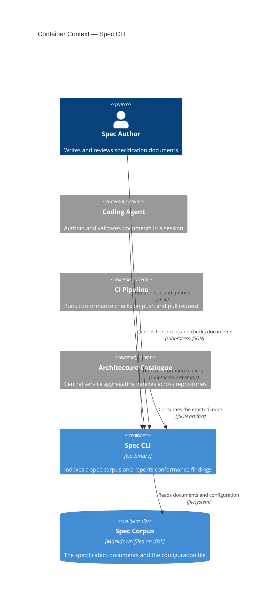
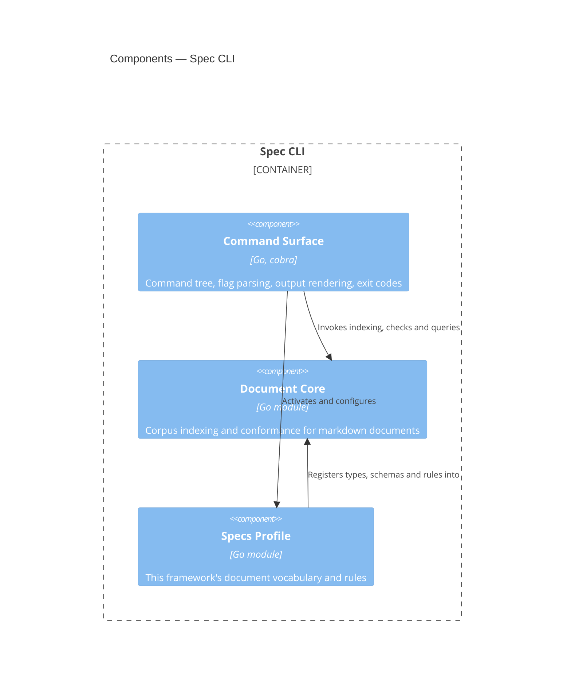

# Spec CLI

## Overview

The Spec CLI is the single deployable artifact realizing this
framework's specification tooling. [[frd-spec-index]] is the
first of the feature requirements documents it serves, and this
blueprint describes the container as a whole rather than that one
feature. It walks a specification corpus, builds a
machine-readable index of every document's metadata, structure and
relationships, and reports deterministic conformance findings against
the rules the active profile registers.

The container itself is deliberately thin. Every capability lives in one
of two composed modules — [[module-document-core]], which knows about
markdown documents with frontmatter that reference each other, and
[[module-spec-profile]], which supplies this framework's document
vocabulary. The container contributes only the command surface: argument
parsing, configuration loading, output rendering, and exit codes. That
split exists so the same capabilities can later be wrapped in an HTTP
API or an MCP server without extracting them from a CLI first.

- **Responsibility:** present the indexing and conformance capabilities
  of its composed modules as a command-line interface, and own the
  process-level concerns those modules deliberately do not — argument
  parsing, configuration discovery, output format, and exit status.
- **Technology:** Go, `cobra` for the command tree. See [[adr-015]] for
  the language decision and its measured basis.
- **Runtime:** a single statically linked binary, invoked per command.
  No daemon, no persistent process, no network listener.

## Container Context



**Spec Author → Spec CLI.** A human runs the CLI directly to check a
document before review, or to ask what identifier is next. The surface
is the command tree and its `--help` output.

**Coding Agent → Spec CLI.** An agent invokes the CLI as a subprocess
and parses its JSON output, rather than reading documents itself. This
is the interaction the latency requirements in FEAT-SPEC-009 exist for:
the agent asks one question and acts on the answer.

**CI Pipeline → Spec CLI.** An adopting repository runs the CLI in its
build and fails on a non-zero exit status. The CLI is invoked as a
subprocess with no runtime installed beyond the binary itself.

**Architecture Catalogue → Spec CLI.** A central service consumes the
emitted index to compose an organization-wide architecture graph. The
CLI does not push; it emits an artifact that a pipeline uploads, so the
CLI has no network dependency and no knowledge of the catalogue. The
index schema that governs this exchange is not yet a contract document —
see Open Questions.

**Spec CLI → Spec Corpus.** The CLI reads markdown documents and one
configuration file, and writes nothing. Read-only operation is a
property of this feature, not an implementation detail:
[[frd-spec-index]] places document modification out of scope.
`links` re-affirms rather than narrows this: its rewritten document goes
only to standard output, and it creates, modifies and deletes no file
(AC-SPECMD-005.3) — including the derived index cache the "Data" section
below describes `check`, `refs`, `slug-exists` and `next-id` writing on a
cold cache, which `links` opens warm without persisting for exactly this
reason.

## Components



### Command Surface

```component
entity_name: Command Surface
slug: component-command-surface
description: Command tree, flag parsing, configuration discovery, output rendering and exit codes
```

(Go, `cobra`) — Command tree, flag parsing, configuration discovery,
output rendering and exit codes. This is the only component the
container owns outright. It resolves `specs.toml`, activates the
profile, dispatches to Document Core, and turns findings into either
human-readable text or the JSON that AC-SPEC-006.5 requires. It holds no
domain logic: a check that lives here rather than in a module is a
layering defect, because it would be unavailable to a future API or MCP
wrapper.

**Built (configuration resolution)** — `cli/cmd`. `Load` reads and
checks `specs.toml` against the generated
`cli/core/schema/specs-config.schema.json`, reporting every defect in one
run — an offending key with its span (AC-SPEC-008.4), never defaulted
(AC-SPEC-008.5) — through the same `finding.Report` a corpus check
produces its findings through. It resolves `[workspace].root` relative to
the configuration file's own directory (AC-SPEC-008.1) and, on a clean
run, returns the spec root, workspace identifier, activated profile and
resolved conventions the rest of the container needs (AC-SPEC-008.2). An
absent `specs.toml` is reported as `*cmd.ErrConfigNotFound` rather than a
finding, per [[contract-specs-configuration]]'s "no file to carry a span
into" (AC-SPEC-008.3).

`Registry` is the profile registry [[contract-specs-configuration]]
names as the customization seam: it maps a `[profile].name` value to a
`corpus.Profile`, and `BuiltinRegistry` is the one place in this
container that imports `cli/profile` to register `specs` as
the built-in. `[profile].name` naming no entry in the registry is
reported as a finding listing the registered names, not a bare lookup
failure.

Once `[profile].name` resolves to a registered profile, `Load` also runs
`corpus.ValidateRegistration` against it. A registration is compiled in
and has no position of its own, so every defect it reports is turned
into a finding positioned at `[profile].name` — the one place in
`specs.toml` that selected it — naming the offending key and, where the
defect belongs to one document type rather than the profile's lifecycle
registration, that type (AC-SPECREF-004.3). As with every other
`specs.toml` defect, a registration defect is never defaulted around: no
`Config` is resolved while one is reported.

**Built (link-map reading)** — also `cli/cmd`, beside `Load` and reading
the same way: `LoadLinkMap` takes a caller-named YAML file — a mapping
whose keys are corpus document slugs and whose value per slug is a
record carrying a `path` string — and resolves it to a `LinkMap`
(AC-SPECMD-005.4). A property other than `path` is ignored, so the file
can carry a caller's own per-document data the CLI never interprets
(AC-SPECMD-005.6); decoding with `goccy/go-yaml` ([[adr-015]]) means a
map written in JSON is accepted unchanged, JSON being valid YAML
(AC-SPECMD-005.7). The link map is caller-supplied file input, not
repository configuration, so unlike `specs.toml` there is no
not-found contract of its own: a file that cannot be read or parsed, or
a record declaring no `path`, is reported as a finding naming the file
and the fault, with no map resolved at all — never partially, the same
discipline `Load` applies to `specs.toml` (AC-SPECMD-005.8). A slug
repeated as a top-level key is a parse fault `goccy/go-yaml` itself
rejects as a duplicate mapping key, rather than one record silently
winning. `LoadLinkMap` performs no interpretation, resolution or
normalization of a `path` value; it is read and returned exactly as
written.

**Built (command tree)** — also `cli/cmd`, via `cobra`
([[adr-015]]): `Execute` builds the command tree — `index`, `check`,
`slug-exists`, `next-id`, `refs`, `links`, `feature`, `criterion`,
`headings`, `list`, `c4` — and converts each one's flags into calls against Document Core
(`corpus.Build`, `corpus.Open`, `corpus.Load`, `corpus.Corpus.Check`/`CheckFor`,
`corpus.Corpus.Slug`, `corpus.Corpus.InboundReferences`/`OutboundReferences`,
`corpus.Corpus.Feature`/`Features`/`FeaturesByCode`,
`corpus.Corpus.Criterion`/`CriteriaOf`/`CriteriaByTag`,
`corpus.Corpus.DocumentSummaries`, `corpus.Corpus.C4Model`,
`numbering.Next`, `references.Extract`/`Resolve`,
`mdlinks.Resolve`/`Substitute`, `gherkin.Render`) and its result back into
stdout and an exit status. No file here decides what makes a document
valid or scores a check; every one of those calls is the whole of what a
subcommand does with what it receives.

**Built (exit statuses)** — `cli/cmd/exit.go`, per
[[cli-exit-status-standards]]. Every run exits with one of five statuses
and no other: `0` success; `1` a gate failed (the corpus author acts);
`2` an invocation error — an unknown command or flag, a missing or
surplus argument, a value outside a registered set, an operand the
command cannot act on (the caller acts); `3` an environment error — no
`specs.toml`, a `specs.toml` defect, an output path that cannot be
written (the repository's maintainer acts); `4` an internal error (this
tool's maintainer acts). A gate failing is not an error: it sets the
status and returns its findings as the answer. A run ending `2`, `3` or
`4` returns a classified error instead (`invocationError`,
`environmentError`, `internalError`); an error cobra raises before any
command runs is `2`, an unclassified `*fs.PathError` is `3`, and any
other error nobody classified is `4`, so a missing classification
surfaces as the bug it is rather than as a plausible status. Document
Core keeps returning its own sentinel errors; classifying them is this
component's job, because a future API or MCP wrapper would map the same
sentinels to its own codes. Standard output is buffered and reaches the
process only when the run ends `0` or `1`, so a run ending `2`, `3` or
`4` writes nothing there — not even half an answer written before it
failed — and writes its reason to standard error, beginning with the
offending value or condition and carrying no `Error: ` prefix. A panic
in any command is recovered and exits `4`, its value and stack on
standard error; an unrecovered Go panic would exit `2` and read as "you
called me wrong". Where a run meets more than one class, the highest
wins (`4`, `3`, `2`, `1`). A `specs.toml` defect's findings go to
standard error as text whatever `--json` says, and the run exits `3`.

`index` always builds fresh (`corpus.Build`, not the warm-cache
`corpus.Open`) and writes through `corpus.Write`, accepting the
`--out` option `IndexPath` resolves (AC-SPEC-011.1); a member that
failed to parse is recorded in the index like any other, so `index`
exits zero regardless (AC-SPEC-002.5). `check` opens the corpus warm at
the default index path and accepts `--json`, `--strict` and `--only`.
`--json` selects `finding.Report.JSON` over `.Text` (AC-SPEC-006.5).
`--only` narrows a report built from `finding.NewReport`'s own
requested/passed/failed/not-requested accounting rather than by
filtering text: a rule named by `--only` is requested and then marked
ran from the matching findings (if any), and a rule left out is simply
never requested, which is what lets the rendered report tell "checked
and clean" apart from "not asked for" (AC-SPEC-006.8). Exit status
follows `finding.Report.HasErrors`: any error exits 1 unconditionally;
warning or unverified findings alone exit 0 unless `--strict` is given
(AC-SPEC-006.6, AC-SPEC-006.7). `checkRules` declares every rule a run
can raise, so `--only` can name each and a clean run reports each as
passed. It holds all ten `c4/*` rules Document Core raises over the C4
diagrams in architecture blueprints — `c4/parse`, `c4/undeclared-node`,
`c4/ambiguous-node`, `c4/bidirectional`, `c4/duplicate-edge`,
`c4/drawing-conflict`, `c4/interaction-conflict`,
`c4/contract-unresolved`, `c4/contract-mismatch` and `c4/tag-separator`
— so each is selectable with `--only`; the command surface adds no c4
logic of its own. `slug-exists` and `next-id` open the
corpus warm and answer `corpus.Corpus.Slug` and `numbering.Next`
directly (AC-SPEC-011.3, AC-SPEC-011.4).

`refs` opens the corpus warm, the same as `check`, `slug-exists` and
`next-id`, and takes one argument written `<slug>` or `<slug>#<anchor>`:
by default it answers `corpus.Corpus.InboundReferences` — every corpus
member whose body or a registered frontmatter property references it
(AC-SPECREF-003.1) — and, given `--outbound`,
`corpus.Corpus.OutboundReferences` instead, the documents that slug
references (AC-SPECREF-003.2). It converts an argument and a direction
into that one corpus lookup and nothing else — the same no-domain-logic
discipline every subcommand here holds to — and always exits zero: a
slug the corpus resolves but nothing references, and a slug no corpus
member declares at all — the same `corpus.Corpus.Slug` query
AC-SPEC-007.2 defines for `slug-exists` — are told apart by the
`declared` property rather than by the same empty result
(AC-SPECREF-003.5).

An anchor qualifies the argument rather than changing what it looks up:
the same inbound set is narrowed to the references whose anchor
resolves to that heading, the blast radius of renaming it
(AC-SPECANCH-003.1). Which heading an anchor reached is read off the
reference's own `anchor_resolution` — the References component settled
it during resolution — so this command derives nothing about anchors and
cannot disagree with the checks. A reference whose anchor matched more
than one heading resolves to none of them and is listed for each of
them, carrying `ambiguous_anchor` (AC-SPECANCH-003.4); an anchor no
reference reaches answers with the empty collection and exits zero
(AC-SPECANCH-003.3). `--outbound` takes no anchor and refuses one: an
anchor names a heading of the *cited* document, and the outbound
direction asks what the given document cites.

The answer is a mapping of the properties the query established, with
the references as a sequence of mappings beneath it, rendered as YAML
and as JSON under `--json` per [[cli-output-standards]]. Each reference
is the generated `specmodel.Reference` — already carrying its file path
and span (AC-SPECREF-003.3) — embedded rather than copied, so both
renderings are views over the generated model ([[adr-016]]) rather than
a second declaration of it. The YAML renderer resolves a value that
marshals itself through its own `MarshalJSON`, which is what makes the
two renderings carry the same keys in the same order for a union such
as `resolution` or `anchor_resolution`.

`links` takes one operand, the path of a markdown document, and an
optional `--map` naming a link-map file; it does not require the operand
to be a corpus member. It extracts the document's references
(`references.Extract`), resolves them against the corpus
(`references.Resolve`), settles each one's markdown-link target and
raises the two reachability findings (`mdlinks.Resolve`), and rewrites
the document (`mdlinks.Substitute`). Unlike `refs`, which always exits
zero, `links` writes the rewritten document to standard output only when
no finding of severity error was raised, and exits 1 otherwise
(AC-SPECMD-002.2) — except that an operand that cannot be read
(`document/unreadable`) and a `--map` that cannot be read or parsed
(`linkmap/invalid`) are operands the command cannot act on, which exit 2
with the finding's message on standard error; a run whose only findings are warnings still emits
the document and exits 0 (AC-SPECMD-002.6, AC-SPECMD-002.8). Findings
and the replacement count go to standard error, never to the stream
carrying the document (AC-SPECMD-003.2). `links` carries no `--strict`
option: AC-SPECMD-002.8 already fixes the exit status a warning-only run
takes, so a flag reversing it would contradict the criterion rather than
narrow it — the same reasoning `check`'s own `--strict` does not apply
to.

`feature <id> --emit` writes that feature — its tags, description and
criteria, looked up by identifier from the warm corpus index the same
way `refs` and `slug-exists` look one up — as a standalone `.feature`
file: to standard output by default, to the path `--out` names
otherwise (AC-GHK-009.1). One feature yields one file, per
[[adr-021]]'s constraint 8. The rendering itself is `gherkin.Render`,
Document Core's inverse of `gherkin.Parse`; this component's own part is
converting an index record's identifier, negation, manual-verification
and verification-level properties back into the tags that name them —
the same vocabulary `cli/profile` registers for parsing, read in
reverse — and writing the result. An emitted file always carries the
owning-document tag, `@frd-<slug>`, even where the feature's own source
was a fenced block that carried none: the emitted file is a feature
source in its own right, and per [[adr-021]] constraint 11 a feature
source names its owner. An identifier naming no feature in the index is
an operand `--emit` cannot act on: it is named on standard error and the
run exits 2, since a producer has no answer that could carry "not
declared".

Querying a feature without `--emit` reads the same warm index by a
different corpus call. `feature <id>` returns that feature's record,
including its criteria, via `corpus.Corpus.Feature` (AC-GHK-007.1);
`feature --code <CODE>` returns every feature `corpus.Corpus.FeaturesByCode`
groups under that code, and `feature` with no argument and no `--code`
every feature `corpus.Corpus.Features` holds (AC-GHK-003.3, AC-GHK-007.3).
A feature identifier resolves the same way regardless of which admissible
form or file it sits in, because the lookup reads the index's `Id` field
and never its `Path` (AC-GHK-003.1). `--json` marshals the matching
`specmodel.Feature` value — or, for a selection, a `specmodel.Feature`
array — straight through, the same generated-JSON discipline `refs`
applies to `specmodel.Reference` (AC-GHK-007.5). An identifier naming no
feature is reported distinctly on standard error and exits 1
(AC-GHK-007.4); `--code` naming a group nothing carries is an
empty selection instead, and exits zero — a selector is not an identifier,
so it cannot itself be "unknown". `--code` and `--json` cannot be
combined with `--emit`, and an identifier and `--code` cannot both be
given: the command's `Args` validator and `RunE` branch on `--emit` before
either flag-conversion path runs, so the two never share logic.

`criterion --changed` lists every acceptance criterion whose content
hash differs between the persisted index and the current corpus,
classifying each as changed, added or removed by whether its identifier
is present in both, only now, or only before (AC-GHK-008.1,
AC-GHK-008.3). It reads the persisted side with `corpus.Load` rather
than through `corpus.Open`'s warm cache: `Open` rebuilds silently on a
hash mismatch and hands back the corpus it just built, discarding the
earlier state this comparison needs, which is exactly the case
`--changed` exists to report. The current side always builds fresh
(`corpus.Build`), and neither call writes the artifact back — a
`--changed` run must never replace the baseline it is comparing against
with the state it is reporting as different from that baseline. A
criterion whose content hash is unchanged is never listed, regardless of
whether its position moved (AC-GHK-008.2): only identifier and content
hash are compared, never a position or a markdown diff. Where no
persisted index exists to compare against, the command says so rather
than reporting every criterion as added.

Querying a criterion without `--changed` reads the same warm index by a
different corpus call. `criterion <id>` returns that criterion's record
via `corpus.Corpus.Criterion` (AC-GHK-007.2). `criterion --of <feature-id>`
returns every criterion `corpus.Corpus.CriteriaOf` that feature holds, and
`criterion --tag <qualifier>` every criterion `corpus.Corpus.CriteriaByTag`
matches against the active profile's registered qualifier vocabulary —
the same `Negative`/`Manual`/`Level` properties and `FeatureTagRules.Qualifiers`
registration `--emit`'s `criterionTags` reads in the write direction
(AC-GHK-007.3). `--json` marshals the matching `specmodel.Criterion` value
or array straight through (AC-GHK-007.5). An identifier naming no
criterion is reported distinctly on standard error and exits 1 (AC-GHK-007.4); `--of`
naming a feature nothing declares, or `--tag` naming a qualifier no
criterion carries, is an empty selection instead, and exits zero for the
same reason `--code` does on `feature`. `--changed` cannot be combined
with an identifier, `--of`, `--tag` or `--json`; an identifier cannot be
combined with `--of` or `--tag`; and `--of` and `--tag` cannot both be
given — `criterion`'s `RunE` validates these combinations before either
flag-conversion path runs, the same separation `feature` keeps between
`--emit` and its query surface.

Both `feature` and `criterion` open the corpus warm (`corpus.Open`), the
same as `check`, `slug-exists`, `next-id` and `refs`, so a query answers
from the persisted index without re-walking the corpus when its inputs
are unchanged (AC-GHK-007.6). Every corpus call this paragraph and the one
above it name is a linear scan over the warm index's in-memory
`SpecIndex.Features`, not a second on-disk structure — "warm" already
means no filesystem walk happens, and the two subcommands hold to the
same no-domain-logic discipline `refs` does: each converts its flags into
one corpus lookup and the result into stdout and an exit status, with no
selection or matching logic of its own.

`headings` answers a heading selection with every match's file path,
heading text, heading identifier, level and the span of the content
beneath it (AC-SPECSTR-003.1). The selection is one operand written
`<document>#<heading>`, either half omittable: `<document>` alone selects
every heading in that document, `#<heading>` that heading in every corpus
member, and an absent operand every heading in the corpus
(AC-SPECSTR-003.3). A document half holding a path separator or ending in
`.md` is read as a repository-relative path and otherwise as a slug. A
heading is matched on the identifier `markdown.Identifier` derives, so
letter case and punctuation do not decide a match (AC-SPECSTR-003.2), and
a matched heading is returned with every heading nested inside its
section, each carrying its own level (AC-SPECSTR-003.4). `--emit` writes
the content each match stands over instead, read back through the
recorded span and written as itself with no envelope (AC-SPECSTR-003.5) —
a section already contained in one just written is skipped, because the
matches carry nested headings and a parent's span already covers its
children's text. A selection matching nothing renders the empty
collection and exits zero (AC-SPECSTR-003.6). Like the queries beside it,
it opens the corpus warm and holds no domain logic: the heading tree and
the identifier derivation are Markdown Structure's.

**`headings` is the first command written to [[cli-output-standards]].**
Its answer renders as YAML by default and as JSON under `--json`, both
carrying the same values in the same order. The YAML rendering lives in
`cli/cmd`, in `renderYAML`, and resolves the marshalled struct's fields
the way `encoding/json` resolves them — the same `json` tags, embedded
structs promoted the same way, and the same rule deciding which of two
fields sharing a name is visible — so the two renderings carry the same
keys in the same order and neither can quietly gain or lose a value the
other has. One difference between them is required rather than
accidental: an empty or nil sequence renders `[]` and an empty or nil
mapping `{}` per [[cli-output-standards]], where JSON writes `null` for a
nil one. `cli/cmd/yaml_promotion_test.go` holds the renderer to this by
rendering a table of struct shapes both ways and comparing the key
sequences, and asserts the collection difference as the deliberate one it
is. It is not a general YAML library: block style, two-space indent, `[]`
and `{}` for empty collections, block scalars for multi-line values
trimmed at the edges, plain scalars where they round-trip and double
quotes where they do not, and no comments, anchors, aliases, tags or
document markers.
Every other command on this surface still prints what it printed before;
migrating them is per command, and belongs to whichever feature next
touches each one.

`list` is the second, and is a listing over the frontmatter every member
already declares: one entry per corpus member carrying its `path`,
`slug`, `type`, `status`, `title` and `description`, in that order
(AC-SPECLIST-001.2), under the single key `documents`. The whole of it is
one `corpus.Corpus.DocumentSummaries` call — the summary shape, the entry
order and both filters are Document Core's, and this component decides
none of them. It opens the corpus warm, as `check` and the queries beside
it do: every value it reports is already in the index, so a listing needs
no walk.

`--type` names the document types to return, repeatable and
comma-separated from one `StringSliceVar` exactly as `check`'s `--only`
is (AC-SPECLIST-002.2). Per-type boolean flags would not reach a type a
custom profile registers, which is why the surface takes values rather
than switches. `--all` asks for summaries at every status; without it the
ones the active profile registers as no longer in effect are omitted
(AC-SPECLIST-003.2), because a superseded document read as current
misleads an agent rather than merely costing it tokens. `--json` selects
the JSON rendering, carrying the same values in the same order as the
YAML one (AC-SPECLIST-004.1, AC-SPECLIST-004.2).

An empty answer is an answer: a filter matching nothing, and a corpus
holding no members, both render `documents: []` and exit zero
(AC-SPECLIST-001.7). A `--type` value the active profile does not
register is an invocation error, which `DocumentSummaries` reports rather
than answering; the report — the value and the registered type names —
reaches standard error and the run exits 2 (AC-SPECLIST-002.4).
That is the deliberate departure from [[cli-output-standards]]' empty-answer
rule, and it is narrow: the rule is about the world, where a corpus with
no contracts is a fact, whereas an unregistered type is a malformed
question and an empty collection would make a typo indistinguishable from
an empty category. Nothing else reaches the output — no count, no heading
naming the command, no trailing summary (AC-SPECLIST-004.5); the exit
status carries the outcome. Two runs over an unchanged corpus emit the
same bytes, because the order is the index's own (AC-SPECLIST-004.3), and
a title carrying a colon and a space comes back double-quoted because
`renderYAML` already quotes what a plain scalar would not round-trip
(AC-SPECLIST-004.4).

`c4` emits the corpus's C4 model and is wired the same way: flags in, one
`corpus.Corpus.C4Model` call, one rendering out. It takes no positional
argument and two flags, `--root <slug>`, which narrows the model to that
element and its descendants, and `--json`. It opens the corpus warm, as
`list` does, passes `Config.Workspace` as the workspace name, and writes
the model as YAML by default and as JSON under `--json`, both carrying the
same values in the same order (AC-C4-004.1, AC-C4-004.2). The model
carries `schema_version` and the workspace name (AC-C4-004.3), and two
runs over an unchanged corpus emit the same bytes (AC-C4-004.4). It exits
zero whatever the model holds, excluded relationships and `c4/*` findings
included (AC-C4-004.7). A `--root` naming no element is reported by
Document Core; the message naming the slug reaches standard error,
nothing reaches standard output, and the run exits 1 (AC-C4-004.6).

A bare invocation or `--help` lists the subcommands with their one-line
synopses and, per subcommand, its own flags — cobra's default rendering
of the `Use`, `Short` and flag declarations above, so the listed surface
and the code that implements it cannot drift (AC-SPEC-011.5, and the
Change Guidance below). No hand-written help text exists anywhere in
this component.

Observable command-tree behavior is verified by the snapshot cases
under `cli/testdata/cases/`, replayed by `cli/cmd/snapshot_test.go`,
per [[testing-standards]]; `scripts/regenerate-cli-snapshots.sh`
regenerates their expected artifacts from the current implementation.

### Document Core

See [[module-document-core]] (internal). (Go module) — Corpus
discovery, frontmatter parsing and schema validation, markdown structure
and span extraction, reference graph construction, numbering, and the
index and finding models. Knows nothing about this framework's document
types.

### Specs Profile

See [[module-spec-profile]] (internal). (Go module) — This framework's
document vocabulary: one union schema over every document type, each
type's slug pattern and numbered-ness, and the convention defaults.
Registers itself into Document Core through the extension point that
module defines. Required sections, element record blocks and lifecycle
rules are designed in that blueprint and not yet registered.

**Command Surface → Specs Profile.** The command
surface activates exactly one profile per invocation and hands it the
configuration it resolved. Which profile is active is a configuration
decision, not a compile-time one.

**Command Surface → Document Core.** All indexing, checking and query
work is delegated. The command surface converts between the module's
finding and index models and the process's stdout and exit status.

**Specs Profile → Document Core.** The profile is a
consumer of Document Core's extension point: it registers document
types, schemas, patterns and rules, and never the other way round.
Document Core SHALL NOT import the profile.

## Provided Contracts

**Public** (consumable outside the system):

- [[contract-specs-configuration]] — the `specs.toml` format an adopting
  repository authors, and the profile-registration surface beneath it.

## Consumed Contracts

None. The CLI reads files and emits artifacts; it calls no service and
depends on no interface another team provides.

## Data

The CLI owns no persistent data. It reads the corpus and emits
artifacts, and any cache it keeps is derived and disposable.

- **Index cache** (on-disk, derived) — the built index, retained so a
  subsequent query answers without re-reading the corpus. This is the
  "warm index" FEAT-SPEC-009.1 and FEAT-SPEC-009.2 are measured against.
  - WHEN any input the index was built from has changed, the CLI SHALL
    rebuild rather than serve a stale answer.
  - The CLI SHALL produce identical output whether or not a cache is
    present, so deleting the cache is always safe.

**Built** — there is no separate cache. The emitted index *is* the cache:
`index` writes `specs.json` into the configured spec root, and `check`,
`slug-exists`, `next-id` and `refs` open that same artifact warm from
that same default path. One file, one shape, one code path, so "delete
the cache" and "delete the artifact" are the same act and neither can
change an answer. An `index --out` naming somewhere else writes an
artifact for a consumer rather than a cache for the reading commands,
which simply find nothing at the default path and rebuild.

The reading commands **also write it when they had to build it**, which
is what makes AC-SPEC-010.5's own example — "run twice in a row reads
`specs.json` the second time" — true of a workflow that never invokes
`index`. Until they did, only `index` ever created the artifact, and
since nothing instructs an author to run it, every check and query in
practice rebuilt from cold and the warm path the FEAT-SPEC-009 budgets
are stated against went unreached (`agent-plugins-9ur`). That write is
best-effort and its failure is discarded: a read-only checkout or a race
with a concurrent writer makes the answer no less correct, and a query
that failed because it could not refresh a cache would be a worse tool
than a slow one. AC-SPEC-010.4's atomic replace keeps a concurrent
reader from seeing a partial file.

**Staleness is decided by a content hash of the inputs, never by a
modification time.** Every emitted index carries an `input_hash` folding
each candidate file's repository-relative path and content digest,
together with the inputs that change the index while the files stand
still: the workspace identifier, the active profile's schema and per-type
table, and the schema version. A persisted index is served warm only when
it records the corpus's current hash; every other condition — an absent
file, an unreadable one, one of another `schema_version`, one carrying no
hash — rebuilds. The reason for hashing rather than stat-ing is the
environment the latency budget is claimed in: a fresh CI checkout gives
every file a new mtime and identical bytes, so an mtime-keyed cache would
be cold on every CI run and FEAT-SPEC-009.1 would never hold there.
Absolute paths are deliberately excluded from the hash, so the same
content checked out at another location is still warm.

Invalidation is whole-index, not per-entry: the guarantee above says
"rebuild" rather than "rebuild the affected entries" because a rebuild
costs one corpus walk — 70ms cold over this repository's own 26
documents, against 26ms warm — and a partial invalidation would buy a
fraction of that while adding a way to be subtly wrong.

The correctness argument rests on one property — the fingerprint and the
build consume the same walk over the same bytes — which is what makes
"this index was built from exactly these inputs" a checkable claim rather
than a hopeful one.

## Infrastructure and Deployment

This container is standalone: there is no system blueprint, so this
section is authoritative for its deployment.

- **Exclusive infrastructure:** none. The CLI has no database, no queue,
  and no network dependency at runtime.
- **Deployment:** the CLI is distributed as a per-platform binary.
  FEAT-SPEC-009.4 through FEAT-SPEC-009.6 govern the shape: it runs with
  no language runtime installed beyond itself, it retrieves no
  executable content at install time, and it is installable from at
  least one package registry that supports on-premises mirroring.
  Cross-compilation produces the platform matrix from a single build.
- **Build:** `CGO_ENABLED=0`, so each artifact is one statically linked
  file with no libc to resolve at run time (AC-SPEC-009.4), and
  `-trimpath -ldflags="-s -w"`, so the bytes do not carry the builder's
  absolute paths. Six targets — `linux`, `darwin` and `windows`, each on
  `amd64` and `arm64` — are cross-compiled on one Linux runner from one
  checkout. `.github/workflows/cli.yml` builds the whole matrix on every
  pull request, so a target that stops cross-compiling fails on the
  change that broke it rather than at release time.
- **Distribution — two channels.** The Go module proxy is the registry
  AC-SPEC-009.6 is satisfied by: it is mirrorable on premises (GOPROXY,
  Athens, Artifactory), and `go install …/cli/specs@<tag>` needs no
  release artifact at all. For a machine with no Go toolchain, tagged
  releases carry one archive per target plus `SHA256SUMS`; unpacking one
  runs no install-time code, which is what AC-SPEC-009.5 turns on.
  Nothing here is signed yet, and the binaries carry no version string —
  both are open, and both belong to the release-and-distribution ADR
  rather than to this blueprint.
- **The entry point is `cli/specs/`, not the module root.** Go names an
  installed binary after the directory holding its main package, so the
  path is what makes `go install` produce `specs` rather than `cli`. For
  the same reason release tags are `cli/vX.Y.Z`: the module lives in a
  subdirectory, and the proxy resolves a subdirectory module's versions
  only from tags carrying that prefix.
- **Cross-platform reproducibility (AC-SPEC-009.7) is a property of the
  read path, not of the build.** The CLI normalizes CRLF to LF at the
  single point where it reads a candidate file, so a Windows checkout
  under `core.autocrlf` cannot move a span's byte offsets or the
  content hash the warm-cache path compares. The consequence is
  deliberate: a reported byte offset indexes the normalized text rather
  than the on-disk file where the two differ, while line and column —
  what a human or an editor acts on — are unaffected.

## Cross-Cutting Standards

This container SHALL comply with:

- [[testing-standards]] — unit tests per declared component,
  harness-independent snapshot cases for observable behavior, and the
  coverage obligations tying both back to acceptance criteria.

The repository's other standards document,
`specs/standards/skill-authoring-standards.md`, governs skill authoring and
does not apply to a compiled binary.

## Change Guidance

- WHEN a capability is added to the command surface, that capability
  SHALL be implemented in [[module-document-core]] or
  [[module-spec-profile]] and invoked from the command surface, never
  implemented in the command surface itself.
- [[module-document-core]] SHALL NOT depend on [[module-spec-profile]]
  or on any framework-specific vocabulary. The dependency runs one way,
  and a violation is what would make the core unusable for the Obsidian
  vault case it is designed to serve.
- WHEN the emitted index changes shape, its schema version SHALL be
  updated in the same change, per AC-SPEC-002.2.
- WHEN a new command or flag is added, its `--help` text SHALL be
  derived from the same declaration that defines it, so the two cannot
  drift.
- **Verification gates:** `go test ./cmd/...` for command-surface
  changes, plus the snapshot cases under `cli/testdata/cases/` governed
  by [[testing-standards]]. WHEN the command surface changes in a way
  that alters observable output, the snapshot regeneration script SHALL
  be run and every resulting diff reviewed before commit. Changes
  reaching into a module additionally run that module's gates. CI runs
  the full suite.

## Key Decisions

- [[adr-015]] — Go is the implementation language; the measured basis
  and the rejected alternatives are recorded there.
- [[adr-021]] — Gherkin is the notation for features and acceptance
  criteria. Command Surface queries the feature and criterion records
  Document Core extracts, emits a feature back out as a standalone
  `.feature` file, and reports which criteria changed locally; the
  parsing and the rendering are Document Core's, and the tag vocabulary
  is [[module-spec-profile]]'s.

## Open Questions

- [ ] The emitted index is a published artifact with a versioned schema
      (AC-SPEC-002.2, AC-SPEC-002.3) consumed by the Architecture
      Catalogue. That makes it a contract by this framework's own filing
      rule, but no contract document exists yet. It is deferred to the
      index-schema ADR, which also has to settle whether references are
      modelled as object properties or as a separate edge collection
      (`agent-plugins-dgn`). Decide whether the contract is authored
      alongside that ADR or before it.

      **Decided, in part.** Promotion to a contract document, with a
      formal versioning policy, is **deferred to `agent-plugins-h6c`**
      and waits on a consumer or catalogue that actually exists. Until
      one does, the generated JSON Schema for `SpecIndex` — emitted from
      `schemas/index.strata` with every other model — is the index's
      machine-readable specification, and it is the only consumer-facing
      statement of the shape.

      What is pinned meanwhile: `schema_version` is `2.0`, and the shape
      is **additive** under it. Later features attach headings, extracted
      record blocks and references to the same entry without changing the
      version; changing what is already there — a property's meaning, its
      type, its removal — bumps `schema_version`, the Strata source and
      the emitted index together, per the Change Guidance above. One
      exception: a property that no emitted index has ever carried —
      because the shape holding it has never been emitted with an
      instance — MAY be changed or removed without a bump, since no
      artifact a 1.0 consumer has read contains it. `RecordBlock.content`
      was removed under this exception: `record_blocks` had been emitted
      empty for every entry. That
      rule is what makes a one-producer artifact safe to ship before its
      contract is written: a consumer built against 1.0 keeps working
      until the version says otherwise. It is deliberately weaker than a
      contract — nothing here says how long 1.0 is supported, or what a
      consumer is owed on a bump — and closing that gap is exactly what
      `agent-plugins-h6c` is for.
- [ ] Whether the CLI ships a `serve` mode holding the index in memory
      across queries. Not required — FEAT-SPEC-009.1 states a latency
      target, not a gate, and the warm path holds it on a quiet machine —
      but it is the natural home for filesystem watching, which is listed
      as a follow-on capability.

## References

- `c4-guide.md` — C4 mapping rules and diagram conventions
- [[frd-spec-index]] — the requirements this container realizes
- [[module-document-core]] — the general engine it composes
- [[module-spec-profile]] — the framework vocabulary it composes
