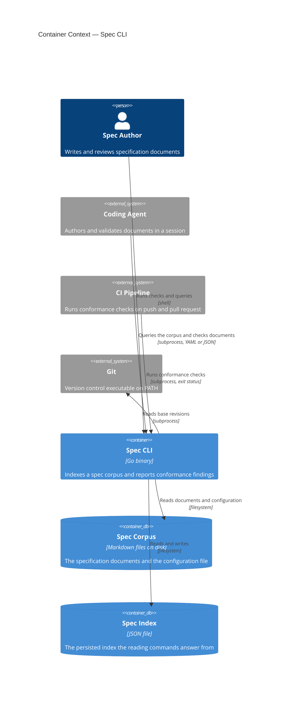
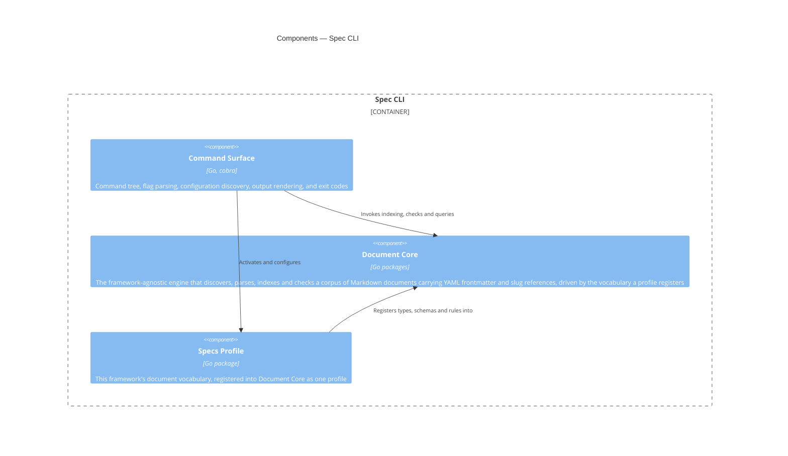

# Spec CLI

## Overview

The Spec CLI is the `specs` binary: the one deployable unit of this
framework's specification tooling. It walks a specification corpus, builds
an index of every document's metadata, structure, and references, answers
queries over that index, and reports conformance findings against the rules
the active profile registers.

Every indexing, query, and conformance capability lives in a composed
module, [[module-document-core]] or [[module-spec-profile]]. The
container adds the command surface over them and the index cache on disk.

### Responsibility

The Spec CLI presents its modules' capabilities as a command-line interface.
It owns the process-level concerns the modules leave out: the command tree
and its flags, finding and checking `specs.toml`, rendering each answer,
choosing the exit status, and persisting the index between runs.

### Does not own

Corpus discovery, parsing, the reference graph, every conformance check, and
the index model — [[module-document-core]] owns them.

The document types, slug patterns, Gherkin tag vocabulary, and convention
defaults — [[module-spec-profile]] owns them.

What each command does, and its acceptance criteria — the FRDs below own
it, and [[frd-spec-index]] owns the command surface itself:

| Command | Owning FRDs |
|---|---|
| `index`, `slug-exists`, `next-id` | [[frd-spec-index]] |
| `check` | [[frd-spec-index]], [[frd-spec-reference-integrity]], [[frd-spec-anchor-references]], [[frd-gherkin-adoption]], [[frd-spec-c4-diagrams]] |
| `refs` | [[frd-spec-reference-integrity]], [[frd-spec-anchor-references]] |
| `links` | [[frd-spec-markdown-links]] |
| `feature`, `criterion` | [[frd-gherkin-adoption]] |
| `headings` | [[frd-spec-structure]] |
| `list` | [[frd-spec-list]] |
| `c4` | [[frd-spec-c4]] |

What a command prints — [[cli-output-standards]] owns it.

What each exit status means, and which one a run reports —
[[cli-exit-status-standards]] owns it.

### Runtime

A single statically linked binary, run once per command. It has no daemon,
no persistent process, and no network listener, and it scales only as far as
the process that runs it.

## Tech stack

**Language:** Go, built as one statically linked binary. [[adr-015]]

**Command tree:** `spf13/cobra`, which provides commands, flags, and the
help output rendered from their declarations.

**Configuration:** `BurntSushi/toml` decodes `specs.toml`, and
`santhosh-tekuri/jsonschema` validates it against the schema generated from
`schemas/config.strata`. [[adr-016]]

**Link maps:** `goccy/go-yaml` reads the caller's link-map file, so a map
written as JSON reads unchanged. [[adr-015]]

**Base revisions:** the `git` executable, which only `criterion --changed`
runs. [[adr-031]]

**Build and release:** `scripts/build-release.sh` cross-compiles every
target with cgo disabled, and `.github/workflows/release.yml` publishes
tagged releases.

`cli/go.mod` holds the full dependency list, and each module blueprint
names the technologies that module adds.

## Container context



**Spec Author → Spec CLI.** A person runs a command in a shell, to check a
document before review or to ask the corpus a question. The surface is the
command tree, whose output [[cli-output-standards]] and whose exit status
[[cli-exit-status-standards]] govern.

**Coding Agent → Spec CLI.** An agent runs the CLI as a subprocess and reads
its answer instead of reading the documents. The surface is the same
command tree and the same standards. The boundary sits at the process
so that an agent needs nothing but the binary.

**CI Pipeline → Spec CLI.** An adopting repository runs `specs check` in
its build and reads the exit status. The pipeline needs no runtime beyond
the binary.

**Spec CLI → Spec Corpus.** The CLI reads Markdown documents and one
`specs.toml`, whose format [[contract-specs-configuration]] governs. The
corpus belongs to its authors; the CLI never writes it.

**Spec CLI → Spec Index.** The CLI reads and writes `specs.json` in the
spec root. The file is this container's own data; see Data.

**Spec CLI → Git.** `criterion --changed` reads the corpus at a base
revision through the `git` executable, as [[adr-031]] decides. No other
command runs it.

## Components



Command Surface activates exactly one profile per run, chosen by
`[profile].name` in `specs.toml`, and hands it the configuration it
resolved. It delegates every indexing, checking, and query call to Document
Core, and converts the results into standard output and an exit status.
Specs Profile registers its document types, schemas, patterns, and rules into
Document Core through the extension point that module defines.

### Command Surface

```component
entity_name: Command Surface
slug: component-command-surface
description: Command tree, flag parsing, configuration discovery, output
  rendering, and exit codes
technology: Go, cobra
```

(Go, `cobra`) — Command tree, flag parsing, configuration discovery, output
rendering, and exit codes. It is the one component this container owns
outright, and it lives in `cli/cmd`, with the entry point in
`cli/specs/main.go`. Each subcommand converts its flags into module calls
and converts the result into an answer and an exit status. `Execute` in
`cli/cmd/exit.go` builds the tree and classifies every error.

It hides how `specs.toml` is found and checked (`Load` and
`discoverConfig` in `cli/cmd/config.go`), how a caller's link map is read
(`LoadLinkMap` in `cli/cmd/linkmap.go`), how an answer is rendered as YAML
(`renderYAML` in `cli/cmd/yaml.go`), and how an error maps to an exit status
(`cli/cmd/exit.go`). The profile registry in `cli/cmd/registry.go` is the
customization seam [[contract-specs-configuration]] names.

### Document Core

See [[module-document-core]] (internal). (Go packages) — The
framework-agnostic engine that discovers, parses, indexes and checks a
corpus of Markdown documents carrying YAML frontmatter and slug references,
driven by the vocabulary a profile registers.

### Specs Profile

See [[module-spec-profile]] (internal). (Go package) — This framework's
document vocabulary, registered into Document Core as one profile.

## Design

### Architectural style and patterns

Plugin, Microkernel (Buschmann et al., *POSA Vol. 1*) — Document Core is
the kernel, Specs Profile is the plugin, and Command Surface selects one
plugin per run from the profile registry. It serves the profile registry
that [[contract-specs-configuration]] states as the extension point for a
second taxonomy. It rules out a kernel that knows a profile's vocabulary,
which [[module-document-core]]'s import-boundary invariant enforces.

Layers (Buschmann et al.) — Command Surface sits above both modules, and
Specs Profile above Document Core, with dependencies pointing down only.
It serves the test strategy [[testing-standards]] sets: the command surface
is thin, so its behavior is asserted by snapshot cases over a corpus rather
than by unit tests of argument plumbing. It rules out domain logic in
Command Surface; see the first invariant below.

### Invariants

Command Surface SHALL NOT decide whether a document conforms, how a check
scores, or which records a query selects. Enforced by: review only.

The Spec CLI SHALL NOT create, modify, or delete a corpus document. Enforced
by: `TestLinksCreatesModifiesAndDeletesNoFile` in `cli/cmd/links_test.go`
for `links`; review only for every other command.

Each command's help text SHALL be cobra's default rendering of that
command's `Use`, `Short`, `Long` and flag declarations, with no custom help
function or help or usage template. Enforced by: review only.

Command Surface SHALL locate the repository root by the presence of a
`.git` entry, without running `git`. Enforced by:
`TestDiscoveryStopsAtTheRepositoryRoot` in
`cli/cmd/config_discovery_internal_test.go`, whose `.git` entry `git` can't
read as a repository.

### Extension points

A new command — implement the capability in [[module-document-core]] or
[[module-spec-profile]], then add a cobra command in `cli/cmd` that converts
its flags into module calls and the result into an answer. Not by adding
selection, matching, or validation logic to `cli/cmd`.

A new profile — register it in the profile registry
(`BuiltinRegistry` in `cli/cmd/registry.go`), as
[[contract-specs-configuration]] describes. Not by teaching Document Core
the new vocabulary.

## Provided Contracts

**Public** (consumable outside the system):

[[contract-specs-configuration]] — the `specs.toml` format an adopting
repository authors, and the profile registration beneath it.

## Consumed Contracts

None. The CLI calls no service and depends on no interface that another
team provides.

## Data

- **Spec Index** (JSON file, `specs.json` in the spec root) — the built
  index the reading commands answer from, and the artifact `index` writes.
  Schema source of truth: `schemas/index.strata`, generated into
  `cli/core/specmodel`. Exclusively owned by this container.
  - When the persisted index is current, and when it's rebuilt, are
    [[component-corpus]]'s invariants.
  - The Spec CLI SHALL produce the same answer and exit status whether or
    not `specs.json` is present. Enforced by: the second-run tests in
    `cli/cmd/list_test.go` and `cli/cmd/c4_test.go`.
  - IF a reading command can't write the index it built, THEN the Spec CLI
    SHALL answer with the same output and exit status as when the write
    succeeds (AC-SPEC-010.7). Enforced by:
    `TestAQueryThatCannotPersistTheIndexAnswersUnchanged` in
    `cli/cmd/index_persist_test.go`.
  - WHEN a change alters the meaning or type of a property that an emitted
    index has carried, or removes one, the change SHALL bump
    `schema_version` (AC-SPEC-002.2). Enforced by: review only.
  - WHEN a change adds to the index shape without altering a property an
    emitted index has carried, the change MAY keep `schema_version`.
  - WHERE no emitted index has ever carried a property, a change MAY alter
    or remove that property without bumping `schema_version`.

The emitted index has no independently built consumer, so it has no
Contract document: the JSON Schema generated from `schemas/index.strata` is
its only consumer-facing specification. The schema-version rules above
cover what a consumer can rely on until a Contract exists.

## Infrastructure and deployment

### Exclusive infrastructure

None. The CLI has no database, no queue, and no network dependency at run
time. The index file is data, described in Data.

### Deployment

The container is standalone, so this section is authoritative for its
deployment.

The CLI ships as one statically linked binary per platform. It installs
through the Go module proxy (`go install` of `cli/specs`), which can be
mirrored on premises, or from the archives attached to each tagged release
with `SHA256SUMS`. `scripts/build-release.sh` holds the target matrix and
build flags, and `.github/workflows/release.yml` publishes the release.

The release build SHALL disable cgo, so that each binary runs with no
language runtime installed (AC-SPEC-009.4). Enforced by: the `no-runtime`
job in `.github/workflows/cli.yml`.

The main package SHALL stay in `cli/specs/`, because Go names an installed
binary after the directory holding its main package, and the binary is
`specs`. Enforced by: review only.

Each release tag SHALL carry the `cli/v` prefix, because the module lives in
`cli/` and the Go module proxy resolves a subdirectory module's versions
only from tags with that prefix. Enforced by: `TAG_PREFIX` in
`.github/workflows/release.yml`.

## Cross-cutting Standards

This container SHALL comply with [[testing-standards]]: unit tests per
component, snapshot cases for observable behavior, and the coverage that
ties both to acceptance criteria.

This container SHALL comply with [[cli-output-standards]]: what every
command prints.

This container SHALL comply with [[cli-exit-status-standards]]: the exit
status of every command and what reaches each stream on failure.

## Change guidance

WHEN a capability is added to the command surface, the capability SHALL be
implemented in [[module-document-core]] or [[module-spec-profile]].

WHEN Document Core gains a conformance rule, `checkRules` in
`cli/cmd/check.go` SHALL declare it in the same change, so that `--only` can
name it and a clean run reports it as passed.

WHEN a change alters a command's observable output, the same change SHALL
carry the snapshot cases' expected artifacts, regenerated with
`scripts/regenerate-cli-snapshots.sh`. [[testing-standards]] sets the review
of the resulting diff.

### Verification gates

#### Verify always

`cd cli && go test ./cmd/...` — the Command Surface unit tests and the
snapshot cases under `cli/testdata/cases/`.

#### Verify conditionally

WHEN a change touches `cli/specs/`, configuration discovery, or exit
statuses, run `cd cli && go test ./specs/...`, the end-to-end tests that
run the built binary.

WHEN a change reaches into a module, run that module's Verification gates.

WHEN a change touches the build or release, run
`scripts/build-release.sh <version> <out-dir>`, which the `cross-compile`
job of `.github/workflows/cli.yml` runs on every pull request.

## Key decisions

[[adr-015]] — Go is the implementation language.

[[adr-016]] — Strata is the single source for generated schemas, including
the one `specs.toml` is validated against.

[[adr-021]] — Gherkin is the notation for features and acceptance criteria;
`feature` and `criterion` query the records Document Core extracts.

[[adr-031]] — `criterion --changed` reads its base revision through the
`git` executable, so that one command needs `git` on `PATH`.

## Open questions

- [ ] Whether the CLI ships a `serve` mode that holds the index in memory
      across queries. It isn't required (AC-SPEC-009.1 states a latency
      target, not a gate, and the warm path holds it on a quiet machine),
      but it's the natural home for filesystem watching, a follow-on
      capability. Blocks nothing today.
- [ ] Whether Document Core's Findings should adopt `samber/oops` for
      structured error context, as [[adr-015]] raises. Findings carry their
      structure in the generated `FindingDetail` union, and internal errors
      are wrapped with `fmt.Errorf`.
