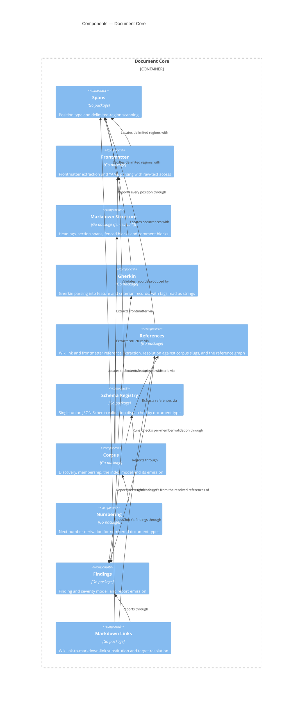

# Document Core

## Overview

Document Core is the general half of the CLI: everything that is true of
*any* corpus of markdown documents that carry YAML frontmatter and
reference each other by slug. It discovers a corpus, parses each
document into a structured record, resolves the reference graph, and
reports findings against schemas and patterns supplied from outside.

It has no knowledge of this framework. It does not know that `adr` is a
document type, that ADR slugs are numbered, or that a component record
block exists. Those facts arrive through the extension point described
under Interface, which [[module-spec-profile]] populates. The test for
whether a capability belongs here is the one
`docs/plans/spec-validation-cli-brief.md` states: could an Obsidian
vault with nothing to do with C4 use it?

That boundary is not tidiness for its own sake. It is what allows the
module to be wrapped in an HTTP API or an MCP server later without first
being extracted from a CLI, and what lets an enterprise with a different
document taxonomy reuse the engine.

- **Role:** parse, index and check a corpus of frontmatter-bearing
  markdown documents, driven entirely by registered configuration.
- **Scope:** in — corpus discovery, frontmatter parsing, JSON Schema
  validation, markdown structure and span extraction, Gherkin parsing,
  reference graph construction, numbering, the index and finding models.
  Out — any
  document-type vocabulary, any framework-specific rule, and all
  process-level concerns (argument parsing, output rendering, exit
  codes), which belong to the command surface of
  [[container-spec-cli]].
- **Composed into:** [[container-spec-cli]] — a Go module in the same
  repository, imported as a package. See that blueprint for this
  module's relationships to its sibling components.
- **Source & tests:** `cli/core`, with tests beside their subjects per
  Go convention.

## Interface

The module's surface is its Go package API. Two parts of it are
load-bearing enough to state here: the **Profile extension point**,
which is how all domain knowledge enters, and the **Span type**, which
is how every position in the corpus is addressed.

- **Surface:** the exported identifiers of the packages under
  `cli/core`. The `Profile` interface in `cli/core/corpus` is the
  extension point.

**The Profile extension point.** A profile is a value supplied at
startup that registers document types and the rules attached to them.
This is the plugin architecture: Document Core is the host, a profile is
the plugin, and no framework vocabulary is compiled into the host.

- **Guarantees:**
  - The module SHALL accept exactly one active profile per corpus
    operation, supplied by the caller.
  - WHERE no profile is registered, the module SHALL still discover the
    corpus and parse frontmatter, reporting every document as excluded
    with reason `unknown-type`.
  - The module SHALL NOT import, reference, or special-case any
    individual profile.
  - The module SHALL accept from the active profile **one** JSON Schema
    — a discriminated union over every document type that profile
    defines — and SHALL validate a document's frontmatter against the
    branch of that union its declared `type` selects. It is one schema,
    not a registry of schemas keyed by type: a profile needing a schema
    per type would be describing several vocabularies rather than one,
    and the host would have to know which to reach for.
  - WHEN a profile registers a document type, the module SHALL treat the
    slug pattern and numbered flag that profile supplies for it as the
    authority for documents declaring it. These are the facts the union
    schema cannot express — a slug pattern because the shared
    frontmatter envelope declares `slug` once and a subtype cannot narrow
    an inherited property, and numbering because it is a query over the
    corpus rather than a property of a document.
  - WHEN a profile registers a document type, the module SHALL treat the
    frontmatter properties that type registers as reference-bearing as
    the whole of what it holds a reference in. A property absent from
    that registration contributes no reference however slug-shaped its
    value is: what is a reference is registered, never guessed.
  - The module SHALL take the lifecycle the active profile registers —
    the statuses at which a document is in effect, the statuses at which
    it is no longer, and the property in which one of the latter names
    its replacement — as the authority for those judgements, and SHALL
    contain no status and no property name of its own.
  - The module SHALL take the tag vocabulary the active profile
    registers — the pattern a feature identifier matches, the pattern a
    criterion identifier matches, the prefix an owning-document tag
    carries, the capture groups a criterion identifier shares with its
    feature's, and the qualifier tags together with what each of them
    means — as the authority for reading a tag, and SHALL contain no tag
    spelling of its own (AC-GHK-002.1). A tag matching no registered
    pattern and named by no qualifier is carried on the record and
    reported by nothing (AC-GHK-002.8).
  - The module SHALL check a criterion identifier's derivation from its
    feature's by comparing only the capture groups the registration
    names as shared, so that neither pattern's internal structure is
    known to it (AC-GHK-003.6).
  - WHEN a profile is activated, the module SHALL validate its
    registration and SHALL report every defect it finds, naming the
    offending key, rather than falling back to a default for that key
    (AC-SPECREF-004.3). The defects are five: a pairing or a typed
    reference naming a property the same type does not register as
    reference-bearing; a typed reference naming a document type the
    profile does not define; a lifecycle registration naming a status
    outside the profile's own status vocabulary; a feature-tag
    registration whose identifier pattern does not compile; and a
    feature-tag registration whose shared captures name a capture group
    an identifier pattern does not define.
  - The module SHALL return those defects to the caller rather than
    rendering them. A compiled-in registration has no file position of
    its own, and the position a reader needs — the configuration value
    that selected the profile — is known only to the caller.
  - The module SHALL express every position it reports as a `Span`, so a
    caller never receives a bare line number.
  - WHEN a document fails to parse, the module SHALL record the failure
    against that document and continue, so that indexing never fails as
    a whole (AC-SPEC-002.4).
  - The module SHALL write exactly one artifact — the emitted index —
    and only to the destination the caller resolves. It modifies no
    document it reads.

**Built** — the `Profile` interface in `cli/core/corpus` has five
members and nothing else:

| Member | Supplies |
|---|---|
| `Schema() []byte` | the one union schema every document type is validated against |
| `DocumentTypes() map[string]DocumentTypeRules` | per type, its slug pattern, whether it is numbered, and which of its properties hold references — keyed by the value documents declare in `type` |
| `Conventions() specmodel.ConventionsConfig` | the convention defaults resolved where an adopting repository's configuration omits them |
| `Lifecycle() LifecycleRules` | the profile's status vocabulary, which of those statuses mean in effect and which mean superseded, and the property a superseded document names its replacement in |
| `FeatureTags() FeatureTagRules` | the tag vocabulary: the identifier patterns a feature and a criterion match, the prefix an owning-document tag carries, the captures a criterion identifier shares with its feature's, and the qualifier tags with their meanings |

`DocumentTypeRules` carries a slug pattern, a numbered flag, and the
type's reference registration — `ReferenceProperties`, the properties
that hold document slugs; `TypedReferenceProperties`, the mapping from
such a property to the `type` its target must declare; and `Pairings`,
the properties that must be declared from both ends. It carries no
schema. The keys of `DocumentTypes` are the whole of the host's knowledge
of which types exist, which is what makes the `unknown-type` exclusion a
lookup rather than a judgement.

`LifecycleRules` is profile-level rather than per-type, because `status`
is a property of the shared envelope that every type carries and none
narrows. It states the status vocabulary explicitly rather than leaving
it to be inferred from the live and retired sets: their union is not the
vocabulary — a status in neither is one the lifecycle says nothing about,
which is the right answer for a draft — and without it the module could
not report a lifecycle naming a status the profile does not define. The
alternative, reading the vocabulary out of the union schema, would mean
the host knowing where a schema keeps its status enum and passing
vacuously against a profile that keeps it elsewhere.

`FeatureTagRules` is profile-level for a different reason: a feature is
not a document type. It is written inside a document of any type, or in
a file that is no document at all, and the tags that identify it are the
same in both. It carries the two identifier patterns, the
owning-document tag prefix, `SharedCaptures`, and `Qualifiers` — each
one a tag paired with the criterion property it populates. Every member
is independent and a profile may register some and not others: a
registration that identifies features and not criteria describes a
corpus with no criteria in it.

`SharedCaptures` is how a criterion identifier's derivation from its
feature's is stated as data. The host compiles both patterns, captures
both identifiers, and compares only the groups named there, so it checks
the derivation while knowing nothing of either pattern's internal
structure. A profile whose two patterns share nothing registers none and
no derivation is checked.

A qualifier's meaning is the generated vocabulary's own type rather than
a string the profile invents, because the set of meanings is fixed by
the criterion record — a qualifier can only mean one of the things a
criterion has somewhere to put. What the profile chooses is each tag's
spelling and which meaning it carries.

`ValidateRegistration` is the registration check, and it returns
`RegistrationDefect` values carrying the document type, the offending key
and what is wrong with it. It renders nothing and repairs nothing.

The surface is narrow because it constrains everything downstream of it.
Required sections and element records are later capabilities and each
widens this interface further; per the Change Guidance in
[[module-spec-profile]], that widening is a change to the host reviewed
on its own merits, never a special case granted to one profile. Two tests
hold the boundary: no package under `cli/core` imports a profile package,
and no non-test source in `cli/core/corpus` contains a string literal
matching anything a profile registers through the extension point — any
document type, any status, any frontmatter property the generated
vocabulary types as a slug or a list of slugs, and any value a qualifier
tag is liable to be spelled after, which is a boolean property of the
criterion record or a verification level. All four sets are read from the
generated schema rather than restated, so the boundary widens with the
vocabulary; the identity property `slug` is excluded because it names the
document declaring it rather than another document. Identifier patterns
are not read, because a pattern is registered whole and the host holds no
part of one.

The write guarantee is narrower in fact than in statement. The module's
only write is `corpus.Write`, whose destination `corpus.IndexPath`
resolves to `specs.json` in the configured spec root unless the caller
names another path or standard output. The persisted index *is* the
cache: there is no separate cache location, so no other file is ever
created.

## Components



Nine of the ten are built and carry a **Built** paragraph naming the
package that realizes them: Spans, Frontmatter, Gherkin, References,
Schema Registry, Corpus, Numbering, Findings and Markdown Links. The
emitted index carries the resolved reference graph, and the corpus checks
read it: a broken link, a live document citing a retired one, a
half-declared pairing and a typed reference landing on the wrong
document type are each reported against the document a reader must
open. **Markdown Structure is built for two of its three capabilities.**
`cli/core/markdown` locates fenced blocks by info string and builds the
heading tree with each heading's section span; comment-block location
remains not yet built, and the diagram edge that would carry it is still
the intended shape rather than an exercised one. Both edges from Corpus
into Markdown Structure and Gherkin are exercised: the walk extracts a
fenced Gherkin block
through `markdown.Fenced` and parses every feature source through
`gherkin.Parse`, and the `gherkin/` checks recompute from the same two
packages.

### Spans

```component
title: Spans
slug: component-spans
description: Position type and delimited-region scanning shared by every parser
```

(Go package) — Position type and delimited-region scanning shared by
every parser. Owns the `Span` type defined in
[[frd-spec-index]]: a byte offset and byte length as the
authoritative extent, plus line and column for readability. It also
provides the general delimiter scanner every other parser is built on —
find the region between an opening and a closing delimiter, such as
`---` and `---` for frontmatter or `<!--` and `-->` for a comment block.
Keeping one scanner here is what makes positions consistent across
components: two parsers that locate regions differently will disagree
about where a finding is.

**Built** — `cli/core/span`. Its surface is `Find`, which locates a
delimited region and returns it as a `Region` carrying two spans: `Outer`
over the whole construct including both delimiters, and `Inner` over the
content between them. `Of` derives a span from a byte extent and `Slice`
recovers the bytes a span covers.

Three semantics are pinned by the implementation and are what every
consumer may rely on:

- **The scanner does not nest.** A second opening delimiter inside a
  region is content, and the first closing delimiter after the opening
  one ends the region. Neither frontmatter nor an HTML comment nests, and
  a scanner that pretended otherwise would locate a region no parser
  reading the same file would agree with.
- **An unterminated opening delimiter yields no region,** rather than one
  running to the end of the document. A caller that must report the
  dangling delimiter as a defect locates it itself; conflating the two
  would swallow the malformed input silently.
- **Line and column are derived, and a column counts codepoints.** Byte
  offset and length remain authoritative; the column follows this
  framework's `line_width` convention of measuring codepoints rather than
  bytes, so an em dash advances it by one.

The `Span` type is a Go alias for the generated `specmodel.Span` rather
than a second declaration. Spans owns how a position is computed and is
the only place one is constructed; the shape it is written in comes from
`schemas/index.strata`, because a span crosses the JSON boundary in both
the index and — from the Findings component onward — every finding. One
definition means no conversion between an in-memory span and a
serialized one, and no way for the two to drift.

### Frontmatter

```component
title: Frontmatter
slug: component-frontmatter
description: Frontmatter extraction and YAML parsing that preserves each property's raw text
```

(Go package) — Frontmatter extraction and YAML parsing that preserves
each property's raw text. Splits the delimited block and parses it to a
generic document model, which serves both schema validation and — after
conversion to JSON — decoding into the generated typed records. The two
steps share one generic model rather than unmarshalling the source twice,
because generated structs carry no YAML tags. The raw text of each
property is retained alongside the parsed value, because AC-SPEC-003.2
requires validating what the author wrote rather than what a YAML parser
inferred from it.

**Built** — `cli/core/frontmatter`. Its surface is `Parse`, returning a
`Document` carrying the block's `Region` and its top-level `Property`
values in declaration order, each with its name, the span of its key, the
span of its value, the value's raw source text, and the parsed value.
`Values` returns the generic tree a JSON Schema is validated against and
`JSON` converts it for decoding into a generated record — one parse
serving both, so a property's position and its value cannot disagree.
`goccy/go-yaml` is the parser, per [[adr-015]].

Six semantics are pinned by the implementation:

- **A sequence-valued property carries its elements individually.**
  `Property.Items` holds one `Item` per element, each with the element's
  own span, its source text and its parsed value; it is nil for a
  property whose value is not a sequence and empty for one whose value is
  the empty sequence, so the two are distinguishable. The whole value's
  span is the right extent for a finding about the property and the wrong
  one for a finding about one slug inside it: a reader told a list holds
  a broken reference still has to find which element, and a rewrite of
  one element cannot address the list. A scalar element is located by its
  own token rather than by the extent running to the next element, which
  in a block sequence would swallow the following element's `- `
  indicator.
- **`Parse` has three outcomes, and they are distinct.** A document and
  no error is a parsed block; no document and no error means the file
  carries no frontmatter, which is the caller's `no-frontmatter`
  exclusion rather than a defect; no document and a located error means
  the block is there and could not be read. Nothing panics, so a corpus
  walk continues past a malformed member (AC-SPEC-002.4).
- **A block is recognised only at the start of the document,** located by
  the Spans scanner with `---` as the opening delimiter and a newline
  followed by `---` as the closing one. A `---` further down is content.
  An opening delimiter with no closing one is reported as an
  unterminated block located at that delimiter — the case the Spans
  scanner deliberately declines to guess at.
- **Raw text is source text, not a re-rendering.** A property's raw value
  runs from the first byte of the value to the start of the next
  property, trailing whitespace removed, so a quoted string keeps its
  quotes and a sequence or nested mapping keeps its whole block. The
  parser leaves an unquoted date as the string the author typed rather
  than resolving it to a timestamp, which is what makes the AC-SPEC-003.2
  check possible at all.
- **The value tree is JSON-compatible.** No parsed value is a type JSON
  cannot carry, so the crossing into the typed records is a marshal
  rather than a conversion layer.
- **Byte offsets are re-derived here, not taken from the YAML library.**
  `goccy/go-yaml` advances a token's reported position one unit per
  Unicode codepoint rather than per byte, so treating it as a byte offset
  is correct only while the block is pure ASCII. Every property after an
  em dash or a curly quote would otherwise land short of its true
  position by the accumulated byte/rune difference, silently corrupting
  the raw text the Schema Registry checks a format constraint against.
  This package therefore counts codepoints into the block's own bytes to
  recover the offset. It is a failure mode no ASCII unit fixture can
  expose, and it surfaced only when the profile self-application gate ran
  over this repository's real documents.

A frontmatter block that is not a mapping — a bare scalar, a sequence —
is reported as a located error rather than as an empty document, because
a file whose frontmatter is a list has a defect worth naming. An empty
block is a document declaring no properties, which is a different thing
from a file with no block.

### Markdown Structure

```component
title: Markdown Structure
slug: component-markdown-structure
description: Headings with their section spans, fenced blocks by info string, and HTML comment blocks
```

(Go package) — Headings with their section spans, fenced blocks by info
string, and HTML comment blocks. Produces the heading tree with the span
of content beneath each heading, extracts fenced blocks whose info
string matches a registered tag, and locates HTML comment blocks both as
content and as leftover-scaffolding hygiene. This is the component the
extract-then-review pattern depends on: an agent asks for the spans of
particular sections and reads only those.

**Built — headings and fenced blocks.** `cli/core/markdown`. Its
fenced-block surface is `Fenced`, which takes a document body and a set
of registered tags and returns every fenced block whose info string
matches one of them, in
document order, as a `Block`: `Content` — the bytes between the fences —
alongside `Outer`, over the whole construct including both fence lines
in full, and `Inner`, over the content alone. Fence recognition comes
from `goldmark` — [[adr-015]]'s choice, already a module dependency via
References — rather than from a hand-rolled scan, because where a fence
ends depends on the fence character, its run length and its info string.
Every position is still computed by Spans's `Of`, so a fenced block's
position is comparable to a frontmatter or reference position. An
unterminated fence — content running to the end of the document with no
closing line — yields no block, matching the Spans scanner's refusal to
guess at a dangling delimiter. `Fenced` locates and returns bytes only:
parsing a matched block's content in its tag's declared format is a
question for that tag's own consumer, not for this package.

Its heading surface is `Headings`, which takes a document body and
returns every heading in document order as a `Heading`: its `Text` as
authored with the markers that open and close the line removed, its
`Level`, `Position` over the heading line itself, and `Section` over the
content beneath it. A section runs from the end of the heading line to
the start of the next heading of the same or a higher level, and to the
end of the document where there is none, so a deeper heading falls
inside its parent's section rather than closing it. A heading standing
over nothing carries an empty span rather than an absent one, and a body
with no heading yields an empty result rather than an error. Heading
recognition comes from `goldmark` for the same reason fence recognition
does: what looks like a heading inside a fenced block or an inline code
span is not one, and only a markdown parser knows which regions are not
to be scanned. A heading underlined rather than prefixed carries its
underline inside `Position`, so `Position` ends exactly where `Section`
begins in both written forms. No section content is returned — only the
span of it, which a caller slices back out of the body it passed in.

`HeadingsFrom` is the same search started at a byte offset, with every
span still expressed in the whole source's coordinates. It is what a
document with frontmatter needs: a frontmatter block's closing delimiter
underlines the YAML above it, which CommonMark reads as a setext
heading, so a whole-file search reports the entire block as a level-2
heading. Starting at the body leaves that construct behind the offset
rather than filtering it out afterwards, and reporting against the whole
source is what keeps a heading's line number the one a reader counts to
in the file. `Headings` is `HeadingsFrom` at offset zero.

The package also exposes `Identifier`, the heading identifier of a text:
its rendered inline content lowercased, with every character that is not
a letter, digit, hyphen, underscore or space removed and each remaining
space replaced by a hyphen. Inline content is rendered rather than
filtered, so the identifier of ``The `Profile` interface`` is
`the-profile-interface` and a link's target does not leak into the
identifier of the heading that carries it. The derivation is a pure
function of the text and derives no positional suffix for a repeated
heading, which is what lets anchor resolution match against this one
derivation rather than a second one. It is exposed as a function rather
than recorded on a `Heading`, and the index model carries no identifier
property for the same reason: it is recomputable from the text and is
therefore not state.

The comment-block location remains **not yet built**: no
`cli/core/markdown` surface locates an HTML comment block yet.

### Gherkin

```component
title: Gherkin
slug: component-gherkin
description: Gherkin parsing into feature and criterion records, with tags read as strings
```

(Go package) — Gherkin parsing into feature and criterion records, with
tags read as strings. Parses a source with the official Go Gherkin parser
[[adr-021]] measured and returns one feature record with its criteria
nested beneath it, each carrying its text, its tags and its position.
Both admissible forms — a fenced block inside a document, and a
standalone `.feature` file — are the same parse over a different region.

**The whole of Gherkin lives here, and none of this framework's
vocabulary does.** Parsing is general: which constructs a source
declares, where each of them ends, and what a tag says are questions
about a notation, and a vault of `.feature` files with nothing to do with
C4 could ask them. Meaning is not general: which tag identifies a
feature, which identifies a criterion, and which qualifiers count are
facts about one document vocabulary, and they arrive through the Profile
extension point. The component asks the caller to resolve a set of tags
to an identity and takes back an answer or nothing; it never inspects a
tag's spelling. This is the module's host-and-plugin split applied to a
notation rather than to a document type, and it is why no identifier
pattern and no qualifier name appears in this package.

**Built** — `cli/core/gherkin`. Its surface is `Parse`, over a source
that is a document in its own right, and `ParseRegion`, over a region of
a containing document such as a fenced block; both take an `Options`
carrying the two functions that resolve tags to a feature identity and to
a criterion identifier. Each returns a `Feature` — the generated
`specmodel.Feature` populated with what Gherkin establishes, the tags as
written, and the `Criterion` values beneath it — or a `*ParseError`
carrying every failure the parser reported as a located
`specmodel.ParseError`. `ContentHashOf` computes a criterion's hash from
a name and a text alone, so a second producer of criteria hashes them the
same way. `FenceTags` names the info strings that mark a fenced block as
a Gherkin source: that names a notation rather than a vocabulary, so it
belongs here and not in a profile, and both the discovery that extracts
those blocks and the reference extraction that declines to mask them
read it from one place.

Four semantics are pinned by the implementation:

- **A source that declares no `Feature` is parsed behind a synthetic
  header,** and no position the header occupies is ever reported
  (AC-GHK-001.4, AC-GHK-001.5). Every reported line is the line in the
  containing document: the source's start line, plus the parser's line,
  less the lines the header added. The feature such a source yields
  carries no name, because a name invented here would be reported as
  though an author had written it.
- **A criterion's content hash covers its name and its text and nothing
  else** (AC-GHK-005.5). Spans and parser node identifiers are excluded:
  a node identifier is a positional counter that shifts whenever anything
  above it is edited, so including one would report every criterion below
  an insertion as changed. The text is hashed normalized — LF line
  endings, common indentation removed, trailing whitespace stripped per
  line — so a reindent or a CRLF checkout hashes as before, and only a
  wording change moves the hash (AC-GHK-005.6, AC-GHK-005.7).
- **A criterion's body is text.** It is the steps and any example table
  verbatim with the block's common indentation removed, never decomposed
  into typed steps or keyed example rows: decomposition would model one
  notation, and nothing in the framework operates below the level of a
  whole criterion.
- **A construct ends where the next one begins,** trimmed back over
  trailing blank and comment lines. Deriving an extent this way rather
  than from the last step, table row or doc-string delimiter means no
  construct needs arithmetic of its own, and a doc string's contents —
  which may look like anything, comment lines included — sit inside the
  range rather than at its edge.

A scenario carrying `Examples` blocks divides on identity: where any
block is identified, each block becomes its own criterion, and where none
is, the scenario is one criterion whose text covers every block
(AC-GHK-002.6, AC-GHK-002.9). An unidentified block beside an identified
one still becomes a criterion, carrying no identifier — the partial
tagging is a defect for a check to report, and a check can only report
what the records carry.

A parse failure is returned instead of records rather than alongside
them, and never panics: a half-parsed source yields a feature missing
criteria its author wrote, and an index that silently lost one is worse
than an index that recorded why (AC-GHK-006.1).

### References

```component
title: References
slug: component-references
description: Wikilink discovery, heading-anchor resolution, and the inbound and outbound reference graph
```

(Go package) — Wikilink discovery, heading-anchor resolution, and the
inbound and outbound reference graph. Finds every `[[slug]]` and
`[[slug#Anchor]]` in a document body, records the span at which each
occurs, and resolves them against the corpus. It never scans fenced or
inline code spans, because an illustrative reference inside backticks is
not a reference — except a fenced block whose info string names a
registered Gherkin tag (Gherkin's `FenceTags`, above), which is Gherkin
content rather than an illustration and is scanned like the rest of the
body. It also extracts from a `.feature` source read whole, recording
references against that file's own path though the file is not a corpus
member. Inbound edges are derived, so no document maintains a list of its
own referrers.

**Built** — `cli/core/references`. `Extract` takes one
document — its path, its bytes, its parsed frontmatter, and the
reference-bearing property names the active profile registers for its
type — and returns the references it makes as `specmodel.Reference`
values, ordered by position: the registered frontmatter properties in
declaration order, then the body in the order it is written. `Resolve`
takes those references and one `SpecIndex` and records what each of them
reached, in place. The two are separate because they know different
things: extraction knows a document, resolution knows a corpus, and
keeping the seam between them is what makes a reference impossible to put
in the index without a corpus having been consulted.

**Resolution is a lookup, and it reads nothing.** It matches a
reference's slug half against the slugs the index's members declare, and
that is the whole of its input — no document is opened, no frontmatter is
re-parsed, and the answer is a function of the index alone, so the same
references over the same index resolve identically on every platform and
on every run. What it costs is the walk it rides on; see Corpus below for
where it is called from.

The graph the index carries is one collection of edges, and both
directions are read from it. `Corpus` exposes `OutboundReferences` by the
path a reference occurs in and `InboundReferences` by the path it
resolved to, each built once when the corpus is built or opened, so a
document's referrers are a lookup rather than a scan and no reverse edge
is stored ([[adr-018]], AC-SPECREF-001.3).

Five further semantics are pinned by the resolution half:

- **Slugs are compared lowercased and trimmed** (AC-SPECREF-002.8),
  matching the case-insensitive slug uniqueness AC-SPEC-003.4 already
  establishes. The two rules have to agree: a corpus that refuses to hold
  `adr-012` and `ADR-012` as distinct documents but resolves a reference
  to only one of them is answering one question about one identifier two
  ways.
- **A reference resolves only within the workspace the run is against.**
  A slug declared only in another repository's index is unresolved, per
  the boundary [[frd-spec-reference-integrity]] states. The merged-graph
  case is a known follow-on rather than a defect.
- **A slug matching a file the index recorded as an exclusion, or as a
  member whose frontmatter could not be read, resolves to `non-member`
  rather than to nothing** (AC-SPECREF-002.7), carrying that file's path
  and the reason or the parse failure. The reader's next step differs:
  the document is right there and what is wrong is its frontmatter.
- **A non-member is matched on its file name without the extension,
  lowercased**, because it is the only handle such a file has — a parse
  failure has no readable frontmatter to declare a slug, and a file
  excluded for carrying no frontmatter has none either. The name is
  recorded on the index, so the match is reproducible by anything reading
  the artifact rather than resting on knowledge only the build held. The
  consequence is deliberate and one-directional: a non-member whose
  intended slug differs from its file name matches nothing and reports as
  an ordinary unresolved reference, which is the answer it received
  before this rule existed.
- **A member always wins over a file named like one**, and where two
  non-members share a name the first in path order is reported, decided
  by comparison rather than by the order the index happens to hold its
  collections in.

Nine semantics are pinned by the extraction half:

- **The body is what follows the frontmatter block,** so a frontmatter
  value describing the notation — `description: References use [[slug]]
  wikilinks` — is not read as a reference. It is the only unresolved
  reference a scan of this repository's corpus produces, and it is a
  false one. Frontmatter contributes references only through registered
  properties.
- **A registered property is the whole of what holds a reference in
  frontmatter.** An unregistered property contributes nothing however
  slug-shaped its value is, and a registered property whose value is not
  text contributes nothing either — whether such a value belongs there is
  the schema's question, not this component's.
- **A sequence-valued property yields one reference per element,** at the
  element's own span rather than the list's, which is the widening
  recorded under Frontmatter.
- **Code regions are located with `goldmark`, not with a backtick scan.**
  Where an inline code span ends depends on matching backtick-run
  lengths, and where a fenced block ends depends on the fence length and
  its info string; a hand-rolled masker getting one of those wrong
  produces exactly the false positive the exclusion exists to prevent.
  This brings `goldmark` into the module ahead of Markdown Structure, and
  nothing here builds that component: no heading is read.
- **The code-region mask is narrowed by fence info string, not removed.**
  A fenced block whose info string exactly matches one of Gherkin's
  `FenceTags` is left unmasked — a wikilink in a feature description, a
  scenario name, a step, a rule name or an examples cell is extracted
  like any other body reference — because that content is Gherkin, not
  an illustration. Every other fenced block, every indented code block,
  and every inline code span stays masked, and a fence's info string is
  always masked regardless of its tag: it is notation naming the block,
  never a place Gherkin content is written. Reading the tag vocabulary
  from Gherkin's exported `FenceTags` rather than a literal keeps the two
  components from drifting when that vocabulary changes.
- **A `.feature` source is extracted the same way a document body is,**
  with no frontmatter and no reference-bearing properties: the whole
  file is body from its first byte, so a wikilink anywhere in it is
  found by the same scan, and the reference is recorded against that
  file's own path even though it is not a corpus member — an edge's
  endpoints are paths, and the referring file is the one a reader must
  open to fix it. It resolves exactly as a reference written in prose
  does; an unresolved one is reported by Corpus's `reference/unresolved`
  check, below, rather than by a rule of its own.
- **An HTML comment block is read as body text.** Only code is excluded,
  and `template-authoring-standards.md` requires a finished document's
  comment blocks to be deleted, so masking them would hide a reference in
  a document that should not be carrying the block at all.
- **A reference splits on its first `#`,** into the slug half this
  feature resolves and the anchor half it records without interpreting —
  inside a Gherkin source exactly as elsewhere, so an anchor is never
  matched against a `Feature`, `Rule` or `Scenario` name: a scenario name
  is not a heading, and nothing in this component resolves an anchor
  against a heading either. No other separator is read: the display alias
  `[[slug|text]]` is prohibited by the reference standard, so such a
  reference carries `slug|text` as its slug half and reports as
  unresolved rather than resolving quietly to something the standard
  forbids.
- **Extraction leaves the resolution unset,** which is deliberately
  unserializable, so a reference cannot reach the index without having
  been resolved on the way. `Resolve` is what sets it, and it sets one on
  every reference — including the ones that reached nothing, because the
  index describes the corpus it found and reporting a broken link is a
  check's job (AC-SPECREF-001.6).

A reference's position covers what a reader is pointed at and what a
rewrite replaces: for a body reference the text between the brackets, the
brackets being notation rather than reference; for a frontmatter
reference the value's own source text as written, quotes included.

Reference-bearing values are read from the parsed frontmatter block and
never from an index entry's typed envelope, which carries neither the
per-type properties a profile registers nor the positions a reference
needs (`agent-plugins-gz3`). A test in the package asserts the import is
absent rather than leaving the boundary to review.

### Schema Registry

```component
title: Schema Registry
slug: component-schema-registry
description: Single-union JSON Schema validation, dispatched by document type, producing located findings
```

(Go package) — Single-union JSON Schema validation, dispatched by
document type, producing located findings. A profile registers **one**
schema — a discriminated union over every document type it defines —
not a schema per type; this component compiles that union once and
validates each document's frontmatter against the branch its declared
`type` selects. It reports every violation in one pass, each with the
JSON Pointer at which it occurred, rather than stopping at the first
(AC-SPEC-003.1). Where the selected branch constrains a property with a
format keyword, the property's raw source text — from the Frontmatter
component — is validated in place of its YAML-coerced value, so that a
value a YAML parser silently reinterpreted is checked as the author
wrote it (AC-SPEC-003.2). A slug that does not match the pattern the
active profile's per-type table supplies is reported separately, naming
both the actual slug and the expected pattern (AC-SPEC-003.5) — that
check is independent of the union schema, because the shared frontmatter
envelope declares `slug` once and no subtype can narrow it there.

**Built** — `cli/core/schemaregistry`. The branch a document is checked
against is found mechanically: a document's declared type
("system-blueprint") is converted to the PascalCase form the union's
top-level `definitions` are keyed by ("SystemBlueprint"), which is a
string transform rather than a lookup table naming any type. This is
what lets the package hold to the Change Guidance below without a
per-type schema pointer from the profile.

### Corpus

```component
title: Corpus
slug: component-corpus
description: Discovery, membership determination, the index model and its versioned emission
```

(Go package) — Discovery, membership determination, the index model and
its versioned emission. Walks the configured spec root, decides
membership from frontmatter and declared type, records exclusions with
their reason rather than dropping them, extracts the features written in
either admissible source form, and assembles the index every other
capability queries. It orchestrates the parsing components but holds no
parsing logic of its own.

**The index model is `SpecIndex`, and it is generated.** The index
crosses a boundary — CI, agents and a central architecture catalogue all
read it — so its shape is declared once in `schemas/index.strata` and
transpiled to JSON Schema, Go and Markdown with every other model, per
[[adr-016]], rather than being assembled by hand in the emitter. Corpus
populates the generated `specmodel.SpecIndex`; it does not define it.

The vocabulary is:

- **`SpecIndex`** — the root: a `schema_version`, the `workspace`
  identifier from configuration, an ordered list of `entries`, an
  ordered list of `exclusions`, an ordered list of `references`, an
  ordered list of `features`, and the optional `input_hash` the warm
  cache is decided by. Every collection is a list rather than a map
  precisely so that the emitter owns their order and can make output
  byte-identical across platforms (AC-SPEC-009.7) without a change to the
  model.
- **`IndexEntry`** — one corpus member: its repository-relative `path`,
  its parsed `frontmatter`, and a `parse_error` carrying a located
  failure for a member whose frontmatter could not be read
  (AC-SPEC-002.4). Exactly one of the latter two is present. It also
  carries the document's structure: its `headings` in document order
  (AC-SPECSTR-001.1), and the `record_blocks` attached to the document
  rather than to any heading — those written before the first heading,
  and those in a document with none. Headings are recorded for every
  member, including one whose frontmatter could not be parsed, because a
  heading is markdown and does not depend on an envelope.
- **`IndexExclusion`** — one candidate file that is not a member: its
  `path`, a `reason` of `no-frontmatter` or `unknown-type`, and — where
  the reason is `unknown-type` — the `type` value the file declared
  (AC-SPEC-001.3, AC-SPEC-001.4).
- **`Reference`** — one occurrence of one document referencing another:
  the `path` it occurs in, the reference `text` as written, its `slug`
  and `anchor` halves, its `origin`, its `position` as a `Span`, and its
  `resolution`. References are their own collection rather than an array
  on each entry, per [[adr-018]]: the attributes of a reference describe
  the edge and not either endpoint, both directions are derived by
  indexing the one list when the index is read, and merging two
  repositories' indexes into one graph is appending rows. One row per
  occurrence, so a document referencing the same target twice carries two
  rows with two spans (AC-SPECREF-001.5). The `slug` half is a plain
  string rather than a `Slug`, because a reference is hand-written and a
  malformed one has to be representable in order to be reported.
- **`ReferenceOrigin`** — a union discriminated on `kind`: a reference
  parsed from the body, or one held by a named reference-bearing
  frontmatter property, carrying that property's name
  (AC-SPECREF-001.7). The origin decides how the defect reads and how a
  rewrite finds it, so it belongs to the reference rather than being
  inferred from where its span falls.
- **`ReferenceResolution`** — a union discriminated on `state`:
  `resolved` naming the target's path, `unresolved`, or `non-member`
  carrying the matched file's path with either the exclusion reason or
  the parse failure that keeps it out of the corpus (AC-SPECREF-002.7).
  A reference that reaches nothing is recorded with a state rather than
  dropped, because indexing never fails (AC-SPECREF-001.6).
- **`Feature`** — one feature declared by the corpus: its `id`, the
  `code` that groups it, the `document_slug` of the document that owns
  it, the `path` it is written in, its `name`, its `description`, its
  `source`, its `position` as a `Span`, and its nested `criteria`
  (AC-GHK-005.1). Features are a top-level collection because a feature
  is addressed by its identifier and not by the document that happens to
  hold it, ordered by the path a feature occurs in and then by its
  position within that file.
- **`FeatureSource`** — a union discriminated on `form`: a
  `fenced-block` carrying the extent of the fence around the Gherkin, or
  a `feature-file` carrying nothing, the file being the feature. The form
  changes what a consumer may do with the feature, so it is a value
  rather than something inferred from an absent property.
- **`Criterion`** — one acceptance criterion, nested inside the feature
  it qualifies rather than held in a sibling collection: its `id`, its
  `name`, its body as `text`, its `description`, the `rule` it sits
  beneath, the `negative` and `manual` qualifiers, its verification
  `level`, its `notation`, its `content_hash`, and its `position`
  (AC-GHK-005.2, AC-GHK-005.4). The body is one string and is not
  decomposed into typed steps and keyed example rows: a criterion is the
  atomic unit here, and a decomposed shape could be filled from one
  notation only (AC-GHK-005.3). The `content_hash` covers the criterion's
  name and text and nothing else, so a criterion that moved has not
  changed (AC-GHK-005.5).
- **`Heading`** — one heading of a document body: its `text` as
  authored, its `level` constrained to 1 through 6, the `position` of the
  heading line itself, the `section` span of the content beneath it, and
  the `record_blocks` attached to it. The section span runs from the end
  of the heading line to the start of the next heading of the same or a
  higher level, and to the end of the document where there is none. No
  section content is carried: a reader that wants the text reads it back
  through the span, which is what keeps a document's prose out of the
  index. A heading carries no identifier, because the identifier is a
  pure function of the text and is derived by the Markdown Structure
  component on demand.
- **`RecordBlock`** — one fenced block the active profile registers as
  carrying structured data about an element declared inside a document
  ([[adr-008]]): its `tag`, its parsed `content`, and the `position` of
  the block as written, fences included, so that a rewrite promoting the
  element replaces the whole construct. The content is a mapping of
  property name to value; Strata models closed shapes, so an open record
  is a map rather than an arbitrary value, and this framework's element
  declarations — a title, a description and a slug — are exactly that
  shape. A tag whose registration names a schema is validated against it
  by the Schema Registry, so this shape names no tag and carries no
  vocabulary of its own. A block is attached to the innermost heading
  whose section contains it, and to the document where no heading does,
  so every parsed block in a document appears exactly once
  (AC-SPECSTR-001.2).
- **`Span`** and **`ParseError`** — the position type every component
  reports through, and a message paired with one. `Span` is declared
  here, in the generated model, because findings and parse errors carry
  it across the JSON boundary; the Spans component below owns its
  semantics and is the only place spans are computed.

`schema_version` is required and pinned to `1.0` (AC-SPEC-002.2). The
model is additive. The reference collection is the first exercise of that
rule and it is a deliberate no-bump rather than an oversight —
`references` is an addition alongside the existing shape,
which is exactly what [[container-spec-cli]]'s additive rule permits at
the same version, and the model and the emitted index changed in the
same change as the Change Guidance below requires. The `features`
collection is the second exercise, and is a no-bump for the same reason.
The structure properties — `headings` and `record_blocks` on
`IndexEntry`, with the `Heading` and `RecordBlock` shapes they carry —
are the third, and are a no-bump for the same reason: every one of them
is an addition alongside the existing shape, and none changes how
anything already recorded is carried. The schema constrains
`schema_version` by pattern (`String ~= /^1\.0$/`) rather than pinning
it, so the generated model carries a validated field and not a constant;
the emitted value lives in `cli/core/specindex` alongside the
constructor that writes it — a separate package because
`scripts/generate-schemas.sh` rebuilds `cli/core/specmodel/` from
scratch on every run.

Strata does support pinning a scalar to a single value with `==`, which
would make the generated model carry the constant directly and remove
the need for the separate package (`agent-plugins-13j`).

The index is not yet a contract document, and that is now a recorded
decision rather than an omission. It has one producer and no
independently-built consumer, so the generated JSON Schema is its interim
machine-readable specification. Promotion to a contract, with a formal
versioning policy, is deferred to the index-schema ADR
(`agent-plugins-h6c`) and waits on a real consumer — see the Open
Questions in [[container-spec-cli]], which owns that decision.

**Built** — `cli/core/corpus`. `Build` walks the spec root and returns a
`Corpus`: the populated `specmodel.SpecIndex`, the findings discovery
raised over it, and the lookups the queries need — `Entry` by path,
`Slug` by identifier, `Document` for the parsed frontmatter behind one
member, `OutboundReferences` and `InboundReferences` for the two
directions of the reference graph, `FeatureFailures` for every Gherkin
source that would not parse, and `FindingsFor` to narrow a
whole-corpus result to one file.

**Headings ride the walk too.** Each member's headings are extracted
inside the same visit that reads its bytes, through Markdown Structure's
`HeadingsFrom` — Corpus calls the component and holds no heading logic
of its own. They are recorded in document order, which is the order the
extraction returns and what keeps the emitted index byte-identical
across platforms (AC-SPEC-009.7) without a sort of its own. A member
whose frontmatter could not be parsed still carries its headings,
because a heading is markdown and does not depend on an envelope.

The search starts at the member's body rather than at the first byte of
the file. A frontmatter block's closing delimiter underlines the YAML
above it, which CommonMark reads as a setext heading, so a whole-file
search would record the entire frontmatter block as a level-2 heading.
The offset comes from the frontmatter parse the walk already performed;
where that parse failed the block is located again from the source, so
the member still gets its headings and not its frontmatter. This is the
one respect in which the heading search differs from the fenced-block
search beside it, which is offered the whole file precisely so that its
spans need no second arithmetic — heading spans are in document
coordinates for the same reason, computed against the whole file rather
than against the body slice.

A warm corpus answers for headings from the index it opened, reading no
document off disk: the headings are in the persisted index like every
other property of an entry.

**The reference graph rides the walk.** A member's references are
extracted inside the same visit that reads its bytes and parses its
frontmatter, so no document is read or parsed twice; resolution then runs
once, after the walk, because what a reference reached is a question
about the whole corpus and the first file read may name the last. The
rows are ordered by the path a reference occurs in and then by its
position within that document, which satisfies AC-SPECREF-001.5's
document ordering and AC-SPEC-009.7's byte-identical output in one rule.
Only a member contributes references: a file that is not a specification
has no declared type, and what holds a reference in frontmatter is
registered per type.

**Feature discovery rides the same walk, over two kinds of source.** A
`.md` candidate is offered to the membership decision as before; a
regular file whose name ends in `.feature`, matched without regard to
letter case, is offered as a **feature source** (AC-GHK-001.2). Both are
read through the one `os.Root` handle and the one line-ending
normalization every other read passes through, and both are offered by
one walk rather than by two passes over the same tree — which is what
puts a feature source's bytes into the input hash on the same terms a
candidate's are.

A feature source produces **neither an entry nor an exclusion**. It
carries no frontmatter and is no document, so AC-SPEC-001.6's silent
pass-over of a non-`.md` file stands and no exception to corpus
membership is introduced. What it produces is features, and the
`features` collection is where they land, ordered by the path a feature
is written in and then by its position within that file — the rule the
reference collection is ordered by, for the same reason.

**Ownership is the one fact the two forms establish differently.** A
fenced block is written inside the document that owns it, so it needs no
tag to say so and is attributed to the slug that document declares
(AC-GHK-001.7). That slug is read from the *parsed frontmatter*, not
from the typed envelope: a document whose slug is absent or malformed
does not reach the envelope, and its features would then be attributed
to nothing while the document itself still indexed. A feature source,
having no document around it, names its owner in a tag; the tag is the
slug, and the profile's registered owner prefix is only how that tag is
told apart from the others on the feature (AC-GHK-001.2). Discovery
therefore needs no location of its own — a feature source sits with the
documents of its feature and is found wherever beneath the spec root it
sits (AC-GHK-001.6).

**This is where the registered patterns meet the Gherkin component.**
That component reads tags as strings and resolves no pattern of its own,
so the profile's `FeatureTags` registration is compiled once per build
and handed to it as two identity functions. The code a feature is
grouped under is derived from the matched identifier itself — the
identifier's composition is the generated model's, a prefix, the group
code and the number — rather than from a named capture group, which
would mean the host knowing what a profile called that group. A pattern
that does not compile leaves its half of the vocabulary unresolved
rather than failing the build: `ValidateRegistration` is where a
malformed registration is reported, and a build under one still indexes
every document.

A source that will not parse is recorded as a failure against its own
file and the walk continues, so indexing never fails as a whole
(AC-SPEC-002.4). A parse failure is not on the index — a persisted index
records what was extracted — so a corpus served warm carries none, the
same shape a duplicate-slug finding has.

`Check` and `CheckFor` run the Schema Registry's validation and the
active profile's per-type slug-pattern check for every member with parsed
frontmatter — `CheckFor` narrowed to one file the same way `FindingsFor`
is — folding the result into one `finding.Report` together with the
corpus's own duplicate-slug findings, so a caller reads one ordered list
rather than reconciling discovery-time and check-time findings as two
channels. `Corpus` reaches the Schema Registry only through the compiled
union schema the active `Profile` already supplied to `Build`; nothing
here names a document type.

**They also report every reference the graph recorded as broken.** One
rule, `reference/unresolved`, covers a body reference matching no corpus
member, a reference-bearing frontmatter value matching no corpus member,
and a slug matching a non-member — the last carrying the non-member's
path and reason rather than reading as an ordinary unresolved slug
(AC-SPECREF-002.1, AC-SPECREF-002.3, AC-SPECREF-002.7). `CheckFor`
narrows that result to the document named with one exception: every
reference finding survives wherever it was written, reported against the
*referring* document at the referrer's own span, because that is the file
a reader must open to fix it (AC-SPECREF-002.9, AC-SPECREF-002.11).
Renaming a document's slug, retiring it and changing its `type` all break
references held by other files, so a result narrowed strictly by path is
silent about the very defect a write-time check exists to catch — and
worse than silent, since the run report would then declare those rules
`passed` over findings it had discarded. Membership in the exception is a
property of where a rule's findings land, not of its `reference/` prefix.
The exception costs nothing: those findings are derived from the
reference collection the corpus holds in memory regardless of which file
was named, so the narrowing was the only thing discarding them, and
AC-SPEC-009.2's single-document budget is untouched. What it does not do
is separate breakage this edit caused from breakage already present — an
edit invalidates the content fingerprint, so the check reads a freshly
rebuilt graph with no memory of what those references resolved to.

`CheckFor` also refuses a path no corpus member occupies, returning
`ErrNotAMember` rather than a result. Narrowing by path means an unknown
path selects nothing, and a caller cannot tell an empty result from a
document that conformed; a mistyped path, a file outside the spec root
and a file the index excluded would all read as success. Where the index
recorded an exclusion the error carries its reason, so the answer to
"why was this not checked" is the one the index already holds.

**They also report what a resolved reference *means*, not only whether
it lands.** Three rules walk the same already-resolved reference
collection `reference/unresolved` reads, so each costs a lookup rather
than a second corpus walk. `reference/retired-target` — the first rule
this package emits at severity `warning` rather than `error` — fires
when a document at a status the active profile's `Lifecycle` registers
as live resolves a reference to one at a registered retired status,
naming the retired target and, where it declares one, the value of the
registered successor property (AC-SPECREF-002.6). Because the target
still resolves, failing a build on it would punish a corpus for
retiring anything; this is also what makes `--strict`'s boundary
(AC-SPEC-006.7) reachable end to end for the first time, since every
rule before it was `error`. `reference/pairing-incomplete` fires when
the active profile registers a pairing and the resolved target does not
declare the counterpart in return, reporting against both documents
with the same structured detail — the declaring document at the
declared value's span, the target at the span of its frontmatter block,
because an absent property has no position of its own (AC-SPECREF-002.5).
`reference/type-mismatch` fires when the active profile requires a
reference-bearing property's target to declare a particular document
`type` and the resolved target declares a different one, naming the
property and both types (AC-SPECREF-002.10). A type or profile that
registers no pairing and no typed reference is not a reason to skip
either check: the loop runs its full length and matches nothing, which
is what lets a run that requests these checks report them `passed`
rather than `not-requested` even where the registration behind them is
empty (AC-SPEC-006.9).

**They also report whether a feature or a criterion is addressed,
addressed once, and whether its address agrees with where it sits** —
VTAG's nine identity rules, all raised from `gherkinIdentityFindings`.
`gherkin/feature-untagged` and `gherkin/criterion-untagged` fire for a
`Feature` or a `Scenario` resolving no identifier at all (AC-GHK-002.2);
`gherkin/identifier-malformed` fires instead of the untagged rule when
one that resolved none nonetheless carries a tag sharing its pattern's
literal prefix but not matching it in full — the near-miss the FRD's own
`@AC-chk-003.1` / `@AC-CHK-3.1` / `@AC-CHK-003` examples describe
(AC-GHK-002.3, AC-GHK-006.5). A pattern with no literal run before its
first capture group, such as the shipped profile's own `FeaturePattern`,
never yields a near miss, so `identifier-malformed` fires there for a
criterion but never for a feature — a limit of the mechanism under that
particular registration, not of the rule. `gherkin/identifier-multiple`
fires for an element carrying more than one tag matching its pattern,
naming every one of them (AC-GHK-002.5). `gherkin/identifier-duplicate`
fires for a feature or a criterion identifier declared by two records in
the corpus, against each and naming the other's location — features and
criteria compared separately, the Gherkin analogue of `slug/duplicate`
(AC-GHK-002.4, AC-GHK-003.4) — and is the one rule in this set that
survives `CheckFor`'s narrowing on the same terms `reference/unresolved`
does: `finding.IsCorpusWideRule` (renamed from `IsReferenceRule` to admit
a non-`reference/`-prefixed member) now covers it alongside the four
reference rules. `gherkin/criterion-code-mismatch` fires when a
criterion's identifier and its feature's disagree on the capture values
the profile's `SharedCaptures` name (AC-GHK-003.6) — read from the two
compiled patterns' own named captures, never from `Feature.Code`, which
groups several features under one code by design and would make sharing
a code look like a defect (AC-GHK-003.5). `gherkin/owner-missing`,
`gherkin/owner-mismatch` and `gherkin/owner-unresolved` cover whether a
feature's owning document is stated, whether a fenced block's own owner
tag (if it carries one) agrees with the document it is written in
(AC-GHK-002.11), and whether a standalone source's owner tag resolves to
a corpus member at all (AC-GHK-002.10) — the last reading as an
unresolved reference rather than an ordinary mismatch, because ownership
that names nothing has not been recorded.

**Every one of the nine reads from a fresh Gherkin parse, on a warm
corpus and a cold one alike.** `specmodel.Feature` and `.Criterion` keep
only a construct's *resolved* identity — an empty `Id` where nothing
matched — never the tag that failed to match or the second tag that
matched alongside the first, so `gherkinIdentityFindings` reads from
`Corpus.recomputeGherkin`'s result, which walks the same `scanSources`
`Build` does and calls the same extraction `blockFeatures` and
`featureFileFeature` that a cold build's `builder` calls (features.go),
factored out so the two paths can never silently drift into two
implementations of one parse. A fenced block is only extracted from a
path the corpus already knows is a member with fully-decoded
frontmatter, the same condition `classifyDocument` gates it on at build
time — consulted from the already-built index rather than re-derived, so
this walk is never a second, divergeable notion of corpus membership.
This is a real, unavoidable cost: every `Check` and `CheckFor` call re-
parses every Gherkin source in the corpus, proportional to the corpus
rather than to the one file a single-document check names, wider than
the AC-SPEC-009.2 budget the rest of this component holds itself to. A
recompute confined to what only fires cold would report nothing in the
overwhelmingly common warm case, which is a worse defect than the cost.
`check()` calls `recomputeGherkin` exactly once per `Check` or `CheckFor`
call and hands the one result to both `gherkinIdentityFindings` and
VCON's `gherkinContentFindings` below, so the two rule families cost one
parse together rather than one each.

**A Scenario Outline's inconsistently tagged Examples blocks are not
double-counted.** `gherkin.Feature.PartialOutlines`, populated by the
Gherkin component's own `criteria` alongside the criterion records
themselves, names the untagged blocks of an outline where at least one
sibling block matched and at least one did not (AC-GHK-002.7); VTAG's
untagged check excludes exactly those positions, deferring the
block-level defect to VCON's `gherkin/examples-partially-tagged`
entirely rather than reporting the same block under two rules. An
outline whose blocks are all tagged, and one whose blocks are all
untagged — one criterion in named groups, per AC-GHK-002.9 — both record
no `PartialOutline` at all.

**They also report what the parser accepted and a reader would not** —
VCON's four content and diagnostic rules, raised from
`gherkinContentFindings` over the same `recomputeGherkin` result VTAG
reads. `gherkin/parse` reports a Gherkin source that would not parse at
all, at the line and column of the offending text with the parser's own
expectation quoted (AC-GHK-006.1) — the one VCON rule that cannot be
found from features alone, since a source that fails to parse produces
no feature record and so is invisible to every walk but the full
recompute that already produced `recomputeGherkin`'s second result,
`failures`. `gherkin/criterion-empty` fires for a criterion whose `Text`
is empty — a Scenario with no steps (AC-GHK-006.2). `gherkin/scenario-prose`
fires for a criterion carrying a non-empty `Description`, reported at
severity `warning` rather than `error` as a *probable* untagged
criterion rather than a certain one; it reads only
`Criterion.Description`, never `Feature.Description`, which is what
makes AC-GHK-006.4's exemption for a Feature's user story a property of
the check's shape rather than a condition it tests and could get wrong.
`gherkin/examples-partially-tagged` raises one finding per
`PartialOutline`, naming every untagged block (AC-GHK-002.7); its
severity is `error`, matching `criterion-untagged`'s tier rather than
`scenario-prose`'s, because the blueprint frames the mixture itself as
unambiguous where a normative description is merely probable. Checking
one document reports that document's own content findings and nothing
more, on the same path-scoped narrowing every VTAG rule but
`gherkin/identifier-duplicate` gets (AC-GHK-006.7).

**Output and warm cache** — the same package. `Write` emits the index to
one destination, resolved by `IndexPath`: `specs.json` inside the
configured spec root by default (AC-SPEC-010.1), a named path when the
output-path option gives one (AC-SPEC-010.2), or standard output when it
is `-`, in which case no file is created or modified at all
(AC-SPEC-010.3). A file destination is replaced through a temporary file
in the destination's own directory followed by a rename, so a concurrent
reader observes either the old complete index or the new one and never a
partial file (AC-SPEC-010.4) — the index is rebuilt by a write-time hook
while queries read it, so an in-place write would hand some reader a
truncated document.

`Open` is the read side, and the only place the cache decision is made.
It serves the persisted index unchanged when that index records the
corpus's current input hash (AC-SPEC-010.5), and rebuilds otherwise
(AC-SPEC-010.6). Every condition that is not "this index was built from
exactly these inputs" rebuilds — an absent file, an unreadable one, one
of another `schema_version`, one carrying no hash — because a stale
answer is a silent wrong answer and a rebuild costs a second at worst.
The two paths are interchangeable by construction: the warm corpus holds
the very index the cold one wrote, so deleting the artifact is always
safe.

**Staleness is a content hash, never a modification time**, and the
reason is the environment the latency budget is claimed in. A fresh CI
checkout gives every file a new mtime and identical bytes; an
mtime-keyed cache would be cold on every CI run, and FEAT-SPEC-009.1's
warm-index budget would never hold there. `Fingerprint` computes that
hash over the same walk `Build` uses — the property the whole path rests
on, since a fingerprint that drifted from the build would either serve
stale indexes or never serve one. What it folds in is every source
file's repository-relative path and content digest — **candidates and
feature sources alike**, each under its own label so the two can never
collide — plus the inputs that
change the index while the files stand still: the workspace identifier,
the active profile's schema, per-type table and registered feature tags,
and the schema version.
The per-type table includes each type's **reference-bearing properties**,
because they decide the index's content — a property registered today
holds a reference the emitted graph carries and did not carry yesterday,
while every file on disk stands still. The registration's other members
are deliberately not folded in: typed references, pairings and the
lifecycle are read by checks that run against the live profile on every
invocation and reach nothing the index records, so a change to one of
them cannot make a persisted index stale. Absolute paths are deliberately
excluded, so the same content checked out at another location hashes the
same.

**A hash covering only `.md` candidates would be a silent wrong
answer**, which is why the feature sources are folded in on the same
walk rather than by a pass of their own: a `.feature` file edited under
a persisted index would leave every query over features answering from
the index built before the edit, with nothing to see. The registered
feature-tag **patterns, owner prefix and qualifiers** are folded in for
the same reason a reference-bearing property is — a changed pattern
records a different identifier, a changed prefix attributes a feature
source to a different document, and a qualifier registered today
populates a criterion property that was empty before. The registration's
shared captures are not folded in: they are read only by the check that
compares a criterion identifier against its feature's, which runs
against the live profile on every invocation.

A corpus served warm has parsed no document. It reads and parses one on
demand when a caller asks something only the source can answer — a
slug's position for a duplicate finding, or a schema check — which is
what keeps a single-document check against a warm index proportional to
that document rather than to the corpus (AC-SPEC-009.2). The reference
graph is not one of those questions: the rows were resolved by the build
that wrote them, so both directions are served from the persisted index
with nothing parsed at all, which is what keeps a reference query and the
inbound half of a single-document check inside the AC-SPEC-009.1 and
AC-SPEC-009.2 budgets (AC-SPECREF-003.4).

Six semantics are pinned by the implementation:

- **Every read passes through one choke point, and that choke point
  normalizes line endings.** A candidate's bytes are read through the
  `os.Root` handle and every CRLF is rewritten to a bare LF before any
  other component sees them, so a Windows checkout under `core.autocrlf`
  — the *same commit*, a different byte sequence — cannot move a span's
  offsets or the content hash the warm path compares (AC-SPEC-009.7).
  The consequence is deliberate: where the two differ, a reported byte
  offset indexes the normalized text rather than the file on disk, while
  line and column — what a human or an editor acts on — are unaffected.
- **Only regular files ending in `.md` are candidates**, matched without
  regard to letter case, and everything else is passed over without being
  recorded (AC-SPEC-001.6) — a `.feature` file included, which the same
  walk offers as a feature source rather than as a candidate. Excluding symlinks is what closes the one
  route by which a walk could leave the spec root, since `filepath.WalkDir`
  already declines to descend into a symlinked directory; reads go through
  an `os.Root` handle on top of that, so a path resolving outside the root
  is refused by the operating system rather than by a check this package
  would have to get right (AC-SPEC-001.5).
- **A file that claimed to be a specification and could not be read is an
  entry, not an exclusion.** Unparsable frontmatter, and frontmatter that
  parses as YAML but does not fit the envelope, are both recorded as a
  located `parse_error` against their own member while every other
  document still indexes (AC-SPEC-002.4). An exclusion is reserved for the
  two judgements the reader needs — no frontmatter, and a type the profile
  does not define.
- **A `.md` file with frontmatter declaring no `type` at all is
  `unknown-type` with no declared value reported.** It is not a document
  the active profile governs, and reporting an empty `type` would claim
  the file said something it did not.
- **Duplicate slugs are compared lowercased** (AC-SPEC-003.4) and reported
  as every ordered pair within a colliding group, so that checking any one
  member surfaces every collision it takes part in (AC-SPEC-003.3). Each
  finding quotes the slug as *its own* document declared it, so a
  case-only collision is legible in the report rather than normalised
  away.
- **Ordering is the component's, not the walk's.** Directory iteration
  order is a property of a filesystem; entries and exclusions are sorted
  by path and findings ordered through `Report`, the one authority for
  finding order, so the same corpus content yields identical output
  wherever it is built.

### Numbering

```component
title: Numbering
slug: component-numbering
description: Next-number derivation for document types a profile registers as numbered
```

(Go package) — Next-number derivation for document types a profile
registers as numbered. Numbering is global per type: the next ADR number
is one greater than the highest ADR number in the corpus, regardless of
directory. It reads the index rather than the filesystem, so it costs a
query rather than a corpus walk.

**Built** — `cli/core/numbering`. Its surface is `Next`, which takes the
built `SpecIndex`, a document type, and the profile's numbered-type
table, and returns one greater than the highest number in use for that
type — reading the run of digits immediately following the
`<type>-` prefix out of each matching member's slug, wherever in the
corpus that member sits. An index with no member of the type — an empty
corpus included — has a highest-in-use of zero, so `Next` returns 1. A
type the table does not register as numbered, whether absent from it or
present with `Numbered` false, returns `ErrNotNumbered` rather than an
answer derived from the wrong query.

### Findings

```component
title: Findings
slug: component-findings
description: The finding and severity model, and emission of the report in human and JSON form
```

(Go package) — The finding and severity model, and emission of the
report in human and JSON form. Owns the three severities
[[frd-spec-index]] defines — `error`, `warning` and
`unverified` — and the rule that a check which could not run is reported
as `unverified` rather than as passed. Every finding carries a rule
identifier, a severity, a path, a span, and a message stating the
violated constraint and the offending value.

**The finding model is `Finding`, and it is generated.** The finding JSON
is a published interface surface — an agent parses it and branches on it
— so its shape is declared once in `schemas/finding.strata` and
transpiled to JSON Schema, Go and Markdown with every other model, per
[[adr-016]], rather than being hand-rolled in the emitter. The vocabulary
is:

- **`Finding`** — one reported result: the `rule` that raised it, its
  `severity`, the `path` it is against, its `position` as a `Span`, a
  `message` stating the violated constraint and the offending value, and
  a `detail`.
- **`FindingDetail`** — a union discriminated on `kind`, carrying the
  structured fields that make each defect self-contained: a schema
  violation with its JSON Pointer, constraint and raw value; a missing
  property with its name; a slug-pattern mismatch with both the slug and
  the pattern; a duplicate slug with the other document's path; an
  unverified check with the reason it could not run; a spec root beneath
  which discovery found no corpus member, carrying that root — the one
  variant whose subject is the corpus rather than a document, which is
  why it is not folded into a document-level one; an unresolved
  reference with its slug, its origin and — where the slug matched a
  file the index excluded or could not parse — that file and the reason
  (AC-SPECREF-002.1, AC-SPECREF-002.3, AC-SPECREF-002.7); a retired
  target with its slug and the successor it names, where it names one
  (AC-SPECREF-002.6); an incomplete pairing with both property names and
  both documents (AC-SPECREF-002.5); a reference-type mismatch with
  the property, the expected `type` and the `type` the target declares
  (AC-SPECREF-002.10); an unmapped citation with its slug, the citing
  document's path and the link map's path, for a citation whose slug
  names a corpus document the map does not cover; and an unresolved
  citation with its slug and the citing document's path, for a citation
  whose slug names no corpus document at all (AC-SPECMD-002.3,
  AC-SPECMD-002.4); a Gherkin parse failure with the parser's own
  expectation (AC-GHK-006.1); an identifier tag that is absent or
  malformed, with the identifier as written where there is one and the
  pattern it must match (AC-GHK-006.5); a duplicate identifier with the
  other occurrence's path and span; a partially tagged scenario outline
  with the spans of the untagged examples blocks; and an owning-document
  defect with the slug the feature's tag names and the slug of the
  document the feature is written in, each absent where that defect
  leaves it unknown. The message is derivable from the variant, so a
  consumer branches on structure rather than parsing prose.
- **`Severity`** — `error`, `warning` and `unverified`, the three
  [[frd-spec-index]] defines and no others.
- **`FindingReport`** — the run envelope: every `Finding` produced, and a
  `CheckResult` for every check the run knows about carrying an outcome
  of `passed`, `failed`, `unverified` or `not-requested`.

**The detail is nested rather than inherited.** The alternative — a base
`Finding` with each variant inheriting it — flattens in every target, so
Go code wanting the severity or path of an arbitrary finding would need a
type switch to reach fields every finding carries. Nesting keeps the five
common properties readable without branching, which is what lets the
command surface render one shape.

**Built** — `cli/core/finding`. It owns the rules about the generated
model rather than the model itself: a constructor per variant that
derives the message from the variant's fields, and a `Report` that
accumulates findings and accounts for every check. Three semantics are
pinned by the implementation:

- **A requested check that has not reported is `unverified`, not
  `passed`.** Requesting a check sets that outcome, and only an explicit
  completion clears it, so a check that starts and never finishes cannot
  read as clean (AC-SPEC-006.4). A check the caller did not request stays
  `not-requested` and is still listed, which is what distinguishes it from
  one that passed (AC-SPEC-006.9).
- **Both renderings come from one recorded state.** The report emits the
  generated JSON and a human-readable text form; the command surface
  selects a rendering and never formats a finding itself.
- **Order is fixed here, not by the caller.** Checks are ordered by rule
  and findings by path, then position, then rule and message, so the same
  run yields byte-identical output (AC-SPEC-009.7) and snapshot cases stay
  stable.
- **Which rules survive a single-document check's narrowing is decided
  here, by membership rather than by a `reference/` prefix.**
  `IsCorpusWideRule` (renamed from `IsReferenceRule` by VTAG) reports
  whether a rule's findings are raised against the declaring document
  rather than confined to the one file `CheckFor` named — true for the
  four reference-integrity rules and for `gherkin/identifier-duplicate`,
  which needs the same treatment for the same reason: an edit to one
  document can duplicate an identifier declared in another, and a result
  narrowed strictly by path would be silent about it.

The unverified mechanism is built and no check registers against it yet;
the diagram validation AC-SPEC-006.3 illustrates is a structure-feature
concern. A later check adds a variant to the union without changing the
envelope that carries it.

### Markdown Links

```component
title: Markdown Links
slug: component-markdown-links
description: Wikilink-to-markdown-link substitution and target resolution
```

(Go package) — Wikilink-to-markdown-link substitution and target
resolution. Decides what a resolved `[[slug]]` or `[[slug#Anchor]]`
reference should point at before any byte is rewritten, and reports the
two ways it can fail to: a caller-supplied link map takes precedence
where it names the slug, a corpus-resolved reference with no map instead
derives its target from the resolved document's own path, and a
reference that settles neither way is reported rather than guessed at.
Replacing the `[[...]]` construct with the markdown link these targets
settle is a separate half of this component, built on top of the targets
this half settles.

**Built** — `cli/core/mdlinks`. `Resolve` takes the corpus-resolved
`specmodel.Reference` values the References component already produced
and an optional link map, and returns, aligned by index, the settled
target for each reference — nil where none settled — plus every
`links/unmapped` and `links/unresolved` finding the pass raised, through
the Findings component's constructors.

Four semantics are pinned by the implementation:

- **A link map entry wins outright.** WHERE the caller supplies a map
  and the reference's slug is a key in it, the target is that entry's
  path exactly as held — no resolution against the corpus, no
  normalization (AC-SPECMD-005.5).
- **With no map, a resolved reference derives its target from the
  corpus.** The cited document's own repository-relative path, taken
  relative to the directory of the citing document's own
  repository-relative path — supplied by the caller rather than derived,
  so a citing document outside the corpus resolves the same way one
  inside it does — with no other normalization: the cited file's own
  name and extension are kept, never a name built from the slug
  (AC-SPECMD-006.1, AC-SPECMD-006.2).
- **A map, once given, is never completed by derivation.** A
  corpus-resolved slug the map omits raises `links/unmapped` at
  `error`; a slug naming no corpus document at all raises
  `links/unresolved` at `warning`, mapped or not. Either way the
  reference settles no target (AC-SPECMD-002.1, AC-SPECMD-006.3).
- **An anchor becomes a target fragment by GitHub's heading-anchor
  rule:** lowercase the anchor text, drop every character that is not a
  letter, digit, space, hyphen or underscore, then replace each
  remaining space with a hyphen (AC-SPECMD-001.3).

Every reference is settled in one pass and every finding returned, never
just the first (AC-SPECMD-002.5).

`Substitute` is the component's other half: it takes a document's bytes
alongside the same references and the targets `Resolve` settled for
them, and returns the rewritten bytes plus a count of the references it
replaced (AC-SPECMD-003.1). Three semantics are pinned:

- **A reference with a settled target replaces the whole `[[...]]`
  construct it occupies** with a markdown link — text the reference's
  text as written, anchor included (AC-SPECMD-001.2), target the
  settled target, anchor fragment already appended by `Resolve`
  (AC-SPECMD-001.1). A reference with no settled target is copied
  through exactly as written instead (AC-SPECMD-002.7), and every byte
  no reference's span covers is copied through unchanged, which is what
  makes "alters nothing else" (AC-SPECMD-001.5) and idempotence
  (AC-SPECMD-004.1) the same property: a second pass finds no
  wikilinks left to replace.
- **The construct's extent is derived from `Reference.Position`, using
  `cli/core/span`, rather than rescanned.** A reference's `Position`
  covers the text between the brackets, so the construct is that span
  widened by the wikilink delimiters' own fixed width on each side.
  Code-region exclusion (AC-SPECMD-001.4) is therefore a property of
  the References component's output rather than a rule reimplemented
  here: a reference is never handed to `Substitute` for a wikilink
  written inside a code span, an indented block, or a fenced block.
- **Only a body-origin reference is rewritten.** A frontmatter-origin
  reference's `Position` covers the property's raw YAML value rather
  than a `[[...]]` construct, so `Substitute` leaves it untouched even
  where it settled a target.

The relationships below are stated for the module's whole component set.
The Corpus → Markdown Structure edge is still the intended shape rather
than an existing one: nothing in Corpus calls `cli/core/markdown` yet.
Markdown Structure → Spans is now real for the fenced-block half.

**Corpus → Frontmatter, Markdown Structure, References.** Corpus is the
orchestrator: it walks files and delegates every act of parsing. A
parser that Corpus does not call is unreachable, and parsing logic that
lives in Corpus is misplaced. It delegates to Frontmatter and to
References, both on the one walk that reads each candidate's bytes.

**Frontmatter, Markdown Structure, References → Spans.** All three
locate regions through the shared scanner rather than implementing their
own, so every position in a report is computed the same way.

**Schema Registry → Frontmatter.** The registry validates the generic
document model Frontmatter produces. It never reads files.

**Numbering → Corpus.** Numbering is a query over the built index, not
an independent scan.

**Markdown Links → References, Spans, Findings.** It settles targets
from References' already-resolved reference collection, uses Spans for
the extents its substitution half replaces, and reports through
Findings like every other component that can find a problem.

**Schema Registry, References → Findings.** Every component that can
report a problem produces `Finding` values; none of them formats output.
Rendering belongs to the command surface of [[container-spec-cli]].

## Cross-Cutting Standards

This module SHALL comply with:

- [[testing-standards]] — every component declared below carries unit
  tests covering its exported surface, cited to the acceptance criteria
  they verify.

## Change Guidance

- The module SHALL NOT gain a dependency on [[module-spec-profile]] or
  on any other profile. A capability that cannot be expressed without
  naming a specific document type belongs in a profile, not here.
- WHEN a component needs to report a position, it SHALL do so with a
  `Span` from the Spans component rather than a bare line number, so
  positions stay comparable across components.
- WHEN the index model changes shape, the schema version and the emitted
  index SHALL be updated in the same change, per AC-SPEC-002.2.
- WHEN a new parsing capability is added, it SHALL be built on the Spans
  delimiter scanner rather than scanning independently. One narrowing:
  where a capability needs to know which regions of a document are *not*
  to be scanned, it MAY take that mask from a markdown parser. References
  does — it locates code regions with `goldmark`, because where an inline
  code span ends depends on matching backtick-run lengths and where a
  fence ends depends on the fence length and its info string, none of
  which a delimiter scanner can derive. Every position is still computed
  by the scanner, which is what the rule is for: one way of computing a
  position, not one way of deciding where to look.
- WHILE visibility is internal, this module and its in-repo consumers
  evolve together: a breaking change to the package API MAY be made in
  the same change as the consumer updates, with no compatibility window.
  WHEN the module is first published for use outside this repository,
  its visibility becomes public and the versioning obligations in the
  module template apply from that point.
- **Verification gates:** `go test ./core/...` for any change in this
  module, plus the CLI snapshot cases under `cli/testdata/cases/`, which
  are where the JSON report for each rule is asserted end to end
  (`check-json` and `check-error` among them), and the profile
  self-application gate in `cli/profile`, which runs discovery and
  checking over this repository's own corpus. A change to Spans is the
  highest-risk change in the module, because every other position derives
  from it; its own suite in `cli/core/span` is exhaustive over the
  scanner's edge cases and is run in full. CI runs everything.

## Key Decisions

- [[adr-015]] — Go, `goccy/go-yaml`, `santhosh-tekuri/jsonschema` and
  `goldmark` are the implementation choices this module is built on. All
  four are in use; `goldmark` arrived with References rather than with
  Markdown Structure, for the code-region mask described under that
  component.
- [[adr-016]] — Strata is the single source for generated models, which
  is why the index model this module emits is declared in
  `schemas/index.strata` rather than written as Go structs.
- [[adr-021]] — settles the acceptance-criteria notation and the parser
  the Gherkin component is built on.
- [[adr-012]] — the `[[slug]]` and heading-anchor conventions the
  References component implements.
- [[adr-018]] — references are one top-level edge collection on the
  index, with both directions derived from it, which is why the index
  vocabulary above gains `Reference` rather than an array on each entry.

## Open Questions

- [x] **Resolved — the index cache is invalidated by content hash, never
      by file modification time.** Mtime is cheaper, and it is wrong in
      exactly the environment the warm-index latency of FEAT-SPEC-009.1 is
      claimed in: a fresh CI checkout gives every file a new mtime and
      identical bytes, so an mtime-keyed cache would be cold on every CI
      run. `Fingerprint` folds each candidate's repository-relative path
      and content digest, plus the workspace identifier, the active
      profile's schema and per-type table, and the schema version — the
      inputs that change the index while the files stand still. Absolute
      paths are excluded, so the same content checked out elsewhere
      hashes the same. Invalidation is whole-index rather than partial,
      and the persisted index is itself the cache, so there is no second
      on-disk location to place or ignore. The full argument is recorded
      under Corpus above. `agent-plugins-igc` stays open to record this
      as an ADR; it is no longer the question of what to build.
- [ ] Whether Findings should adopt `samber/oops` for structured error
      context, as raised in [[adr-015]]. Deferred to implementation; it
      affects this component's API shape. The implementation shipped
      without it — findings carry their structure in the generated
      `FindingDetail` union and internal errors are wrapped with
      `fmt.Errorf`, so the question is now whether to adopt it rather
      than whether to start with it.

## References

- `c4-guide.md` — C4 mapping rules and diagram conventions
- [[container-spec-cli]] — the container this module is composed into
- [[frd-spec-index]] — the requirements it implements
- [[module-spec-profile]] — the profile that registers into this module
