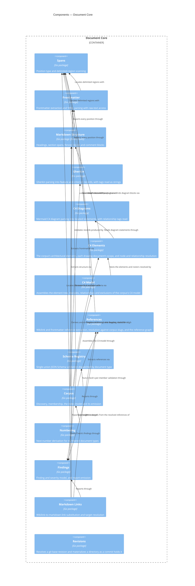

# Document Core

## Overview

Document Core is the general half of the CLI. It covers everything that's
true of any corpus of Markdown documents that carry YAML frontmatter and
reference each other by slug. It discovers a corpus, parses each document
into a structured record, resolves the reference graph, and reports findings
against schemas and patterns supplied from outside.

It has no knowledge of this framework. It doesn't know that `adr` is a
document type, that ADR slugs are numbered, or that a component record block
exists. Those facts arrive through the extension point described under
Interface, which [[module-spec-profile]] populates. The test for whether a
capability belongs here: could an Obsidian vault with nothing to do with C4
use it?

The boundary lets the module be wrapped in an HTTP API or an MCP server later
without first being extracted from a CLI. It also lets an enterprise with a
different document taxonomy reuse the engine.

- **Role:** parse, index, and check a corpus of frontmatter-bearing Markdown
  documents, driven entirely by registered configuration.
- **Scope:** in — corpus discovery, frontmatter parsing, JSON Schema
  validation, Markdown structure and span extraction, Gherkin parsing,
  reference graph construction, numbering, and the index and finding models.
  Out — any document-type vocabulary, any framework-specific rule, and all
  process-level concerns (argument parsing, output rendering, exit codes),
  which belong to the command surface of [[container-spec-cli]].
- **Composed into:** [[container-spec-cli]] — a Go module in the same
  repository, imported as a package. See that blueprint for this module's
  relationships to its sibling components.
- **Source and tests:** `cli/core`, with tests beside their subjects, per Go
  convention.

## Tech stack

- **Language:** Go, imported by its host as a package. [[adr-015]]
- **Frontmatter:** `goccy/go-yaml` — parses frontmatter and record
  blocks. [[adr-015]]
- **Schema validation:** `santhosh-tekuri/jsonschema` — validates frontmatter
  against the schema a profile registers. [[adr-015]]
- **Markdown structure:** `yuin/goldmark` — headings, spans, and the
  code-region mask. [[adr-015]]
- **Gherkin:** `cucumber/gherkin` and `cucumber/messages` — parse
  acceptance criteria. [[adr-021]]
- **Generated models:** Strata — generates the index, finding, and C4 model
  types from `schemas/*.strata` instead of hand-written Go structs.
  [[adr-016]]
- **Base revisions:** the `git` executable, which the Revisions component
  runs instead of linking a Git library. [[adr-031]]

## Interface

The module's surface is its Go package API. Two parts of it matter enough to
state here: the **Profile extension point**, through which all domain
knowledge enters, and the **Span type**, which addresses every position in
the corpus.

- **Surface:** the exported identifiers of the packages under
  `cli/core`. The `Profile` interface in `cli/core/corpus` is the
  extension point.

**The Profile extension point.** A profile is a value supplied at startup
that registers document types and the rules attached to them. This is the
plugin architecture: Document Core is the host, a profile is the plugin, and
no framework vocabulary is compiled into the host.

- **Guarantees:**
  - The module SHALL accept exactly one active profile per corpus
    operation, supplied by the caller.
  - WHERE no profile is registered, the module SHALL still discover the
    corpus and parse frontmatter, reporting every document as excluded
    with reason `unknown-type`.
  - The module SHALL NOT import, reference, or special-case any
    individual profile.
  - The module SHALL accept from the active profile **one** JSON Schema
    — a discriminated union over every document type that profile
    defines — and SHALL validate a document's frontmatter against the
    branch of that union its declared `type` selects. It is one schema,
    not a registry of schemas keyed by type: a profile needing a schema
    per type would be describing several vocabularies rather than one,
    and the host would have to know which to reach for.
  - WHEN a profile registers a document type, the module SHALL treat the
    slug pattern and numbered flag that profile supplies for it as the
    authority for documents declaring it. These are the facts the union
    schema cannot express — a slug pattern because the shared
    frontmatter envelope declares `slug` once and a subtype cannot narrow
    an inherited property, and numbering because it is a query over the
    corpus rather than a property of a document.
  - WHEN a profile registers a document type, the module SHALL treat the
    frontmatter properties that type registers as reference-bearing as
    the whole of what it holds a reference in. A property absent from
    that registration contributes no reference however slug-shaped its
    value is: what is a reference is registered, never guessed.
  - The module SHALL take the lifecycle the active profile registers —
    the statuses at which a document is in effect, the statuses at which
    it is no longer, and the property in which one of the latter names
    its replacement — as the authority for those judgements, and SHALL
    contain no status and no property name of its own.
  - The module SHALL take the tag vocabulary the active profile
    registers — the pattern a feature identifier matches, the pattern a
    criterion identifier matches, the prefix an owning-document tag
    carries, the capture groups a criterion identifier shares with its
    feature's, and the qualifier tags together with what each of them
    means — as the authority for reading a tag, and SHALL contain no tag
    spelling of its own (AC-GHK-002.1). A tag matching no registered
    pattern, carrying no owning-document prefix and named by no
    qualifier is carried on the record with no meaning and reported as
    a warning (AC-GHK-002.8).
  - The module SHALL check a criterion identifier's derivation from its
    feature's by comparing only the capture groups the registration
    names as shared, so that neither pattern's internal structure is
    known to it (AC-GHK-003.6).
  - WHEN a profile is activated, the module SHALL validate its
    registration and SHALL report every defect it finds, naming the
    offending key, rather than falling back to a default for that key
    (AC-SPECREF-004.3). The defects are thirteen: a pairing or a typed
    reference naming a property the same type does not register as
    reference-bearing; a typed reference naming a document type the
    profile does not define; a lifecycle registration naming a status
    outside the profile's own status vocabulary; a feature-tag
    registration whose identifier pattern does not compile; a
    feature-tag registration whose shared captures name a capture group
    an identifier pattern does not define; a record-block schema pointer
    that resolves to nothing; a record-block tag registered more than
    once; an architecture registration naming a document type the
    profile does not define; an architecture registration naming a
    property the union schema does not declare on a type the property
    applies to; an element type registered at a level outside the four
    C4 levels; a roster record-block tag registered with no roster
    heading; a roster heading registered with no roster record-block tag;
    and a roster record-block tag that is not among the profile's
    registered record-block tags.
  - The module SHALL return those defects to the caller rather than
    rendering them. A compiled-in registration has no file position of
    its own, and the position a reader needs — the configuration value
    that selected the profile — is known only to the caller.
  - The module SHALL express every position it reports as a `Span`, so a
    caller never receives a bare line number.
  - WHEN a document fails to parse, the module SHALL record the failure
    against that document and continue, so that indexing never fails as
    a whole (AC-SPEC-002.4).
  - The module SHALL write exactly one artifact — the emitted index —
    and only to the destination the caller resolves. It modifies no
    document it reads.

**Built** — the `Profile` interface in `cli/core/corpus` has these seven
members and nothing else:

| Member | Supplies |
|---|---|
| `Schema() []byte` | the one union schema every document type is validated against |
| `DocumentTypes() map[string]DocumentTypeRules` | per type, its slug pattern, whether it is numbered, and which of its properties hold references — keyed by the value documents declare in `type` |
| `Conventions() specmodel.ConventionsConfig` | the convention defaults resolved where an adopting repository's configuration omits them |
| `Lifecycle() LifecycleRules` | the profile's status vocabulary, which of those statuses mean in effect and which mean superseded, and the property a superseded document names its replacement in |
| `FeatureTags() FeatureTagRules` | the tag vocabulary: the identifier patterns a feature and a criterion match, the prefix an owning-document tag carries, the captures a criterion identifier shares with its feature's, and the qualifier tags with their meanings |
| `RecordBlocks() []RecordBlockTag` | the fenced-block info strings registered as record blocks, each with an optional JSON Pointer fragment into the union schema that its YAML record is validated against |
| `Architecture() ArchitectureRules` | the architecture vocabulary: the document types that declare an element, each with its C4 level and, where it holds children, its roster heading and roster record-block tag; the entity-name, system, composed-modules and consumed-contracts properties; and the contract type with its provider property |

`DocumentTypeRules` carries a slug pattern, a numbered flag, a number width,
and the type's reference registration: `ReferenceProperties`, the properties
that hold document slugs; `TypedReferenceProperties`, the mapping from such a
property to the `type` its target must declare; and `Pairings`, the
properties that must be declared from both ends. It carries no schema. The
keys of `DocumentTypes` are all the host knows about which types exist, so
the `unknown-type` exclusion is a lookup, not a judgment.

`LifecycleRules` is profile-level, not per-type, because `status` is a
property of the shared envelope that every type carries and none narrows. It
states the status vocabulary explicitly instead of leaving it to be inferred
from the live and retired sets. Their union isn't the vocabulary: a status in
neither set is one the lifecycle says nothing about, which is the right
answer for a draft. Without the explicit vocabulary, the module couldn't
report a lifecycle that names a status the profile doesn't define. The
alternative, reading the vocabulary out of the union schema, would mean the
host knowing where a schema keeps its status enum, and passing vacuously
against a profile that keeps it elsewhere.

`RecordBlockTag` registers a record-block tag as data, the same way the
lifecycle and tag vocabulary are registered. A record is YAML, so there's no
per-tag format. The optional `Schema` pointer addresses a definition inside
`Profile.Schema()`, so the host still holds one schema. The module names no
tag, and a profile that registers none yields a corpus with no record blocks.
`ValidateRegistration` reports a pointer that resolves to nothing, instead of
skipping validation. It also reports a tag registered more than once, because
which schema applies would then depend on registration order. A tag with no
pointer is valid. A schema that isn't JSON raises no pointer defect, because
no pointer can be judged against it: the Schema Registry reports it when the
corpus compiles the profile's schema.

`ArchitectureRules` registers, as data, how a profile's documents declare C4
elements, following the `FeatureTagRules` precedent ([[adr-030]]). The module
knows the four C4 levels (`system`, `container`, `module`, `component`)
because they're notation, and it names no document type, property, or
heading. Each registered property applies to a fixed set of types: the
entity-name and consumed-contracts properties to every element type, the
system property to container-level types, the composed-modules property to
container-level and module-level types, and the provider property to the
contract type. `ValidateRegistration` asks the Schema Registry whether the
union schema declares each property on each type it applies to, selecting
the branch exactly as validation does. A renamed property is therefore a
defect, not a model that silently reads nothing. A type the profile doesn't
define is reported alone, without the level, property, and roster defects its
rules would otherwise raise. A property left empty isn't registered and is
checked nowhere. A profile that registers no architecture vocabulary yields a
corpus with no elements, and no error.

`FeatureTagRules` is profile-level for a different reason: a feature isn't a
document type. A feature is written inside a document of any type, or in a
file that isn't a document at all, and the tags that identify it are the same
in both. `FeatureTagRules` carries the two identifier patterns, the
owning-document tag prefix, `SharedCaptures`, and `Qualifiers` (each a tag
paired with the criterion property it populates). Every member is
independent, and a profile may register some and not others: a registration
that identifies features and not criteria describes a corpus with no
criteria in it.

`SharedCaptures` states as data how a criterion identifier derives from its
feature's identifier. The host compiles both patterns, captures both
identifiers, and compares only the groups named there, so it checks the
derivation without knowing either pattern's internal structure. A profile
whose two patterns share nothing registers no shared captures, and no
derivation is checked.

A qualifier's meaning is the generated vocabulary's own type, not a string
the profile invents, because the criterion record fixes the set of meanings:
a qualifier can only mean one of the things a criterion has somewhere to put.
The profile chooses each tag's spelling and which meaning it carries.

`ValidateRegistration` is the registration check. It returns
`RegistrationDefect` values that carry the document type, the offending key,
and what's wrong with it. It renders nothing and repairs nothing.

The surface is narrow because it constrains everything downstream of it.
Required sections and element records are later capabilities, and each
widens this interface further. Per the Change guidance in
[[module-spec-profile]], that widening is a change to the host reviewed on
its own merits, never a special case granted to one profile. Two tests hold
the boundary. First, no package under `cli/core` imports a profile package.
Second, no non-test source in `cli/core/corpus` contains a string literal
matching anything a profile registers through the extension point: any
document type, any status, any frontmatter property the generated vocabulary
types as a slug or a list of slugs, and any value a qualifier tag is liable
to be spelled after (a boolean property of the criterion record, or a
verification level). All four sets are read from the generated schema
instead of restated, so the boundary widens with the vocabulary. The
identity property `slug` is excluded, because it names the document
declaring it, not another document. Identifier patterns aren't read, because
a pattern is registered whole and the host holds no part of one.

The write guarantee is narrower in fact than in statement. The module's only
write is `corpus.Write`, whose destination `corpus.IndexPath` resolves to
`specs.json` in the configured spec root, unless the caller names another
path or standard output. The persisted index is the cache. There's no
separate cache location, so no other file is ever created.

## Components



Thirteen of the fourteen are built and carry a **Built** paragraph naming the
package that realizes them: Spans, Frontmatter, Gherkin, C4 Diagrams, C4
Elements, C4 Model, References, Schema Registry, Corpus, Numbering, Findings,
Markdown Links, and Revisions. The emitted index carries the resolved
reference graph, and the corpus checks read it. A broken link, a live
document citing a retired one, a half-declared pairing, and a typed reference
landing on the wrong document type are each reported against the document a
reader must open. **Markdown Structure is built for two of its three
capabilities.** `cli/core/markdown` locates fenced blocks by info string and
builds the heading tree with each heading's section span. Comment-block
location isn't built yet, and the diagram edge that would carry it is still
the intended shape, not an exercised one. Both edges from Corpus into
Markdown Structure and Gherkin are exercised: the walk extracts a fenced
Gherkin block through `markdown.Fenced` and parses every feature source
through `gherkin.Parse`, and the `gherkin/` checks recompute from the same
two packages.

### Spans

```component
entity_name: Spans
slug: component-spans
description: Position type and delimited-region scanning shared by every parser
```

(Go package) — Position type and delimited-region scanning shared by every
parser. Spans owns the `Span` type defined in [[frd-spec-index]]: a byte
offset and byte length as the authoritative extent, plus line and column for
readability. It also provides the general delimiter scanner that every other
parser is built on. The scanner finds the region between an opening and a
closing delimiter, such as `---` and `---` for frontmatter, or `<!--` and
`-->` for a comment block. Keeping one scanner here is what makes positions
consistent across components: two parsers that locate regions differently
will disagree about where a finding is.

**Built** — `cli/core/span`. Its surface is `Find`, which locates a delimited
region and returns it as a `Region` carrying two spans: `Outer`, over the
whole construct including both delimiters, and `Inner`, over the content
between them. `Of` derives a span from a byte extent, and `Slice` recovers
the bytes a span covers.

The implementation pins three semantics, and every consumer may rely on
them:

- **The scanner doesn't nest.** A second opening delimiter inside a region is
  content, and the first closing delimiter after the opening one ends the
  region. Neither frontmatter nor an HTML comment nests, and a scanner that
  pretended otherwise would locate a region that no parser reading the same
  file would agree with.
- **An unterminated opening delimiter yields no region,** not one running to
  the end of the document. A caller that must report the dangling delimiter
  as a defect locates it itself. Conflating the two would swallow the
  malformed input silently.
- **Line and column are derived, and a column counts codepoints.** Byte
  offset and length remain authoritative. The column follows this
  framework's `line_width` convention of measuring codepoints, not bytes, so
  an em dash advances it by one.

The `Span` type is a Go alias for the generated `specmodel.Span`, not a
second declaration. Spans owns how a position is computed and is the only
place one is constructed. The shape it's written in comes from
`schemas/index.strata`, because a span crosses the JSON boundary in both the
index and, from the Findings component onward, every finding. One definition
means no conversion between an in-memory span and a serialized one, and no
way for the two to drift.

### Frontmatter

```component
entity_name: Frontmatter
slug: component-frontmatter
description: Frontmatter extraction and YAML parsing that preserves each property's raw text
```

(Go package) — Frontmatter extraction and YAML parsing that preserves each
property's raw text. It splits the delimited block and parses it to a
generic document model. That one model serves both schema validation and,
after conversion to JSON, decoding into the generated typed records. The two
steps share one generic model instead of unmarshalling the source twice,
because generated structs carry no YAML tags. The raw text of each property
is kept alongside the parsed value, because AC-SPEC-003.2 requires validating
what the author wrote, not what a YAML parser inferred from it.

**Built** — `cli/core/frontmatter`. Its surface is `Parse`, which returns a
`Document` carrying the block's `Region` and its top-level `Property` values
in declaration order. Each property carries its name, the span of its key,
the span of its value, the value's raw source text, and the parsed value.
`Values` returns the generic tree a JSON Schema is validated against, and
`JSON` converts it for decoding into a generated record. One parse serves
both, so a property's position and its value can't disagree. `goccy/go-yaml`
is the parser, per [[adr-015]].

`Document.InlineComments` lists every YAML comment that follows another token
on the same line, such as `description: a # b`, whose value an unquoted `#`
has silently cut to `a`. Each comment comes with the top-level property whose
source it sits in, and its span from the `#` to the end of the line. A
comment on a line holding nothing else isn't listed, because it cuts no value
short (AC-SPEC-003.9, AC-SPEC-003.10). The comments are read from
`goccy/go-yaml`'s lexer tokens, with the line a multi-line scalar ends on
counting as its line, not by parsing with comments retained. So no value or
span that `Parse` reports depends on them. The Corpus reports each one as a
`frontmatter/inline-comment` warning.

Beside `Parse`, the package exposes `Locate`, which reports the block's
`Region` and nothing else. `Parse` is written on it, so one place decides
where a block begins and ends. A caller that needs only where the block ends
(the Corpus walk, for a document whose frontmatter didn't parse) asks this
component instead of re-deriving the delimiters, and a second derivation
can't disagree with the first.

`TopLevelScalar` reads one top-level property's value by line from a block
that `Parse` rejected. So one malformed value elsewhere in the block doesn't
make a property written correctly on its own line unreadable
(AC-SPEC-003.7). It reads a value only where three conditions hold: the
block is delimited (`Locate` finds it, because an unterminated block has no
extent to read from), the key begins its line unindented, and the value is a
non-empty single-line scalar, plain or quoted, with an optional trailing
comment. Anything else is no value, not a guess. It takes the property's
name from its caller and knows no envelope vocabulary: the Corpus asks it
for `slug`. `TopLevelScalarAt` reads the same value and also returns its span
(the value's source text on its line, which is what a parsed property's
`Position` covers), so a duplicate-slug finding against a recovered slug
points at the value (AC-SPEC-003.3).

The implementation pins six semantics:

- **A sequence-valued property carries its elements individually.**
  `Property.Items` holds one `Item` per element, each with the element's own
  span, its source text, and its parsed value. It's nil for a property whose
  value isn't a sequence, and empty for one whose value is the empty
  sequence, so the two are distinguishable. The whole value's span is the
  right extent for a finding about the property and the wrong one for a
  finding about one slug inside it. A reader told that a list holds a broken
  reference still has to find which element, and a rewrite of one element
  can't address the list. A scalar element is located by its own token, not
  by the extent running to the next element, which in a block sequence would
  swallow the following element's `- ` indicator.
- **`Parse` has three outcomes, and they're distinct.** A document and no
  error is a parsed block. No document and no error means the file carries
  no frontmatter, which is the caller's `no-frontmatter` exclusion, not a
  defect. No document and a located error means the block is there and
  couldn't be read. Nothing panics, so a corpus walk continues past a
  malformed member (AC-SPEC-002.4).
- **A block is recognized only at the start of the document.** The Spans
  scanner locates it, with `---` as the opening delimiter and a newline
  followed by `---` as the closing one. A `---` further down is content. The
  closing delimiter carries its leading newline so that only a `---`
  beginning a line ends the block: a run of three hyphens inside a value is
  content, and a search for a bare `---` would close the block inside that
  value. An opening delimiter with no closing one is reported as an
  unterminated block located at that delimiter, which is the case the Spans
  scanner deliberately declines to guess at. `Locate` applies exactly this
  rule and is the only place it's applied.
- **Raw text is source text, not a re-rendering.** A property's raw value
  runs from the first byte of the value to the start of the next property,
  with trailing whitespace removed. So a quoted string keeps its quotes, and a
  sequence or nested mapping keeps its whole block. The parser leaves an
  unquoted date as the string the author typed instead of resolving it to a
  timestamp, which is what makes the AC-SPEC-003.2 check possible at all.
- **The value tree is JSON-compatible.** No parsed value is a type JSON can't
  carry, so the crossing into the typed records is a marshal, not a
  conversion layer.
- **Byte offsets are re-derived here, not taken from the YAML library.**
  `goccy/go-yaml` advances a token's reported position one unit per Unicode
  codepoint, not per byte, so treating it as a byte offset is correct only
  while the block is pure ASCII. Otherwise, every property after an em dash
  or a curly quote would land short of its true position by the accumulated
  byte/rune difference, silently corrupting the raw text the Schema Registry
  checks a format constraint against. This package therefore counts
  codepoints into the block's own bytes to recover the offset. No ASCII unit
  fixture can expose this failure mode.

A frontmatter block that isn't a mapping (a bare scalar, a sequence) is
reported as a located error, not as an empty document, because a file whose
frontmatter is a list has a defect worth naming. An empty block is a
document declaring no properties, which is a different thing from a file
with no block.

### Markdown Structure

```component
entity_name: Markdown Structure
slug: component-markdown-structure
description: Headings with their section spans, fenced blocks by info string, and HTML comment blocks
```

(Go package) — Headings with their section spans, fenced blocks by info
string, and HTML comment blocks. It produces the heading tree with the span
of content beneath each heading, extracts fenced blocks whose info string
matches a registered tag, and locates HTML comment blocks both as content and
as leftover-scaffolding hygiene. The extract-then-review pattern depends on
this component: an agent asks for the spans of particular sections and reads
only those.

**Built — headings and fenced blocks.** `cli/core/markdown`. Its fenced-block
surface is `Fenced`, which takes a document body and a set of registered
tags. It returns every fenced block whose info string matches one of them, in
document order, as a `Block` carrying `Content`, `Text`, `Outer`, and
`Inner`. `Content` is the bytes between the fences. `Text` is the content
lines as the parser reads them, with container prefixes such as a
blockquote's `> ` removed, so unlike `Content`, it isn't a slice of the
document. `Outer` spans the whole construct, including both fence lines in
full, and `Inner` spans the content alone. Fence recognition comes from
`goldmark` ([[adr-015]]'s choice, already a module dependency through
References), not from a hand-rolled scan, because where a fence ends depends
on the fence character, its run length, and its info string. Every position
is still computed by the `Of` function in Spans, so a fenced block's position
is comparable to a frontmatter or reference position. An unterminated fence
(content running to the end of the document with no closing line) yields no
block, matching the Spans scanner's refusal to guess at a dangling delimiter.
`Fenced` locates and returns bytes only. `FencedFrom` is its offset-taking
form, mirroring `HeadingsFrom`: it searches from a byte offset and reports
every span in whole-file coordinates. `Fenced` is `FencedFrom` at offset 0.

**Built — record-block recording.** Corpus calls `FencedFrom` with the tags
the active profile registers through `RecordBlocks`, searching from the start
of the body so that a fence inside frontmatter YAML is never a record. It
records each block as a `RecordBlock` of tag and `Outer` span, fences
included, never its content. A record attaches to the innermost heading
whose section span contains it, and to the entry's own `record_blocks` where
no heading's does. Each record appears exactly once, and an entry with no
registered tag carries `[]` throughout. A block is recorded whether or not
its content is valid: indexing raises no finding about a record.

`DecodeRecordBlock` reads a recorded block's content back through its span.
It re-locates the block from the body through `FencedFrom` (the same search
that recorded it), matching on `Outer`, and decodes the block's `Text` as
YAML into a caller-supplied Go value. So a record inside a blockquote decodes
like any other, and a span that covers no fenced block of the tag is an
error. Every command and check decodes a record the same way. The registered
tags are folded into the input hash, because they decide what the index
records.

Its heading surface is `Headings`, which takes a document body and returns
every heading in document order as a `Heading`: its `Text` as authored, with
the markers that open and close the line removed; its `Level`; `Position`,
over the heading line itself; and `Section`, over the content beneath it. A
section runs from the end of the heading line to the start of the next
heading of the same or a higher level, or to the end of the document where
there's none. So a deeper heading falls inside its parent's section instead
of closing it. A heading standing over nothing carries an empty span, not an
absent one, and a body with no heading yields an empty result, not an error.

Heading recognition comes from `goldmark` for the same reason fence
recognition does: what looks like a heading inside a fenced block or an
inline code span isn't one, and only a Markdown parser knows which regions
not to scan. A heading underlined instead of prefixed carries its underline
inside `Position`, so `Position` ends exactly where `Section` begins in both
written forms. The two forms are told apart by where the heading's text sits
on its line, not by the line's first character. A prefixed heading's markers
stand between the start of the line and the start of its text. An underlined
heading's text begins the line's content. So the rule holds inside a
container block, where that first character is the blockquote's or list
item's own marker and not the heading's. No section content is returned,
only its span, which a caller slices back out of the body it passed in.

`HeadingsFrom` is the same search started at a byte offset, with every span
still expressed in the whole source's coordinates. A document with
frontmatter needs it: a frontmatter block's closing delimiter underlines the
YAML above it, which CommonMark reads as a setext heading, so a whole-file
search reports the entire block as a level-2 heading. Starting at the body
leaves that construct behind the offset instead of filtering it out
afterward. Reporting against the whole source keeps a heading's line number
the one a reader counts to in the file. `Headings` is `HeadingsFrom` at
offset zero.

The package also exposes `Identifier`, the heading identifier of a text: its
rendered inline content, lowercased, with every character that isn't a
letter, digit, hyphen, underscore, or space removed, and each remaining space
replaced by a hyphen. Inline content is rendered, not filtered, so the
identifier of ``The `Profile` interface`` is `the-profile-interface`, and a
link's target doesn't leak into the identifier of the heading that carries
it. It's rendered as inline content specifically, because the text is a
heading's name and not a document. So a block-level marker opening it (an
ordinal, a bullet, a blockquote marker) is a literal character of that name,
not syntax, and `1. Overview` and `2. Overview` yield `1-overview` and
`2-overview` instead of one identifier addressing neither. The derivation is
a pure function of the text and derives no positional suffix for a repeated
heading, which lets anchor resolution match against this one derivation
instead of a second one. It's exposed as a function instead of being
recorded on a `Heading`, and the index model carries no identifier property
for the same reason: it's recomputable from the text, so it isn't state.

Two more pure functions name a heading among same-named ones. They work on an
`Outline` (a heading's text and level, which a parsed `Heading` and an
indexed one both carry), so the package takes no dependency on the index
model. `HeadingPaths` returns each heading's heading path: the identifier of
every enclosing heading from the outermost down, then its own
(AC-SPECSTR-003.9). `JoinPath` writes a path with `#` between segments. A
heading encloses the headings after it up to the next one at its own level or
higher, which is the nesting its section follows. So a skipped level changes
nothing, and a document with no top-level heading has paths that begin at
its shallowest. `MatchesPath` decides whether a heading's path satisfies a
query of one or more `#`-separated segments, each compared on its
identifier. The last segment must be the heading's own identifier, and every
earlier one an enclosing heading's, in order from the outermost, at any depth
(AC-SPECSTR-003.11, AC-SPECANCH-002.10).

`SelectPaths` decides selection over one document's whole outline. A query of
more than one segment that equals some heading's full heading path selects
exactly the headings with that path, and any other query selects every
heading satisfying it. Without that precedence, a shallow heading's full path
(`document-core#references`) is also satisfied by a deeper same-named heading
(`document-core#components#references`), and a path the CLI prints wouldn't
paste back as a selection naming its heading alone. One segment is never
narrowed: it's exactly an identifier comparison over every heading. So every
selection and anchor written before paths existed answers as it did, and a
heading whose path is one segment is named alone only where no other heading
shares its identifier. A query holding an empty segment selects nothing. The
`headings` query, `refs`, and anchor resolution all select through
`SelectPaths`, over paths derived by one conversion of the recorded headings
(`references.HeadingPaths`), so a selection and an anchor written alike
can't select different headings.

Comment-block location is **not built yet**: no `cli/core/markdown` surface
locates an HTML comment block.

### Gherkin

```component
entity_name: Gherkin
slug: component-gherkin
description: Gherkin parsing into feature and criterion records, with tags read as strings
```

(Go package) — Gherkin parsing into feature and criterion records, with
tags read as strings. It parses a source with the official Go Gherkin parser
that [[adr-021]] measured, and returns one feature record with its criteria
nested beneath it, each carrying its text, its tags, and its position. Both
admissible forms (a fenced block inside a document, and a standalone
`.feature` file) are the same parse over a different region.

**The whole of Gherkin lives here, and none of this framework's vocabulary
does.** Parsing is general. Which constructs a source declares, where each of
them ends, and what a tag says are questions about a notation, and a vault of
`.feature` files with nothing to do with C4 could ask them. Meaning isn't
general. Which tag identifies a feature, which identifies a criterion, and
which qualifiers count are facts about one document vocabulary, and they
arrive through the Profile extension point. The component asks the caller to
resolve a set of tags to an identity and takes back an answer or nothing. It
never inspects a tag's spelling. This is the module's host-and-plugin split
applied to a notation instead of a document type, and it's why no identifier
pattern and no qualifier name appears in this package.

**Built** — `cli/core/gherkin`. Its surface is `Parse`, over a source that's a
document in its own right, and `ParseRegion`, over a region of a containing
document such as a fenced block. Both take an `Options` carrying the two
functions that resolve tags to a feature identity and to a criterion
identifier. Each returns either a `Feature` or a `*ParseError`. The `Feature`
is the generated `specmodel.Feature`, populated with what Gherkin
establishes, the tags as written, and the `Criterion` values beneath it. The
`*ParseError` carries every failure the parser reported as a located
`specmodel.ParseError`. `ContentHashOf` computes a criterion's hash from a
name and a text alone, so a second producer of criteria hashes them the same
way. `FenceTags` names the info strings that mark a fenced block as a Gherkin
source. That names a notation, not a vocabulary, so it belongs here and not
in a profile. Both the discovery that extracts those blocks and the reference
extraction that declines to mask them read it from one place.

The implementation pins four semantics:

- **A source that declares no `Feature` is parsed behind a synthetic
  header,** and no position the header occupies is ever reported
  (AC-GHK-001.4, AC-GHK-001.5). Every reported line is the line in the
  containing document: the source's start line, plus the parser's line, minus
  the lines the header added. The feature such a source yields carries no
  name, because a name invented here would be reported as though an author
  had written it.
- **A criterion's content hash covers its name and its text and nothing
  else** (AC-GHK-005.5). Spans and parser node identifiers are excluded. A
  node identifier is a positional counter that shifts whenever anything above
  it is edited, so including one would report every criterion below an
  insertion as changed. The text is hashed normalized (LF line endings,
  common indentation removed, trailing whitespace stripped per line), so a
  reindent or a CRLF checkout hashes as before, and only a wording change
  moves the hash (AC-GHK-005.6, AC-GHK-005.7).
- **A criterion's body is text.** It's the steps and any example table,
  verbatim, with the block's common indentation removed. It's never
  decomposed into typed steps or keyed example rows: decomposition would
  model one notation, and nothing in the framework operates below the level
  of a whole criterion.
- **A construct ends where the next one begins,** trimmed back over trailing
  blank and comment lines. Deriving an extent this way, instead of from the
  last step, table row, or doc-string delimiter, means no construct needs
  arithmetic of its own. It also means a doc string's contents, which may
  look like anything (comment lines included), sit inside the range instead
  of at its edge.

A scenario carrying `Examples` blocks divides on identity. Where any block is
identified, each block becomes its own criterion. Where none is, the scenario
is one criterion whose text covers every block (AC-GHK-002.6,
AC-GHK-002.9). An unidentified block beside an identified one still becomes a
criterion, carrying no identifier: the partial tagging is a defect for a
check to report, and a check can only report what the records carry.

A parse failure is returned instead of records, not alongside them, and
parsing never panics: a half-parsed source yields a feature missing criteria
its author wrote, and an index that silently lost one is worse than an index
that recorded why (AC-GHK-006.1).

### C4 Diagrams

```component
entity_name: C4 Diagrams
slug: component-c4-diagrams
description: Mermaid C4 diagram parsing into located statements, with relationship tags read
```

(Go package) — Mermaid C4 diagram parsing into located statements, with
relationship tags read. It takes the content of one fenced `mermaid` block
and its position in its document, and returns the diagram type and the
statements read, each with its kind, its macro, its arguments, and its span.
[[adr-029]] gives the CLI this parser of its own, because the one Go library
measured fails on this corpus's own diagrams.

**The subset is a table, and everything outside it is a parse error.** Only
`C4Context`, `C4Container`, and `C4Component` diagrams are parsed. Any other
diagram type is returned by name with no statements. The macros read are
those that [[frd-spec-c4-diagrams]]'s terminology lists. A statement outside
them, with unbalanced quotes or parentheses, or with too few arguments for
its macro, is returned as a parse error carrying its span, and parsing
continues with the next line. Growing the subset is an edit to the table,
not a change of behavior.

**It's pure notation.** It neither reads the corpus nor resolves a node to an
element. Relationships come back in dependency direction (`Rel_Back(a, b)`
with source `b`). Every directional variant is returned as `Rel`, with the
macro as written kept, and `BiRel` is flagged bidirectional. Tags are split
on `+` only. `sync`, `async`, and `contract:<slug>` are returned as reserved,
and a comma in the tags argument is recorded instead of treated as a
separator (AC-C4-DIAG-001.2, AC-C4-DIAG-004.1).

**Built** — `cli/core/c4diagram`. A boundary's `{` opens it, and a line
holding only `}` closes the innermost one. A stray `}` and a boundary left
open are both parse errors. Leading `---` frontmatter and `%%{ ... }%%`
directives spread over several lines are skipped before the diagram type is
read. C4 Elements is its one caller, and the C4 checks reach it through that
component.

### C4 Elements

```component
entity_name: C4 Elements
slug: component-c4-elements
description: The corpus's architectural elements, each drawing document's scope, and node and relationship resolution
```

(Go package) — The corpus's architectural elements, each drawing
document's scope, and node and relationship resolution. It owns the judgment
of what a diagram node names, so the C4 checks and the C4 model read one
answer. It reads the index and the architecture vocabulary the profile
registers ([[adr-030]]), and names no document type, property, or heading of
its own.

**Elements.** Every corpus member whose type the vocabulary registers declares
an element: the member's slug, its entity-name property as the name, and its
registered level. So does every record block that carries the registered
roster tag of its document's type and is attached to the roster heading, or
to a heading nested in its section. The heading is matched on the identifier
that Markdown Structure derives, so letter case doesn't decide. A roster
block is decoded through the corpus's record-block decoding function. One
that doesn't decode to a mapping carrying a slug and an entity name declares
nothing. Reporting it is the structure checks' job. A member whose source
can't be read at the time of the run declares its element without a name and
draws nothing. A member with no slug declares an element of its own that no
declaration merges with and no slug lookup finds. A record block in a
document whose type registers no roster declares nothing. Declarations of one
slug (a blueprint and record blocks, or several record blocks) are one
element carrying every declaration, ordered by path and then by span. A
blueprint's declaration is its frontmatter block and defines the element's
name and level, and an element that only record blocks declare is a
component.

**Scope.** A node drawn in a document may name the document's own element;
the elements its roster declares, by record block or by a `[[slug]]`
reference under the roster heading that resolves to a component-level
member; the elements its composed-modules property names; and every
system-level and container-level element in the corpus.

**Resolution.** A node resolves to every in-scope element whose name equals
its label exactly, as written. An element with no entity name is named by no
node. An external node isn't resolved, and a `Db` or `Queue` node matching
nothing in scope is a passive store, not an undeclared node. A member whose
type declares no element has no drawing document, so its diagrams yield no
node.

**Drawings.** A relationship statement resolves to a drawing when both of its
endpoint aliases name nodes in the same diagram that each resolve to exactly
one element. A drawing carries the source and target elements in dependency
direction (`Rel_Back(a, b)` draws `b` depending on `a`); the label,
technology, and description arguments; the tags as parsed; the view the
diagram's type draws; the aliases as written; and the statement's path and
span. Any other statement is unresolved, with one reason, spelled as the
model's `C4ExclusionReason`: `external_endpoint`, `passive_store`,
`undeclared_node` (including an alias naming no node in its diagram), and
`ambiguous_node`. The reasons are checked in that order, with the source
endpoint before the target at each step, so an ambiguous source with an
external target is `external_endpoint`. An endpoint alias that more than one
node in the diagram carries is `ambiguous_node`, whatever its first node
resolves to. A `BiRel` statement states no single direction and is neither a
drawing nor unresolved.

**Relationships.** Drawings whose source element, target element, and label
are equal are drawings of one relationship, wherever they're drawn. A
relationship holds its drawings ordered by path and then by span, and the set
orders relationships by source slug, target slug, and label. The
drawing-conflict rule compares this grouping, and the C4 model emits it.

**Built** — `cli/core/c4elements`, reached through `Corpus.C4Elements`.
Diagrams are read from each drawing document's source at the time of the run
through `Corpus.Source`. The index doesn't record them, so neither its shape
nor its `schema_version` changes. The architecture vocabulary's types are
declared in this package and named by the `Profile` extension point, because
the corpus's checks call this package and not the reverse. The source scan
that keeps `cli/core/corpus` free of registered vocabulary covers this
package too. Each drawing document also carries its roster: every child its
roster declares, by record block or by reference, with the declaration's
span. Each element carries the system and composed-modules slugs its
blueprint names, which is what C4 Model nests by.

### C4 Model

```component
entity_name: C4 Model
slug: component-c4-model
description: Assembles the element tree, modules, relationships and exclusions of the corpus's C4 model
```

(Go package) — Assembles the corpus's C4 model from the elements and
drawings C4 Elements resolves: the element tree, the module collection,
the relationships and the excluded statements. It returns the generated
`specmodel.C4Model`, whose shape `schemas/c4.strata` declares, and renders
nothing. It decides nothing that C4 Elements owns and, like C4 Elements,
names no document type, property, or heading of its own.

**Element tree.** Every `system`-level element is placed in
`software_systems`, every `module`-level element in `modules`, and every
other element under its parent or in an orphaned collection. Placement
follows the edges the corpus declares, never directory layout or a diagram,
so no element is created from a diagram node. A container nests under the
system its system property names. Where that property is absent or names no
system-level element, the container is in `orphaned_containers`. A component
nests under the container or module whose roster declares it, by record
block or by a reference to its blueprint. A component that several rosters
declare nests under the one whose declaration sorts first by path and then by
span, and nowhere else. A component that no roster declares is in
`orphaned_components`.

**Derived edges.** A container's and a module's `modules` list the slugs its
composed-modules property names. A module's `contained_by` lists every
container and module naming it, and an element's `contracts_provided` lists
every contract whose provider property names it. Both are computed over the
whole corpus.

**Properties.** An element's `declarations` are every declaration C4 Elements
holds for its slug, each with its path and the span of the frontmatter block
or the record block, fences included. Its properties are taken from its
blueprint's frontmatter where it has one, and otherwise from the declaration
that sorts first by path and then by span: `entity_name`, `description`,
`technology`, `contracts_consumed`, and `tags`; for a module, `kind`,
`visibility`, and `version`; and for a component with a blueprint, `kind`. A
property the source doesn't carry is absent. A composed-module slug that
isn't a well-formed slug is left out of `modules`. Reporting it is the
checks' job. Every collection of elements and of slugs is ordered by slug.

**Relationships.** Each group of drawings that C4 Elements reports as one
relationship is one relationship, whatever document and view each drawing
sits in. Its `description`, `technology`, and `detail` are the label,
technology, and description arguments of the drawing that sorts first by
path and then by span. An absent or empty argument leaves the property
absent. Its `drawn_in` lists every drawing by path and then span, with the
view and the aliases after `Rel_Back` normalization. Its `level` is the finer
of its endpoints' levels: `system`, then `container`, then `module` and
`component`, both recorded as `component`. Relationships are ordered by
source slug, target slug, and description.

**Reserved tags.** A relationship reads the reserved tags of its first
drawing, by path and then span. `interaction` is `sync` or `async` when
exactly one of the two is tagged, and absent when both or neither are.
`contract` carries the slug that the first `contract:` tag names, with
source `tag`, whether or not it resolves, as long as it's a well-formed
citation. A malformed one is read as no tag. With no such tag, `contract`
carries the one contract in the source element's `contracts_consumed` whose
provider is the target, with source `derived`, and is absent when none or
several fit. `tags` are the drawing's unreserved tags in the order written,
and absent when there are none.

**Exclusions.** Every statement that C4 Elements leaves unresolved is in
`excluded_relationships` with the reason it gives, and so is every `BiRel`
statement, with reason `bidirectional`. Each carries its path, span, and text
as written, and they're ordered by path and then by span. A statement the
parser couldn't read, a `C4Dynamic` or `C4Deployment` diagram, and a diagram
in a member whose type declares no element contribute nothing.

**Subtree.** Given a root slug, the model holds only that element and its
descendants: for a system, its containers and everything they hold; for a
container or a module, its components, the modules composed into it, and
theirs; for a component, nothing else. The root's ancestors appear only as
the chain from the top of the tree down to it, each holding no other child
(no other component, container, or composed module). A module root, and
every module among the descendants, is in `modules`, and a component whose
parent is a module appears under it there. An orphaned root stays in its
orphaned collection. Only the relationships whose two endpoints are both in
the narrowed set are kept, and only the excluded relationships whose
statement sits in the blueprint of an element in it. Derived properties keep
their whole-corpus values. A narrowed model carries `root_declared`: true for
a root naming an element, and false for one naming none. The model then holds
every collection empty, because a root the corpus doesn't declare is an
answer, not an error (AC-C4-004.6).

**Built** — `cli/core/c4model`, reached through `Corpus.C4Model`, for the
element tree, relationships, reserved tags, exclusions, and the subtree
query. A root naming no element answers a model with `root_declared` false.
The source scan that keeps `cli/core/corpus` free of registered vocabulary
covers this package: the properties it copies are named by the registered
vocabulary or by the model's own field names.

### References

```component
entity_name: References
slug: component-references
description: Wikilink discovery, heading-anchor resolution, and the inbound and outbound reference graph
```

(Go package) — Wikilink discovery, heading-anchor resolution, and the
inbound and outbound reference graph. It finds every `[[slug]]` and
`[[slug#Anchor]]` in a document body, records the span at which each occurs,
and resolves them against the corpus. It never scans fenced or inline code
spans, because an illustrative reference inside backticks isn't a reference.
The exception is a fenced block whose info string names a registered Gherkin
tag (Gherkin's `FenceTags`, above). That block is Gherkin content, not an
illustration, and is scanned like the rest of the body. References also
extracts from a `.feature` source read whole, recording references against
that file's own path, though the file isn't a corpus member. Inbound edges
are derived, so no document maintains a list of its own referrers.

**Built** — `cli/core/references`. `Extract` takes one document: its path,
its bytes, its parsed frontmatter, and the reference-bearing property names
the active profile registers for its type. It returns the references the
document makes as `specmodel.Reference` values, ordered by position: the
registered frontmatter properties in declaration order, then the body in the
order it's written. `Resolve` takes those references and one `SpecIndex` and
records, in place, what each of them reached. The two are separate because
they know different things: extraction knows a document, and resolution
knows a corpus. Keeping the seam between them makes it impossible to put a
reference in the index without a corpus having been consulted.

**Resolution is a lookup, and it reads nothing.** It matches a reference's
slug half against the slugs the index's members declare. Where a reference
carries an anchor, it matches the anchor against the headings already
recorded on the target's index entry. Markdown Structure populated those
headings during the same walk, and they're never read from disk again here.
That's the whole of its input. No document is opened, no frontmatter is
re-parsed, and the answer is a function of the index alone, so the same
references over the same index resolve identically on every platform and on
every run. What it costs is the walk it rides on. See Corpus below for where
it's called from.

The graph the index carries is one collection of edges, and both directions
are read from it. `Corpus` exposes `OutboundReferences` by the path a
reference occurs in, and `InboundReferences` by the path it resolved to. Each
is built once, when the corpus is built or opened, so a document's referrers
are a lookup, not a scan, and no reverse edge is stored ([[adr-018]],
AC-SPECREF-001.3).

The resolution half pins five further semantics:

- **Slugs are compared lowercased and trimmed** (AC-SPECREF-002.8), matching
  the case-insensitive slug uniqueness that AC-SPEC-003.4 already
  establishes. The two rules have to agree: a corpus that refuses to hold
  `adr-012` and `ADR-012` as distinct documents but resolves a reference to
  only one of them answers one question about one identifier two ways.
- **A reference resolves only within the workspace the run is against.** A
  slug declared only in another repository's index is unresolved, per the
  boundary that [[frd-spec-reference-integrity]] states. The merged-graph
  case is a known follow-on, not a defect.
- **A slug matching a file the index recorded as an exclusion, or as a member
  whose frontmatter couldn't be read, resolves to `non-member` instead of to
  nothing** (AC-SPECREF-002.7). It carries that file's path and the reason or
  the parse failure. The reader's next step differs: the document is right
  there, and what's wrong is its frontmatter. The index records the outcome
  either way. Check reports only the exclusion's, because a reference
  reaching a parse failure depends on that failure, which is already the one
  finding (AC-SPEC-003.8).
- **A non-member is matched on its file name without the extension,
  lowercased**, because that's the only handle such a file has. A parse
  failure with no legible slug has no readable frontmatter to declare one,
  and a file excluded for carrying no frontmatter has none either. (A member
  whose slug was recovered is a member under that slug, AC-SPEC-003.7, and
  keeps the file-name match besides.) The name is recorded on the index, so
  the match is reproducible by anything reading the artifact, instead of
  resting on knowledge only the build held. A parse failure with no recovered
  slug is matched by a stem prefix as well. A numbered slug (one ending in a
  `-` and a number) that its file name begins with, followed by `-`, reaches
  it, so `[[adr-012]]` finds `adr-012-reference-conventions.md` under the
  `<slug>-<title>` naming of numbered types (AC-SPEC-003.8). Any other prefix
  is no member's slug and depends on no unreadable file: `[[adr]]` and
  `[[adr-012-reference]]` match nothing there and report as unresolved. The
  test is lexical, so resolution stays a function of the index. An exact stem
  outranks a prefix, and between two prefix matches, the first in path order
  wins. An exclusion is matched on its exact stem only, because it never
  claimed to be a member. The consequence is deliberate: a non-member whose
  intended slug matches its file name neither way (`frd-spec-index` for
  `spec-index-frd.md`) matches nothing and reports as an ordinary unresolved
  reference.
- **A member always wins over a file named like one.** Where two non-members
  share a name, the first in path order is reported, decided by comparison
  instead of by the order the index happens to hold its collections in.

The anchor half, which resolves against the headings the corpus records
([[frd-spec-structure]]), pins six more:

- **An anchor is matched against a heading by deriving a heading identifier
  from each and comparing them** (AC-SPECANCH-002.2). It's the same
  derivation that Markdown Structure exposes and Markdown Links consumes for
  its own fragment, so an anchor this component resolves is an anchor an
  exported copy can target.
- **An anchor written as a path of headings resolves through its enclosing
  headings** (AC-SPECANCH-002.10). `#Components#References` selects the
  `References` heading beneath `Components` at any depth, through Markdown
  Structure's `SelectPaths`, so one of two same-named headings can be named
  without renaming either. It's unresolved where no heading satisfies every
  segment, and ambiguous where several are selected (a full heading path
  selects only the headings with exactly that path), by the same rule as a
  single-segment anchor. Every match the resolution records carries its
  `anchor` (its heading path). A resolved nested anchor's Markdown link
  fragment is its last heading's, because a fragment can address only one
  heading.
- **Exactly one match resolves the anchor to that heading; more than one
  resolves it to no heading and carries every match** (AC-SPECANCH-002.5). So
  the reader is told which headings to disambiguate, not only that a
  collision exists.
- **An anchor naming no slug resolves against the document containing the
  reference** (AC-SPECANCH-002.6), so `[[#Heading]]` addresses the document
  it's written in instead of reporting as broken. An embed resolves exactly
  as the equivalent link, because nothing on `Reference` distinguishes the
  two: extraction already records an embed the way it records a link
  (AC-SPECANCH-002.7).
- **An anchor resolution is set only where the slug half reached a document
  to check it against:** a corpus member the slug resolved to, or the
  containing document for a slug-less anchor. A slug that didn't resolve gets
  no anchor resolution at all. The parent feature already reports it as
  broken, and a second finding for one mistake would train a reader to skim
  (AC-SPECANCH-002.8).
- **A target the index carries no entry for at all resolves the anchor as
  unverified, not as zero matches.** The concrete case is a standalone
  `.feature` file's own path, because a feature source produces no index
  entry. The tool didn't get to look, which is a different claim from having
  looked and found nothing (AC-SPECANCH-002.4).

The extraction half pins ten semantics:

- **The body is what follows the frontmatter block,** so a frontmatter value
  describing the notation (`description: References use [[slug]]
  wikilinks`) isn't read as a reference. It's the only unresolved reference
  a scan of this repository's corpus produces, and it's a false one.
  Frontmatter contributes references only through registered properties.
- **A registered property is the whole of what holds a reference in
  frontmatter.** An unregistered property contributes nothing, however
  slug-shaped its value is. A registered property whose value isn't text
  contributes nothing either. Whether such a value belongs there is the
  schema's question, not this component's.
- **A sequence-valued property yields one reference per element,** at the
  element's own span instead of the list's, as described under Frontmatter.
- **Code regions are located with `goldmark`, not with a backtick scan.**
  Where an inline code span ends depends on matching backtick-run lengths,
  and where a fenced block ends depends on the fence length and its info
  string. A hand-rolled masker getting one of those wrong produces exactly
  the false positive the exclusion exists to prevent. Extraction reads no
  heading.
- **The code-region mask is narrowed by fence info string, not removed.** A
  fenced block whose info string exactly matches one of Gherkin's
  `FenceTags` is left unmasked, because that content is Gherkin, not an
  illustration. A wikilink in a feature description, a scenario name, a
  step, a rule name, or an examples cell is extracted like any other body
  reference. Every other fenced block, every indented code block, and every
  inline code span stays masked. A fence's info string is always masked,
  whatever its tag: it's notation naming the block, never a place Gherkin
  content is written. Reading the tag vocabulary from Gherkin's exported
  `FenceTags`, instead of from a literal, keeps the two components from
  drifting when that vocabulary changes.
- **Gherkin-fenced references are indexed but not rewritten.**
  `OutsideGherkinFences` takes the same `Options` that `Extract` was given,
  and its references. It returns them without the body references inside a
  Gherkin-tagged fence, order preserved, and frontmatter references pass
  through. It shares the one `goldmark` walk the mask uses, so the two can't
  disagree about where a fence ends. A caller rendering the document applies
  it, because a renderer shows a fence literally. The index never does, so
  `refs` and the checks still see the reference (AC-GHK-004.1,
  AC-SPECMD-001.4).
- **A `.feature` source is extracted the same way a document body is,** with
  no frontmatter and no reference-bearing properties. The whole file is body
  from its first byte, so the same scan finds a wikilink anywhere in it. The
  reference is recorded against that file's own path even though the file
  isn't a corpus member, because an edge's endpoints are paths, and the
  referring file is the one a reader must open to fix it. It resolves
  exactly as a reference written in prose does. An unresolved one is
  reported by Corpus's `reference/unresolved` check (below), not by a rule of
  its own.
- **An HTML comment block is read as body text.** Only code is excluded, and
  [[template-authoring-standards]] requires a finished document's comment
  blocks to be deleted. So masking them would hide a reference in a document
  that shouldn't be carrying the block at all.
- **A reference splits on its first `#`,** into the slug half this feature
  resolves and the anchor half it records without interpreting. That holds
  inside a Gherkin source exactly as elsewhere, so an anchor is never matched
  against a `Feature`, `Rule`, or `Scenario` name: a scenario name isn't a
  heading, and extraction resolves no anchor against a heading either. No
  other separator is read. The reference standard prohibits the display
  alias `[[slug|text]]`, so such a reference carries `slug|text` as its slug
  half and reports as unresolved, instead of resolving quietly to something
  the standard forbids.
- **Extraction leaves the resolution unset,** which is deliberately
  unserializable, so a reference can't reach the index without having been
  resolved on the way. `Resolve` sets one on every reference, including the
  ones that reached nothing, because the index describes the corpus it found,
  and reporting a broken link is a check's job (AC-SPECREF-001.6).

A reference's position covers what a reader is pointed at and what a rewrite
replaces. For a body reference, it's the text between the brackets, because
the brackets are notation, not reference. For a frontmatter reference, it's
the value's own source text as written, quotes included.

Reference-bearing values are read from the parsed frontmatter block, never
from an index entry's typed envelope, which carries neither the per-type
properties a profile registers nor the positions a reference needs. A test in
the package asserts that the import is absent, instead of leaving the
boundary to review.

### Schema Registry

```component
entity_name: Schema Registry
slug: component-schema-registry
description: Single-union JSON Schema validation, dispatched by document type, producing located findings
```

(Go package) — Single-union JSON Schema validation, dispatched by
document type, producing located findings. A profile registers **one**
schema, a discriminated union over every document type it defines, not a
schema per type. This component compiles that union once and validates each
document's frontmatter against the branch its declared `type` selects. It
reports every violation in one pass, each with the JSON Pointer at which it
occurred, instead of stopping at the first (AC-SPEC-003.1). Where the
selected branch constrains a property with a format keyword, the property's
raw source text (from the Frontmatter component) is validated in place of
its YAML-coerced value. So a value that a YAML parser silently reinterpreted
is checked as the author wrote it (AC-SPEC-003.2). A slug that doesn't match
the pattern from the active profile's per-type table is reported separately,
naming both the actual slug and the expected pattern (AC-SPEC-003.5). That
check is independent of the union schema, because the shared frontmatter
envelope declares `slug` once and no subtype can narrow it there.

**Built** — `cli/core/schemaregistry`. The branch a document is checked
against is found mechanically. The registry finds the discriminated union in
the profile's schema (the definition whose `anyOf` branches each fix `type`
to a constant) and selects the branch whose constant is the document's
declared type. Where a schema has no such union, the declared type
("system-blueprint") is converted to the PascalCase form its top-level
`definitions` are keyed by ("SystemBlueprint"). Neither is a lookup table
naming any type, which lets the package hold to the Change guidance below
without a per-type schema pointer from the profile. `Declares` answers, over
that same branch, whether a type declares a property, directly or through
`$ref` and `allOf`, never through an alternative. `Declares` is how a
profile's architecture registration is checked against its own schema.
`Enum` answers, over the same branch, the values a property's schema allows,
followed through `$ref`.

A violation reached through `$ref` is reported by its **leaf constraint**, not
by the `$ref` that led to it. The registry walks the validation error's
causes down to the ones that have none, so a pattern failure names its
expression (`pattern "^[a-z0-9]+(?:-[a-z0-9]+)*$"`) and an enum failure names
every allowed value (`one of draft, approved, …`), beside the offending value
(AC-SPEC-006.1). Every failed `oneOf`/`anyOf` branch and every sibling
violation is still reported. A slug that fails its type's pattern is
reported **once**, as `slug/pattern-mismatch`. The Corpus check drops the
shared schema's pattern violation on the same `/slug` beside it, under
`--only frontmatter/schema` as well, and keeps one only where the type's
pattern passes. A message about the frontmatter object itself (a missing
required property) carries no pointer prefix. Its detail keeps the root
pointer `""`.

**Built** — `cli/core/envelope`. The index carries each document's
frontmatter as the union variant its `type` selects (`TypedFrontmatter`), so
every property the type defines is carried (AC-SPEC-002.1). This package
decodes a parsed block into that variant and reads the shared envelope back
out of one, without naming a document type. The variants are discovered from
the generated union, each tag the kebab-case of its variant's name. It
decodes without the generated required-field enforcement, because a document
missing a required property must still be indexed for
`frontmatter/missing-property` to report it.

A value that its property's generated type refuses (a `status` outside the
vocabulary) fails the decode with a `PropertyError` naming that property and
the value as written, so the `frontmatter/parse` failure is located at the
property. Where the property's schema is an enum, Corpus asks the Schema
Registry for the allowed values, compiling the schema on that failure path
only, and the message names them all:
`status: "actve" is not one of draft, ready-for-review, approved,
in-progress, active, retired` (AC-SPEC-003.6, AC-SPEC-006.1).

`Encode` is the matching write. Corpus encodes every entry's frontmatter
through it when it renders the index. It writes the `type` discriminator and
then the variant's properties exactly as the generated encoder does, except
that a required enum the document leaves undeclared (an ADR's `status`, a
blueprint's `kind`) is **omitted from the index instead of refused**. The
generated encoder refuses the empty value, which would make the index
unwritable over a corpus that merely fails a check. The omission is that
check's finding alone (AC-SPEC-002.4, AC-SPEC-002.5). For frontmatter that
declares every enum, the bytes are the generated encoder's, so the index of
a valid corpus is unchanged. An index with an omitted enum doesn't load back
through the generated decoder, which requires the property. So a corpus
holding such a member always rebuilds instead of serving its cache warm.
Status and output are the same either way.

### Corpus

```component
entity_name: Corpus
slug: component-corpus
description: Discovery, membership determination, the index model and its versioned emission
```

(Go package) — Discovery, membership determination, the index model and
its versioned emission. It walks the configured spec root, decides
membership from frontmatter and declared type, records exclusions with their
reason instead of dropping them, extracts the features written in either
admissible source form, and assembles the index every other capability
queries. It orchestrates the parsing components but holds no parsing logic
of its own.

**The index model is `SpecIndex`, and it's generated.** The index crosses a
boundary (CI, agents, and a central architecture catalog all read it), so
its shape is declared once in `schemas/index.strata` and transpiled to JSON
Schema, Go, and Markdown with every other model, per [[adr-016]], instead of
being assembled by hand in the emitter. Corpus populates the generated
`specmodel.SpecIndex`. It doesn't define it.

The vocabulary is:

- **`SpecIndex`** — the root: a `schema_version`, the `workspace` identifier
  from configuration, an ordered list of `entries`, an ordered list of
  `exclusions`, an ordered list of `references`, an ordered list of
  `features`, and the optional `input_hash` that decides the warm cache.
  Every collection is a list, not a map, so that the emitter owns their order
  and can make output byte-identical across platforms (AC-SPEC-009.7) without
  a change to the model.
- **`IndexEntry`** — one corpus member: its repository-relative `path`, its
  parsed `frontmatter`, and a `parse_error` carrying a located failure for a
  member whose frontmatter couldn't be read (AC-SPEC-002.4). Exactly one of
  the latter two is present. A member carrying a `parse_error` also carries a
  `recovered_slug` when its slug is still legible (AC-SPEC-003.7), and every
  slug lookup honors it. An entry also carries the document's structure: its
  `headings` in document order (AC-SPECSTR-001.1), and the `record_blocks`
  attached to the document instead of to any heading (those written before
  the first heading, and those in a document with none). Headings are
  recorded for every member, including one whose frontmatter couldn't be
  parsed, because a heading is Markdown and doesn't depend on an envelope.
- **`IndexExclusion`** — one candidate file that isn't a member: its `path`,
  a `reason` of `no-frontmatter` or `unknown-type`, and, where the reason is
  `unknown-type`, the `type` value the file declared (AC-SPEC-001.3,
  AC-SPEC-001.4).
- **`Reference`** — one occurrence of one document referencing another: the
  `path` it occurs in, the reference `text` as written, its `slug` and
  `anchor` halves, its `origin`, its `span`, and its `resolution`. References
  are their own collection, not an array on each entry, per [[adr-018]]. The
  attributes of a reference describe the edge and not either endpoint, both
  directions are derived by indexing the one list when the index is read, and
  merging two repositories' indexes into one graph is appending rows. There's
  one row per occurrence, so a document referencing the same target twice
  carries two rows with two spans (AC-SPECREF-001.5). The `slug` half is a
  plain string, not a `Slug`, because a reference is hand-written, and a
  malformed one has to be representable to be reported.
- **`ReferenceOrigin`** — a union discriminated on `kind`: a reference parsed
  from the body, or one held by a named reference-bearing frontmatter
  property, carrying that property's name (AC-SPECREF-001.7). The origin
  decides how the defect reads and how a rewrite finds it, so it belongs to
  the reference instead of being inferred from where its span falls.
- **`ReferenceResolution`** — a union discriminated on `state`: `resolved`,
  naming the target's path; `unresolved`; or `non-member`, carrying the
  matched file's path with either the exclusion reason or the parse failure
  that keeps it out of the corpus (AC-SPECREF-002.7). A reference that
  reaches nothing is recorded with a state, not dropped, because indexing
  never fails (AC-SPECREF-001.6).
- **`Feature`** — one feature declared by the corpus: its `id`, the `code`
  that groups it, the `document_slug` of the document that owns it, the
  `path` it's written in, its `name`, its `description`, its `source`, its
  `span`, and its nested `criteria` (AC-GHK-005.1). Features are a top-level
  collection because a feature is addressed by its identifier, not by the
  document that happens to hold it. They're ordered by the path a feature
  occurs in and then by its position within that file.
- **`FeatureSource`** — a union discriminated on `form`: a `fenced-block`
  carrying the extent of the fence around the Gherkin, or a `feature-file`
  carrying nothing, because the file is the feature. The form changes what a
  consumer may do with the feature, so it's a value, not something inferred
  from an absent property.
- **`Criterion`** — one acceptance criterion, nested inside the feature it
  qualifies instead of held in a sibling collection. It carries its `id`;
  the `path` of the file it's written in and the `feature_id` of the feature
  it belongs to, so a lookup of one criterion locates it without a second
  query; every tag written on it as `tags`, in order and without the leading
  `@` (unregistered tags included, and an Examples-derived criterion's
  scenario tags first); its `name`; its body as `text`; its `description`;
  the `rule` it sits beneath; the `negative` and `manual` qualifiers; its
  verification `level`; its `notation`; its `content_hash`; and its `span`
  (AC-GHK-005.2, AC-GHK-005.4). `path`, `feature_id`, and `tags` are
  required, so a persisted index written before they existed fails to decode
  and is rebuilt instead of served warm. The body is one string and isn't
  decomposed into typed steps and keyed example rows: a criterion is the
  atomic unit here, and a decomposed shape could be filled from one notation
  only (AC-GHK-005.3). The `content_hash` covers the criterion's name and
  text and nothing else, so a criterion that moved hasn't changed
  (AC-GHK-005.5).
- **`Heading`** — one heading of a document body: its `text` as authored, its
  `level` constrained to 1 through 6, the `span` of the heading line itself,
  the `section_span` of the content beneath it, and the `record_blocks`
  attached to it. The section span runs from the end of the heading line to
  the start of the next heading of the same or a higher level, or to the end
  of the document where there's none. No section content is carried. A
  reader that wants the text reads it back through the span, which keeps a
  document's prose out of the index. A heading carries no identifier,
  because the identifier is a pure function of the text, and the Markdown
  Structure component derives it on demand.
- **`RecordBlock`** — one fenced block that the active profile registers as
  carrying a YAML record about an element declared inside a document
  ([[adr-008]]): its `tag` and the `span` of the block as written, fences
  included, so that a rewrite promoting the element replaces the whole
  construct. The record's content isn't carried. Strata has no open value
  type, so an arbitrary YAML mapping has no typed home in the generated
  model. A command that needs a record reads it back through the span and
  decodes it into its own Go type, and `specs check` validates it: as YAML,
  as a mapping, and against the schema its registration names, where it
  names one. This shape names no tag and carries no vocabulary of its own. A
  block is attached to the innermost heading whose section contains it, and
  to the document where no heading does, so every registered block in a
  document appears exactly once (AC-SPECSTR-001.2).
- **`Span`** and **`ParseError`** — the position type every component reports
  through, and a message paired with one. `Span` is declared here, in the
  generated model, because findings and parse errors carry it across the JSON
  boundary. The Spans component above owns its semantics and is the only
  place spans are computed.

`schema_version` is required and pinned to `2.2` (AC-SPEC-002.2). A change to
what the index already carries, such as renaming or removing a property, is
a version bump. Otherwise the model is additive: an addition alongside the
existing shape keeps the version, which is what [[container-spec-cli]]'s
additive rule permits. The `references` and `features` collections and the
structure properties (`headings` and `record_blocks` on `IndexEntry`, with
the `Heading` and `RecordBlock` shapes they carry) are such additions.
Removing a property that no emitted index has ever carried also keeps the
version, under the exception [[container-spec-cli]] records. The schema
constrains `schema_version` by pattern (`String ~= /^2\.2$/`) instead of
pinning it, so the generated model carries a validated field, not a constant.
The emitted value lives in `cli/core/specindex`, alongside the constructor
that writes it. It's a separate package because
`scripts/generate-schemas.sh` rebuilds `cli/core/specmodel/` from scratch on
every run.

Strata does support pinning a scalar to a single value with `==`. That would
make the generated model carry the constant directly and remove the need for
the separate package.

The index isn't yet a contract document, and that's a recorded decision, not
an omission. It has one producer and no independently built consumer, so the
generated JSON Schema is its interim machine-readable specification.
Promotion to a contract, with a formal versioning policy, is deferred to the
index-schema ADR and waits on a real consumer. See the Open questions in
[[container-spec-cli]], which owns that decision.

**Built** — `cli/core/corpus`. `Build` walks the spec root and returns a
`Corpus`: the populated `specmodel.SpecIndex`, the findings that discovery
raised over it, and the lookups the queries need. The lookups are `Entry` by
path, `Slug` by identifier, `Document` for the parsed frontmatter behind one
member, `OutboundReferences` and `InboundReferences` for the two directions
of the reference graph, `FeatureFailures` for every Gherkin source that
wouldn't parse, and `FindingsFor` to narrow a whole-corpus result to one
file.

`Feature`, `FeaturesByCode`, and `Criterion` match an identifier or code
regardless of letter case, and return the record as declared (AC-GHK-007.7).
`CriteriaByTag` accepts a qualifier with or without Gherkin's leading `@`
(AC-GHK-007.9). For a qualifier the active profile doesn't register, it
returns an error wrapping `ErrUnregisteredQualifier`, because no document
could make that qualifier valid (AC-GHK-007.8). The error quotes the value
and lists every registered qualifier, in the shape of `ErrUnregisteredType`.

**`DocumentSummaries` is the listing query**, beside `Features` and
`CriteriaOf` on the same query surface, for the same reason those are here:
the command surface may hold no domain logic, and a future API or MCP wrapper
needs the same answer without going through Cobra. It returns one
`DocumentSummary` per index entry. A summary is a projection of `IndexEntry`
over its `path` and the frontmatter envelope it parsed, carrying `path`,
`slug`, `type`, `status`, `title`, and `description`, in that order and
nothing else (AC-SPECLIST-001.1, AC-SPECLIST-001.2). It's a projection and
not a new record, so the index shape doesn't change and `schema_version` is
unaffected.

Summaries come back in the index's own entry order, which the emitter already
fixes by repository-relative path. So the query sorts nothing, and two runs
over an unchanged corpus answer identically. Each path is passed through
exactly as the index holds it: relative to the repository root, with forward
slashes on every platform (AC-SPECLIST-001.4).

The envelope fields are absent, not null, on a member the index recorded with
a `parse_error`. That member is summarized, carrying its path and the located
failure, because the index recorded it as a member, and omitting it would
make the listing disagree with the corpus. But a null slug would assert that
the document declares none, which isn't known (AC-SPECLIST-001.5). An
`IndexExclusion` yields no summary at all (AC-SPECLIST-001.6). Whether a
non-member ought to be a member is a conformance judgment that `Check`
already owns and reports as a finding, and answering it from a query would
put that judgment in two places. A corpus with no members answers with an
empty collection, not an error (AC-SPECLIST-001.7).

**Two filters narrow that listing, and both resolve against tables the
profile registers.** `SummaryOptions` carries them: a set of document types,
and whether summaries at every status are wanted. Filtering is the query's
job, not a caller's, because a caller-side filter would make every consumer
reimplement it and would put the policy in the command surface, which
[[container-spec-cli]]'s Change guidance forbids. The zero value is the plain
listing.

The type filter validates each value against `Profile.DocumentTypes` and
returns only members declaring one of them (AC-SPECLIST-002.1,
AC-SPECLIST-002.2). A value that isn't a key of that map is a malformed
question, not an empty category. So it's reported, wrapped in
`ErrUnregisteredType` and naming the value and the registered type names
(sorted, so the answer doesn't depend on map iteration), and no summaries are
returned at all (AC-SPECLIST-002.4). This is a deliberate departure from
[[cli-output-standards]]' "an empty answer is an answer". That rule is about
the world, where a corpus with no contracts is a fact, and an empty
collection here would make a typo indistinguishable from an empty category. A
registered type carrying no member is the other case, and does answer empty
(AC-SPECLIST-002.3). A member recorded with a parse error is returned under
no type filter, because it declares no type for one to match
(AC-SPECLIST-002.5).

The status filter reads `LifecycleRules.RetiredStatuses` and omits summaries
at those statuses unless every status was asked for (AC-SPECLIST-003.1,
AC-SPECLIST-003.2, AC-SPECLIST-003.3). **It never tests for a status spelling
of its own**, which is the single change here that would break the module's
rule against framework-specific vocabulary. A profile whose documents move
from `current` to `sunset` gets the same behavior. The extension point's own
source scan (`TestTheExtensionPointNamesNoRegisteredVocabulary`) fails on any
string literal in this package naming a registered status. A profile
registering no retired statuses withholds nothing, which is a lifecycle
saying its documents have none. Unlike the type filter, this filter keeps a
member with a parse error. That member declares no status either, so it's at
none of the withheld ones, and the unfiltered listing is where a caller
looking for holes in the corpus finds it.

`Corpus.InEffect(entry)` offers the same predicate to the other queries that
withhold retired members, so that `headings` filters by the registered
`RetiredStatuses` and not by a status spelling of its own
(AC-SPECSTR-003.14).

The two filters compose: a call carrying both returns only what satisfies
both (AC-SPECLIST-003.4). A filter matching nothing yields an empty
collection, not a failure.

**Headings ride the walk too.** Each member's headings are extracted inside
the same visit that reads its bytes, through Markdown Structure's
`HeadingsFrom`. Corpus calls the component and holds no heading logic of its
own. Headings are recorded in document order, which is the order the
extraction returns, and which keeps the emitted index byte-identical across
platforms (AC-SPEC-009.7) without a sort of its own. A member whose
frontmatter couldn't be parsed still carries its headings, because a heading
is Markdown and doesn't depend on an envelope.

The search starts at the member's body, not at the first byte of the file. A
frontmatter block's closing delimiter underlines the YAML above it, which
CommonMark reads as a setext heading, so a whole-file search would record the
entire frontmatter block as a level-2 heading. The offset comes from the
frontmatter parse the walk already performed. Where that parse failed, the
block is located again from the source through Frontmatter's `Locate`, so the
member still gets its headings and not its frontmatter. Corpus asks for the
block instead of re-deriving it, because the block's extent is the
Frontmatter component's rule. A second derivation here, closing the block at
a bare `---`, would end it inside a value that contains one and hand the rest
of the envelope to the heading search. That's the level-2 heading the offset
exists to avoid. This is the one respect in which the heading search differs
from the fenced-block search beside it, which is offered the whole file so
that its spans need no second arithmetic. Heading spans are in document
coordinates for the same reason, computed against the whole file and not
against the body slice.

A warm corpus answers for headings from the index it opened, reading no
document off disk: the headings are in the persisted index like every other
property of an entry.

**The reference graph rides the walk.** A member's references are extracted
inside the same visit that reads its bytes and parses its frontmatter, so no
document is read or parsed twice. Resolution then runs once, after the walk,
because what a reference reached is a question about the whole corpus, and
the first file read may name the last. The rows are ordered by the path a
reference occurs in and then by its position within that document. That one
rule satisfies both AC-SPECREF-001.5's document ordering and AC-SPEC-009.7's
byte-identical output. Only a member contributes references: a file that
isn't a specification has no declared type, and what holds a reference in
frontmatter is registered per type.

**Feature discovery rides the same walk, over two kinds of source.** A `.md`
candidate is offered to the membership decision. A regular file whose name
ends in `.feature`, matched without regard to letter case, is offered as a
**feature source** (AC-GHK-001.2). Both are read through the one `os.Root`
handle and the one line-ending normalization that every other read passes
through. One walk offers both, instead of two passes over the same tree.
That puts a feature source's bytes into the input hash on the same terms as
a candidate's.

A feature source produces **neither an entry nor an exclusion**. It carries no
frontmatter and isn't a document, so AC-SPEC-001.6's silent pass-over of a
non-`.md` file stands, and corpus membership gains no exception. What a
feature source produces is features, and they land in the `features`
collection, ordered by the path a feature is written in and then by its
position within that file. That's the rule the reference collection is
ordered by, for the same reason.

**Ownership is the one fact the two forms establish differently.** A fenced
block is written inside the document that owns it, so it needs no tag to say
so, and it's attributed to the slug that document declares (AC-GHK-001.7).
That slug is read from the parsed frontmatter, not from the typed envelope. A
document whose slug is absent or malformed doesn't reach the envelope, and
its features would then be attributed to nothing while the document itself
still indexed. A feature source has no document around it, so it names its
owner in a tag. The tag is the slug, and the profile's registered owner
prefix is only how that tag is told apart from the others on the feature
(AC-GHK-001.2). Discovery therefore needs no location of its own: a feature
source sits with the documents of its feature, and is found wherever beneath
the spec root it sits (AC-GHK-001.6).

**This is where the registered patterns meet the Gherkin component.** That
component reads tags as strings and resolves no pattern of its own, so the
profile's `FeatureTags` registration is compiled once per build and handed
to it as two identity functions. The code a feature is grouped under is
derived from the matched identifier itself, not from a named capture group,
which would mean the host knowing what a profile called that group. The
identifier's composition is the generated model's: a prefix, the group code,
and the number. A pattern that doesn't compile leaves its half of the
vocabulary unresolved instead of failing the build. `ValidateRegistration` is
where a malformed registration is reported, and a build under one still
indexes every document.

A source that won't parse is recorded as a failure against its own file, and
the walk continues, so indexing never fails as a whole (AC-SPEC-002.4). A
parse failure isn't on the index, because a persisted index records what was
extracted. So a corpus served warm carries none, the same shape a
duplicate-slug finding has.

`Check` and `CheckFor` run the Schema Registry's validation and the active
profile's per-type slug-pattern check for every member with parsed
frontmatter. They report each comment trailing one of its values as
`frontmatter/inline-comment` (AC-SPEC-003.9), with `CheckFor` narrowed to one
file the same way `FindingsFor` is. They fold the result into one
`finding.Report`, together with the corpus's own duplicate-slug findings, so
a caller reads one ordered list instead of reconciling discovery-time and
check-time findings as two channels. `Corpus` reaches the Schema Registry
only through the compiled union schema that the active `Profile` already
supplied to `Build`. Nothing here names a document type.

**They also report every reference the graph recorded as broken.** One rule,
`reference/unresolved`, covers a body reference matching no corpus member, a
reference-bearing frontmatter value matching no corpus member, and a slug
matching an excluded file. The last carries the file's path and reason
instead of reading as an ordinary unresolved slug (AC-SPECREF-002.1,
AC-SPECREF-002.3, AC-SPECREF-002.7). A slug that reached a parse failure
raises nothing against the referring document. It depends on that member's
parse failure, which `frontmatter/parse` already reports, so one unreadable
member is one finding however often it's cited (AC-SPEC-003.8). No anchor
finding stands in for it, because an anchor is checked only against a
member. A reference finding is located in the referring document, at the
referrer's own span, because that's the file a reader must open to fix it.

The rules still run over the whole corpus, so every reference finding located
in the document that `CheckFor` names is reported exactly as a corpus check
reports it (AC-SPECREF-002.11). Of the findings located in other documents,
`CheckFor` reports exactly those that the named document's change caused, and
nothing else (AC-SPECREF-002.9). They fall in two sets. The first is every
`reference/unresolved` finding of a reference citing a slug that the caller
passes as one the document declared at the comparison base and no longer
declares (compared without regard to letter case, as resolution compares).
The second is every `reference/unresolved-anchor` finding of a reference
resolving to the document. Each is the finding a corpus check reports for
that reference, located in the citing document. Corpus reads no revision
itself. The caller passes the former slugs, which the command surface reads
from Git HEAD through Revisions and `corpus.DeclaredSlug`. With none passed
(a new document, or no base to read), the first set is empty. A changed
`type` or a retirement isn't reported elsewhere, because the citing
reference still resolves.

**They also report the anchor half of a reference, under two rule identifiers
of its own.** `reference/unresolved-anchor` fires at severity `error` when a
reference's anchor matches no heading of a target whose headings are known,
naming the target document and the anchor as authored (AC-SPECANCH-002.1).
`reference/ambiguous-anchor` fires at `error` when the anchor selects more
than one heading. It carries every match with its span and heading path, and
names each match's heading path and line in its message, because the reader
has to know which headings to disambiguate, and the path that selects each
one alone, not only that a collision exists (AC-SPECANCH-002.5). Where the
target's headings were never recorded, `reference/unresolved-anchor` reports
at `unverified` instead. The tool couldn't look, which isn't the claim that
it looked and found nothing (AC-SPECANCH-002.4). Like `c4/parse`, it reports
at more than one severity under one rule identifier. A reference whose slug
resolved to nothing gets no anchor finding at all. The unresolved slug is
already reported, and two findings for one mistake train a reader to skim
(AC-SPECANCH-002.8).

Both rules run over every anchored reference in an ordinary corpus check, not
behind an option (AC-SPECANCH-002.9). A single-document check narrows both,
as above. A check of the document whose heading was renamed reports the
`reference/unresolved-anchor` findings of references into it held elsewhere,
and no other anchor finding located in another document (AC-SPECANCH-003.2,
AC-SPECREF-002.11). Unlike the three relational rules below, these two read
no document off disk. The References component settled what an anchor
reached during resolution, and this check derives the finding from that
record instead of matching a heading a second time.

`CheckFor` also refuses a path that no corpus member occupies, returning
`ErrNotAMember` instead of a result. Narrowing by path means an unknown path
selects nothing, and a caller can't tell an empty result from a document that
conformed. A mistyped path, a file outside the spec root, and a file the
index excluded would all read as success. Where the index recorded an
exclusion, the error carries its reason, so the answer to "why wasn't this
checked" is the one the index already holds.

**They also report what a resolved reference means, not only whether it
lands.** Three rules walk the same already-resolved reference collection that
`reference/unresolved` reads, so none re-walks the corpus to find its
candidates. But two of the three call back into the corpus for the target
document itself, to resolve a retired target's successor or a pairing's
counterpart. On a warm corpus, that reads and parses that one file off disk
(and caches it for later callers). All three also run over the whole corpus,
and a single-document `CheckFor` reports the findings among them located in
the named document.

`reference/retired-target` fires at severity `warning`, not `error`, when a
document at a status that the active profile's `Lifecycle` registers as live
resolves a reference to one at a registered retired status. It names the
retired target and, where the target declares one, the value of the
registered successor property (AC-SPECREF-002.6). Because the target still
resolves, failing a build on it would punish a corpus for retiring anything.
As a warning, it fails a run only under `--strict` (AC-SPEC-006.7).
`reference/pairing-incomplete` fires when the active profile registers a
pairing and the resolved target doesn't declare the counterpart in return. It
reports against both documents with the same structured detail: the
declaring document at the declared value's span, and the target at the span
of its frontmatter block, because an absent property has no position of its
own (AC-SPECREF-002.5). `reference/type-mismatch` fires when the active
profile requires a reference-bearing property's target to declare a
particular document `type`, and the resolved target declares a different
one. It names the property and both types (AC-SPECREF-002.10). A type or
profile that registers no pairing and no typed reference isn't a reason to
skip either check. The loop runs its full length and matches nothing, which
lets a run that requests these checks report them `passed` instead of
`not-requested`, even where the registration behind them is empty
(AC-SPEC-006.9).

**They also report whether a feature or a criterion is addressed, addressed
once, and whether its address agrees with where it sits.** These are VTAG's
ten identity rules, all raised from `gherkinIdentityFindings`.
`gherkin/feature-untagged` and `gherkin/criterion-untagged` fire for a
`Feature` or a `Scenario` that resolves no identifier at all (AC-GHK-002.2).
`gherkin/identifier-malformed` fires instead of the untagged rule when an
element that resolved no identifier still carries a tag that shares its
pattern's literal prefix but doesn't match it in full. That's the near miss
the FRD's own `@AC-chk-003.1` / `@AC-CHK-3.1` / `@AC-CHK-003` examples
describe (AC-GHK-002.3, AC-GHK-006.5). A pattern with no literal run before
its first capture group, such as the shipped profile's own `FeaturePattern`,
never yields a near miss. So under that registration, `identifier-malformed`
fires for a criterion but never for a feature, which is a limit of the
mechanism under that particular registration, not of the rule.

`gherkin/identifier-multiple` fires for an element carrying more than one tag
that matches its pattern, naming every one of them (AC-GHK-002.5).
`gherkin/identifier-duplicate` fires for a feature or a criterion identifier
declared by two records in the corpus, against each record, naming the
other's location. Features and criteria are compared separately, and the
rule is the Gherkin analogue of `slug/duplicate` (AC-GHK-002.4,
AC-GHK-003.4). Uniqueness is resolved against the whole corpus even on a
single-document check. So an identifier that the named document shares with
another file is reported in the named document, naming the other location
(AC-GHK-006.7), and the finding raised against the other file is narrowed
away like any other.

`gherkin/criterion-code-mismatch` fires when a criterion's identifier and its
feature's identifier disagree on the capture values that the profile's
`SharedCaptures` name (AC-GHK-003.6). The values are read from the two
compiled patterns' own named captures, never from `Feature.Code`. That field
groups several features under one code by design, and would make sharing a
code look like a defect (AC-GHK-003.5). `gherkin/owner-missing`,
`gherkin/owner-mismatch`, and `gherkin/owner-unresolved` cover three
questions. Is a feature's owning document stated? Does a fenced block's own
owner tag (if it carries one) agree with the document it's written in
(AC-GHK-002.11)? Does a standalone source's owner tag resolve to a corpus
member at all (AC-GHK-002.10)? The last reads as an unresolved reference, not
an ordinary mismatch, because ownership that names nothing hasn't been
recorded.

`gherkin/tag-unregistered`, the one identity rule at severity warning, fires
for each Feature or criterion tag the vocabulary assigns no meaning: one that
matches neither identifier pattern in full, carries no owning-document
prefix, and names no registered qualifier. It names the tag and the
registered qualifiers, so a misspelled `@negatve` doesn't silently lose its
meaning, while a project's own `@wip` still passes a default run
(AC-GHK-002.8). Which element a registered tag sits on isn't judged. A
near-miss identifier on an element that resolved none is left to
`identifier-malformed`. A scenario tag inherited by every Examples block of a
divided outline is judged once, on the first block, through the Gherkin
component's `Criterion.Inherited` and `FirstBlock`.

**Every one of the ten reads from a fresh Gherkin parse, on a warm corpus and
a cold one alike.** `specmodel.Feature` keeps only a construct's resolved
identity (an empty `Id` where nothing matched), never the tag that failed to
match or the second tag that matched alongside the first. A
`specmodel.Criterion` record does carry its tags, but not which of them the
vocabulary tried and rejected as an identifier, nor anything for a construct
that never became a criterion. So `gherkinIdentityFindings` reads from the
result of `Corpus.recomputeGherkin`. That function walks the same
`scanSources` that `Build` does, and calls the same extraction functions,
`blockFeatures` and `featureFileFeature`, that a cold build's `builder` calls
(`cli/core/corpus/features.go`). They're factored out so that the two paths
can never silently drift into two implementations of one parse. A fenced
block is extracted only from a path that the corpus already knows is a member
with fully decoded frontmatter, the same condition `classifyDocument` gates
it on at build time. That condition is read from the already-built index
instead of re-derived, so this walk is never a second notion of corpus
membership that could diverge from the first.

This is a real, unavoidable cost. Every `Check` and `CheckFor` call re-parses
every Gherkin source in the corpus, in proportion to the corpus and not to
the one file a single-document check names. That's wider than the
AC-SPEC-009.2 budget the rest of this component holds itself to. A recompute
confined to what only fires cold would report nothing in the overwhelmingly
common warm case, which is a worse defect than the cost. `check()` calls
`recomputeGherkin` exactly once per `Check` or `CheckFor` call, and hands the
one result to both `gherkinIdentityFindings` and VCON's
`gherkinContentFindings` (below). So the two rule families cost one parse
together, not one each.

**A Scenario Outline's inconsistently tagged Examples blocks aren't
double-counted.** `gherkin.Feature.PartialOutlines`, which the Gherkin
component's own `criteria` populates alongside the criterion records, names
the untagged blocks of an outline where at least one sibling block matched
and at least one didn't (AC-GHK-002.7). VTAG's untagged check excludes
exactly those positions, deferring the block-level defect entirely to VCON's
`gherkin/examples-partially-tagged`, instead of reporting the same block under
two rules. An outline whose blocks are all tagged, and one whose blocks are
all untagged (one criterion in named groups, per AC-GHK-002.9), both record
no `PartialOutline` at all.

**They also report what the parser accepted and a reader wouldn't.** These
are VCON's four content and diagnostic rules, raised from
`gherkinContentFindings` over the same `recomputeGherkin` result that VTAG
reads. `gherkin/parse` reports a Gherkin source that wouldn't parse at all,
at the line and column of the offending text, quoting the parser's own
expectation (AC-GHK-006.1). It's the one VCON rule that can't be found from
features alone: a source that fails to parse produces no feature record. So
it's invisible to every walk except the full recompute, which already
produced `failures`, the second result of `recomputeGherkin`.
`gherkin/criterion-empty` fires for a criterion whose `Text` is empty: a
Scenario with no steps (AC-GHK-006.2). `gherkin/scenario-prose` fires for a
criterion carrying a non-empty `Description`, at severity `warning`, not
`error`, as a probable untagged criterion, not a certain one. It reads only
`Criterion.Description`, never `Feature.Description`. That makes
AC-GHK-006.4's exemption for a Feature's user story a property of the check's
shape, not a condition it tests and could get wrong.
`gherkin/examples-partially-tagged` raises one finding per `PartialOutline`,
naming every untagged block (AC-GHK-002.7). Its severity is `error`, matching
the tier of `criterion-untagged` and not of `scenario-prose`, because the
blueprint frames the mixture itself as unambiguous, where a normative
description is merely probable. Checking one document reports that
document's own content findings and nothing more, on the same path-scoped
narrowing every rule gets (AC-GHK-006.7).

**They check the C4 diagrams in architecture blueprints.** This is the first
half of the `c4/*` family, raised from `c4NodeFindings` over the element set
that `Corpus.C4Elements` builds, after the Gherkin rules. `c4/parse` reports
two cases. At severity `error` and at the statement's span, it reports a
statement the C4 Diagrams parser couldn't read, quoting the statement and the
parser's reason (AC-C4-DIAG-001.1). At severity `unverified` and at the
block's span, it reports a `mermaid` block whose diagram type the parser
doesn't read, naming the type (AC-C4-DIAG-001.3). The block wasn't looked
inside, which isn't the claim that it's sound. `c4/undeclared-node` reports a
node that's neither external nor a passive store and names no element in its
drawing document's scope. `c4/ambiguous-node` reports a node naming several,
listing every match in slug order (AC-C4-DIAG-002.3, AC-C4-DIAG-002.4). Both
are errors at the node's span, and a node naming one element raises nothing
(AC-C4-DIAG-002.1, AC-C4-DIAG-002.2). External nodes and passive stores are
never reported undeclared (AC-C4-DIAG-002.5). Only a member whose type the
profile registers as declaring an element is examined. So a diagram in a
Feature Blueprint raises nothing (AC-C4-DIAG-001.4), and a profile
registering no architecture vocabulary raises nothing at all. The element
set is built for the whole corpus even on a single-document check, because a
node's scope reaches beyond its own file. The findings are then narrowed to
the named file like every other per-file rule.

**They check every arrow and the tags on it.** This is the second half of the
family, raised from `c4RelationshipFindings` over the same element set. Per
relationship statement: `c4/bidirectional` at a `BiRel` (AC-C4-DIAG-003.1);
`c4/duplicate-edge` at the later of two statements in one diagram with the
same source and target alias after `Rel_Back` normalization, where `a` to `b`
and `b` to `a` are different pairs and a `BiRel` isn't counted
(AC-C4-DIAG-003.2); `c4/interaction-conflict` at a statement tagged both
`sync` and `async` (AC-C4-DIAG-004.2); `c4/contract-unresolved` for a
`contract:` tag naming a slug that no member of the registered contract type
declares (AC-C4-DIAG-004.3); and `c4/tag-separator` for a tags argument
holding a comma (AC-C4-DIAG-004.5). The first three are errors, and the last
is a warning. Per drawing, `c4/contract-mismatch` warns when a resolved
contract tag names a contract that the source element's blueprint doesn't
list in its consumed-contracts property, or whose provider property doesn't
name the target element, saying which (AC-C4-DIAG-004.4). A statement whose
endpoint doesn't resolve to exactly one element isn't a drawing, so it's
never reported here. The node finding already covers it. Per relationship,
`c4/drawing-conflict` warns at every drawing that differs from the
relationship's first drawing (by path and then by span) in technology,
description, or tags, naming the first (AC-C4-DIAG-003.3). Because the
element set and its relationships are built for the whole corpus, a
single-document check still compares the named document's drawings against
every architecture blueprint's before the result is narrowed to the named
file.

**Output and warm cache** — the same package. `Write` emits the index to one
destination, resolved by `IndexPath`: `specs.json` inside the configured spec
root by default (AC-SPEC-010.1), a named path when the output-path option
gives one (AC-SPEC-010.2), or standard output when it's `-`, in which case no
file is created or modified at all (AC-SPEC-010.3). A file destination is
replaced through a temporary file in the destination's own directory,
followed by a rename. So a concurrent reader observes either the old complete
index or the new one, never a partial file (AC-SPEC-010.4). The index is
rebuilt by a write-time hook while queries read it, so an in-place write
would hand some reader a truncated document.

`Open` is the read side, and the only place the cache decision is made. It
serves the persisted index unchanged when that index records the corpus's
current input hash (AC-SPEC-010.5), and rebuilds otherwise (AC-SPEC-010.6).
Every condition that isn't "this index was built from exactly these inputs"
rebuilds (an absent file, an unreadable one, one of another
`schema_version`, one carrying no hash), because a stale answer is a silent
wrong answer and a rebuild costs a second at worst. The two paths are
interchangeable by construction: the warm corpus holds the very index the
cold one wrote, so deleting the artifact is always safe.

**Staleness is a content hash, never a modification time**, because of the
environment the latency budget is claimed in. A fresh CI checkout gives every
file a new mtime and identical bytes. An mtime-keyed cache would be cold on
every CI run, and AC-SPEC-009.1's warm-index budget would never hold there.
`Fingerprint` computes that hash over the same walk that `Build` uses. The
whole path rests on that shared walk, because a fingerprint that drifted from
the build would either serve stale indexes or never serve one. It folds in
every source file's repository-relative path and content digest
(**candidates and feature sources alike**, each under its own label so the
two can never collide). It also folds in the inputs that change the index
while the files stand still: the workspace identifier; the active profile's
schema, per-type table, and registered feature tags; and the schema version.
The per-type table includes each type's **reference-bearing properties**,
because they decide the index's content. A property registered today holds a
reference that the emitted graph carries and didn't carry yesterday, while
every file on disk stands still. The registration's other members are
deliberately not folded in. Typed references, pairings, and the lifecycle are
read by checks that run against the live profile on every invocation and
reach nothing the index records, so a change to one of them can't make a
persisted index stale. Absolute paths are deliberately excluded, so the same
content checked out at another location hashes the same.

**A hash covering only `.md` candidates would be a silent wrong answer**,
which is why the feature sources are folded in on the same walk, not by a
pass of their own. A `.feature` file edited under a persisted index would
leave every query over features answering from the index built before the
edit, with nothing to see. The registered feature-tag **patterns, owner
prefix, and qualifiers** are folded in for the same reason a
reference-bearing property is. A changed pattern records a different
identifier, a changed prefix attributes a feature source to a different
document, and a qualifier registered today populates a criterion property
that was empty before. The registration's shared captures aren't folded in.
They're read only by the check that compares a criterion identifier against
its feature's, which runs against the live profile on every invocation.

A corpus served warm has parsed no document. It reads and parses one on
demand when a caller asks something only the source can answer, such as a
slug's position for a duplicate finding, or a schema check. That keeps a
single-document check against a warm index proportional to that document,
not to the corpus (AC-SPEC-009.2). The reference graph isn't one of those
questions. The build that wrote the rows resolved them, so both directions
are served from the persisted index with nothing parsed at all. That keeps a
reference query, and the inbound half of a single-document check, inside the
AC-SPEC-009.1 and AC-SPEC-009.2 budgets (AC-SPECREF-003.4).

The implementation pins nine semantics:

- **Every read passes through one choke point, and that choke point
  normalizes line endings.** A candidate's bytes are read through the
  `os.Root` handle, and every CRLF is rewritten to a bare LF before any other
  component sees them. So a Windows checkout under `core.autocrlf` (the same
  commit, a different byte sequence) can't move a span's offsets or the
  content hash the warm path compares (AC-SPEC-009.7). The consequence is
  deliberate: where the two differ, a reported byte offset indexes the
  normalized text, not the file on disk, while line and column (what a human
  or an editor acts on) are unaffected.
- **Only regular files ending in `.md` are candidates**, matched without
  regard to letter case. Everything else is passed over without being
  recorded (AC-SPEC-001.6), including a `.feature` file, which the same walk
  offers as a feature source instead of as a candidate. Excluding symlinks
  closes the one route by which a walk could leave the spec root, because
  `filepath.WalkDir` already declines to descend into a symlinked directory.
  Reads also go through an `os.Root` handle, so the operating system refuses
  a path resolving outside the root, instead of a check this package would
  have to get right (AC-SPEC-001.5).
- **A file that claimed to be a specification and couldn't be read is an
  entry, not an exclusion.** Unparsable frontmatter, and frontmatter that
  parses as YAML but doesn't fit the envelope, are both recorded as a located
  `parse_error` against their own member, while every other document still
  indexes (AC-SPEC-002.4). An exclusion is reserved for the two judgments
  the reader needs: no frontmatter, and a type the profile doesn't define.
- **A member whose frontmatter failed keeps a legible slug.** Where the YAML
  parsed and the typed decode failed (a status outside the vocabulary), the
  slug is read from the parsed `slug` property. Where the YAML itself failed
  inside a delimited block, Frontmatter's `TopLevelScalarAt` reads it, and
  where its value sits, by line. Either way, a non-empty string is recorded
  as the entry's `recovered_slug`. Every slug lookup reads an entry's slug
  through `envelope.DeclaredSlug` (the envelope's slug, else the recovered
  one). So the slug query, reference resolution, and a heading selection by
  slug find such a member as they would one that parsed (AC-SPEC-003.7). One
  mistyped value therefore produces one finding, the `frontmatter/parse`
  failure, not one `reference/unresolved` per citation of the document. The
  checks that read a target's typed frontmatter (retired target, type
  mismatch, pairing) skip a target without one, so a reference reaching a
  recovered member raises none of them. The slug-pattern and schema checks
  still run only on members that parsed.
- **A recovered slug takes part in duplicate detection** exactly as a parsed
  one does (AC-SPEC-003.3, AC-SPEC-003.7). A member whose frontmatter failed
  and a member declaring the same slug each get a `slug/duplicate` finding
  naming the other, with the recovered one placed at its slug value's
  position, alongside the separate `frontmatter/parse` failure. The warm path
  groups entries by `envelope.DeclaredSlug` and places a recovered slug from
  the source by the same rule, so its findings match the cold build's.
- **A parsed member wins a slug lookup over a recovered one.** Where both
  declare one slug, the slug query, reference resolution, and the warm
  index's slug table all answer the member whose frontmatter parsed, whatever
  their path order. Between two of the same kind, the first in path order
  wins. One rule, `envelope.HoldsSlugOver`, decides it at every site, so a
  reference to a shared slug still reaches a target that the retired-target,
  type-mismatch, and pairing checks can read.
- **A `.md` file with frontmatter declaring no `type` at all is
  `unknown-type`, with no declared value reported.** It isn't a document the
  active profile governs, and reporting an empty `type` would claim the file
  said something it didn't.
- **Duplicate slugs are compared lowercased** (AC-SPEC-003.4) and reported as
  every ordered pair within a colliding group, so that checking any one
  member surfaces every collision it takes part in (AC-SPEC-003.3). Each
  finding quotes the slug as its own document declared it, so a case-only
  collision is legible in the report instead of normalized away.
- **Ordering is the component's, not the walk's.** Directory iteration order
  is a property of a filesystem. Entries and exclusions are sorted by path,
  and findings are ordered through `Report`, the one authority for finding
  order. So the same corpus content yields identical output wherever it's
  built.

### Numbering

```component
entity_name: Numbering
slug: component-numbering
description: Next-number derivation for document types a profile registers as numbered
```

(Go package) — Next-number derivation for document types a profile
registers as numbered. Numbering is global per type: the next ADR number is
one greater than the highest ADR number in the corpus, regardless of
directory. It reads the index, not the filesystem, so it costs a query
instead of a corpus walk.

**Built** — `cli/core/numbering`. Its surface is `Next`, which takes the built
`SpecIndex`, a document type, and the profile's numbered-type table. It
returns one greater than the highest number in use for that type, reading
the run of digits immediately after the `<type>-` prefix out of each matching
member's slug, wherever in the corpus that member sits. An index with no
member of the type, including an empty corpus, has a highest-in-use of zero,
so `Next` returns 1. A type the table doesn't register as numbered, whether
absent from it or present with `Numbered` false, returns `ErrNotNumbered`
instead of an answer derived from the wrong query. `Format` writes a number
back into the slug it forms for the type: the type, a hyphen, and the number
zero-padded to the type's `DocumentTypeRules.NumberWidth` (`adr-031` at
width 3; unpadded at 0; never truncated, so `adr-1000`). It refuses an
unnumbered type the same way. The width is the profile's to register, not
derived from the slug pattern, and the profile's own tests hold every
numbered type's formatted slug to its pattern.

### Findings

```component
entity_name: Findings
slug: component-findings
description: The finding and severity model, and emission of the report in human and JSON form
```

(Go package) — The finding and severity model, and emission of the
report in human and JSON form. It owns the three severities that
[[frd-spec-index]] defines (`error`, `warning`, and `unverified`), and the
rule that a check that couldn't run is reported as `unverified`, not as
passed. Every finding carries a rule identifier, a severity, a path, a span,
and a message stating the violated constraint and the offending value.

**The finding model is `Finding`, and it's generated.** The finding JSON is a
published interface surface (an agent parses it and branches on it), so its
shape is declared once in `schemas/finding.strata` and transpiled to JSON
Schema, Go, and Markdown with every other model, per [[adr-016]], instead of
being hand-rolled in the emitter. The vocabulary is:

- **`Finding`** — one reported result: the `rule` that raised it, its
  `severity`, the `path` it's against, its `span`, a `message` stating the
  violated constraint and the offending value, and a `detail`.
- **`FindingDetail`** — a union discriminated on `kind`, carrying the
  structured fields that make each defect self-contained. Its variants are:
  - a schema violation, with its JSON Pointer, constraint, and raw value
  - a missing property, with its name
  - a slug-pattern mismatch, with both the slug and the pattern
  - a duplicate slug, with the other document's path
  - an unverified check, with the reason it couldn't run
  - a spec root beneath which discovery found no corpus member, carrying that
    root: the one variant whose subject is the corpus, not a document, which
    is why it isn't folded into a document-level one
  - an unresolved reference, with its slug, its origin, and, where the slug
    matched a file the index excluded, that file and the reason
    (AC-SPECREF-002.1, AC-SPECREF-002.3, AC-SPECREF-002.7)
  - a retired target, with its slug and the successor it names, where it
    names one (AC-SPECREF-002.6)
  - an incomplete pairing, with both property names and both documents
    (AC-SPECREF-002.5)
  - a reference-type mismatch, with the property, the expected `type`, and
    the `type` the target declares (AC-SPECREF-002.10)
  - an unmapped citation, with its slug, the citing document's path, and the
    link map's path, for a citation whose slug names a corpus document the
    map doesn't cover
  - an unresolved citation, with its slug and the citing document's path, for
    a citation whose slug names no corpus document at all (AC-SPECMD-002.3,
    AC-SPECMD-002.4)
  - a Gherkin parse failure, with the parser's own expectation
    (AC-GHK-006.1)
  - an identifier tag that's absent or malformed, with the identifier as
    written where there is one, and the pattern it must match
    (AC-GHK-006.5)
  - a duplicate identifier, with the other occurrence's path and span
  - a partially tagged scenario outline, with the spans of the untagged
    examples blocks
  - an owning-document defect, with the slug the feature's tag names and the
    slug of the document the feature is written in, each absent where that
    defect leaves it unknown
  - an anchor matching no heading of its target, with the anchor as authored
    and the target document's path (AC-SPECANCH-002.1)
  - an ambiguous anchor, with the anchor as authored, the target document's
    path, and every heading it matches, with its heading path and span
    (AC-SPECANCH-002.5)

  The message is derivable from the variant, so a consumer branches on
  structure instead of parsing prose.
- **`Severity`** — `error`, `warning`, and `unverified`: the three that
  [[frd-spec-index]] defines, and no others.
- **`FindingReport`** — the run envelope: every `Finding` produced, and a
  `CheckResult` for every check the run was asked for, carrying an outcome of
  `passed`, `failed`, or `unverified`. The `not-requested` outcome stays in
  the vocabulary and is never emitted.

**The detail is nested, not inherited.** The alternative, a base `Finding`
that each variant inherits, flattens in every target. Go code wanting the
severity or path of an arbitrary finding would then need a type switch to
reach fields every finding carries. Nesting keeps the five common properties
readable without branching, which lets the command surface render one
shape.

**Built** — `cli/core/finding`. It owns the rules about the generated model,
not the model itself: a constructor per variant that derives the message
from the variant's fields, and a `Report` that accumulates findings and
accounts for every check. The implementation pins three semantics:

- **A requested check that hasn't reported is `unverified`, not `passed`.**
  Requesting a check sets that outcome, and only an explicit completion
  clears it, so a check that starts and never finishes can't read as clean
  (AC-SPEC-006.4). A check the caller didn't request is left out of `Model`'s
  checks entirely, so it can never read as passed, and a narrowed run lists
  only what it asked for (AC-SPEC-006.8, AC-SPEC-006.9).
- **Every rendering comes from one recorded state.** `Model` is the answer a
  command writes to standard output, which the command surface renders as
  YAML or JSON. `Text` is a human-readable form for standard error, where no
  structured answer is written. Neither formats a finding outside this
  package.
- **Order is fixed here, not by the caller.** Checks are ordered by rule, and
  findings by path, then position, then rule and message, so the same run
  yields byte-identical output (AC-SPEC-009.7) and snapshot cases stay
  stable.

**`frontmatter/inline-comment` is a warning.** `InlineComment` reports a
comment trailing a frontmatter value at its `#`. It names the property in the
message and in its `inline-comment` detail, and says that the text after the
`#` isn't part of the value and to quote the value to keep it
(AC-SPEC-003.9). It's a warning, not an error, because the block still parses
and the shortened value may even be valid, so only `--strict` fails on it.

The unverified mechanism is built, and no check calls it yet. The diagram
validation that AC-SPEC-006.3 illustrates is a structure-feature concern. A
later check adds a variant to the union without changing the envelope that
carries it.

**The c4 rules are declared here.** Ten identifiers check the Mermaid C4
diagrams in architecture blueprints for [[frd-spec-c4-diagrams]]:
`c4/parse`, `c4/undeclared-node`, `c4/ambiguous-node`, `c4/bidirectional`,
`c4/duplicate-edge`, `c4/drawing-conflict`, `c4/interaction-conflict`,
`c4/contract-unresolved`, `c4/contract-mismatch`, and `c4/tag-separator`.
Each has its `FindingDetail` variant: an unreadable statement, with the
statement and the parser's reason; for `c4/parse` at `unverified`, the
diagram type the block names; an undeclared or ambiguous node, with its
alias, its label, and the slug of every element the label matched; a
bidirectional, duplicate, or interaction-conflicting relationship, with its
source and target aliases; a drawing conflict, with those aliases and the
other drawing's path and span; a contract tag, with its slug and both
aliases; and a tag-separator defect, with the tags argument as written.
`c4/parse` reports at `error` and at `unverified` under one identifier, as
`reference/unresolved-anchor` does. Corpus raises all ten, and all ten are in
the command surface's check list.

### Markdown Links

```component
entity_name: Markdown Links
slug: component-markdown-links
description: Wikilink-to-markdown-link substitution and target resolution
```

(Go package) — Wikilink-to-markdown-link substitution and target
resolution. It decides what a resolved `[[slug]]` or `[[slug#Anchor]]`
reference should point at before any byte is rewritten, and reports the two
ways it can fail to. A caller-supplied link map takes precedence where it
names the slug. A corpus-resolved reference with no map instead derives its
target from the resolved document's own path. A reference that settles
neither way is reported, not guessed at. Replacing the `[[...]]` construct
with the Markdown link these targets settle is a separate half of this
component, built on top of the targets this half settles.

**Built** — `cli/core/mdlinks`. `Resolve` takes the corpus-resolved
`specmodel.Reference` values that the References component already produced,
and an optional link map. It returns, aligned by index, the settled target
for each reference (nil where none settled), plus every `links/unmapped` and
`links/unresolved` finding the pass raised, through the Findings component's
constructors.

The implementation pins four semantics:

- **A link map entry wins outright.** Where the caller supplies a map and the
  reference's slug is a key in it, the target is that entry's path exactly as
  held, with no resolution against the corpus and no normalization
  (AC-SPECMD-005.5).
- **With no map, a resolved reference derives its target from the corpus.**
  The target is the cited document's own repository-relative path, taken
  relative to the directory of the citing document's own repository-relative
  path, with no other normalization. The caller supplies the citing path
  instead of it being derived, so a citing document outside the corpus
  resolves the same way one inside it does. The cited file's own name and
  extension are kept, never a name built from the slug (AC-SPECMD-006.1,
  AC-SPECMD-006.2).
- **A map, once given, is never completed by derivation.** A corpus-resolved
  slug that the map omits raises `links/unmapped` at `error`. A slug naming
  no corpus document at all raises `links/unresolved` at `warning`, mapped or
  not. Either way, the reference settles no target (AC-SPECMD-002.1,
  AC-SPECMD-006.3).
- **An anchor becomes a target fragment through the heading identifier that
  Markdown Structure exposes.** Wherever the anchor resolved to a heading,
  the fragment is derived from the resolved heading's text (AC-SPECMD-001.3).
  The two agree wherever an anchor names a heading in full, and where they
  don't, the heading is what a reader following the emitted link has to land
  on. Every other outcome, including an absent resolution, derives the
  fragment from the anchor as the author wrote it, so the rewrite stays total
  and the copy is no worse than the source (AC-SPECMD-001.7). This component
  holds no derivation of its own: two would be free to disagree, and every
  disagreement is a link that the checks call resolved and a reader can't
  follow.

Every reference is settled in one pass, and every finding is returned, never
just the first (AC-SPECMD-002.5).

`Substitute` is the component's other half. It takes a document's bytes, the
same references, and the targets that `Resolve` settled for them. It returns
the rewritten bytes plus a count of the references it replaced
(AC-SPECMD-003.1). The implementation pins three semantics:

- **A reference with a settled target replaces the whole `[[...]]` construct
  it occupies** with a Markdown link. The link text is the reference's text
  as written, anchor included (AC-SPECMD-001.2). The link target is the
  settled target, with the anchor fragment already appended by `Resolve`
  (AC-SPECMD-001.1). A reference with no settled target is copied through
  exactly as written instead (AC-SPECMD-002.7). Every byte that no
  reference's span covers is copied through unchanged, which makes "alters
  nothing else" (AC-SPECMD-001.5) and idempotence (AC-SPECMD-004.1) the same
  property: a second pass finds no wikilinks left to replace.
- **The construct's extent is derived from `Reference.Span`, using
  `cli/core/span`, not rescanned.** A reference's `Span` covers the text
  between the brackets, so the construct is that span widened by the
  wikilink delimiters' own fixed width on each side. Code-region exclusion
  (AC-SPECMD-001.4) is therefore a property of the References component's
  output, not a rule reimplemented here: a reference is never handed to
  `Substitute` for a wikilink written inside a code span, an indented block,
  or a fenced block. `Extract` alone doesn't give that for a Gherkin fence,
  whose wikilinks the index keeps. So `links` passes `Extract`'s output
  through `references.OutsideGherkinFences` before `Resolve`. A wikilink in a
  Gherkin fence is left as written, isn't counted as rewritten
  (AC-SPECMD-003.1), and raises no `links/*` finding, exactly like one in any
  other fenced block.
- **Only a body-origin reference is rewritten.** A frontmatter-origin
  reference's `Span` covers the property's raw YAML value, not a `[[...]]`
  construct, so `Substitute` leaves it untouched even where it settled a
  target.

### Revisions

```component
entity_name: Revisions
slug: component-revisions
description: Resolves a git base revision and materializes a directory as a commit holds it
```

(Go package) — Reads the spec root as a git commit holds it, so a
comparison can build the corpus at a base revision with the same Corpus
build the working tree uses. It resolves the base (the merge-base of HEAD and
the repository's default branch, or of HEAD and a named revision) and copies
a directory's tracked files at that commit into a temporary directory. It
knows Git and directories and nothing of documents, criteria, or the index,
which is why it's framework-agnostic and lives here instead of in the
command surface ([[adr-031]]).

**Built** — `cli/core/revisions`. `Open` locates the work tree containing a
directory (`git rev-parse --show-toplevel`) and exposes its top level,
cleaned and in OS form. `Repository.Base` resolves a revision string. An
empty string names the default branch: the first that resolves of the target
of `refs/remotes/origin/HEAD`, then `origin/main`, `origin/master`, `main`,
and `master`. Remote-tracking branches come first, because a fetch refreshes
them and nothing refreshes a local branch. When the branch chosen is
remote-tracking and a local branch of the same name is a strict ancestor of
it, the returned `Base` carries that local branch and both commits in
`Behind`, so the command surface can warn (AC-GHK-008.14). An equal, ahead,
or diverged local branch doesn't. Any other string must resolve under
`git rev-parse --verify '<revision>^{commit}'`. The base is
`git merge-base HEAD <commit>`, returned as a full object name with the
reference it was taken against.

`Repository.Materialize` lists a repository-relative directory at a commit
with `git ls-tree -r -z --full-tree` and keeps only `100644` and `100755`
entries (no symbolic link, no submodule). It writes each blob, read through
one `git cat-file --batch` process, byte for byte at its repository-relative
path under a fresh temporary directory. No checkout filter, `.gitattributes`
rule, or `export-ignore` applies. A directory the commit doesn't hold gives
an empty tree. The returned `Tree`'s `Close` removes the directory, and every
error path removes it before returning. `Repository.FileAt` reads one
repository-relative file's bytes at a revision (`git ls-tree`, then
`git cat-file blob`), reporting it absent where the commit holds no regular
file there. An unborn HEAD is **environment**, and any other revision that
doesn't resolve is **invocation**.

The package runs only `rev-parse`, `merge-base`, `ls-tree`, and `cat-file`,
always as `git -C <top level>` with `GIT_TERMINAL_PROMPT=0` and
`GIT_OPTIONAL_LOCKS=0`. So it never writes to the repository or its `.git`
directory, and never changes HEAD, the index, or the working tree. Every
condition a caller can act on is a `revisions.Error` carrying a class, not an
exit status. A named revision that doesn't resolve is **invocation**. No work
tree, no runnable `git`, no default branch (naming every reference tried and
`--since`), no common ancestor (saying so, and that the clone is shallow
where it is), and an unborn HEAD are **environment**. Nothing in this module
uses the package. The command surface of [[container-spec-cli]] does.

The relationships below are stated for the module's whole component set.
Corpus calls `cli/core/markdown` for headings and fenced blocks, and Markdown
Structure computes every position through Spans.

**Corpus → Frontmatter, Markdown Structure, References.** Corpus is the
orchestrator: it walks files and delegates every act of parsing. A parser
that Corpus doesn't call is unreachable, and parsing logic that lives in
Corpus is misplaced. It delegates to Frontmatter, Markdown Structure, and
References, all on the one walk that reads each candidate's bytes.

**Frontmatter, Markdown Structure, References → Spans.** All three locate
regions through the shared scanner instead of implementing their own, so
every position in a report is computed the same way.

**Schema Registry → Frontmatter.** The registry validates the generic
document model that Frontmatter produces. It never reads files.

**Numbering → Corpus.** Numbering is a query over the built index, not an
independent scan.

**Markdown Links → References, Markdown Structure, Spans, Findings.** It
settles targets from the already-resolved reference collection of
References. It derives every anchor fragment through Markdown Structure's
heading identifier instead of a rule of its own. That's the same derivation
References matches an anchor by, so a fragment can't address something the
checks resolved differently. It uses Spans for the extents its substitution
half replaces, and it reports through Findings like every other component
that can find a problem.

**Schema Registry, References → Findings.** Every component that can report a
problem produces `Finding` values, and none of them formats output. Rendering
belongs to the command surface of [[container-spec-cli]].

## Cross-cutting standards

This module SHALL comply with:

- [[testing-standards]] — every component declared above carries unit tests
  covering its exported surface, cited to the acceptance criteria they
  verify.

## Change guidance

- The module SHALL NOT gain a dependency on [[module-spec-profile]] or
  on any other profile. A capability that cannot be expressed without
  naming a specific document type belongs in a profile, not here.
- WHEN a component needs to report a position, it SHALL do so with a
  `Span` from the Spans component rather than a bare line number, so
  positions stay comparable across components.
- WHEN the index model changes shape, the schema version and the emitted
  index SHALL be updated in the same change, per AC-SPEC-002.2.
- WHEN a new parsing capability is added, it SHALL be built on the Spans
  delimiter scanner rather than scanning independently. One narrowing:
  where a capability needs to know which regions of a document are *not*
  to be scanned, it MAY take that mask from a markdown parser. References
  does — it locates code regions with `goldmark`, because where an inline
  code span ends depends on matching backtick-run lengths and where a
  fence ends depends on the fence length and its info string, none of
  which a delimiter scanner can derive. Every position is still computed
  by the scanner, which is what the rule is for: one way of computing a
  position, not one way of deciding where to look.
- WHILE visibility is internal, this module and its in-repo consumers
  evolve together: a breaking change to the package API MAY be made in
  the same change as the consumer updates, with no compatibility window.
  WHEN the module is first published for use outside this repository,
  its visibility becomes public and the versioning obligations in the
  module template apply from that point.
- **Verification gates:** `go test ./core/...` for any change in this module.
  Also run the CLI snapshot cases under `cli/testdata/cases/`, which assert
  the JSON report for each rule end to end (`check-json` and `check-error`
  among them), and the profile self-application gate in `cli/profile`, which
  runs discovery and checking over this repository's own corpus. A change to
  Spans is the highest-risk change in the module, because every other
  position derives from it. Its own suite in `cli/core/span` is exhaustive
  over the scanner's edge cases and is run in full. CI runs everything.

## Key decisions

- [[adr-015]] — Go, `goccy/go-yaml`, `santhosh-tekuri/jsonschema`, and
  `goldmark` are the implementation choices this module is built on. All
  four are in use.
- [[adr-016]] — Strata is the single source for generated models, which is
  why the index model this module emits is declared in
  `schemas/index.strata` instead of written as Go structs.
- [[adr-021]] — settles the acceptance-criteria notation and the parser
  the Gherkin component is built on.
- [[adr-012]] — the `[[slug]]` and heading-anchor conventions that the
  References component implements.
- [[adr-018]] — references are one top-level edge collection on the index,
  with both directions derived from it, which is why the index vocabulary
  above includes `Reference` instead of an array on each entry.
- [[adr-029]] — relationships are read from blueprint diagrams by a parser
  this CLI owns, with reserved relationship tags, which is why C4 Diagrams is
  a component of its own.
- [[adr-030]] — the parser and the resolver live in this module, and the
  architecture vocabulary arrives as a profile registration, which is why C4
  Elements takes its types and properties from `Architecture()`.
- [[adr-031]] — base revisions are read through the `git` executable, with
  the spec root's tracked blobs copied into a temporary directory, which is
  why Revisions runs `git` instead of linking a Git library.

## Open questions

- [x] **Resolved — the index cache is invalidated by content hash, never
      by file modification time.** Mtime is cheaper, and it's wrong in
      exactly the environment where the warm-index latency of
      AC-SPEC-009.1 is claimed: a fresh CI checkout gives every file a new
      mtime and identical bytes, so an mtime-keyed cache would be cold on
      every CI run. `Fingerprint` folds in each candidate's
      repository-relative path and content digest, plus the workspace
      identifier, the active profile's schema and per-type table, and the
      schema version: the inputs that change the index while the files stand
      still. Absolute paths are excluded, so the same content checked out
      elsewhere hashes the same. Invalidation is whole-index, not partial,
      and the persisted index is itself the cache, so there's no second
      on-disk location to place or ignore. The full argument is under Corpus
      above. Recording this as an ADR remains open. What to build is
      settled.
- [ ] Whether Findings should adopt `samber/oops` for structured error
      context, as raised in [[adr-015]]. The answer affects this component's
      API shape. Findings carry their structure in the generated
      `FindingDetail` union, and internal errors are wrapped with
      `fmt.Errorf`, so the question is whether to adopt `samber/oops`, not
      whether to start with it.

## References

- [[c4-standards]] — C4 mapping rules and diagram conventions
- [[container-spec-cli]] — the container this module is composed into
- [[frd-spec-index]] — the requirements it implements
- [[module-spec-profile]] — the profile that registers into this module
