# Document Core

## Responsibility

Document Core is the general half of the Spec CLI. It holds everything that's
true of any corpus. A corpus is the Markdown documents under one directory (the
spec root) that carry YAML frontmatter and cite each other by slug, the
identifier a document declares in its frontmatter. It knows nothing of this
framework. It doesn't know that `adr` is a document type, that ADR slugs are
numbered, or that a component record block (a fenced YAML block declaring a C4
element) exists. That vocabulary arrives through the Profile extension point:
the `Profile` Go interface, which the caller implements to register its document
types, its JSON Schema and the rest of its vocabulary. A capability belongs here
only if an Obsidian vault with nothing to do with C4 architecture diagrams could
use it. Holding that line lets an enterprise with a different document taxonomy
reuse the engine. It also lets the engine sit behind an HTTP API or an MCP
server without first being extracted from a CLI.

### Owns

Corpus discovery and membership (which files are corpus documents), and the
corpus index: its model, its emission, and the warm cache that serves it. The
index is the JSON description of the corpus that the module emits. The warm
cache reuses an emitted index while the hash of the corpus's input files still
matches the hash that index records.

Parsing of frontmatter, Markdown structure, Gherkin sources and Mermaid C4
diagrams. Also the `Span` type, which expresses every parsed position as a
byte offset and length, with start and end lines and columns.

The reference graph: extracting references, resolving them against the
corpus, and looking them up in both directions (from a document and to it).

Conformance: validating frontmatter against the profile's union schema (one
JSON Schema whose branch each document's `type` selects), the check rules
that run over the corpus, and the finding model they report in. A finding is
one reported defect, with its rule, severity and position.

The C4 model assembled from the corpus's blueprints and diagrams.

Deriving the next number for a numbered document type, rewriting `[[slug]]`
wikilinks as Markdown links, and reading the spec root as a Git commit holds
it.

The Profile extension point: the interface through which all document
vocabulary enters.

### Hides

Which parsers read the corpus, and how the index is persisted and
invalidated. A host (the program that imports this module) sees the
generated record types in the `cli/core/specmodel` package, `Span`
positions and findings. It never sees a YAML, Markdown or Gherkin library
type. It gets the same answer from a warm index as from a fresh walk of the
spec root.

### Does not own

Every document type, schema, slug pattern, lifecycle, tag vocabulary and
architecture vocabulary — [[module-spec-profile]] owns them and registers
them here.

Argument parsing, configuration loading, output rendering and exit statuses
— [[container-spec-cli]] owns them in its command surface.

Whether the emitted index becomes a Contract, and the versioning policy it
would carry — [[container-spec-cli]] owns that decision.

### Composed into

[[container-spec-cli]]; see that blueprint for this module's relationships
to its sibling components.

### Vended as

Go packages under `cli/core`, inside the CLI's own Go module (`cli/go.mod`),
imported directly by the host. Document Core isn't published to a package
registry.

## Tech stack

**Language:** Go — the module and its host. [[adr-015]]

**Frontmatter:** `goccy/go-yaml` — parses frontmatter and record blocks.
[[adr-015]]

**Schema validation:** `santhosh-tekuri/jsonschema` — validates frontmatter
against the union schema a profile registers. [[adr-015]]

**Markdown structure:** `yuin/goldmark` — finds headings, fenced blocks, and
the code regions that reference extraction skips. [[adr-015]]

**Gherkin:** `cucumber/gherkin` and `cucumber/messages` — parse features and
acceptance criteria. [[adr-021]]

**C4 diagrams:** a parser of the module's own — reads the subset of Mermaid
C4 statements the framework uses. [[adr-029]]

**Generated models:** Strata, a schema language that compiles to Go types
and JSON Schema — generates the index, finding and C4 model types in
`cli/core/specmodel`, and the schema bundle in `cli/core/schema`, from
`schemas/*.strata`. [[adr-016]]

**Base revisions:** the `git` executable — run by the Revisions component
instead of a linked Git library. [[adr-031]]

## Interface

### Surface

The surface is the exported identifiers of the packages under `cli/core`.
The extension point is the `Profile` interface in
`cli/core/corpus/profile.go`. The corpus's queries and checks are methods of
the `corpus.Corpus` type. The functions `corpus.Build` and `corpus.Open`
return one: `Build` walks the spec root, and `Open` serves the warm index
when it's current and builds otherwise. The records the methods return are
the generated types in `cli/core/specmodel`.

### Provides

The module SHALL accept exactly one active profile per corpus operation,
supplied by the caller.

IF the active profile registers no document type, THEN the module SHALL
still discover the corpus and parse frontmatter, recording every candidate
as excluded with reason `unknown-type`.

The module SHALL validate a document's frontmatter against the branch of the
profile's one union schema that the document's declared `type` selects.

WHEN a profile registers a document type, the module SHALL treat the slug
pattern and numbered flag the profile supplies for it as the authority for
documents declaring that type.

WHEN a profile registers a document type, the module SHALL treat the
frontmatter properties that type registers as reference properties as the whole
of what holds a reference in that type's frontmatter.

The module SHALL take the lifecycle the active profile registers as the
authority for whether a document is in effect, retired, or names a
successor.

The module SHALL take the tag vocabulary the active profile registers as the
authority for reading a Gherkin tag.

WHEN a caller validates a profile's registration, the module SHALL return every
registration defect (a fault in what the profile registers) that the
`corpus.ValidateRegistration` function finds, each naming the offending key.

WHEN a profile's registration carries a defect, the module SHALL NOT
substitute a default for the defective key.

The module SHALL return registration defects to the caller unrendered, as
`corpus.RegistrationDefect` values.

The module SHALL express every position it reports as a `Span`.

WHEN a document fails to parse, the module SHALL record the failure against
that document and continue indexing the rest of the corpus.

The module SHALL NOT create, modify or delete any file in the repository
other than the emitted index at the destination the caller resolves, and the
temporary file the index is written through.

### Requires

WHEN a corpus operation starts, the caller SHALL supply one `Profile` whose
`Schema` is a JSON Schema holding a union discriminated on `type`.

WHEN the caller asks a single-document check for findings its change caused
in other documents, the caller SHALL supply the slugs that document declared
at the base revision.

WHEN a caller reads a base revision, the `git` executable SHALL be runnable
on `PATH`.

## Design

### Patterns and principles

Plugin, Microkernel (Buschmann et al., *POSA Vol. 1*, 1996) — Document Core
is the core and a profile is the plugin. `Profile` is the one named
extension point, and the core calls it, never the reverse. It serves the
variation that exists today: this framework's profile in the `cli/profile`
package, and the stub profiles the module's own tests register.

Single Source of Truth (Codd, 1970; Hunt and Thomas, 1999) — each
derivation a check depends on has one home. Spans computes every position.
Markdown Structure derives every heading identifier (the anchor text a
heading's words reduce to) and locates every fence. Strata declares every
record serialized to JSON. It serves the need for a finding's position, an
anchor's resolution and an emitted link to agree with each other.

### Invariants

No package under `cli/core` SHALL import a package under `cli/profile`.
Enforced by: `TestDocumentCoreImportsNoProfilePackage`.

Non-test source in `cli/core/corpus`, `cli/core/c4elements` and
`cli/core/c4model` SHALL NOT hold a string literal naming a document type, a
status, a reference property or a criterion qualifier that the
generated schema declares. Enforced by:
`TestTheExtensionPointNamesNoRegisteredVocabulary`.

Non-test source in `cli/core/schemaregistry` SHALL NOT name a document type.
Enforced by: `TestNoDocumentTypeInPackageSource`.

Every component SHALL compute each position it reads from source text through
the Spans component. A component MAY join spans already computed into a wider
span, as C4 Elements does for a Components section. Enforced by:
`TestEverySpanIsComputedThroughSpans` and
`TestTheImplementationCallsTheSharedScanner` for Markdown Structure and
Frontmatter; review only for the others.

The Spans scanner SHALL end a region at the first closing delimiter after
its opening one, treating a second opening delimiter as content. Enforced
by: `TestFindDoesNotNest` and `TestPropertyNestedOpeningDelimiterIsContent`.

IF an opening delimiter has no closing delimiter, THEN the Spans scanner
SHALL return no region. Enforced by:
`TestFindReportsNoRegionForAnUnterminatedOpening`.

The Spans component SHALL count a column in codepoints while byte offset and
byte length stay authoritative. Enforced by:
`TestColumnsCountCodepointsRatherThanBytes`.

The C4 Diagrams component SHALL NOT read the corpus or resolve a node to a
C4 element. Enforced by: review only.

IF a diagram statement falls outside the parser's macro table, THEN the C4
Diagrams component SHALL return it as a located parse error and continue
with the next line. Enforced by:
`TestParseErrorsCarryTheStatementSpanAndParsingContinues`.

No package under `cli/core` other than `cli/core/finding` SHALL build a
finding's message. The command surface builds its own configuration and
link-map findings, outside this module. Enforced by: review only.

IF a requested check hasn't reported completion, THEN the Findings `Report`
SHALL record its outcome as `unverified`. Enforced by:
`TestARequestedCheckThatReportsNothingIsNotPassed` and
`TestAnUnrunnableCheckIsUnverifiedRatherThanPassed`.

The Findings `Report` SHALL order checks by rule, and findings by path, then
position, then rule and message. Enforced by:
`TestOutputOrderIsDeterministic`.

The Revisions component SHALL NOT write to the repository, its `.git`
directory, HEAD, the Git index, or the working tree. Enforced by:
`TestOperationsLeaveTheRepositoryUntouched`.

The packages `cli/core/specmodel` and `cli/core/schema` SHALL hold only
output `scripts/generate-schemas.sh` generates. Enforced by:
`scripts/generate-schemas.sh --check`.

### Extension points

A new document vocabulary — the intended way in is a new `Profile`
implementation outside `cli/core`. Not by a branch in the core that tests
for a type, status, property or tag name.

A new kind of registered vocabulary — the intended way in is a new method
of `Profile` that carries the vocabulary as data, with the
`corpus.ValidateRegistration` function reporting its defects. Not by a
method that only one profile can satisfy.

A new parsing capability — the intended way in is a new component that
computes its positions through Spans and is called from the Corpus walk.
Not by a second scanner or a parse inside Corpus itself.

## Components

```mermaid
C4Component
    title Components — Document Core
    Container_Boundary(core, "Document Core") {
        Component(span, "Spans", "Go package", "Position type and delimited-region scanning")
        Component(fm, "Frontmatter", "Go package", "Frontmatter extraction and YAML parsing with raw-text access")
        Component(md, "Markdown Structure", "Go package", "Headings, section spans, fenced blocks and heading identifiers")
        Component(gherkin, "Gherkin", "Go package", "Gherkin parsing into feature and criterion records")
        Component(c4, "C4 Diagrams", "Go package", "Mermaid C4 diagram parsing into located statements")
        Component(c4e, "C4 Elements", "Go package", "Architectural elements, drawing scopes, and node and relationship resolution")
        Component(c4m, "C4 Model", "Go package", "The corpus's C4 model: element tree, modules, relationships and exclusions")
        Component(refs, "References", "Go package", "Reference extraction, resolution, and the reference graph")
        Component(schema, "Schema Registry", "Go package", "Union-schema validation dispatched by document type")
        Component(corpus, "Corpus", "Go package", "Discovery, membership, the index and its cache, queries and checks")
        Component(num, "Numbering", "Go package", "Next-number derivation for numbered document types")
        Component(find, "Findings", "Go package", "The finding and severity model, and the report")
        Component(mdlinks, "Markdown Links", "Go package", "Wikilink-to-Markdown-link target resolution and substitution")
        Component(rev, "Revisions", "Go package", "Git base revisions and directories as a commit holds them")
    }
    Rel(fm, span, "Locates the frontmatter block with")
    Rel(md, span, "Computes heading and fence positions with")
    Rel(gherkin, span, "Reports every position through")
    Rel(c4, span, "Reports every position through")
    Rel(c4e, c4, "Reads diagram statements through")
    Rel(c4e, md, "Matches Components headings and finds diagram blocks via")
    Rel(c4e, fm, "Reads each blueprint's frontmatter via")
    Rel(c4e, schema, "Reads each corpus document's envelope via")
    Rel(c4m, c4e, "Nests the elements and relationships resolved by")
    Rel(c4m, c4, "Reads reserved relationship tags via")
    Rel(c4m, fm, "Reads each element's properties via")
    Rel(refs, span, "Locates occurrences with")
    Rel(refs, md, "Selects anchor headings via")
    Rel(refs, gherkin, "Reads the Gherkin fence tags of")
    Rel(refs, fm, "Reads reference properties from")
    Rel(refs, schema, "Reads each corpus document's declared slug via")
    Rel(schema, fm, "Validates records produced by")
    Rel(schema, find, "Reports through")
    Rel(corpus, fm, "Extracts frontmatter via")
    Rel(corpus, md, "Extracts headings and record blocks via")
    Rel(corpus, gherkin, "Extracts features and criteria via")
    Rel(corpus, refs, "Extracts and resolves references via")
    Rel(corpus, schema, "Validates and decodes frontmatter through")
    Rel(corpus, c4e, "Resolves elements and diagram nodes through")
    Rel(corpus, c4m, "Assembles the C4 model through")
    Rel(corpus, c4, "Reads relationship tags via")
    Rel(corpus, find, "Folds check findings through")
    Rel(corpus, span, "Positions read failures with")
    Rel(num, corpus, "Queries the index of")
    Rel(num, schema, "Reads each corpus document's envelope via")
    Rel(mdlinks, refs, "Resolves links from the resolved references of")
    Rel(mdlinks, md, "Derives anchor fragments through the heading identifier of")
    Rel(mdlinks, span, "Locates the spans it replaces with")
    Rel(mdlinks, find, "Reports through")
```



Frontmatter → Spans: the frontmatter block's span comes from the shared
scanner, so a block's position agrees with every other region's.

Markdown Structure → Spans: heading and fence positions are computed by
Spans even though `goldmark` recognizes the constructs.

Gherkin → Spans, C4 Diagrams → Spans: a position inside a fenced block is a
`Span` in the containing document's coordinates, not the block's.

C4 Elements → C4 Diagrams: C4 elements are resolved from the statements the
parser returns. C4 Elements never reads Mermaid text itself.

C4 Elements → Markdown Structure: the headings under which a blueprint declares
its child C4 elements are matched on the heading identifier Markdown Structure
derives. Diagram blocks are found by its fence search.

C4 Elements, References, Numbering → Schema Registry: Schema Registry owns
decoding a corpus document's typed envelope (the frontmatter properties every
document type shares), in the `cli/core/envelope` package. That includes the
rule that decides which corpus document holds a slug that two corpus documents
declare.

C4 Model → C4 Elements: the model nests and groups what C4 Elements resolved,
and decides nothing C4 Elements owns.

References → Markdown Structure: an anchor is matched by the same heading
path selection that the `specs headings` command uses, so the two can't
disagree.

References → Gherkin: the fence tags that mark Gherkin content come from the
Gherkin component, so extraction and discovery read one list.

Schema Registry → Frontmatter: the registry validates the generic value tree
and raw text Frontmatter produces, and reads no file.

Corpus → References: the walk extracts each corpus document's references, and
resolution runs once over the finished index.

Numbering → Corpus: the next number is a query over the built index, not a
scan of the spec root.

Markdown Links → Markdown Structure: an anchor's link fragment comes from the
heading identifier anchors resolve by, so an emitted link lands where the
check resolved it.

Markdown Links → Spans: the span a substitution replaces is derived from the
reference's `Span`, never rescanned.

### Spans

```component
entity_name: Spans
slug: component-spans
description: Position type and delimited-region scanning
technology: Go package
```

(Go package) — Position type and delimited-region scanning. Spans owns how a
position is computed from text, and is the one place a `Span` is computed
from source bytes. It hides how byte offsets become lines and columns.

### Frontmatter

See [[component-frontmatter]]. (Go package) — Frontmatter extraction and YAML
parsing with raw-text access.

### Markdown Structure

See [[component-markdown-structure]]. (Go package) — Headings, section spans,
fenced blocks and heading identifiers.

### Gherkin

See [[component-gherkin]]. (Go package) — Gherkin parsing into feature and
criterion records.

### C4 Diagrams

```component
entity_name: C4 Diagrams
slug: component-c4-diagrams
description: Mermaid C4 diagram parsing into located statements
technology: Go package
```

(Go package) — Mermaid C4 diagram parsing into located statements. It owns
the statement subset the framework reads ([[adr-029]]) and hides how Mermaid
text is tokenized. It reads notation only and resolves nothing.

### C4 Elements

See [[component-c4-elements]]. (Go package) — Architectural elements, drawing
scopes, and node and relationship resolution.

### C4 Model

See [[component-c4-model]]. (Go package) — The corpus's C4 model: element
tree, modules, relationships and exclusions.

### References

See [[component-references]]. (Go package) — Reference extraction,
resolution, and the reference graph.

### Schema Registry

See [[component-schema-registry]]. (Go package) — Union-schema validation
dispatched by document type.

### Corpus

See [[component-corpus]]. (Go package) — Discovery, membership, the index and
its cache, queries and checks.

### Numbering

```component
entity_name: Numbering
slug: component-numbering
description: Next-number derivation for numbered document types
technology: Go package
```

(Go package) — Next-number derivation for numbered document types. It owns
the rule that numbering is global per type: the next number follows the
highest in use for that type anywhere in the corpus, whatever its directory.
It hides how a number is read out of a slug.

### Findings

```component
entity_name: Findings
slug: component-findings
description: The finding and severity model, and the report
technology: Go package
```

(Go package) — The finding and severity model, and the report. It owns the
constructor for every finding kind, which derives the message from the
finding's structured detail. It also owns the `Report` type, which accounts
for every requested check. It hides how a message is worded, so a consumer
branches on the detail instead.

### Markdown Links

See [[component-markdown-links]]. (Go package) — Wikilink-to-Markdown-link
target resolution and substitution.

### Revisions

```component
entity_name: Revisions
slug: component-revisions
description: Git base revisions and directories as a commit holds them
technology: Go package
```

(Go package) — Git base revisions and directories as a commit holds them.
It owns reading the spec root at a base commit, the commit a change is
compared against ([[adr-031]]). It hides that it does so through the `git`
executable. No other component of this module depends on it.

## Cross-cutting Standards

This module SHALL comply with [[testing-standards]]: unit tests per
component covering its exported surface, cited to the acceptance criteria
they verify.

## Change guidance

WHEN a capability can't be expressed without naming a specific document
type, status, property or tag, the capability SHALL be registered through
`Profile` by a profile rather than built into this module.

WHEN a profile's registration gains a part, `corpus.ValidateRegistration`
SHALL report that part's defects in the same change.

WHEN a package under `cli/core` is added, removed or renamed, this
blueprint's Components section and diagram SHALL be updated in the same
change.

WHEN a model in `schemas/*.strata` changes, `cli/core/specmodel` and
`cli/core/schema` SHALL be regenerated with `scripts/generate-schemas.sh` in
the same change.

WHEN the index model changes what an emitted index already carries, the
schema version, the Strata source and the emitted index SHALL change
together, under the additive rule recorded in [[container-spec-cli]].

WHILE visibility is internal, the module and its in-repo consumers evolve
together: a breaking change to the package API MAY be made in the same
change as the consumer updates, with no compatibility window.

### Verification gates

#### Verify always

`cd cli && go test ./core/...`

#### Verify conditionally

WHEN a change alters what a command prints, run the snapshot cases under
`cli/testdata/cases/` with `cd cli && go test ./cmd/ -run TestSnapshotCases`.

WHEN a change touches parsing, checks or the Profile extension point, run
the profile's self-application gate over this repository's corpus with
`cd cli && go test ./profile/`.

WHEN a model in `schemas/*.strata` changes, run
`scripts/generate-schemas.sh --check`.

## Key decisions

[[adr-015]] — Go, `goccy/go-yaml`, `santhosh-tekuri/jsonschema` and
`goldmark` are the implementation choices the module is built on.

[[adr-016]] — Strata is the single source for generated models, so the
index, finding and C4 model shapes are declared in `schemas/*.strata`
instead of written as Go structs.

[[adr-021]] — Gherkin is the acceptance-criteria notation, parsed with the
official Go parser.

[[adr-012]] — the `[[slug]]` and heading-anchor conventions that References
implements.

[[adr-018]] — references are one top-level edge collection on the index,
with both directions derived from it.

[[adr-029]] — relationships are read from blueprint diagrams by a parser the
CLI owns, which is why C4 Diagrams is a component of its own.

[[adr-030]] — the C4 parser and resolver live in this module, and the
architecture vocabulary arrives as a profile registration.

[[adr-031]] — base revisions are read through the `git` executable, which is
why Revisions runs `git` instead of linking a Git library.

## References

[[container-spec-cli]] — the container this module is composed into.
