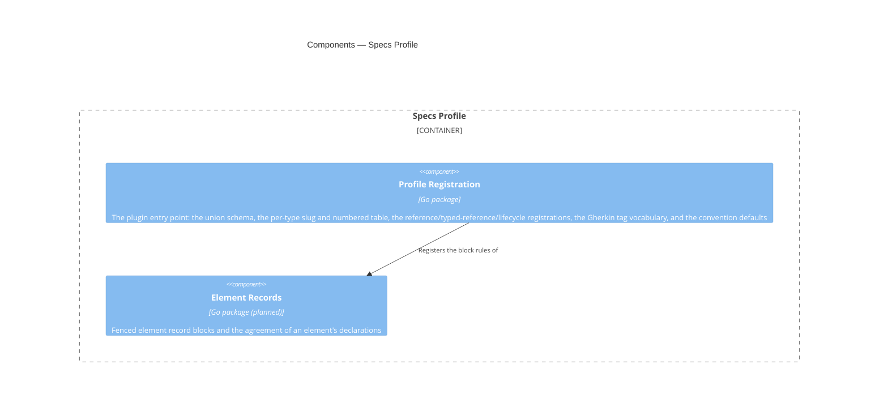

# Specs Profile

## Overview

This module is the domain half of the CLI. It knows that an ADR is a
document type, that its slug is `adr-<nnn>`, and that ADRs are numbered
while FRDs are not. It also knows which of a document's frontmatter
properties hold references to other documents, that a Feature Blueprint's
`frd` must resolve to an FRD, and that `retired` is this framework's one
status at which a document is no longer in effect. [[module-document-core]]
knows none of that on its own. This module supplies it as data for Document
Core's checks to read, rather than as a check this module runs itself. A
fuller vocabulary, including that a Container Blueprint declares
un-promoted components as fenced record blocks, is designed below and
partly built.

It's a **plugin**: it holds no engine of its own and implements no parsing.
Every capability it needs (frontmatter extraction, schema validation,
reference resolution, and span queries) comes from Document Core. This
module's job is to register vocabulary and rules into that host through the
extension point Document Core defines. The dependency runs one way, and the
value of that is concrete rather than aesthetic: an enterprise with a
different taxonomy writes a different profile and reuses the whole engine.

Most of this module is configuration rather than code, and as built it's
almost exclusively configuration: one generated union schema, the reference
and lifecycle registrations derived from it, and a table of slug patterns
and numbered flags. A handful of Go files supply all of it, with no engine
among them. The one remaining rule that can't be expressed as data is the
element-record invariant, which isn't implemented yet. Lifecycle integrity
is relational rather than an invariant on this module's own data, so its
checks belong in Document Core (see Components, below), and this module's
part of it is the registration alone.

- **Role:** supply this framework's document vocabulary and its
  non-schema-expressible rules to Document Core.
- **Scope:** in — the one union schema over every document type, each
  type's slug pattern and numbered-ness, the reference-bearing
  properties, typed references and pairings for each type, the status
  lifecycle, the convention defaults, and (as later capabilities)
  required sections, named section sets, and element record blocks and
  their invariants. Out — all parsing, indexing, reference resolution,
  and lifecycle checking, which belong to Document Core, and all
  process-level concerns, which belong to the command surface of
  [[container-spec-cli]].
- **Composed into:** [[container-spec-cli]] — a Go module in the same
  repository, imported as a package and activated by configuration. See
  that blueprint for this module's relationships to its sibling
  components.
- **Source & tests:** `cli/profile`, with tests beside their subjects
  per Go convention.

## Tech stack

- **Language:** Go, standard library only, composed into its host as a
  package. [[adr-015]]
- **Vocabulary:** Strata. The union frontmatter schema and the
  document-type vocabulary are generated from `schemas/*.strata`, and this
  module registers the generated schema rather than declaring types of its
  own. [[adr-016]]

## Interface

This module's surface is deliberately narrow: it exports one constructor,
which returns a value that satisfies Document Core's `Profile` interface.
Everything else is internal.

- **Surface:** the exported `New` constructor in `cli/profile`,
  returning a `corpus.Profile`. [[contract-specs-configuration]] describes
  the registered content: types, schemas, and patterns.

- **Guarantees:**
  - The module SHALL implement Document Core's `Profile` interface
    without requiring changes to that interface for framework-specific
    reasons.
  - The module SHALL register every document type this framework
    defines, so a corpus authored to the framework produces no
    `unknown-type` exclusion for a conforming document.
  - The module SHALL NOT parse document text directly; it registers
    schemas, patterns and predicates that Document Core applies.
  - WHERE a rule is expressible as a JSON Schema or a pattern, the
    module SHALL register it as data rather than implement it as code.
    [[contract-specs-configuration]] doesn't expose that data publicly in
    v1, so the reason isn't adopter override but reviewability: a
    registered pattern is checkable against the template it mirrors, while
    the same rule buried in a predicate isn't.
  - The module SHALL register this framework's Gherkin tag vocabulary —
    the feature and criterion identifier patterns, the owning-document
    tag prefix, the derivation rule linking a criterion's code and
    number to its feature's, and the qualifier tags it assigns
    meaning to. The identifier patterns SHALL be checkable against the
    generated `FeatureId` and `CriterionId` patterns
    (`cli/core/specmodel`) rather than transcribed independently.

**Built — single-schema profile.** `cli/profile.New` returns a value that
satisfies `corpus.Profile`, registered under the name `specs`. It supplies
**one** embedded union schema (`cli/core/schema/spec-model.schema.json`,
through Go's `//go:embed`, so the binary reads no schema file at runtime).
It also supplies a thin per-type table of slug pattern and numbered-ness for
every `DocumentType`, the `line_width` convention default of 80 codepoints,
and the reference, typed-reference, and lifecycle registrations below.
Besides those, it supplies this framework's tag vocabulary: the feature and
criterion identifier patterns, the owning-document tag prefix, the
code/number derivation rule, and the qualifier tag table. There is no
per-type schema, no required-sections tree, and no named section sets.

**This profile fills the whole of the host's extension point.**
`corpus.DocumentTypeRules` carries a type's reference-bearing properties,
its typed references, and its pairings. `corpus.Profile` carries a
`Lifecycle()` member that supplies the status vocabulary, the live and
retired statuses, and the successor property. This profile registers as
reference-bearing every frontmatter property that
`schemas/frontmatter.strata` types as a citation. It registers exactly one
typed reference: a Feature Blueprint's `frd` must resolve to `type: frd`.
It deliberately registers no pairing, because every relationship this
framework declares has its reverse derived from inbound edges, so
[[document-relationship-standards]]'s pairing check has nothing to pair
here. Its lifecycle names `retired` as the only retired status, every other
status as live, and `superseded_by` as the successor property. Both the
reference set and the status vocabulary are derived from the generated
schema rather than transcribed, so a property or a status added to the
vocabulary is registered the moment it's declared. See
`cli/profile/registration.go`.

`corpus.Profile`'s fifth member, `FeatureTags()`, is populated the same
way. It holds the feature identifier pattern
`^[A-Z]+-[A-Z][A-Z0-9]*(?:-[A-Z][A-Z0-9]*)*-[0-9]{3}$`, the criterion
identifier pattern `^AC-[A-Z][A-Z0-9]*(?:-[A-Z][A-Z0-9]*)*-[0-9]{3}\.[0-9]+$`,
the owning-document tag prefix `frd-`, and the `code`/`number` capture
groups that the two identifier patterns share (the derivation rule that a
criterion's code and number are its feature's). It also holds the qualifier
tags `negative`, `manual`, and the `level-` prefixed vocabulary `unit`,
`integration`, and `e2e`. The two identifier patterns are authored as the
generated `FeatureId` and `CriterionId` patterns with named capture groups
added, rather than transcribed independently. Stripping the names recovers
the generated pattern exactly, which is what
`TestFeatureTagPatternsMatchTheGeneratedIdentifiers` checks. See
`cli/profile/profile.go`.

**The registered patterns are grounded in this repository's corpus, not
transcribed from the prefix registry**, and for guides the two disagree:
the registry has no row at all and this repository's guides do not
consistently carry a `guide-` prefix (`work-order-field-guide` and
`specs-cli-reference` do not), so the pattern is the type's least
restrictive form. The divergence is recorded at the table in
`cli/profile/profile.go`. The Change guidance below is what obliges a
template change to come back here.

## Components



**One component is built.** Profile Registration is the whole of the
module today: `cli/profile/profile.go` and `cli/profile/registration.go`.
Element Records is planned and has no package, so its edge describes the
intended wiring rather than an existing one.

**Lifecycle rules are data, not a component.** The statuses, the successor
property, and the pairings are values that Profile Registration supplies
like everything else it registers. The checks that read them live in
[[module-document-core]], alongside the checks it already runs over the
corpus. They check that a retired document names a resolvable successor,
and that a live document citing a retired one is surfaced. This module
carries no package for them. `reference/retired-target`,
`reference/pairing-incomplete`, and `reference/type-mismatch` are those
checks, and every judgment each one makes comes from the registration
below. No relational logic is left for a package in this module to hold, so
the lifecycle rules are part of Profile Registration rather than a
component of their own.

**There is no separate Document Types component.** Document Core's
extension point accepts exactly one union schema, so the host never has to
choose which schema to reach for. What remains of a per-type registry is a
small table (slug pattern, numbered flag, and number width), small enough
that a component of its own would be a directory containing a map literal.
It lives in Profile Registration, alongside the schema it complements.

### Profile Registration

```component
entity_name: Profile Registration
slug: component-profile-registration
description: The plugin entry point supplying the union schema, the per-type slug and numbered table, the reference/typed-reference/lifecycle registrations, the Gherkin tag vocabulary, and the convention defaults
```

(Go package) — The plugin entry point that supplies this framework's
vocabulary to Document Core. It's the only component the host sees, and it
holds no engine and no parsing of its own. Its value is that the
conformance surface is one file: reading it answers whether this module is
a well-behaved plugin.

**Built** — `cli/profile`. `New` returns a `corpus.Profile` whose seven
members are the whole of what this framework tells the host:

| Member | Registers |
|---|---|
| `Schema()` | the embedded union schema over every document type |
| `DocumentTypes()` | per type, its slug pattern, whether it is numbered and, for a numbered type, the width its number is zero-padded to (authored — `adr` alone is numbered, at width 3, so `next-id adr` forms `adr-032`); its reference-bearing properties and its one typed reference (derived from the schema and authored, respectively); no pairings |
| `Conventions()` | the `line_width` default of 80 codepoints |
| `Lifecycle()` | the whole status vocabulary, `retired` as the only retired status, every other status as live, and `superseded_by` as the successor property |
| `FeatureTags()` | the feature and criterion identifier patterns, the owning-document tag prefix `frd-`, the `code`/`number` capture groups the two identifier patterns share, and the qualifier tags `negative`, `manual`, and the `level-` prefixed vocabulary `unit`, `integration`, `e2e` |
| `RecordBlocks()` | the `component` record-block tag, validated against the generated `C4ElementRecord` definition (`#/definitions/C4ElementRecord`) |
| `Architecture()` | the architecture vocabulary: `system-blueprint`, `container-blueprint`, `module-blueprint` and `component-blueprint` at the `system`, `container`, `module` and `component` levels; `entity_name`, `system`, `modules` and `contracts_consumed` as the entity-name, system, composed-modules and consumed-contracts properties; `contract` as the contract type with `provider` as its provider property; and the `Components` roster heading with the `component` record-block tag for container and module blueprints only |

**The union schema is generated, not authored here.** It comes from
`schemas/*.strata` through `scripts/generate-schemas.sh`, which emits
`cli/core/schema/spec-model.schema.json` and the matching Go vocabulary in
`cli/core/specmodel`. This module embeds the result. Three mechanisms keep
the registered vocabulary and the generated schema from drifting:

- The per-type table is keyed by the generated `DocumentType` constants
  rather than by string literals, so a renamed or removed type fails to
  compile here.
- `TestDocumentTypesCoversEveryVocabularyValue` asserts one table entry,
  with a compiling slug pattern, for every value in the generated
  vocabulary, so an *added* type fails the suite.
- `TestEveryCitationTypedPropertyInTheVocabularyIsRegistered` asserts, for
  every document type, that every frontmatter property the schema types as
  `Citation` or `[Citation]` is registered as reference-bearing by that
  type, and that nothing wider is registered. It's the same drift guard,
  applied to the reference set.

`cli/profile/registration.go` reads the reference properties and the status
vocabulary from the decoded schema at package initialization. Only the one
typed reference (`frd` → `type: frd`) and the lifecycle's live/retired
split are authored, because the schema has no way to state either.

**The architecture vocabulary is authored, and held to the schema by a
test.** Nothing in the schema says which property is an element's name or
which heading holds a roster, so `Architecture()` transcribes them from the
vocabulary and [[c4-standards]].
`TestEveryRegisteredArchitecturePropertyIsDeclaredWhereItApplies` asserts
that the generated schema declares each registered property on every type
it applies to, so a renamed property fails the suite rather than silently
resolving nothing. `corpus.ValidateRegistration` checks the same at
activation.

**The Gherkin identifier patterns carry the same guard, structurally
rather than by derivation.** `FeaturePattern` and `CriterionPattern` are
authored as the generated `FeatureId` and `CriterionId` patterns
(`cli/core/schema/spec-model.schema.json`) plus named capture groups.
Adding a name changes nothing a pattern matches, so
`TestFeatureTagPatternsMatchTheGeneratedIdentifiers` strips the names back
off and asserts equality against the generated pattern directly. Unlike the
reference set and the status vocabulary, the patterns themselves aren't
derived at package initialization, because the named capture groups that
the derivation rule needs have no generated counterpart to derive from.
The drift guard is the test rather than the construction.

Required sections, named section sets, and the heading-tree requirement
described in [[contract-specs-configuration]] are later capabilities. None
is registered, because Document Core's extension point has nowhere to
receive them yet. Widening it is a change to the host, per the Change
guidance below.

### Element Records

```component
entity_name: Element Records
slug: component-element-records
description: Fenced element record blocks and the rule that every declaration of one element agrees
```

(Go package) — Fenced element record blocks, and the rule that every
declaration of one element agrees. It registers the `component` fence tag
so that Document Core extracts and parses those blocks, and supplies the
base record schema they validate against. It implements the
declaration-agreement rule from [[adr-008]]: the one rule here that no
schema can express, because it's a constraint between declarations in
different places rather than a constraint on a value.

**Partly built.** Profile Registration registers the `component` fence tag
through `Profile.RecordBlocks`, with its schema pointing at the generated
`C4ElementRecord` definition in the embedded union schema. Validating a
block against that schema, and the declaration-agreement rule, aren't built
yet.

**Profile Registration → Element Records.** Registration is a pure wiring
layer: it exposes what it registers and hands it to the host. No component
here reaches the host directly, so there's exactly one place to look when
the plugin contract changes. Today it's the only built place, because it's
the only built component.

## Cross-cutting Standards

This module SHALL comply with:

- [[testing-standards]] — every component declared above carries unit
  tests covering its exported surface.

Its registered rules derive from this framework's own Standards documents,
[[frontmatter-standards]], [[spec-authoring-standards]], and
[[cross-document-references]], which the `spec` skill also ships as
vendored copies. The derivation isn't literal transcription. The union
schema reaches this module through `schemas/*.strata`, and each slug
pattern was checked against the documents this repository actually holds
before it was registered, which is where the divergence noted under
Interface comes from.

## Change guidance

- WHEN this framework's document vocabulary changes — a type added, a
  slug pattern altered, a required section introduced — the registered
  schema or pattern here SHALL be updated in the same change as the
  template or standard that defines it. This module is a copy of rules
  owned elsewhere, and a copy that lags is worse than no check at all.
- The module SHALL NOT implement parsing, indexing or reference
  resolution. WHEN a rule appears to need one of those, the capability
  belongs in [[module-document-core]] and this module registers against
  it.
- The module SHALL NOT require a change to Document Core's `Profile`
  interface for a framework-specific reason. WHEN a rule cannot be
  expressed through the existing extension point, that is a signal the
  extension point is too narrow, and widening it is a change to the host
  reviewed on its own merits — not a special case for this profile.
- WHILE visibility is internal, this module and its in-repo consumers
  evolve together, with no compatibility window.
- **Verification gates:** `go test ./profile/...` for any change here.
  It includes the conformance test asserting that this module satisfies
  Document Core's `Profile` interface, the vocabulary-coverage test above,
  and the self-application gate in `cli/profile/self_application_test.go`,
  which runs discovery and checking over this repository's own corpus.
  That last gate is the one that catches a registered schema drifting from
  the templates it mirrors. It's rooted at `specs/` (the repository's
  actual corpus root per `specs.toml`), not at `docs/`. It resolves that
  root from its own file's location and fails outright if `specs.toml` and
  `specs/` aren't there, because a gate that passes over zero documents is
  worse than no gate. CI runs the full suite.

## Key decisions

- [[adr-008]] — element record blocks and the two-schema model this
  module's Element Records component will implement when it's built.
- [[adr-012]] — the reference conventions the registered types rely on.
- [[adr-021]] — Gherkin is where features and acceptance criteria are
  authored. Profile Registration registers this framework's feature and
  criterion identifier patterns and qualifier tag vocabulary for
  [[module-document-core]]'s checks to apply.
- [[adr-015]] — Go, and the profile-as-package composition model.
- [[adr-016]] — Strata is the single source for the frontmatter schema
  and the document-type vocabulary this module registers.

## Open questions

- [ ] `kind` is `standard` because exactly one profile exists. WHEN a
      second profile is written — an enterprise taxonomy, or a stripped
      Obsidian-vault profile — this blueprint SHOULD be reconsidered as
      `kind: pattern`, governing how any profile is built, with the
      profiles as instances. Deciding early would be inventing a pattern
      from one example.
- [ ] How much of the vocabulary should be shipped as data files versus
      compiled-in defaults. The registered form is settled and v1 exposes
      none of it publicly, so this is purely a question of where the
      bytes live. But it forces the answer to the promotion question in
      [[contract-specs-configuration]], because a data file is already
      most of the way to an override mechanism. As built, everything is
      compiled in: the schema through `//go:embed` and the per-type table
      as a Go map, so the binary reads no vocabulary file at runtime.
      That's an implementation default chosen to keep the binary
      self-contained, not an answer to this question.
- [ ] Whether the deferred domain rules (AC traceability, C4 diagram
      conventions, blueprint AC-coverage keys, and Work Order readiness)
      become components here or a second profile layered on this one.
      They're out of scope for the current feature, and the answer isn't
      forced yet.

## References

- [[c4-standards]] — C4 mapping rules and diagram conventions
- [[frd-spec-index]] — the requirements this module's
  registrations satisfy
- [[container-spec-cli]] — the container this module is composed into
- [[module-document-core]] — the host it registers into
- [[contract-specs-configuration]] — the configuration surface it
  populates and extends
- [[adr-008]] — the declaration-agreement rule this profile registers
- [[adr-012]] — the reference conventions its slug patterns resolve
  against
