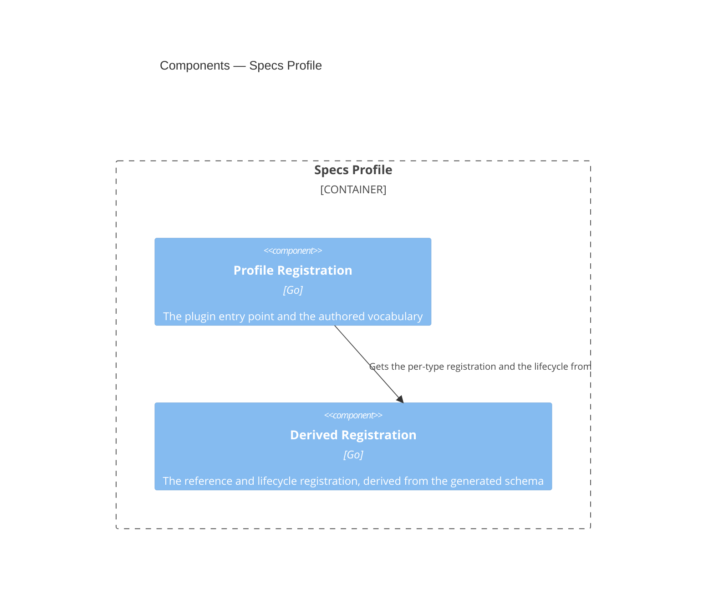

# Specs Profile

## Responsibility

This module supplies this framework's document vocabulary, as data, to
Document Core (the host): the engine that indexes and checks any corpus of
Markdown documents that carry frontmatter and cite each other. The
vocabulary reaches the host through `corpus.Profile`, the Go interface that
is the host's extension point. An implementation of that interface is a
profile. The host knows nothing of ADRs, slug prefixes, or Feature
Blueprints until a profile registers them, so a different taxonomy reuses
the whole engine by registering a different profile.

### Owns

The registration of this framework's vocabulary through `corpus.Profile`:
the embedded union schema, each document type's slug pattern and
numbering, the reference-bearing properties and typed references, the
status lifecycle, the convention defaults, the Gherkin tag vocabulary, the
record-block tags, and the architecture vocabulary.

The union schema is one JSON Schema that validates the frontmatter of
every document type. A slug is a document's identifier. An ADR's slug
carries a number. A reference-bearing property is a frontmatter property
whose value cites another document, and a typed reference is one that
must resolve to a document of a given type. A record-block tag is the
info string of a fenced block that declares an element inside another
document. The architecture vocabulary says which blueprint types are C4
elements, at which level, and which properties hold an element's name and
edges.

### Hides

Which document types this framework defines and how each is cited,
numbered, referenced, and retired, and how those facts are read out of the
generated schema's JSON. A new type or a regenerated schema doesn't change
`corpus.Profile`.

### Does not own

Parsing, indexing, reference resolution, and every check that reads the
registration, including the lifecycle and record-block checks —
[[module-document-core]] owns them.

The command surface, configuration loading, and profile selection —
[[container-spec-cli]] owns them.

The slug prefix registry and the line-width rule —
[[spec-authoring-standards]] owns them.

The status vocabulary and the element-record format —
[[frontmatter-standards]] owns them.

The Gherkin tag vocabulary — [[frd-gherkin-adoption]] owns it.

The architecture vocabulary — [[c4-standards]] owns it.

The frontmatter schema and the document-type vocabulary — the
`schemas/*.strata` files are their single source ([[adr-016]]), and the
`scripts/generate-schemas.sh` script generates the schema this module
embeds.

### Composed into

[[container-spec-cli]]. Its blueprint holds this module's relationships to
sibling components.

### Vended as

The Go package `cli/profile` in the CLI's Go module (`cli/go.mod`),
compiled into the `specs` binary. The file `cli/cmd/registry.go` registers
it under the constant `profile.Name`, and the `[profile].name` key in
`specs.toml` selects it.

## Tech stack

**Language:** Go, standard library only, composed into its host as a
package. [[adr-015]]

**Vocabulary:** Strata, a schema language this repository generates its
JSON Schema and Go types from. The union schema and the generated
document-type constants come from `schemas/*.strata`. This module
registers them and declares no document types of its own. [[adr-016]]

## Interface

### Surface

The function `profile.New` in `cli/profile/profile.go`, which returns a
`corpus.Profile` (the interface is declared in
`cli/core/corpus/profile.go`). [[contract-specs-configuration]] specifies
this registration surface as its internal half.

### Provides

The module SHALL register a slug pattern for every document type this
framework defines, so that a conforming document is never excluded as
`unknown-type`.

The module SHALL register as reference-bearing exactly the frontmatter
properties that the generated schema types as `Citation` or `[Citation]`,
other than `slug`.

WHEN a Feature Blueprint declares `frd`, the registration SHALL require the
value to resolve to a document of type `frd`.

The module SHALL NOT register a pairing.

**Rationale:** a pairing is a relationship that both documents must
declare, one from each end. The index derives the reverse of every
relationship this framework declares from the edges that point at a
document, so [[document-relationship-standards]]'s pairing check has
nothing to pair.

The module SHALL register `retired` as the only retired status.

The module SHALL register `superseded_by` as the successor property.

The module SHALL register every status other than `retired` as live.

**Rationale:** a live document is in effect. When a document cites a
retired one, the host warns and, if the retired document names a
successor, names it as the document to cite instead. The author who most
needs that warning is editing a draft, so a draft counts as live.

The module SHALL register the `line_width` default that
[[spec-authoring-standards]] fixes.

The module SHALL register the Gherkin tag vocabulary that
[[frd-gherkin-adoption]] defines (`featureTags` in `cli/profile/profile.go`).

The module SHALL register the architecture vocabulary that [[c4-standards]]
defines, for the architecture blueprint types only ([[adr-030]]).

The module SHALL register the `component` record-block tag against the
generated `C4ElementRecord` definition ([[adr-008]]).

WHERE a type's documents in this corpus don't follow the prefix registry in
[[spec-authoring-standards]], the module SHALL register the type's least
restrictive slug pattern.

The module SHALL record each such divergence at the table in
`cli/profile/profile.go`.

WHERE a rule is expressible as a JSON Schema or a pattern, the module SHALL
register it as data rather than implement it as code.

**Rationale:** a reviewer can check a registered pattern against the
template it mirrors, but not the same rule written inside a Go function.

The module SHALL NOT parse document text.

### Requires

WHEN the package initializes, the embedded union schema (`schema.SpecModel`)
SHALL declare a definition for every document type in the authored table.

WHEN the package initializes, the embedded union schema SHALL declare the
`Status` enum.

The generated schema and constants this module reads SHALL be the current
output of `scripts/generate-schemas.sh` for `schemas/*.strata`.

WHEN a repository selects this profile, the host SHALL read the vocabulary
only through `corpus.Profile`, as [[contract-specs-configuration]]
specifies.

## Design

### Patterns and principles

Plugin (Buschmann et al., *POSA Vol. 1*, 1996): `corpus.Profile` is the
named extension point, and `profile.New` returns the plugin. The need it
serves is the extension point itself: [[contract-specs-configuration]]
selects a profile by name, and the host has no vocabulary without one. The
pattern rules out a plugin that drives the core. Invariants states that
rule.

Single Source of Truth (Codd, 1970; Hunt and Thomas, 1999): the generated
schema is the one authority for which types, citation properties, and
statuses exist. The Derived Registration component reads them from it, and
tests hold the authored half of the registration to it. The need it
serves: `schemas/*.strata` already states the vocabulary ([[adr-016]]), so
a second, transcribed list could only drift. The pattern rules out a list
of types, properties, or statuses that the schema doesn't hold. Invariants
states that rule as one drift guard per registered set: a test that fails
when the set and the schema disagree.

Fail Fast (Shore, 2004): if the module can't read the embedded schema, the
binary panics at package initialization. The need it serves: a
registration that silently registered nothing would make every check pass
over nothing. The pattern rules out starting with an empty or partial
registration. Invariants states that rule.

### Invariants

Outside its tests, the module SHALL NOT call Document Core except to
construct the values `corpus.Profile` returns.
Enforced by: review only.

The authored per-type table SHALL hold one entry, with a compiling slug
pattern, for every value of the generated `DocumentType` vocabulary.
Enforced by: `TestDocumentTypesCoversEveryVocabularyValue`, for the
values it lists, and the compiler, which rejects a row keyed by a
generated constant that no longer exists. The test lists the generated
constants by hand, so a value added to the vocabulary without a row is
caught by review only.

The registered reference-bearing properties of each type SHALL equal the
properties the generated schema types as `Citation` or `[Citation]` on that
type, other than `slug`.
Enforced by: `TestEveryCitationTypedPropertyInTheVocabularyIsRegistered`.

The generated schema SHALL declare each registered architecture property on
every type that property applies to.
Enforced by: `TestEveryRegisteredArchitecturePropertyIsDeclaredWhereItApplies`,
and by `corpus.ValidateRegistration` when configuration loading activates
the profile.

The registered feature and criterion identifier patterns, with their
capture-group names removed, SHALL equal the generated `FeatureId` and
`CriterionId` patterns.
Enforced by: `TestFeatureTagPatternsMatchTheGeneratedIdentifiers`.

The registration SHALL hold no defect that `corpus.ValidateRegistration`
reports.
Enforced by: `TestTheRegistrationHasNoDefects`.

IF the embedded schema can't be decoded, or declares no branch for a type
in the authored table, THEN the module SHALL panic at package
initialization.
Enforced by: review only.

### Extension points

A new document type — declare it in `schemas/*.strata`, regenerate, and
add its row, keyed by the generated constant, to the `documentTypes` map in
`cli/profile/profile.go`. Not by keying a row with a string literal, and
not by adding a per-type schema.

A framework rule the generated schema can't state — a new method on the
`corpus.Profile` interface, made as a change to the host. Not by a
predicate special-cased for this profile, and not by parsing documents
here.

A different document taxonomy — a separate profile that implements
`corpus.Profile`. Not by parameterizing this one.

## Components



Profile Registration gets the per-type registration and the lifecycle from
Derived Registration, so the host sees one registration and can't tell
which parts are authored and which are derived. Derived Registration adds
the derived reference registration to each row of Profile Registration's
authored per-type table and keeps no list of types of its own, so a new
type is added in one place.

### Profile Registration

```component
entity_name: Profile Registration
slug: component-profile-registration
description: The plugin entry point and the authored vocabulary
technology: Go
```

(Go) — The plugin entry point and the authored vocabulary
(`cli/profile/profile.go`). It returns the `corpus.Profile` value and holds
the facts the generated schema can't state: each type's slug pattern and
numbering, the convention defaults, the Gherkin tag vocabulary, the
record-block tags, and the architecture vocabulary. It hides which of the
framework's rules are authored, so a reviewer checks them in one file.

### Derived Registration

```component
entity_name: Derived Registration
slug: component-derived-registration
description: The reference and lifecycle registration, derived from the generated schema
technology: Go
```

(Go) — The reference and lifecycle registration, derived from the generated
schema (`cli/profile/registration.go`). It reads each type's
reference-bearing properties and the status vocabulary from the embedded
schema, so a property or status added to `schemas/*.strata` is registered
as soon as the schema is regenerated and the binary rebuilt. It authors
only what the schema can't state: the typed reference, the empty pairing
set, the retired status, and the successor property. It hides the
generated schema's JSON shape, such as the `$ref`, `oneOf`, and `items`
forms a citation takes.

## Cross-cutting Standards

This module SHALL comply with [[testing-standards]]: each component above
carries unit tests covering its exported surface, beside its subject.

## Change guidance

WHEN this framework's document vocabulary changes, the registration SHALL
be updated in the same change as the template or Standards document that
defines the change.

WHEN a rule appears to need parsing, indexing or reference resolution, the
change SHALL add that capability to [[module-document-core]] and register
against it here.

IF a rule can't be expressed through `corpus.Profile`, THEN the change SHALL
widen that interface as a change to the host, reviewed on its own merits.

The module SHALL NOT require a change to `corpus.Profile` for a reason
specific to this framework.

WHILE visibility is internal, the module and its in-repo consumers evolve
together: a breaking change MAY be made in the same change as the consumer
updates, with no compatibility window.

### Verification gates

#### Verify always

Run `go test ./profile/...` from `cli/`. Besides its unit tests, the
package holds tests that build this repository's own corpus with the
profile, in `cli/profile/self_application_test.go` and
`cli/profile/architecture_test.go`. They fail when a registered rule
disagrees with the documents it governs, so a change to the documents
alone can fail them.

#### Verify conditionally

WHEN `schemas/*.strata` changes, run `scripts/generate-schemas.sh --check`.

WHEN the registration changes what Document Core checks, run
`go test ./...` from `cli/` and a whole-corpus `specs check`.

## Key decisions

[[adr-008]] — an element without a blueprint of its own is declared in a
record block, validated against a shared element-record schema.

[[adr-012]] — the reference conventions the registered types rely on.

[[adr-015]] — Go as the CLI's language, with each profile composed into it
as a Go package.

[[adr-016]] — Strata is the single source for the frontmatter schema and the
document-type vocabulary this module registers.

[[adr-021]] — Gherkin is where features and acceptance criteria are
authored, and this module registers their tag vocabulary.

[[adr-030]] — the C4 architecture vocabulary reaches Document Core through
this profile.

## Open questions

- [ ] Where record-block validation and the declaration-agreement rule from
      [[adr-008]] live: a component of this module, or a Document Core check
      that reads registered data. The declaration-agreement rule requires
      every declaration of one element to agree with its blueprint. This
      module registers the `component` tag and its schema, and neither the
      validation nor the rule is built.
- [ ] `kind` is `standard` because exactly one profile exists. WHEN a
      second profile is written, such as an enterprise taxonomy or a
      stripped Obsidian-vault profile, this blueprint SHOULD be
      reconsidered as `kind: pattern`, governing how any profile is built.
      Deciding before then would invent a pattern from one example.
- [ ] How much of the vocabulary ships as data files rather than
      compiled-in defaults. The answer settles the question in
      [[contract-specs-configuration]] of which internal keys are promoted
      to public, because a data file is most of the way to an override
      mechanism. Everything is compiled in to keep the binary
      self-contained, which doesn't answer the question.
- [ ] Whether the deferred domain rules (AC traceability, C4 diagram
      conventions, blueprint AC-coverage keys, and Work Order readiness)
      become components here or a second profile layered on this one.

## References

[[container-spec-cli]] — the container this module is composed into.

[[contract-specs-configuration]] — the registration surface this module
populates.
