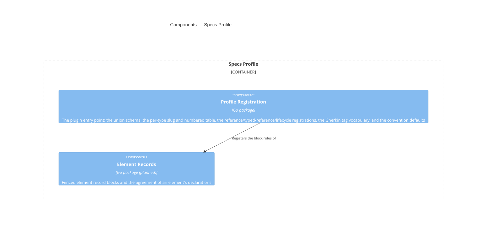

# Specs Profile

## Overview

This module is the domain half of the CLI. It knows that an ADR is a
document type, that its slug is `adr-<nnn>`, and that ADRs are numbered
while FRDs aren't. It also knows which of a document's frontmatter
properties hold references to other documents, that a feature
blueprint's `frd` must resolve to an FRD, and that `retired` is this
framework's one status at which a document is no longer in effect.
[[module-document-core]] knows none of that on its own. This module
supplies it as data for Document Core's checks to read, not as a check
this module runs itself. A fuller vocabulary, in which a container
blueprint declares un-promoted components as fenced record blocks, is
designed below and not yet registered.

It's a plugin: it holds no engine of its own and implements no parsing.
Every capability it needs comes from Document Core: frontmatter
extraction, schema validation, reference resolution, and span queries.
This module's job is to register vocabulary and rules into that host
through the extension point Document Core defines. The dependency runs
one way, and that has a concrete payoff: an enterprise with a different
taxonomy writes a different profile and reuses the whole engine.

Most of this module is configuration rather than code, and as built it's
almost entirely configuration. The vocabulary is one generated union
schema, the reference and lifecycle registrations derived from it, and a
table of slug patterns and numbered flags. A handful of Go files supply
all of it, with no engine among them. The one rule left that can't be
expressed as data is the element-record invariant, which isn't
implemented yet. Lifecycle integrity looked like a second such rule. It
turned out to be relational, not an invariant on this module's own data,
so its checks belong in Document Core instead (see Components, below),
and this module's part of it is the registration alone.

- **Role:** supply this framework's document vocabulary and its
  non-schema-expressible rules to Document Core.
- **Scope:** the module covers the one union schema over every document
  type, each type's slug pattern and numbered-ness, the
  reference-bearing properties, typed references, and pairings for each
  type, the status lifecycle, the convention defaults, and (as later
  capabilities) required sections, named section sets, and element
  record blocks and their invariants. It excludes all parsing, indexing,
  reference resolution, and lifecycle checking, which belong to Document
  Core, and all process-level concerns, which belong to the command
  surface of [[container-spec-cli]].
- **Composed into:** [[container-spec-cli]], as a Go module in the same
  repository, imported as a package and activated by configuration. See
  that blueprint for this module's relationships to its sibling
  components.
- **Source & tests:** `cli/profile`, with tests beside their subjects
  per Go convention.

## Tech stack

- **Language:** Go, standard library only; composed into its host as a
  package. [[adr-015]]
- **Vocabulary:** Strata. The union frontmatter schema and the
  document-type vocabulary are generated from `schemas/*.strata`, and
  this module registers the generated schema rather than declaring
  types of its own. [[adr-016]]

## Interface

This module's surface is deliberately narrow: it exports one
constructor returning a value satisfying Document Core's `Profile`
interface. Everything else is internal.

- **Surface:** the exported `New` constructor in `cli/profile`,
  returning a `corpus.Profile`. [[contract-specs-configuration]]
  describes the registered content: types, schemas, and patterns.

- **Guarantees:**
  - The module SHALL implement Document Core's `Profile` interface
    without requiring changes to that interface for framework-specific
    reasons.
  - The module SHALL register every document type this framework
    defines, so a corpus authored to the framework produces no
    `unknown-type` exclusion for a conforming document.
  - The module SHALL NOT parse document text directly; it registers
    schemas, patterns and predicates that Document Core applies.
  - WHERE a rule is expressible as a JSON Schema or a pattern, the
    module SHALL register it as data rather than implement it as code.
    [[contract-specs-configuration]] doesn't expose that data publicly
    in v1, so the reason is reviewability, not adopter override: you can
    check a registered pattern against the template it mirrors, but not
    the same rule buried in a predicate.
  - The module SHALL register this framework's Gherkin tag vocabulary —
    the feature and criterion identifier patterns, the owning-document
    tag prefix, the derivation rule linking a criterion's code and
    number to its feature's, and the qualifier tags it assigns
    meaning to. The identifier patterns SHALL be checkable against the
    generated `FeatureId` and `CriterionId` patterns
    (`cli/core/specmodel`) rather than transcribed independently.

**Built (single-schema profile):** `cli/profile.New` returns a value
satisfying `corpus.Profile`, registered under the name `specs`. It
supplies one embedded union schema
(`cli/core/schema/spec-model.schema.json`, via Go's `//go:embed`, so the
binary reads no schema file at runtime). It also supplies a thin
per-type table of slug pattern and numbered-ness for every
`DocumentType`, and the `line_width` convention default of 80
codepoints.

The reference integrity feature's PREG delta widened the profile to
supply the reference, typed-reference, and lifecycle registrations below.
The Gherkin adoption feature's PREG delta widened it again to supply this
framework's tag vocabulary: the feature and criterion identifier
patterns, the owning-document tag prefix, the code/number derivation
rule, and the qualifier tag table. There's no per-type schema, no
required-sections tree, no named section sets, and no element-record
registration.

This profile fills the whole of the host's extension point.
`corpus.DocumentTypeRules` carries a type's reference-bearing properties,
its typed references, and its pairings. `corpus.Profile` carries a
`Lifecycle()` member that supplies the status vocabulary, the live and
retired statuses, and the successor property. This profile registers the
following:

- For every frontmatter property `schemas/frontmatter.strata` types as a
  citation, that property as reference-bearing.
- Exactly one typed reference: a feature blueprint's `frd` must resolve
  to `type: frd`.
- No pairing, deliberately. Every relationship this framework declares
  has its reverse derived from inbound edges, so
  [[document-relationship-standards]]'s pairing check has nothing to
  pair here.
- A lifecycle naming `retired` as the only retired status, every other
  status as live, and `superseded_by` as the successor property.

Both the reference set and the status vocabulary are derived from the
generated schema, not transcribed, so a property or a status added to the
vocabulary is registered the moment it's declared. See
`cli/profile/registration.go`.

`corpus.Profile`'s fifth member, `FeatureTags()`, is populated the same
way. It carries the following:

- The feature identifier pattern `^[A-Z]+-[A-Z0-9]+-[0-9]{3}$`.
- The criterion identifier pattern `^AC-[A-Z0-9]+-[0-9]{3}\.[0-9]+$`.
- The owning-document tag prefix `frd-`.
- The `code`/`number` capture groups the two identifier patterns share,
  which express the derivation rule that a criterion's code and number
  are its feature's.
- The qualifier tags `negative`, `manual`, and the `level-` prefixed
  vocabulary `unit`, `integration`, and `e2e`.

The two identifier patterns are authored as the generated `FeatureId`
and `CriterionId` patterns with named capture groups added, not
transcribed independently. Stripping the names recovers the generated
pattern exactly, which is what
`TestFeatureTagPatternsMatchTheGeneratedIdentifiers` checks. See
`cli/profile/profile.go`.

The components below match that shape. The separate Document Types "type
registry" is folded into Profile Registration. Lifecycle Rules is folded
in the same way: its registration is in Profile Registration, and its
checks are in Document Core. Element Records is retained as designed but
marked not yet built.

The registered patterns come from this repository's corpus, not from the
prefix registry, and for guides the two disagree. The registry has no row
for guides at all, and this repository's guides don't consistently carry
a `guide-` prefix (`work-order-field-guide` and `spec-cli-reference`
don't). So the guide pattern is the type's least restrictive form. The
table in `cli/profile/profile.go` records the divergence. Change
guidance, below, is what obliges a template change to come back here.

## Components



One component is built. Profile Registration, in
`cli/profile/profile.go` and `cli/profile/registration.go`, is the whole
of the module today. Element Records is planned and carries no package,
so its edge describes the intended wiring, not an existing one.

Lifecycle rules are data, not a component. The statuses, the successor
property, and the pairings are values Profile Registration supplies like
everything else it registers. The checks that read them live in
[[module-document-core]], alongside the checks it already runs over the
corpus. They check that a retired document names a resolvable successor,
and they surface a live document that cites a retired one. This module
carries no package for them.

Those checks are `reference/retired-target`,
`reference/pairing-incomplete`, and `reference/type-mismatch`, and every
judgment each one makes comes from the registration below. No relational
logic is left for a package in this module to hold, so the component is
folded into Profile Registration instead of built where it was first
drawn.

The separate "Document Types" component has been removed. The earlier
design gave it a type registry holding a schema per type, and the host it
would have registered into was never built that way. Document Core's
extension point accepts exactly one union schema instead, so the host
never has to choose which schema to reach for. What remains of a per-type
registry is a two-column table (slug pattern and numbered flag). A
component of its own for that table would be a directory containing a
map literal, so the table lives in Profile Registration alongside the
schema it complements.

### Profile Registration

```component
entity_name: Profile Registration
slug: component-profile-registration
description: The plugin entry point supplying the union schema, the per-type slug and numbered table, the reference/typed-reference/lifecycle registrations, the Gherkin tag vocabulary, and the convention defaults
```

(Go package): The plugin entry point supplying this framework's
vocabulary to Document Core. It's the only component the host sees, and
it holds no engine and no parsing of its own. Its conformance surface is
one file, so you can tell whether this module is a well-behaved plugin by
reading that file.

**Built:** `cli/profile`. `New` returns a `corpus.Profile` whose seven
members are the whole of what this framework tells the host:

| Member | Registers |
|---|---|
| `Schema()` | the embedded union schema over every document type |
| `DocumentTypes()` | per type, its slug pattern, whether it's numbered, and, for a numbered type, the width its number is zero-padded to (authored: `adr` alone is numbered, at width 3, so `next-id adr` forms `adr-032`); its reference-bearing properties and its one typed reference (derived from the schema and authored, respectively); no pairings |
| `Conventions()` | the `line_width` default of 80 codepoints |
| `Lifecycle()` | the whole status vocabulary, `retired` as the only retired status, every other status as live, and `superseded_by` as the successor property |
| `FeatureTags()` | the feature and criterion identifier patterns, the owning-document tag prefix `frd-`, the `code`/`number` capture groups the two identifier patterns share, and the qualifier tags `negative`, `manual`, and the `level-` prefixed vocabulary `unit`, `integration`, and `e2e` |
| `RecordBlocks()` | the `component` record-block tag, validated against the generated `C4ElementRecord` definition (`#/definitions/C4ElementRecord`) |
| `Architecture()` | the architecture vocabulary: `system-blueprint`, `container-blueprint`, `module-blueprint`, and `component-blueprint` at the `system`, `container`, `module`, and `component` levels; `entity_name`, `system`, `modules`, and `contracts_consumed` as the entity-name, system, composed-modules, and consumed-contracts properties; `contract` as the contract type with `provider` as its provider property; and the `Components` roster heading with the `component` record-block tag for container and module blueprints only |

The union schema is generated, not authored here. It comes from
`schemas/*.strata` through `scripts/generate-schemas.sh`, which emits
`cli/core/schema/spec-model.schema.json` and the matching Go vocabulary
in `cli/core/specmodel`. This module embeds the result. Three mechanisms
keep the registered vocabulary and the generated schema from drifting:

- The per-type table is keyed by the generated `DocumentType` constants,
  not by string literals, so a renamed or removed type fails to compile
  here.
- `TestDocumentTypesCoversEveryVocabularyValue` asserts one table entry,
  with a compiling slug pattern, for every value in the generated
  vocabulary, so an added type fails the suite.
- `TestEveryCitationTypedPropertyInTheVocabularyIsRegistered` applies the
  same drift guard to the reference set. For every document type, it
  asserts that the type registers as reference-bearing every frontmatter
  property the schema types as `Citation` or `[Citation]`, and nothing
  wider.

`cli/profile/registration.go` reads the reference properties and the
status vocabulary from the decoded schema at package initialization. Only
the one typed reference (`frd` → `type: frd`) and the lifecycle's
live/retired split are authored, because the schema has no way to state
either.

The architecture vocabulary is authored, and a test holds it to the
schema. Nothing in the schema says which property is an element's name or
which heading holds a roster, so `Architecture()` transcribes them from
the vocabulary and [[c4-standards]].
`TestEveryRegisteredArchitecturePropertyIsDeclaredWhereItApplies` asserts
that the generated schema declares each registered property on every
type it applies to, so a renamed property fails the suite instead of
silently resolving nothing. `corpus.ValidateRegistration` checks the same
at activation.

The Gherkin identifier patterns carry the same guard, by structure
instead of by derivation. `FeaturePattern` and `CriterionPattern` are
authored as the generated `FeatureId` and `CriterionId` patterns
(`cli/core/schema/spec-model.schema.json`) plus named capture groups.
Adding a name changes nothing a pattern matches, so
`TestFeatureTagPatternsMatchTheGeneratedIdentifiers` strips the names
back off and asserts equality against the generated pattern directly.
Unlike the reference set and the status vocabulary, the patterns
themselves aren't derived at package initialization. The named capture
groups the derivation rule needs have no generated counterpart to derive
from, so the drift guard is the test, not the construction.

Required sections, named section sets, and the heading-tree requirement
described in [[contract-specs-configuration]] are later capabilities.
None is registered, because Document Core's extension point has nowhere
to receive them yet. Widening it is a change to the host, per Change
guidance, below.

### Element Records

```component
entity_name: Element Records
slug: component-element-records
description: Fenced element record blocks and the rule that every declaration of one element agrees
```

(Go package): Fenced element record blocks and the rule that every
declaration of one element agrees. It registers the `component` fence tag
so Document Core extracts and parses those blocks, and it supplies the
base record schema they validate against. It also implements the
declaration-agreement rule from [[adr-008]]. That's the one rule here
that no schema can express, because it constrains declarations in
different places, not a value.

**Partly built:** Profile Registration registers the
`component` fence tag through `Profile.RecordBlocks`, with its schema
pointing at the generated `C4ElementRecord` definition in the embedded
union schema. Validating a block against that schema isn't built yet,
and neither is the declaration-agreement rule.

On the edge from Profile Registration to Element Records, Registration
is a pure wiring layer: it exposes what it registers and hands it to the
host. No component here reaches the host directly, so there's exactly
one place to look when the plugin contract changes. Today it's the only
built place, because it's the only built component.

## Cross-cutting standards

This module SHALL comply with:

- [[testing-standards]]: every component declared below carries unit
  tests covering its exported surface.

Its registered rules derive from this framework's own reference
documents, which ship with the `spec` skill and aren't authored as
project standards documents:

- `plugin/skills/spec/references/frontmatter-standards.md`
- `plugin/skills/spec/references/template-authoring-standards.md`
- `plugin/skills/spec/references/cross-document-references.md`

The derivation isn't literal transcription. The union schema reaches this
module through `schemas/*.strata`, and each slug pattern was checked
against the documents this repository actually holds before it was
registered. That check is where the three divergences noted under
Interface come from.

## Change guidance

- WHEN this framework's document vocabulary changes — a type added, a
  slug pattern altered, a required section introduced — the registered
  schema or pattern here SHALL be updated in the same change as the
  template or standard that defines it. This module is a copy of rules
  owned elsewhere, and a copy that lags is worse than no check at all.
- The module SHALL NOT implement parsing, indexing or reference
  resolution. WHEN a rule appears to need one of those, the capability
  belongs in [[module-document-core]] and this module registers against
  it.
- The module SHALL NOT require a change to Document Core's `Profile`
  interface for a framework-specific reason. WHEN a rule cannot be
  expressed through the existing extension point, that is a signal the
  extension point is too narrow, and widening it is a change to the host
  reviewed on its own merits — not a special case for this profile.
- WHILE visibility is internal, this module and its in-repo consumers
  evolve together, with no compatibility window.
- **Verification gates:** `go test ./profile/...` for any change here.
  It includes the conformance test asserting that this module satisfies
  Document Core's `Profile` interface and the vocabulary-coverage test
  above. It also includes the self-application gate in
  `cli/profile/self_application_test.go`, which runs discovery and
  checking over this repository's own corpus. Of these, the
  self-application gate is the one that catches a registered schema
  drifting from the templates it mirrors. It's rooted at `specs/`, not
  `docs/`, because `specs/` is the repository's actual corpus root per
  `specs.toml`. It resolves that root from its own file's location and
  fails outright if `specs.toml` and `specs/` aren't there, because a
  gate that passes over zero documents is worse than no gate. CI runs
  the full suite.

## Key decisions

- [[adr-008]]: element record blocks and the two-schema model this
  module's Element Records component will implement when it's built.
- [[adr-012]]: the reference conventions the registered types rely on.
- [[adr-021]]: Gherkin is where features and acceptance criteria are
  authored. Profile Registration registers this framework's feature and
  criterion identifier patterns and qualifier tag vocabulary for
  [[module-document-core]]'s checks to apply.
- [[adr-015]]: Go, and the profile-as-package composition model.
- [[adr-016]]: Strata is the single source for the frontmatter schema
  and the document-type vocabulary this module registers.

## Open questions

- [ ] `kind` is `standard` because exactly one profile exists. WHEN a
      second profile is written — an enterprise taxonomy, or a stripped
      Obsidian-vault profile — this blueprint SHOULD be reconsidered as
      `kind: pattern`, governing how any profile is built, with the
      profiles as instances. Deciding early would be inventing a pattern
      from one example.
- [ ] How much of the vocabulary should ship as data files versus
      compiled-in defaults. The registered form is settled and v1
      exposes none of it publicly, so this is only a question of where
      the bytes live. It still forces the answer to the promotion
      question in [[contract-specs-configuration]], because a data file
      is most of the way to an override mechanism already. As built,
      everything is compiled in: the schema through `//go:embed` and the
      per-type table as a Go map, so the binary reads no vocabulary file
      at runtime. That's an implementation default taken to keep the
      binary self-contained, not an answer to this question.
- [ ] Whether the deferred domain rules (AC traceability, C4 diagram
      conventions, blueprint AC-coverage keys, and work-order readiness)
      become components here or a second profile layered on this one.
      They're out of scope for the current feature, and the answer isn't
      forced yet.

## References

- `c4-guide.md`: C4 mapping rules and diagram conventions
- [[frd-spec-index]]: the requirements this module's
  registrations satisfy
- [[container-spec-cli]]: the container this module is composed into
- [[module-document-core]]: the host it registers into
- [[contract-specs-configuration]]: the configuration surface it
  populates and extends
- [[adr-008]]: the declaration-agreement rule this profile registers
- [[adr-012]]: the reference conventions its slug patterns resolve
  against
